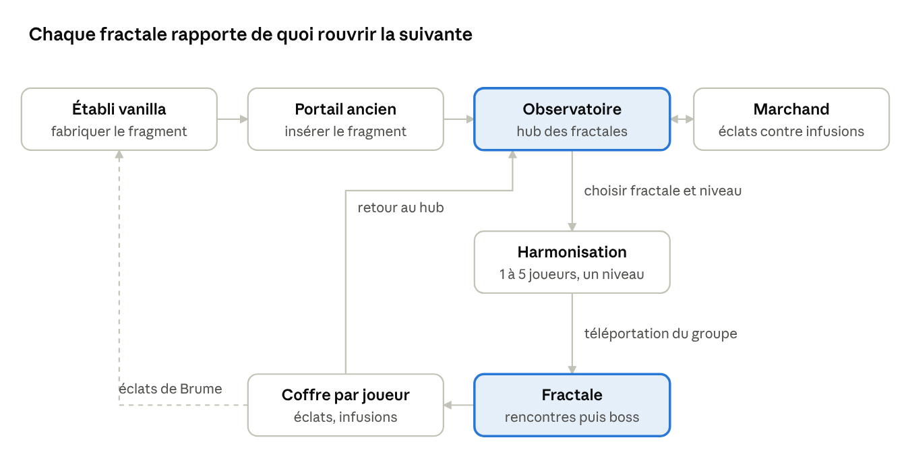
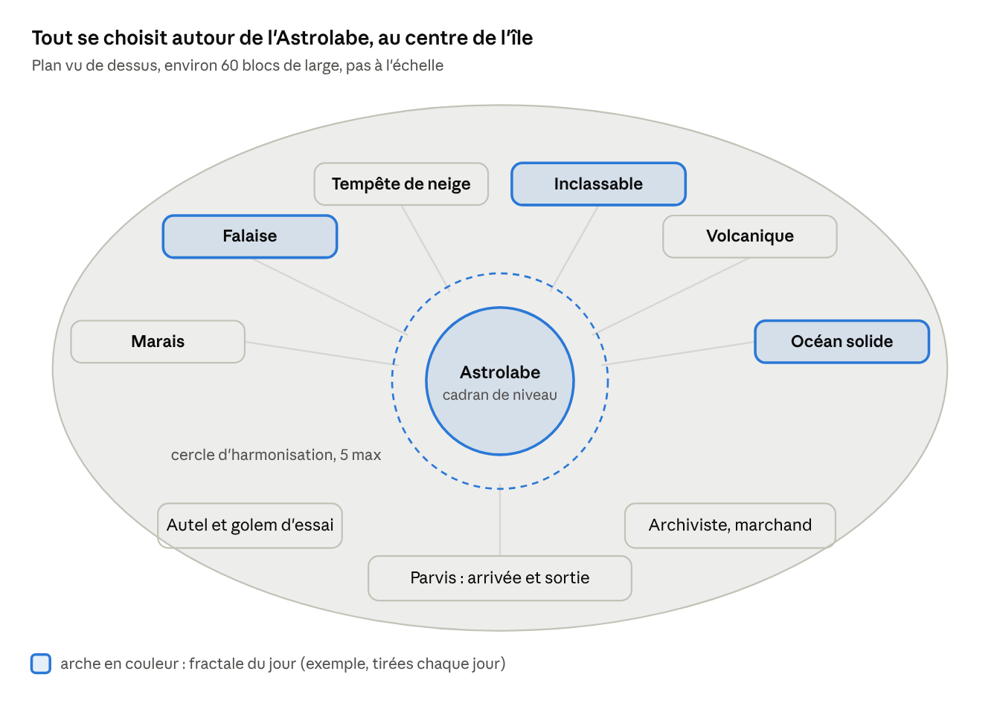
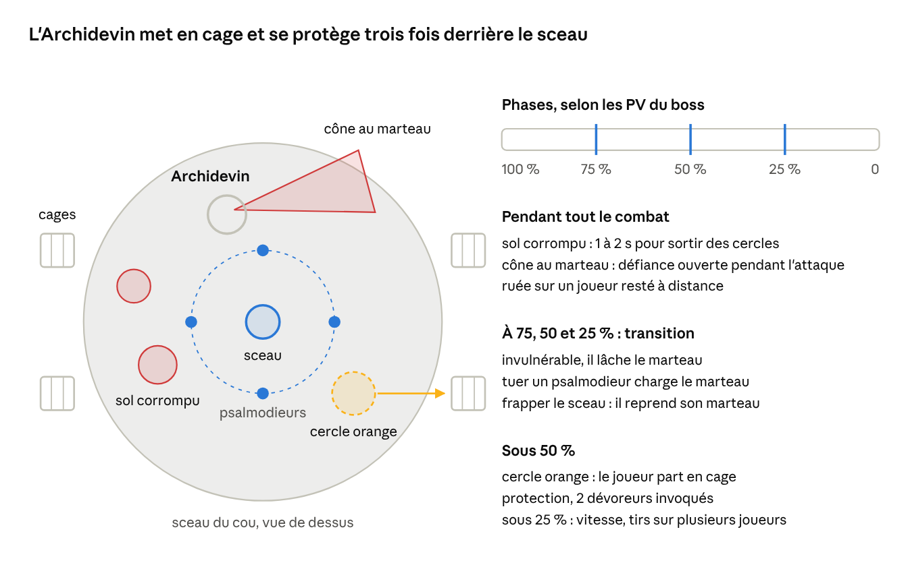
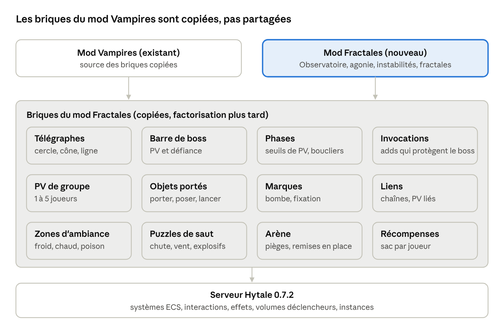

# Fractales des Brumes — Game Design Document

Version du 20 octobre 2026 · conçu avec Kevin. Document de travail : [GDD sur claude.ai](https://claude.ai/code/artifact/eb96bc9c-0925-4576-a39d-24ed46c28e14).

## Vision

Un nouveau mod `mods/nakasar-fractals`, indépendant du mod Vampires, qui transpose les **Fractales des Brumes de Guild Wars 2** dans Hytale : de courts donjons instanciés (10 à 20 min), rejouables à des niveaux de difficulté croissants, pour **1 à 5 joueurs**. On y entre en fabriquant un **fragment d'instance** que l'on insère dans le **portail ancien** (le `Portal_Device` vanilla) : il ouvre l'**Observatoire des fractales**, le hub d'où partent toutes les fractales.

Le mod a deux buts :

- **Un contenu de groupe rejouable** : une saison 1 de 6 fractales, chacune avec 2 ou 3 rencontres et un boss, plus des niveaux, des instabilités (modificateurs) et une résistance à l'agonie qui donnent une progression longue.
- **Une bibliothèque de mécaniques réutilisables** : barre de défiance, objets portés, marques sur joueur, liens, puzzles de saut, zones de froid, escortes. Chaque fractale est écrite pour en tester une partie ; le mod Vampires pourra les reprendre plus tard.

Principes de design :

- **Jouable seul, meilleur à 5** : toute mécanique doit pouvoir être résolue par un joueur seul. Les PV et le nombre d'objets s'adaptent à la taille du groupe, jamais la règle elle-même.
- **Lisibilité d'abord** : on garde les codes déjà validés dans la Tour de l'Alchimiste (zone rouge au sol = danger, attaques majeures annoncées 1,2 s ou plus, rien d'aveuglant).
- **Pas de limite de temps imposée**, pas de perte d'objets à la mort (comme les Deepworks).
- **Inspiré, pas copié** : on garde la structure et l'esprit de chaque fractale GW2, mais décors, noms et monstres sont ceux d'Orbis (gobelins, trorks, outlanders, esprits, golems).

Les descriptions de GW2 dans ce document viennent de ma mémoire du jeu, sans source consultée : à corriger si un détail ne correspond pas.

## Règles permanentes (Kevin, 25 octobre 2026)

Elles valent pour toutes les fractales, présentes et futures :

1. **Aucun monstre ne se régénère** hors combat ou invulnérable. La régénération vanilla des PNJ (5 % toutes les 0,5 s après 15 s sans dégâts) est coupée pour tous les PNJ des fractales (`boss/NoRegenSystem`) ; un soin voulu passe par le Java.
2. **Vanilla d'abord** : blocs, modèles 3D et monstres du jeu avant tout modèle généré.
3. **Une zone rouge a exactement la taille de son effet** : le test de coup et le dessin partent de la même forme (`combat/Telegraphs`), avec pour seule marge la demi-largeur du corps du joueur (`Telegraphs.BODY`, 0,3 bloc), posée au sol là où l'effet frappe.

## Boucle de jeu

Un fragment fabriqué ouvre l'Observatoire ; de là, le groupe enchaîne des fractales à un niveau choisi, et chaque fractale rapporte de quoi fabriquer le fragment suivant et monter sa résistance à l'agonie.

La boucle tourne dans l'Observatoire : on n'en sort que pour refabriquer un fragment (trait pointillé) ou quitter.

**Le fragment d'instance** (`PortalKey_Nakasar_Fractal`, nom affiché « Fragment des Brumes ») se fabrique à l'établi vanilla. Proposition de recette : 4 `Ingredient_Rune_Shard` + 1 `Ingredient_Voidheart` (le cœur du Vide des Deepworks), ce qui place les fractales après le premier donjon vanilla. Il est consommé à chaque ouverture, mais chaque fractale terminée rend des **éclats de Brume** qui permettent d'en refabriquer un sans repasser par les Deepworks.

**Niveaux** : l'échelle 1 à 100 de GW2, en 4 rangs de 25 niveaux (validé par Kevin). Le niveau monte la difficulté, ajoute l'agonie et des instabilités à partir du rang 2.

| Rang | Niveaux | PV et dégâts des ennemis | Agonie | Instabilités | Résistance conseillée |
| --- | --- | --- | --- | --- | --- |
| Initié | 1-25 | +0 à +48 % | aucune | aucune | 0 |
| Adepte | 26-50 | +50 à +98 % | faible | 1 | 10 à 40 |
| Expert | 51-75 | +100 à +148 % | moyenne | 2 | 50 à 100 |
| Maître | 76-100 | +150 à +200 % | forte | 3 | 110 à 150 |

**L'agonie** (comme dans GW2) : certaines attaques de boss et de pièges appliquent un effet « Agonie » qui retire un pourcentage des PV max chaque seconde pendant quelques secondes, quel que soit l'armure. La **résistance à l'agonie** réduit ce pourcentage ; elle vient d'**infusions** que l'on obtient dans les fractales et que l'on dépose dans l'Autel des infusions (ci-dessous).

**L'Autel des infusions** (décision de Kevin du 20 octobre, sur le modèle des runes de Hytale) :

- **Comment marchent les runes vanilla** (lu dans le serveur 0.7.2) : le bloc-établi des capacités ouvre une fenêtre (`OpenAbilityBenchInteraction`, `AbilityBenchWindow`) sur des emplacements rangés **sur le joueur** (composant `InventoryComponent.AbilitySlots`), avec des filtres qui n'acceptent que les bonnes runes. Les runes déposées s'appliquent tant qu'elles y sont, où que soit le joueur.
- **Chez nous** : un bloc **Autel des infusions** (posé dans l'Observatoire, et fabricable pour sa base). L'utiliser ouvre une fenêtre de **12 emplacements** qui appartiennent au joueur (composant Java sauvegardé avec lui). Seuls les objets marqués infusion y entrent.
- **Dès qu'une infusion est dans l'autel, sa résistance s'applique au personnage**, partout ; la retirer l'enlève. Un système Java additionne les valeurs à chaque changement des emplacements et le golem d'essai affiche le total.
- **Infusions** : de +1 à +15 de résistance. Deux infusions identiques + des éclats de Brume donnent la suivante, à l'autel (onglet de fabrication). Elles tombent dans les coffres de fin et s'achètent à l'Archiviste.
- **À vérifier** : ouvrir depuis un mod une fenêtre de conteneur sur un inventaire porté par le joueur (la classe générique `ContainerWindow` existe, son rendu côté client reste à tester).

**Débloquer les niveaux** : on commence au niveau 1 ; terminer une fractale à son niveau le plus haut atteint débloque le niveau suivant pour chaque joueur du groupe. Le groupe peut choisir n'importe quel niveau débloqué par son meneur.

**Récompenses** :

- **Fin de fractale** : un coffre par joueur (sac personnel, comme les sacs de prime du mod Vampires), contenu selon le rang : éclats de Brume, matériaux vanilla, chance d'infusion.
- **Fractales du jour** : 3 fractales tirées chaque jour (graine = date du serveur) donnent un coffre bonus la première fois.
- **Marchand de l'Observatoire** : échange les éclats contre des infusions, des fragments, des cosmétiques de saison et des recettes d'armes « des Brumes ».

## L'Observatoire des fractales

L'Observatoire est une instance hub suspendue dans les Brumes (monde `Void` comme les Deepworks), où tout se choisit physiquement dans le décor, sans interface à construire. Depuis le 25 octobre 2026 (captures de Kevin), il reprend l'Observatoire des Brumes de GW2 : plateau de roche moussue aux falaises sombres, porte asura en anneau au sud, bassin de lumière autour de l'Astrolabe, île asura de l'Archiviste à l'est, île du golem d'essai à l'ouest, ponts de roche courbes, arbres d'automne, ruines gothiques et aiguilles au loin, ciel doré.

- **Arrivée (sud)** : le groupe arrive devant la grande porte asura ; traverser son voile violet (ou le portail de retour à son pied) ramène au monde.
- **L'Astrolabe (centre)** : grand instrument animé, portant la **console de sélection** (révisé le 21 octobre 2026 : une arche par fractale ne tient pas à des dizaines de fractales). Deux **distributeurs** à l'entrée du cercle donnent gratuitement le **noyau** d'une fractale et le **diapason** d'un niveau (1 à 100). Les joueurs posent un noyau et un diapason dans la console : le cercle est **harmonisé**, la fractale, le niveau et le rang s'affichent en titre à l'écran.
- **Cercle d'harmonisation** : l'anneau au sol autour de l'Astrolabe. Les joueurs debout dessus forment le groupe (5 au plus, les suivants reçoivent un message de refus).
- **Résonateurs** au bord intérieur du cercle : le meneur (premier arrivé) en utilise un, tout le cercle est téléporté dans une nouvelle instance de la fractale harmonisée, si le niveau ne dépasse pas son plus haut niveau débloqué.
- **L'Archiviste (est)** : PNJ marchand qui échange les éclats de Brume, plus un tableau des fractales du jour.
- **L'Alchimiste de Dessa (est, au nord de l'Archiviste)** : ajouté le 25 octobre 2026 (captures de Kevin). Il vend les **potions des Brumes** de GW2 contre des éclats de Brume : offensive (+3 % de dégâts infligés par pile), mobilité (+5 % de vitesse et +10 % d'endurance récupérée par pile), défensive (−5 % de dégâts subis par pile, agonie exclue). 1 h, 5 piles au plus ; la potion donne 1 pile (3 à 4 éclats), la grande 5 piles (5 fois le prix). Actives dans les instances de fractale seulement (Java `potion/`, assets `tools/generate_potions.py`). La conversion de résistance à l'agonie de la maîtrise d'Harmonisation de GW2 n'est pas reprise.
- **Golem d'essai (ouest)** : mannequin qui applique de l'agonie et affiche les dégâts subis, pour tester sa résistance.

Une commande `/fractale` (niveau, groupe, abandon) sert de secours et d'outil de test.

En GW2 la sélection passe par une fenêtre ; ici on reste dans le décor, parce que le seul écran personnalisé déjà éprouvé dans le projet est la page `BlockLore` (texte seul).

## Catalogue des fractales

On reprend les vraies fractales de GW2 : même déroulé, mêmes rencontres successives, mêmes attaques de boss ; seuls les monstres sont remplacés par leurs équivalents d'Orbis quand GW2 utilise une race absente de Hytale. Le déroulé ci-dessous vient du [wiki officiel de GW2](https://wiki.guildwars2.com/wiki/Fractals_of_the_Mists), lu le 20 octobre 2026.

La saison 1 réunit les 6 fractales qui mélangent le mieux puzzles de saut, rencontres en chaîne et boss à mécaniques. Toutes ont des points de contrôle (la « singularité de Brumeverrou » de GW2 = la statue des Deepworks), un coffre par joueur à la fin et le portail de retour.

| Fractale (nom GW2) | Enchaînement | Saut | Boss | Monstres Hytale proposés |
| --- | --- | --- | --- | --- |
| Falaise (Cliffside) | 5 sceaux à briser au marteau en montant le long d'un colosse enchaîné | échafaudages, gargouilles à vent, rampes piégées | Archidevin légendaire | cultistes outlanders |
| Inclassable (Uncategorized) | plateformes, détention, escalier mortel, Vieux Tom, plateformes 2, Asura délirant | deux ascensions de plateformes sous les harpies | Vieux Tom, Asura délirant et ses golems | harpies (à créer), golems vanilla |
| Volcanique (Volcanic) | vagues de grawls, couloir à rochers, chaman champion, mine abandonnée | puzzle de saut au-dessus de la lave | Chaman imprégné légendaire | trorks pour les grawls, élémentaires de feu |
| Océan solide (Solid Ocean) | traversée de plateformes de jade, combat en 3 phases | plateformes flottantes, chute = plateforme précédente | Abîme de Jade | golems de cristal, créatures marines |
| Marais (Swampland) | course aux 3 feux-follets, Moussu, Carnasse | murs à sauter pendant la course | Moussu, Carnasse | loups, plantes, esprits animaux |
| Tempête de neige (Snowblind) | feu de camp à nourrir, Source élémentaire, forêt noire, chaman | aucun (fractale d'environnement) | Source élémentaire, Chaman grawl légendaire | outlanders du givre, loups, élémentaires de glace |

**Adaptations obligatoires de GW2 à Hytale** (valables partout) :

- Les joueurs Hytale n'ont ni stabilité, ni renvoi de projectiles, ni nettoyage d'altérations. Ces réponses sont remplacées par l'esquive, le blocage au bouclier, le placement et des objets de la fractale (consommables donnés sur place).
- La **barre de défiance** se vide avec les coups lourds, les projections et les étourdissements Hytale.
- Les phases jouées « à 3 joueurs simultanés » (3 consoles, 3 feux-follets) gardent leur règle mais leur minuteur s'allonge en petit groupe, pour rester faisables seul.
- Tomber d'un puzzle de saut ramène à la dernière plateforme sûre (volumes `Fall_Teleport`), avec une petite perte de PV, jamais la mort.

### Falaise (Cliffside), première fractale à développer

Un colosse géant est enchaîné à une falaise par un culte ; le groupe monte le long de son corps par des échafaudages et brise ses sceaux un par un avec le marteau du culte. ([wiki](https://wiki.guildwars2.com/wiki/Cliffside_Fractal))

**Le marteau du culte** (objet porté, au cœur de toute la fractale) :

- Le ramasser coûte des PV. La **Corruption** avance par crans de 10 s (choix de Kevin, plus lisible que les piles de GW2) : en main, un cran s'ouvre et se vide ; vidé, il monte si le marteau est encore en main, sinon il descend. Vulnérabilité à chaque cran, faiblesse dès le 2, **étourdi en arrivant au 3, au-delà il lâche le marteau et reste étourdi** (dans GW2 il passe à terre ; pas d'état à terre chez nous). Le groupe se le passe.
- Le coup **Brise-sceau** ne se charge qu'en tuant (ou en ayant touché) un ennemi près du porteur ; poser le marteau perd la charge.
- Un marqueur au-dessus du porteur passe du jaune à l'orange puis au rouge selon les piles. Si le marteau est perdu, un PNJ chercheur en redonne un.

**Déroulé** :

1. **Les cultistes du pied** : fanatiques et psalmodieurs autour de l'autel ; prendre le marteau.
2. **Sceaux des genoux** (2) : 4 cultistes, d'autres arrivent ensuite. Charger le marteau deux fois par sceau.
3. **Tunnel à pièges** : plaques à piques au sol, certaines factices.
4. **Échafaudage des gargouilles** (saut) : des gargouilles soufflent un vent qui fait tomber ; passer entre deux souffles. En haut, 1 à 4 leviers coupent les gargouilles pour les suivants (un levier immobilise celui qui l'actionne).
5. **Sceau de la poitrine** : trois zones de feu au sol, le colosse en souffle une à la fois ; il y a toujours une seule zone sûre, il faut la suivre en chargeant le marteau.
6. **Sceaux des bras** (2) séparés par un couloir : frapper un sceau protège celui-ci d'une bulle violette et libère l'autre ; le groupe fait des allers-retours. Des psalmodieurs soignent chaque sceau, les ennemis réapparaissent sans fin.
7. **Rampes piégées** (saut) : des explosifs à minuterie remontent les rampes et projettent dans le vide ; attendre aux paliers ou suivre les explosions. Leviers en haut.
8. **Sceau du cou, l'Archidevin légendaire.**

**Archidevin légendaire** (il combat avec le marteau) :

- *Sol corrompu* : cercles rouges, 1 à 2 s pour sortir avant d'être empoisonné.
- *Coup de marteau en cône* : très gros dégâts, plus rapide aux hauts niveaux.
- *Barre de défiance* : active **seulement** pendant le cône et le sol corrompu ; la vider l'étourdit et augmente ses dégâts subis.
- *Ruée* : se téléporte sur un joueur resté à distance (niveau 25+).
- *Mur anti-projectiles* pendant la première moitié (niveau 51+), *Brise-dos* remplace son attaque de base ensuite.
- **Cage** : il pose un cercle orange au sol ; un joueur dedans est blessé et **téléporté dans une des cages au bord de la salle**. Il en sort en détruisant la porte, en subissant des dégâts continus. Les cercles grandissent avec le niveau.

**Phases** :

| PV | Ce qui change |
| --- | --- |
| 100-75 % | 4 cultistes autour de lui ; coup lourd + sol corrompu |
| 75 %, 50 %, 25 % : transition | invulnérable, lâche le marteau ; la bulle du sceau central tombe et 4 psalmodieurs apparaissent autour. Charger le marteau sur l'un d'eux, frapper le sceau ; il étourdit le groupe 1 s et reprend son marteau |
| 50-25 % | protection permanente, **cages**, invoque 2 dévoreurs à distance régulièrement |
| 25-0 % | vitesse permanente, plus de sol corrompu, projectiles sur plusieurs joueurs ; niveau 71+ : forme de démon (plus rapide, plus fort) |
| 0 % | reste invulnérable : dernier coup de marteau sur le sceau, le colosse se libère et salue le groupe |

Côté Hytale, la cage réutilise directement l'emprisonnement du Capitaine de la garde (mod Vampires : téléport vers une cellule, porte à casser). Le cercle de cage, orange dans GW2, sera rouge chez nous (charte : rouge = négatif) avec un motif de barreaux pour le distinguer du sol corrompu.

### Inclassable (Uncategorized)

Deux ascensions de plateformes sous le feu des harpies encadrent une ruine pleine de prisonniers, un escalier mortel et deux boss golems. ([wiki](https://wiki.guildwars2.com/wiki/Uncategorized_Fractal))

1. **Plateformes des harpies** (saut) : monter de plateforme en plateforme en tuant les harpies. En combat, on avance plus lentement et on saute moins loin. Dès le niveau 10-12, les harpies tirent un projectile lent qui **repousse** à l'impact (cercle rouge) : on tombe et on repart du bas. Astuce GW2 conservée : dos au bord, le recul ne se déclenche pas faute de sol derrière.
2. **Zone de détention** : détruire le générateur ouvre la suite mais libère les cellules : un lapin champion, un saboteur, un chaman du feu et un ettin, à tuer dans cet ordre.
3. **Escalier mortel** : quatre tourelles en haut tirent des impulsions qui mettent à terre ; on les esquive. En haut, **trois consoles à activer en même temps** (activer immobilise un instant) coupent les tourelles.
4. **Vieux Tom** (golem) : la salle se remplit périodiquement de gaz empoisonné ; une console en face allume un ventilateur pour l'évacuer. Dès le niveau 12, il faut d'abord **charger les batteries du ventilateur** aux deux coins opposés en y apportant des « larmes » (objet porté). Attaques : rafale de projectiles tout autour, **attraction** d'un joueur vers lui, coup au corps à corps, éclair qui rebondit.
5. **Plateformes 2** (saut) : comme au début, avec des plateformes jaunes translucides difficiles à voir.
6. **L'Asura délirant** : invulnérable tout le combat derrière son bouclier. Il réveille ses **4 golems un par un**, puis les 4 ensemble après le quatrième. Il tire des boules d'éclairs lentes et téléguidées (agonie dès le niveau 20) qu'on esquive en allant vers elles. Une machine donne à chacun une **charge positive ou négative** : deux joueurs de charges opposées proches l'un de l'autre se blessent. Le combat finit quand les golems sont détruits.

Côté Hytale : les harpies n'existent pas en vanilla, il faudra un modèle ou un volant vanilla qui tire ; Vieux Tom et les golems de l'Asura peuvent copier les golems vanilla. Les charges +/- sont une nouvelle brique (seul : la charge change toutes les 20 s et un pylône de charge opposée remplace l'allié).

### Volcanique (Volcanic)

Un rituel grawl au cœur d'un volcan : vagues d'ennemis sous les chutes de pierres, couloir de rochers roulants, sauvetage de captifs, puzzle de saut dans une mine, puis un boss ailé sur une plateforme brûlante. ([wiki](https://wiki.guildwars2.com/wiki/Volcanic_Fractal))

1. **Gardes grawls** : vagues jusqu'à remplir la barre d'événement ; des pierres tombent (cercles, renversement 2 s).
2. **Couloir des rochers** : chutes de pierres et **rochers enflammés qui dévalent** (mortels, laissent une traînée qui brûle) ; des alcôves sur les côtés servent d'abri. Point de contrôle au bout.
3. **Chaman grawl champion** : protégé par **8 piles de bouclier**. Certaines pierres qui tombent laissent une **pierre imprégnée** à ramasser et **lancer** sur lui : chaque coup retire une pile. Pendant ce temps, des chamans vétérans marchent lentement vers **3 captifs** au bord de la falaise pour les pousser dans le vide ; si tous tombent, le groupe perd. Tous sauvés : coffre bonus. Bouclier tombé : on le tue (il peut remettre un bouclier d'une seule pile).
4. **La mine abandonnée** (saut) : puzzle de saut linéaire sur des rails cassés au-dessus de la lave, avec des chauves-souris. Un squelette à chapeau marque la fin (clin d'œil à garder). Point de contrôle.
5. **Chaman imprégné légendaire** sur une île au milieu d'un lac de lave, visible depuis la falaise du Champion : de petits **cratères** changent de couleur (brun → orange → jaune) puis crachent de la lave active (remplace les Pieds brûlants et les fosses silencieuses de GW2, retour de Kevin du 2026-10-24).
   - *Flèche enflammée* : le joueur touché prend feu et brûle aussi ses voisins (agonie dès le niveau 10).
   - *Plongeon* et *coup d'ailes* (cercle rouge, recul) contre les joueurs au corps à corps.
   - *Tempête de feu* : zone instantanée.
   - **Transition à chaque 25 %** : il s'entoure d'un bouclier à **40 coups**, invoque des larves élémentaires et vole lentement vers un villageois emprisonné. S'il l'atteint avant que le bouclier tombe, il **reprend 25 % de PV**.

Côté Hytale : grawls remplacés par des trorks ; la pierre imprégnée est la même brique que le cristal de l'Abîme de Jade (objet lancé) ; le bouclier à 40 coups est un compteur de coups, comme la porte de cellule du Capitaine (10 coups).

### Océan solide (Solid Ocean)

Une traversée de plateformes de jade flottantes mène à l'Abîme de Jade, un monstre invulnérable qu'on ne blesse qu'en lui renvoyant son propre rayon avec des cristaux. ([wiki](https://wiki.guildwars2.com/wiki/Solid_Ocean_Fractal))

1. **Plateformes de jade** (saut) : on peut combattre ou éviter les créatures en chemin. Tomber ramène à la **plateforme précédente**, pas au début.
2. **L'Abîme de Jade**, en 3 phases :
   - **Phase 1** : tuer 2 tentacules (avec les créatures autour). Un premier test d'agonie à l'arrivée.
   - **Phase 2** : des **colosses de jade** apparaissent ; les tuer remplit une barre. Ils renvoient les projectiles (sauf étourdis), renversent autour d'eux et lâchent des **cristaux réfléchissants**.
   - **Fin** : tentacules et l'Abîme seulement ; les tentacules lâchent maintenant les cristaux.

**Le rayon et les cristaux** :

- L'Abîme marque un joueur d'un **crâne rouge** au-dessus de la tête, puis tire un rayon mortel sur lui. On l'esquive au moment où le crâne disparaît.
- Un joueur qui **tient un cristal** absorbe le rayon sans mourir et devient chargé ; il **lance** alors le cristal sur l'Abîme : -5 % de PV. Tuer un tentacule retire environ 3 %. Deux dégâts au même instant n'en comptent qu'un.
- Tenir un cristal empêche d'attaquer ; un cristal au sol disparaît après 45 à 60 s.
- **Dernier rayon** : près de la mort, elle marque tout le monde et tire sur tous ; il faut tenir un cristal. Si tout le groupe meurt, le combat recommence.
- Les tentacules ne bougent pas, renversent en balayant et finissent leur attaque même à 0 PV.

Côté Hytale : l'Abîme est un énorme modèle immobile sans déplacement ; le cristal est un objet porté qui annule un dégât précis (le rayon) puis devient lançable.

### Marais (Swampland)

Une course chronométrée aux feux-follets à travers un marais piégé, une embuscade du Moussu, puis Carnasse dans une clairière où l'on se déplace de cercle vert en cercle vert. ([wiki](https://wiki.guildwars2.com/wiki/Swampland_Fractal))

1. **Les feux-follets** : ramener 3 feux-follets dans leurs failles avant la fin du minuteur, qui démarre au premier ramassé (1 min 04 au bas niveau, 30 s au plus haut). Des **murs** surgissent entre les arbres dès qu'un feu-follet est pris : il faut **sauter par-dessus** ou contourner. Pièges au sol : fils, pièges à loup, piques, œufs d'araignée. Des fusils au sol près des failles accélèrent les porteurs et ralentissent les ennemis. Raté : la zone se réinitialise et les feux-follets changent de place.
2. **Le Moussu** : embuscade dans le passage, qui se ferme. Il invoque des loups, frappe fort au corps à corps, **disparaît en furtivité** puis réapparaît avec une attaque chargée à longue portée qui met à terre. Bas en PV, il se transforme en bête (bonds, gros dégâts). Barre de défiance.
3. **Carnasse** : 4 failles en cercle ; déposer le feu-follet près de l'entrée lance le combat.
   - Un **cercle vert** apparaît autour d'une faille, rétrécit puis passe à la suivante (sens horaire). **Le boss n'est vulnérable que dans le cercle vert**, qui donne aussi de l'endurance.
   - Attaques : *Charge* (se cabre puis fonce et frappe), *Bond* (grand cercle d'impact), *Martelèement* (canalisé, défiance ouverte, souvent juste après le bond), *Pluie de poison*, *Tir* de poison qui laisse une flaque.
   - **Assaut à 75 % et 50 %** : invulnérable au centre ; des esprits animaux attaquent, invulnérables tant qu'ils ne sont pas dans le cercle vert. Ensuite, des **fleurs de poison** poussent dans l'arène.
   - **Feux-follets à 25 %** : il se charge au centre ; 4 feux-follets apparaissent aux coins, à rapporter dans les failles avant la fin de sa charge, sinon explosion (mortelle au haut niveau). Réussi : grand cercle vert au centre, boss étourdi.

Côté Hytale : le cercle vert est notre première zone positive (couleur verte, autorisée par la charte) ; les murs sont des blocs posés puis retirés par les remises en place d'arène.

### Tempête de neige (Snowblind)

Une fractale d'environnement : le froid tue plus que les ennemis, et chaque rencontre tourne autour du feu. ([wiki](https://wiki.guildwars2.com/wiki/Snowblind_Fractal))

**Règle de zone** : loin du feu, on cumule de l'**Hypothermie** (dégâts selon le nombre de piles) ; les feux donnent de la **Chaleur**, qui empêche l'hypothermie de monter.

1. **Faire fondre le mur de glace** : allumer le grand feu de camp ; il fait fondre le mur qui bloque la route, d'autant plus vite qu'il est bien nourri. Des fagots apparaissent sous les arbres pour le recharger. Des élémentaires de glace courent **éteindre le feu** : les tuer avant, pendant que loups et cultistes arrivent sans arrêt.
2. **La Source élémentaire** : un géant de glace entouré de **5 foyers** à allumer avec des torches ; les foyers donnent de la chaleur et retirent ses piles de **bouclier de givre**. Attaques : projectile lent qui repousse à l'impact, tourbillon qui repousse ceux qui restent dedans. À 75, 50 et 25 %, il tire sur les foyers (-50 % de bois chacun). Tous éteints : **blizzard** (vue réduite, dégâts) jusqu'au rallumage. Les foyers s'épuisent, on les recharge avec les fagots des huttes.
3. **Suivre les traces** : forêt dans le noir, une torche à la main, en suivant les empreintes au sol jusqu'au village ; deux groupes de cultistes en chemin.
4. **Le Chaman légendaire** :
   - Alterne corps à corps (coups d'épée qui ajoutent de l'hypothermie ; trop de piles = **pris dans un éclat de glace** que les alliés cassent) et pluie de glace de loin.
   - Invoque 3 **cristaux de glace corrompus** qui lui donnent un bouclier, à chaque phase au corps à corps.
   - *Pics de glace* : anneau de pics autour de lui. *Souffle glacé* : il s'agenouille et souffle un cône qui suit sa cible.
   - **À 75 % et 50 %** : il saute sur un balcon, invulnérable, fait pleuvoir des pics ; il faut tuer l'**Effigie de glace** (barre de défiance) pour le faire redescendre.
   - **À 25 %** : il se transforme en ours jusqu'à la mort (bond qui renverse longtemps).

Côté Hytale : le feu purificateur du mod Vampires (rayon, temps passé dans la zone) sert de modèle pour Chaleur et Hypothermie ; l'éclat de glace qui enferme un joueur est la même brique que la vrille de la citrouille géante.

### Ressac silencieux (Silent Surf), première fractale de la saison 2

Une grotte de jade sombre sous une mer de jade figée. La fractale est une longue descente guidée par **Thess**, avec l'**équipement de prospection** (objets à clic droit, charges = taille de la pile, rechargées aux **Provisions abandonnées** de chaque point de contrôle) : grappin (32 blocs), parachute, charge de poudre noire (après le repaire des araignées), fusée éclairante.

1. **Relevés** : 4 cercles blancs. La **Garde de Thess** annule une chute de 35 % des PV ou plus et ramène au point de contrôle. Chaque relevé lance son combat : chauves-souris, mère de couvée (pond 2 araignées toutes les 14 s), nagas, marins luxons corrompus.
2. **Trajets** : tyroliennes (s'accroupir pour lâcher), canons à vent, champignons rebondissants, guidés côté serveur par une vitesse imposée à chaque tick (tracés exportés par le générateur). Bloqués tant que le camp du relevé n'est pas dégagé.
3. **Le second Dolus corrompu** : Visage de l'effroi (détourner la caméra : moins de 60° entre le regard et lui = 25 % des PV, Peur, Tourment) et Vitesse effrayante (5 marques I à V, bonds dans l'ordre).
4. **Kanaxai** : Visage de l'effroi, Tempête déchirante (un marqué de plus à chaque fois, flaques de 25 s), Tir de herse des Aspects du bord (état de l'Aspect), liens qui mènent en **Fantasmagorie** (Aspect privé sur une île, masqué aux autres joueurs par le suivi des entités ; grappin pour y aller, champignon pour revenir), Ombres rassemblées (défiance à chaque 10 %), **Fendeur de mondes** à 66 et 33 % (20 s pour tuer les Aspects : 20 % + 30 % par Aspect vivant), Vitesse effrayante après le premier Fendeur.

Générateurs : `tools/generate_silent_surf.py` (assets, rôles, trajets, `SilentSurfLayout.java`) et `tools/silent_surf_scenery.py` (grotte, mer, épave, plates-formes, arène). Code : paquet `silentsurf`.

### Récif de la Sirène (Siren's Reef), deuxième fractale de la saison 2

L'île du trésor maudit d'Arabella Crowe, en plein soleil des tropiques : plages, jungle, ravin, fort englouti, labyrinthe et crique où mouille le **Fierté du Kraken**. Le capitaine **Strohm** et le mousse **Weyandt** attendent sur la plage du naufrage (invulnérables).

1. **Rivage** : trois camps de sauriens vétérans (hérissés, brise-os, écaille-fumée) et des raptors de poche, modèles vanilla (crapauds-rhinos, crocodile, raptor des cavernes).
2. **Tête-de-pierre** (rex vanilla) dans sa clairière : charge, piétinement, meutes à 75 et 50 %. À 25 % il rugit (peur), brise les rochers du ravin, fuit et saute sur une mine : il meurt, le ravin est miné.
3. **Canon des ombres** (modèle du canon gobelin vanilla) : on s'y poste en l'utilisant ; trois boulets à clic droit (ricochet, mitraille, glace) avec temps de recharge. Les boulets font sauter les mines sans blesser personne, abattent la palissade du bout du ravin et entament la défiance des boss. Les mines reviennent 30 s après avoir sauté ; qui s'en approche arme une mèche (cercle rouge de la taille exacte du souffle).
4. **Fort englouti** : vague de fantômes, puis **Black Peter la Mèche** : mines sous les joueurs, mines semées à 75/50/25 % qu'il avale (poudre noire, défiance à briser au canon du rempart, sinon il explose), fantômes à chaque 10 %, Cyclone de cendres hors du fort.
5. **Sentier de jungle** : deux meutes de raptors ; vidées, la **grande tête de pierre** ouvre la bouche.
6. **Labyrinthe** : trois **trésors maudits** à rapporter au coffre de la sirène. Ramassés accroupi, gardés en main ; la malédiction monte tant qu'on les porte (I ralentit, II fait perdre des PV, III fige et fait tomber le trésor) : on se les lance (clic droit vers un joueur, Allègement de la malédiction). Les escrocs fantômes rapportent un trésor au sol à sa cachette ; les orbes spectrales rebondissent contre les haies et font lever des fantômes.
7. **Le navire** : deux trésors (plage sud puis nord) à rapporter au coffre du pont ; chacun réveille un second : **Mad Jack Squall** (souffle glacial, coup qui hébète, fantômes, courants fantômes dès 50 %) puis **le second Calix** (confettis, Lagon sinistre, courants à 50 et 25 %). Défense du navire (20 membres d'équipage), puis la capitaine **Arabella Crowe** : gourdin, Lagon sinistre, Dents des profondeurs (cercle vert à partager), fantômes à chaque 10 %, bonds d'un bout à l'autre du pont à 75/50/25 %, courants fantômes. Pendant ces combats, quitter le pont donne le Brouillard fétide, l'eau les Piranhas des profondeurs.

Aucun boss ne se soigne (AGENTS.md) : une remise à zéro (personne dans la zone 20 à 25 s) le retire, il revient neuf au prochain venu.

Générateurs : `tools/generate_sirens_reef.py` (assets, rôles, effets, `SirensReefLayout.java`) et `tools/sirens_reef_scenery.py` (terrain : mer à bord courbe et récif extérieur, falaises, labyrinthe à couloirs courbes, fort, tête de pierre, navire). Code : paquet `sirensreef`.

### Roche des Abysses (Deepstone), troisième fractale de la saison 2

Le caveau des nains de Deldrimor, entièrement souterrain (voûte de roche sur toute la carte, d'après la carte et les captures GW2 de Kevin). **Torin** et **Kay** attendent devant le **Cristal de Deldrimor** éteint (invulnérables).

1. **Descente** de la grande caverne, de corniche en corniche au-dessus du vide (chauves-souris), pont à balustrades et porte sculptée, puis la **salle du cristal** : porte nord fermée, il faut les deux orbes de lumière.
2. **Ouest** : grille de runes (rangées de dalles vertes allumées qui glissent du nord au sud, comme dans GW2, 1 ou 2 colonnes libres ; une dalle allumée renvoie au début du couloir, sans dégâts), deux **runes à presser ensemble** (deux joueurs), puis la **Sentinelle** sur sa corniche ouverte au vide : spirales de vent, esprits du vent qui emportent un joueur vers le bord (défiance ou mort de l'esprit pour le relâcher).
3. **Est** : nids d'araignées (pontes sans butin), **pont du vent** (bandes rouges qui jettent dans le gouffre, deux runes l'arrêtent), deux mères de couvée puis la **Reine de la couvée** (venin, protection à 50 %).
4. Chaque boss laisse une **orbe** : la prendre ramène au cristal, l'y déposer. Les deux déposées : la **Lumière de Deldrimor** (objet à clic droit, éclat de 6 blocs, 5 s) pour tout le groupe, et le **Minotaure des ombres** surgit, invulnérable tant que la Lumière ne l'a pas dévoilé.
5. **Gouffre invisible** : chemin de dalles tiré au hasard, révélé trois dalles à la fois par la Lumière ; quatre orbes à allumer (points de retour), flammes spectrales qui font tomber les dalles.
6. **Ascenseur** : plate-forme qui descend bloc par bloc quand tout le groupe est dessus, deux vagues à mi-chemin.
7. **La Voix** sur une arène de dalles : Courants ascendants (chutes rattrapées, 4 à 1 selon le rang), orbes rebondissantes, bombes d'ombre en chaîne, siphon (défiance) à 80/40 %, ombres, flammes spectrales et déflagration à 60/20 %.

Aucun boss ne se soigne ; dix trésors nains cachés que révèle la Lumière.

Générateurs : `tools/generate_deepstone.py` (assets, rôles, effets, `DeepstoneLayout.java`) et `tools/deepstone_scenery.py` (caverne, voûtes, caveau, gouffres, pont, ascenseur, arène ; runes lumineuses `Nakasar_Fractal_Deepstone_Rune_Glow`). Code : paquet `deepstone`.

### Pic de Sunqua (Sunqua Peak), quatrième fractale de la saison 2

Le massif flottant d'Ai dans une mer de nuages (d'après la carte GW2 et les captures de Kevin du 26 octobre 2026 : cerisiers roses, bambous, cascades, cratère de lave, arène de marbre ronde à l'est). L'**Esprit de la montagne** accueille le groupe.

1. **Bond chargé** : orbes de foudre (blocs posés par le Java, prises en passant, 3 charges de 20 s, retour 8 s). La force de saut du joueur est changée côté serveur (`MovementManager`), pas de dégâts de chute sous Bond chargé.
2. **Escalier brisé** : neuf îlots, trois élémentaires d'air ; vaincus, le socle refait l'escalier et la **colonne de vent** (trajet guidé comme ceux du Ressac) mène au plateau.
3. **Voix de la montagne** : tornade et quatre nuages d'orage à disperser d'un bond (66/33 %).
4. **Corniche des cascades** : cascades qui jettent dans le vide, trois élémentaires effrayés à rassurer accroupi, esprits de l'eau.
5. **Tristesse** : cinq rochers à briser, **Marché des marées** (lien de l'orbe sombre à se passer, +5 % de dégâts et -4 % de vitesse par charge, la marée à 10).
6. **Sentier de lave** (murs gardés, élémentaires qui explosent et se divisent, tigres) puis la **Fureur** : météores-abris et frappe extrême, divisions à 66/33 %, onde de choc à sauter, défiance ou brasier, météores qui suivent à croiser.
7. **Ai** : air (ondes d'orbes avec défiance, bombes d'orage, balayage), front d'orage à 66 %, feu (météores, frappe extrême), pluie de météores à 33 %, eau (Marché des marées, marée partagée) ; au rang Maître, **Ai assombrie** et ses craintes.

Aucun boss ne se soigne ; une remise à zéro (20 s sans personne) le retire et il revient neuf.

Générateurs : `tools/generate_sunqua_peak.py` (assets, rôles, effets, `SunquaPeakLayout.java`) et `tools/sunqua_peak_scenery.py` (massif, îlots, plateau, corniche, terrasse, cratère, arène ; feuillage rose `Nakasar_Fractal_Sunqua_Blossom` = texture vanilla Rhododendron_Pink). Code : paquet `sunquapeak`.

### Boss en fusion (Molten Boss), cinquième fractale de la saison 2

La fonderie de l'Alliance en fusion (d'après le guide Hardstuck et la carte envoyée par Kevin le 28 octobre 2026), avec **Braham et Rox** (invulnérables, ils suivent le groupe au pont du creuset).

1. **Atelier** : quatre meutes draguerres et Légion de la Flamme (gobelins et trorks vanilla), réveillées à 34 blocs.
2. **Gardien résonateur** : la quatrième meute a un gardien résonateur (monstre, gobelin gardien vanilla) qui rend le chaman de la flamme d'élite invulnérable (rayon et icône) ; tout vaincu, le Java pose le **pont du canal de lave**. Le canal brûle et renvoie au point de retour.
3. **Effigie en fusion** : chaîne de protections gardien résonateur → Protecteur → Effigie, onde de choc blanche à sauter (recul), charges de Puissance (+12 % par charge, 5 au plus).
4. **Cour et passerelle des cuves** : quatre groupes, puis la barrière du pont du creuset s'ouvre.
5. **Berserker et Tempête de feu** : téléportations, ondes blanches au sol (sauter) et bleues en l'air (rester au sol), flammes qui laissent un brasier ; chaque quart de vie perdu enrage l'autre ; le survivant revient **renforcé** (débris, ou couronne de vent brûlant au bord qui pousse vers le vide). Une remise à zéro en phase 2 reprend la phase 2.

Différences avec GW2 : pas de levée d'enrage en 50 coups (l'enrage dure 12 s) ; le survivant renforcé est un nouveau rôle (1600 PV) plutôt qu'un soin complet. Aucun boss ne se soigne hors combat ; une remise à zéro (20 s sans personne) le retire et il revient neuf.

Générateurs : `tools/generate_molten_boss.py` (assets, rôles, effets, `MoltenBossLayout.java`) et `tools/molten_boss_scenery.py` (camp, rampe, atelier, canal, fonderie, cour, passerelle, chaudières, plate-forme). Code : paquet `moltenboss`.

### Saison 2 et suivantes

Les autres fractales de GW2, à reprendre de la même façon (wiki relu avant chacune) :

| Fractale | Ce qui la rend intéressante | Boss |
| --- | --- | --- |
| [Éthérolame (Aetherblade)](https://wiki.guildwars2.com/wiki/Aetherblade_Fractal) | sol en dalles qui s'illuminent (mortelles), champs de force tournants, barrage de canons | Frizz : champs de force rapide (sauter sur les caisses) et lent (le distancer), golems |
| [Capitaine Mai Trin](https://wiki.guildwars2.com/wiki/Captain_Mai_Trin_Boss_Fractal) | 10 piles de bouclier retirées seulement en l'attirant dans les tirs électriques de son second, barrages à 75/50/25 % | Mai Trin et Horrik |
| Fournaise en fusion, Réacteur thaumanova, Installation souterraine, Champ de bataille urbain, Chaos, Oasis du crépuscule | rencontres en chaîne variées | à détailler |
| Cauchemar, Observatoire brisé, Tour solitaire, Kinfall | fractales « boss » avec mode défi | pour le rang Maître |

(Kinfall : nom français non vérifié. Silent Surf est devenu le Ressac silencieux, Siren's Reef le Récif de la Sirène, Deepstone la Roche des Abysses, Sunqua Peak le Pic de Sunqua et Molten Boss le Boss en fusion, ci-dessus.)

## Runes et objets de soutien (26 octobre 2026)

Kevin a retenu les trois lots du document « Fractales : runes et armes de soutien » (https://claude.ai/artifact/69fVzisstSWxQ1LztZjDVR), avec ces décisions : runes neuves dans le mod Fractales seulement (`Rune_Nakasar_Fractal_*`, rien du mod Vampires, pas de Domination) ; zones des joueurs **sans couleur**, montrées par leur seul effet (le rouge reste aux menaces). Mise en œuvre :

- 14 runes (emplacement Core), 3 armes, 2 bannières et 5 consommables sur des objets vanilla (`Parent`), tous par une seule interaction Java `Nakasar_Fractal_Support` (paquet `support`), qui échoue sans cible : rien n'est alors dépensé. Générés par `tools/generate_support.py`.
- Soins sur les joueurs seulement ; boss, élites et PNJ de mécanique ignorent les contrôles (défiance seulement, ralentissement plafonné à 25 % pour les mécaniques). Ralentissement et peur des PNJ par correction du pilotage (`SupportSteeringSystem`), égide, sursis et bannières dans le filtre de dégâts (`SupportDamageFilter`).
- Échos `Nakasar_Fractal_Echo_<Fractale>` au coffre de fin (1 / 1-2 / 2 / 3 selon le rang, +2 fractale du jour), noyau stable 1 sur 3 au rang Maître ; recettes au Creuset (onglets Runes et Armes de soutien) ; consommables chez l'Alchimiste.
- Écarts au document : les armes gardent l'attaque principale vanilla (effets au coup ajoutés), pas de recette vendue par l'Archiviste, leurre à 80 PV fixes, bannières en deux objets sur le bâton de bois.

## Instabilités et groupes de 1 à 5

Chaque fractale reçoit 0 à 3 instabilités selon le rang, tirées une fois par jour et par fractale, et toute la difficulté s'adapte au nombre de joueurs sans changer les règles.

### Instabilités proposées (8 pour la saison 1)

| Instabilité | Inspirée de (GW2) | Effet | Ce qu'il faut côté Hytale |
| --- | --- | --- | --- |
| Dernier rire | Last Laugh | les ennemis explosent à leur mort (cercle rouge 1,5 s) | écouteur de mort de PNJ + moteur de télégraphes |
| Traînée toxique | Toxic Trail | les joueurs laissent des flaques de poison derrière eux | système qui suit les joueurs et pose des zones |
| Malaise social | Social Awkwardness | dégâts si un allié est à moins de 2 blocs ; seul : désactivé et remplacé | distance entre joueurs du groupe |
| Restez groupés | Stick Together | bonus de dégâts près des alliés, malus loin d'eux ; seul : neutre | distance entre joueurs + effets |
| Bombe de flux | Flux Bomb | un joueur au hasard pulse des dégâts autour de lui | marque sur joueur |
| Vengeance | Vengeance | quand un ennemi meurt, ses alliés proches gagnent de la force | écouteur de mort + effet |
| Pente glissante | Slippery Slope | les coups ennemis repoussent beaucoup plus fort | multiplicateur de recul |
| Nuée | Birds | des nuées de corbeaux apparaissent en combat | invocation d'adds |

### Mise à l'échelle selon le groupe

| Élément | 1 joueur | 5 joueurs | Règle |
| --- | --- | --- | --- |
| PV des boss | base | +220 % | +55 % par joueur en plus, mesuré au début du combat (comme les Deepworks et la Tour) |
| PV des monstres | base | +100 % | +25 % par joueur en plus |
| Nombre d'adds | base | base +2 | +1 tous les 2 joueurs |
| Fenêtres de temps (générateurs, œil) | plus longues | normales | jamais au point d'être impossible seul |
| Mécaniques à plusieurs (chaînes, marques) | variante solo | normale | toute mécanique a une sortie solo écrite |

La taille du groupe est lue au moment où le cercle d'harmonisation envoie le groupe ; un joueur qui part en cours de route ne réduit pas les PV d'un boss déjà engagé.

**Mort** : pas de perte d'objets ; réapparition au dernier point de contrôle. Pas d'état **« à terre »** façon GW2 (décision de Kevin du 20 octobre) : à 0 PV on meurt comme dans Hytale. Les mécaniques GW2 qui mettent à terre (marteau, impulsions de l'escalier) étourdissent ou blessent fortement à la place.

## Transposition GW2 vers Hytale 0.7.2

La moitié des mécaniques existe déjà dans le mod Vampires et a tourné en jeu ou en validation hors ligne ; le reste se construit avec les mêmes outils (systèmes Java, volumes déclencheurs, effets, interactions), sauf l'affichage de la barre de défiance qui est à vérifier.

| Mécanique | Dans GW2 | Dans Hytale 0.7.2 | Déjà dans le projet | Certitude |
| --- | --- | --- | --- | --- |
| Entrée par fragment | portail de Brumeverrou | `PortalKey` insérée dans `Portal_Device`, `PortalTypes` + `Instances` | clé Halloween, Tour de l'Alchimiste | éprouvé |
| Hub et fractales en instances | carte instanciée par groupe | téléport vers une nouvelle instance (`TeleportInstance`, `PortalWorldConfig`) lancé en Java pour tout le cercle | portail de la brèche vers le Comté | à adapter : 1 instance par groupe |
| Zones annoncées (cercle, cône, ligne, anneau) | cercles orange/rouges | `Nakasar_Telegraph` : zone rouge à la taille exacte du coup, dégâts appliqués par le système | moteur de télégraphes | éprouvé ; anneau et zone sûre bleue à ajouter |
| Barre de boss | barre de PV + défiance | paquet `UpdateBossBar` | `BossBarSystem` | éprouvé pour les PV |
| Barre de défiance | jauge bleue à vider par contrôles | composant Java qui compte les coups « de contrôle » ; affichage dans le nom de la barre de boss ou en titre | étourdissement `EliteStun` | **à vérifier** (affichage) |
| Phases et invulnérabilité | seuils de PV | filtre de dégâts + `Invulnerable` vanilla | Spectre, Citrouille, Alchimiste | éprouvé |
| PV selon le groupe | fixe (5 joueurs) | modificateur de PV au début du combat | `GroupHealth` | éprouvé |
| Agonie | dégâts en % des PV max, réduits par la résistance | effet d'entité + système Java qui lit la résistance du joueur | effets du vampirisme (DoT) | à construire |
| Objets portés | marteau, feux-follets, cristaux | objet unique en main, effet de lenteur, interaction propre, tombé au sol à la mort | torches de la Tour (brasier à allumer) | à construire |
| Objet lancé sur une cible | cristaux dans l'Abîme de Jade | projectile avec interaction à l'impact sur une entité précise | flèches d'argent, projectiles de l'Alchimiste | à construire |
| Marques sur joueur | bombes, fixations | effet visible au-dessus du joueur + télégraphe qui le suit | annonce de l'emprisonnement (Capitaine) | partiel |
| Chaînes et liens | chaînes de l'Archidevin, PV liés | entité « chaîne » à PV + `Frozen` sur le joueur ; liens de PV en Java | vrille de la citrouille (`RootTrap`) | éprouvé (vrille) |
| Invocations | adds de boss | `SummonMinions` + bouclier tant qu'ils vivent | Citrouille, Spectre, Armure | éprouvé |
| Pièges et énigmes | lasers, presses, leviers | volumes déclencheurs (`TriggerVolumeData`), leviers et braseros (`BLOCK_USED`) | 149 volumes de la Tour | éprouvé hors ligne |
| Points de contrôle | checkpoints | statue + volume des Deepworks | Tour de l'Alchimiste | éprouvé hors ligne |
| Murs de vue et chutes | murs invisibles | volumes `Player_Pushback` et `Fall_Teleport` | Tour de l'Alchimiste | éprouvé hors ligne |
| Zones de froid ou de chaleur | Gel de Snowblind | système Java qui suit les joueurs, piles d'effet, sources de chaleur | feu purificateur (rayon, temps dans la zone) | à adapter |
| Furtivité | Hommes-mousse | composant `Intangible` + joueurs cachés | rune d'Invisibilité | à adapter aux PNJ |
| Escorte | PNJ à protéger | point de laisse déplacé étape par étape | hommes nourriciers de la Chimère | à adapter |
| Récompense par joueur | coffre de fin | sac personnel ouvrable | sacs de prime, sacs de la Tour | éprouvé |

**Mécaniques ajoutées par le déroulé réel des fractales** (lu sur le wiki GW2) :

| Mécanique | Où dans GW2 | Dans Hytale 0.7.2 | Déjà dans le projet | Certitude |
| --- | --- | --- | --- | --- |
| Puzzle de saut avec chute douce | Inclassable, Volcanique, Océan solide | plateformes en prefab + volumes `Fall_Teleport` vers la dernière plateforme sûre | volumes de chute de la Tour | éprouvé hors ligne |
| Pièges qui font tomber | gargouilles à vent, explosifs, harpies | volumes qui donnent une vélocité (comme `Player_Pushback`), cyclés par minuterie ; projectile qui repousse | murs de vue de la Tour | à adapter |
| Leviers qui coupent un piège | gargouilles, bombes, consoles | `BLOCK_USED` sur un levier, étiquette sur les volumes | leviers et braseros de la Tour | éprouvé hors ligne |
| Consoles simultanées | escalier mortel | 3 leviers dans un intervalle de quelques secondes (allongé en petit groupe) | aucun | à construire |
| Piles qui montent en portant un objet | Corruption du marteau | effet à piles + paliers (lenteur, étourdi, marteau lâché) | aucun | à construire |
| Cage | Archidevin | téléport vers une cellule, porte à casser | emprisonnement du Capitaine | éprouvé en jeu |
| Objet lancé sur le boss | pierre imprégnée, cristal réfléchissant | objet tenu, interaction de lancer, projectile qui touche une entité précise | projectiles de l'Alchimiste | à construire |
| Bouclier à piles ou à compteur de coups | chaman champion (8 piles), chaman imprégné (40 coups), Mai Trin | composant compteur + filtre de dégâts | porte de cellule (10 coups) | à adapter |
| Zone de vulnérabilité mobile | cercle vert de Carnasse | zone positive verte qui tourne ; filtre de dégâts hors zone | boucliers d'élites | à adapter |
| Charges +/- entre joueurs | Asura délirant | effets opposés + système de distance entre joueurs | aucun | à construire |
| Rester en mouvement | Pieds brûlants (Volcanique) | système qui lit la vitesse du joueur | aucun | à construire |
| PNJ à protéger | captifs du Volcanique, villageois du chaman | PNJ immobiles + ennemis qui marchent vers eux (laisse) | hommes nourriciers de la Chimère | à adapter |
| Course chronométrée | feux-follets du Marais | minuteur affiché en titre, remise à zéro de la zone | aucun | à construire |

## Mécaniques réutilisables

Pas de bibliothèque commune pour le moment (décision de Kevin du 20 octobre) : les briques utiles du mod Vampires sont copiées dans le mod Fractales, sous son propre package, et les nouvelles briques y sont écrites directement.

Les copies vivent dans `dev.nakasar.hytale.fractals` avec des identifiants d'assets propres au mod (préfixe `Nakasar_Fractal_`), pour que les deux mods chargés ensemble ne se marchent pas dessus. Conséquence à garder en tête : un correctif des télégraphes ou de la barre de boss devra être reporté à la main dans les deux mods. Une factorisation pourra venir plus tard.

Chaque brique est paramétrée par des interactions JSON (comme `Nakasar_Telegraph` aujourd'hui), pour qu'un boss se décrive surtout dans son rôle PNJ et que le Java reste générique. Les nouvelles briques (défiance, objets portés, marques, liens, zones, puzzles de saut) pourront être recopiées dans le mod Vampires si besoin (par exemple une défiance sur le Comte).

## Ce qu'il faudra implémenter

Neuf étapes, chacune livrable en une PR testable en jeu ; les étapes 1 à 4 donnent une première fractale jouable de bout en bout (la Falaise), les suivantes ajoutent du contenu.

1. **Socle du mod**
   - [x] Sous-projet `mods/nakasar-fractals` (manifeste `Nakasar:Fractals`, plugin `dev.nakasar.hytale.fractals.FractalsPlugin`, langues `nakasar_fractals.lang` fr/en), ajouté à `packMods` et à la CI
   - [x] Validateurs hors ligne (`ValidateAssets`, `ValidateRoles`) branchés sur ce mod
   - [x] Copier dans le mod Fractales les briques du mod Vampires : télégraphes, barre de boss, PV de groupe, invocations, boucliers, emprisonnement, remises en place d'arène (identifiants `Nakasar_Fractal_`)
2. **Entrée et Observatoire**
   - [x] Fragment des Brumes : `PortalKey`, recette à l'établi, `PortalTypes`, instance hub (`tools/generate_observatory.py`)
   - [x] Observatoire : île, Astrolabe, cercle, 6 arches (remplacées le 21 octobre 2026 par distributeurs, console de sélection et résonateurs), golem d'essai et son pupitre, filet de chute (`FallRescueSystem`). L'Archiviste attend la monnaie (étape 3) : un Registre lisible tient sa place
   - [x] Gestionnaire de partie (`party/FractalRuns`, `observatory/Observatory`) : cercle d'harmonisation (5 max), cadran de niveau, une instance par groupe, retour au hub (gardé ouvert pendant la partie), commande `/fractale`. Ébauche de Falaise (île + pierre de retour) pour tester l'aller-retour, remplacée à l'étape 4
3. **Systèmes de progression**
   - [x] Niveaux 1-100 et déblocage par joueur (sauvegardés avec le joueur, composant `Nakasar_Fractal_Progress`) ; lancement plafonné au niveau du meneur
   - [x] Agonie (effet + `AgonySystem`), Autel des infusions (12 emplacements sur le joueur, fenêtre de conteneur), infusions +1 à +15 et leur fusion au Creuset des Brumes (`tools/generate_progression.py`)
   - [x] Coffre par joueur (coffre de rang à ouvrir en main), éclats de Brume, l'Archiviste (PNJ et comptoir, boutique de troc). Les fractales du jour sont venues à l'étape 9
4. **Briques de la Falaise + Falaise**
   - [x] Puzzles de saut : chute vers la dernière plateforme sûre, souffle des gargouilles, explosifs qui projettent, leviers qui coupent un piège
   - [x] Marteau du culte : objet porté, piles de Corruption, charge Brise-sceau, sceaux et bulle alternée
   - [x] Barre de défiance ouverte seulement pendant certaines attaques ; cercle de cage (réutilise l'emprisonnement)
   - [x] Fractale Falaise : colosse, échafaudages, 5 sceaux, cultistes, Archidevin légendaire
5. **Instabilités**
   - [x] Cadre de tirage quotidien (`instability/Instabilities`) + les 8 instabilités, commande `/fractale instabilites`
6. **Inclassable et Volcanique**
   - [x] Briques : harpies et recul hors des plateformes, consoles simultanées, gaz et ventilateur, charges +/-, rochers roulants, objet lancé (pierre imprégnée), captifs à protéger, bouclier à compteur de coups, Pieds brûlants
   - [x] Fractales Inclassable (Vieux Tom, Asura délirant) et Volcanique (Champion chaman, Chaman imprégné)
7. **Océan solide et Marais**
   - [x] Briques : marque crâne + rayon absorbé par un objet tenu, cristal lancé, colosses qui renvoient les projectiles, chute vers le dernier fragment sûr, course chronométrée aux feux-follets avec murs temporaires, pièges au sol, fusils revigorants, furtivité du Moussu, cercle vert de vulnérabilité qui tourne, fleurs de poison
   - [x] Fractales Océan solide (Abîme de Jade) et Marais (le Moussu, Carnasse)
8. **Tempête de neige**
   - [x] Briques : Chaleur et Hypothermie, feux à nourrir de fagots, élémentaires qui éteignent, blizzard, éclat de glace
   - [x] Fractale Tempête de neige (mur de glace, Source élémentaire, forêt sombre, Chaman légendaire au balcon avec l'Effigie et sa forme d'ours)
9. **Finitions**
   - [x] Fractales du jour : 3 tirées par jour (graine = date du serveur), coffre en plus la première fois du jour, tableau près de l'Archiviste et `/fractale jour`
   - [x] Cosmétiques de saison (couronne, capuche de l'Archidevin, mantelet) à l'Archiviste et dans le coffre du jour
   - [x] Pages du wiki joueur : onglet Fractales (`docs/wiki/fractales/`)

Nouveaux modèles à créer : colosse enchaîné, Archidevin, harpies, Asura délirant, Chaman imprégné (ailé), Abîme de Jade et tentacules, Moussu, Carnasse, Source élémentaire, Chaman légendaire et sa forme d'ours, Astrolabe. Les monstres de base reprennent des rôles vanilla (outlanders, trorks, golems, loups, élémentaires).

## Questions ouvertes

Ces points changent le contenu ou le code ; mes propositions par défaut sont entre parenthèses.

- [x] **Noms** : on garde les noms GW2 (traduits en français) pour les fractales et les boss, et des monstres d'Orbis quand la race n'existe pas dans Hytale. Validé par Kevin le 20 octobre.
- [x] **Première fractale** : la Falaise (deux puzzles de saut, l'objet porté, la défiance et les cages). Validé par Kevin le 20 octobre.
- [x] **Recette du fragment** : 4 éclats de rune + 1 cœur du Vide, consommé, refabricable avec les éclats de Brume. Validé.
- [x] **Nombre de niveaux** : échelle 1-100 de GW2. Validé.
- [x] **Résistance à l'agonie** : Autel des infusions, comme les runes de Hytale. Validé.
- [x] **Bibliothèque commune** : pas pour le moment, on copie. Validé.
- [x] **État à terre** : non, pas implémenté. Validé.
- [ ] **Identifiants vanilla** : rôles PNJ outlanders, trorks, gobelins et golems de cristal à lire dans `Assets.zip` avant l'étape 4 (je te demanderai l'accès en lecture le moment venu).
- [ ] **Lien avec le mod Vampires** : aucun pour l'instant ; plus tard, une fractale « Comté » ou des infusions utiles aux deux ?
