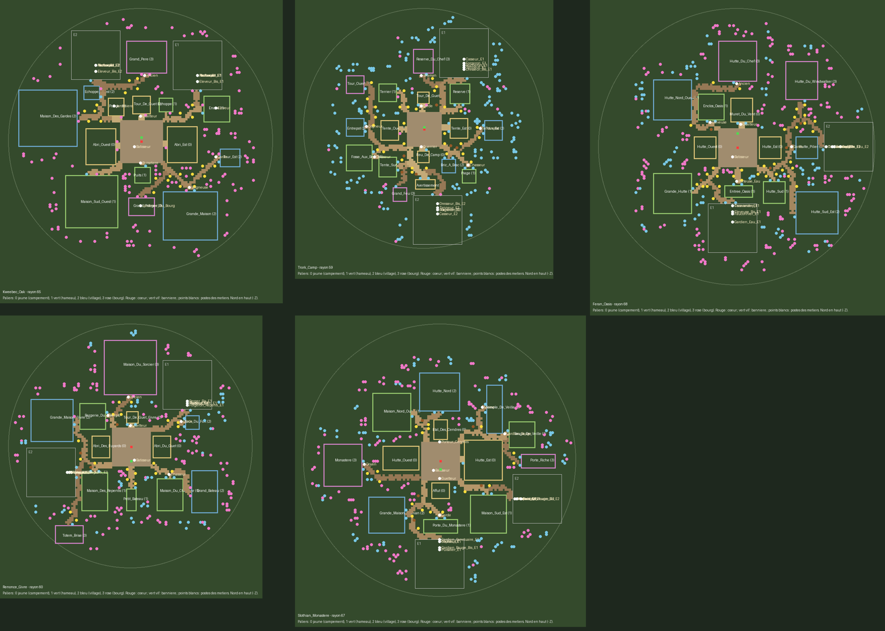
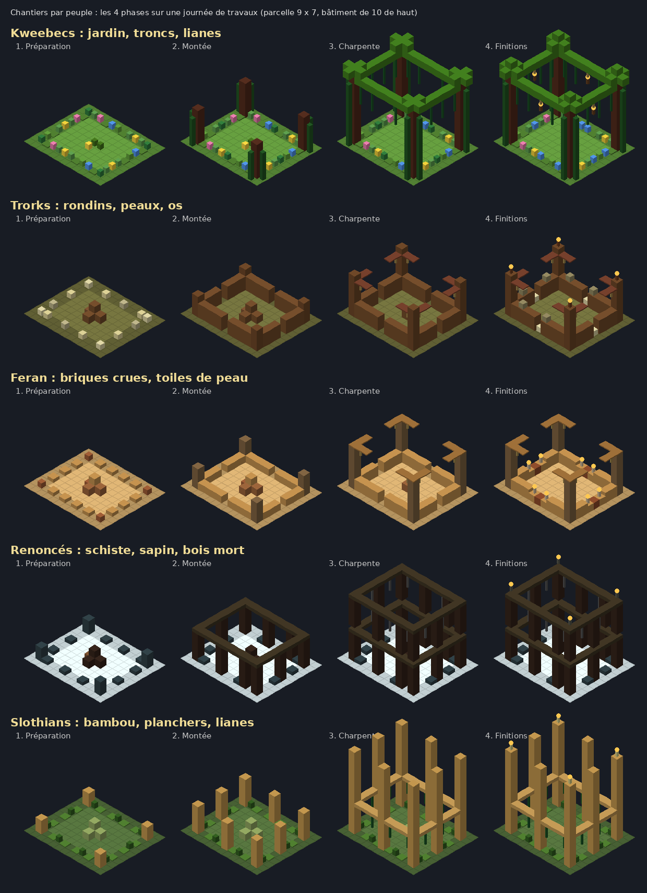
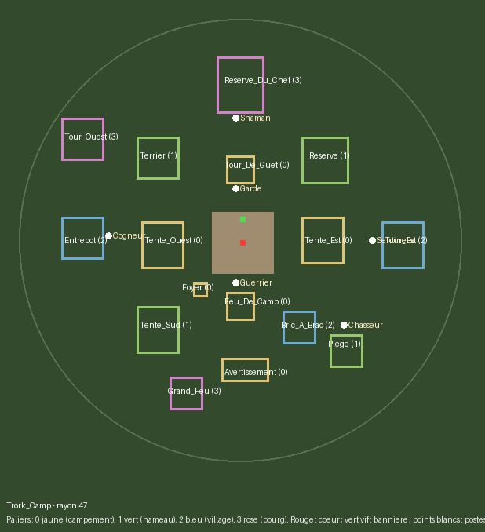

# Peuples d'Orbis : le mod

Mod `mods/nakasar-peuples` (manifest `Nakasar:Peuples`, jar `Nakasar-Peuples-<version>.jar`, plugin
`dev.nakasar.hytale.peuples.PeuplesPlugin`). Des villages vivants des peuples d'Orbis, façon Millénaire, qui grandissent
avec l'aide du joueur. Le game design document validé par Kevin le 14 novembre 2026 :
https://claude.ai/artifact/FJ15VjWp3pgnt9kmRWjfV7 (plan en 9 étapes, une PR par étape).

Le mod est indépendant des mods Vampires et Fractales (recommandation du GDD) : aucune dépendance de manifest, les
briques communes sont copiées (comme entre Vampires et Fractales).

## Étape 1 : le socle

### Villages

Un village est un objet sauvegardé avec le monde : la ressource de monde `Nakasar_Peuples_Villages`
(`village/VillageRegistry`, enregistrée comme `ReputationData` du ReputationPlugin vanilla) garde pour chaque village son
nom, son peuple, son palier (0 campement, 1 hameau, 2 village, 3 bourg), sa jauge d'essor (partagée par tous les
joueurs) et la position de son cœur, de son dépôt et de son tableau.

| Bloc | Rôle | Asset |
|------|------|-------|
| `Nakasar_Peuples_Village_Heart` | ancre du village, invisible et traversable (comme `Nakasar_Prison_Cell`) | `Item/Items/Nakasar/Peuples/` |
| `Furniture_Kweebec_Chest_Small` | dépôt : le coffre kweebec vanilla, lu par le Java | vanilla |
| `Nakasar_Peuples_Board_Kweebec` | tableau : enfant (`Parent`) du panneau vanilla `Furniture_Kweebec_Sign`, seule son interaction `Use` change | `Item/Items/Nakasar/Peuples/` |

Les peuples et leurs blocs sont dans `village/People` (Kweebecs seulement à l'étape 1). Les seuils d'essor par palier
sont dans `village/Tiers` (100, 250, 500 : premier jet, réglé à l'étape 3). Une jauge pleine attend son chantier
(étape 5) au lieu de déborder.

Le **tableau** ouvre la page texte vanilla `BlockLorePage` (déjà éprouvée par les notes du mod Vampires) remplie par
le Java (`village/VillageBoard`) : peuple et palier, jauge d'essor, rang du joueur (« Étranger » jusqu'à l'étape 4),
demandes (vides jusqu'à l'étape 3) et contenu du dépôt (lu dans le composant vanilla `ItemContainerBlock` du coffre).
C'est la page du GDD ; la maquette plus riche (`images/tableau_village.png`, boutons Prendre/Rendre) viendra avec les
demandes, une fois la page .ui du dialogue confirmée en jeu.

### Dialogues

Les dialogues sont des assets JSON du mod : `Server/Nakasar/Dialogues/<peuple>/<id>.json`, un magasin d'assets
enregistré par le plugin comme les rangs de réputation vanilla (l'id est le nom du fichier). Format (classe
`dialogue/Dialogue`) :

```json
{
  "NpcNameKey": "nakasar_peuples.dialogue.X.npc",
  "RoleKey": "nakasar_peuples.dialogue.X.role",
  "People": "Kweebec",
  "Entries": [ { "Node": "Retour", "Conditions": [ { "Type": "Flag", "Flag": "X_Met" } ] }, { "Node": "Accueil" } ],
  "Nodes": [
    { "Id": "Accueil", "TextKey": "...", "Responses": [
      { "TextKey": "...", "HintKey": "...", "Conditions": [ ... ], "FailKey": "...", "Effects": [ ... ], "Next": "Presentation" }
    ] }
  ]
}
```

- Nœud d'entrée : la première entrée dont les conditions sont remplies, sinon le premier nœud.
- Quatre réponses au plus. Une réponse dont une condition manque reste visible et affiche sa condition (`FailKey`).
- Les effets s'appliquent dans l'ordre ; le premier qui échoue (objet manquant, inventaire plein) arrête la suite et le
  dialogue reste sur le nœud. Sans `Next`, la fenêtre se ferme.
- **Paroles du PNJ dans la fenêtre** (Kevin, 16 novembre 2026) : ce qu'un effet fait dire au PNJ (tournée du Klops,
  rumeur, état du chantier ou du raid, destination d'une lettre ou d'un colis, refus « inventaire plein »…) passe par
  `dialogue/DialogueSpeech.say` et s'affiche sous la réplique du nœud suivant, jamais dans le tchat. Si la réponse
  fermait le dialogue, la fenêtre reste ouverte sur ces paroles seules (bouton Partir). Hors fenêtre (commande,
  dialogue au tchat, autre page ouverte par l'effet), elles partent au tchat. Les retours du jeu (essor, réputation,
  notifications) restent dans le tchat.
- Conditions du socle : `Flag`, `NotFlag`, `InVillage` (`People` facultatif), `VillageTier` (`Min`), `HasItem`
  (`ItemId`, `Quantity`). Effets : `SetFlag`, `ClearFlag`, `GiveItem`, `TakeItem`, `AddEssor` (`Amount`),
  `SendMessage` (`TextKey`), `OpenBoard`. Les deux familles sont des `CodecMapCodec` (`dialogue/DialogueTypes`) : les
  étapes suivantes y ajoutent le rang de peuple (ReputationPlugin vanilla), les objectifs, l'étape de chaîne, l'heure.
- Les drapeaux sont gardés avec le joueur (composant `Nakasar_Peuples_Player`, `player/PeuplesPlayer`).

La **fenêtre** (`dialogue/DialoguePage`, maquette `images/dialogue_bas_ecran.png`) est une `InteractiveCustomUIPage`
sur la mise en page du pack `Common/UI/Custom/Pages/Nakasar/Peuples/DialoguePage.ui`. C'est une boîte en bas de l'écran,
façon Baldur's Gate / Divinity, la moitié haute restant à la scène :

- cadre vanilla `$C.@DecoratedContainer` (comme le tableau du village) et léger dégradé sombre en bas de l'écran ;
- en-tête : `#NpcName`, `#NpcRole`, `#Standing` (« peuple · rang », `Dialogues.standing`) ;
- `#Line` (réplique), `#Aside` (absents du jour), séparateur `$C.@PanelSeparatorFancy` ;
- `#Answer0..3` : des `Button` vanilla (pas des `TextButton`) portant le numéro, `#Text0..3` et `#Hint0..3`
  (« — effet » ; grisée : `.Disabled`, texte gris et « — condition » en ambre) ;
- à droite, `#Portrait` (`AssetImage`, comme la page vanilla des Souvenirs) dans un cadre, et `#Leave` dessous
  (Échap ferme aussi).

**Portraits** : `dialogue/Portraits` choisit, d'après le modèle du PNJ (`ModelComponent`), un portrait tête et buste
recadré dans les rendus vanilla `Common/Icons/ModelsGenerated/<Modèle>.png`. Ils sont livrés sous
`Common/Icons/Nakasar/Peuples/Portraits/` par `tools/generate_portraits.py --assets <Assets.zip>` (46 modèles des
peuples). Une variante sans rendu vanilla prend celui du plus long préfixe (`Kweebec_Sapling_Pink` → `Kweebec_Sapling`) ;
un modèle sans rendu (`Klops_Merchant`) n'a pas de portrait (le cadre est masqué).

**Caméra de dialogue** (`dialogue/DialogueCamera`) : quand un PNJ parle, le serveur pose la caméra du client derrière
l'épaule du joueur, cadrant le joueur et le PNJ (paquet `SetServerCamera`, celui de `/camera topdown`). Elle revient à
la vue normale à la fermeture (`onDismiss`, Partir, effet qui ferme, autre fenêtre ouverte à sa place). Pas de caméra
si le PNJ est à plus de 9 blocs ou si aucune place libre (épaule droite, gauche, plus près) n'a de ligne de vue sans
bloc plein. Chaque joueur peut la couper ou la rétablir avec `/village camera` (drapeau `option.dialogueCameraOff`).

Le **secours** reste le même dialogue mené dans le tchat (`/village tchat`, `/village repondre`), qui ne dépend
d'aucune page.

Dialogue d'essai : `Kweebec_Essai` (Brindille, jardinière) passe par toutes les conditions et tous les effets.

### Commande `/village`

| Sous-commande | Qui | Effet |
|---------------|-----|-------|
| `fonder <nom> <peuple>` | opérateur | cœur sous les pieds, dépôt 2 blocs à l'est, tableau 2 blocs à l'ouest (cases vides exigées, 64 blocs entre deux villages) ; `_` dans le nom donne une espace |
| `effacer` | opérateur | retire le cœur et le tableau du village le plus proche ; le dépôt reste avec son contenu |
| `essor <n>`, `palier <n>` | opérateur | règle la jauge et le palier du village le plus proche |
| `info`, `tableau`, `liste` | joueur | état du village le plus proche (48 blocs) dans le tchat, son tableau, tous les villages |
| `parler <dialogue>` | joueur | ouvre le dialogue dans la fenêtre du mod |
| `tchat <dialogue>`, `repondre <n>` | joueur | le même dialogue dans le tchat (0 : partir) |
| `drapeaux`, `oublier` | joueur | ses drapeaux de dialogue, et leur remise à zéro |
| `camera` | joueur | coupe ou rétablit la caméra qui cadre le joueur et le PNJ pendant les dialogues |

Les sous-commandes d'opérateur demandent la permission `nakasar.peuples.admin`.

### Validation hors ligne

`validateAssets` (copie de celui des Fractales) décode aussi les dialogues avec le codec du plugin (types de
conditions et d'effets, nœuds en double, `Next` et entrées vers un nœud absent, plus de 4 réponses) et vérifie que
chaque clé `...Key` existe dans les `.lang` fr-FR et en-US et chaque `ItemId` dans le pack ou dans
`tools/vanilla-item-ids-0.7.2.txt`.

### Tester en jeu

1. Monde créatif, opérateur : `/village fonder Bosquet_d'essai Kweebec` sur un terrain plat dégagé.
2. Utiliser le panneau kweebec à l'ouest : le tableau s'ouvre (Campement, essor 0 / 100, dépôt vide).
3. Poser quelques objets dans le coffre kweebec à l'est, rouvrir le tableau : ils sont listés.
4. `/village essor 40`, rouvrir : la jauge avance. `/village palier 1` : Hameau.
5. `/village parler Kweebec_Essai` : la fenêtre de dialogue. Avec 3 `Plant_Seeds_Carrot` en poche : « Je peux aider le
   village ? » puis « Voici trois graines » (+10 d'essor), puis le cadeau (2 pommes, une seule fois).
6. Si la fenêtre ne s'affiche pas : `/village tchat Kweebec_Essai` et `/village repondre 1`... mène le même dialogue.
7. Quitter et relancer le serveur : `/village liste` retrouve le village, l'essor et le palier ; `/village drapeaux`
   retrouve les drapeaux.

### À vérifier en jeu (fenêtre de dialogue en bas d'écran)

- La boîte s'affiche-t-elle en bas, centrée, avec le portrait qui dépasse au-dessus à droite ? Le dégradé du bas
  (`RunicContainerBottomGradient`) assombrit-il bien le bas de l'écran ?
- Survol des réponses (fond bleu sombre), réponse grisée non cliquable avec sa condition en ambre, couleurs des
  `TextSpans` respectées ?
- La caméra glisse-t-elle derrière l'épaule et regarde-t-elle le PNJ (sinon : signe du tangage ou du lacet à inverser
  dans `DialogueCamera.send`) ? Revient-elle bien à la normale avec Échap, Partir, et en ouvrant l'échoppe ?
- `/camera reset` (vanilla) rend la vue si jamais elle restait bloquée.

### À vérifier en jeu (étape 1)

- La fenêtre `DialoguePage.ui` s'ouvre-t-elle ? (si le client signale une erreur de page, envoyer le message et, si
  possible, le fichier vanilla `Common/UI/Custom/Pages/BlockLorePage.ui` d'Assets.zip pour caler la syntaxe).
- Les clics sur les réponses reviennent-ils au serveur et la page change-t-elle de nœud sans se fermer ?
- Le tableau hérite-t-il bien du modèle du panneau kweebec (`Parent` sur un bloc vanilla, première fois dans le dépôt) ?
- Le coffre posé par le Java a-t-il son inventaire (sinon le tableau dit « Le dépôt du village a disparu ») ?
- Le village survit-il au redémarrage (ressource de monde) ?

### Hors de l'étape 1

Les demandes (étape 3), la réputation et les rangs (étape 4, groupes et rangs du ReputationPlugin vanilla), les chantiers
(étape 5) et les raids (étape 6) s'ajoutent à `Village` et à `PeuplesPlayer`.

## Étape 2 : le premier village kweebec

### Plan du village

Un plan (`Server/Nakasar/VillageLayouts/<Id>.json`, asset `VillageLayout`) place des prefabs **vanilla**
(`Server/Prefabs/Npc/Kweebec/Oak/...`, règle n° 2) autour du cœur. Il est écrit par
`tools/generate_village_layouts.py`, qui lit les emprises de `tools/vanilla-prefabs-0.7.2.txt` (relevées dans
Assets.zip), refuse tout chevauchement (3 blocs entre bâtiments, 1 pour les lanternes et les bancs) et dessine un
aperçu (`--preview DIR`). Chaque bâtiment a un palier : seul le campement (palier 0) est collé à la génération, les
autres attendent les chantiers (étape 5).

| Palier | Bâtiments du plan `Kweebec_Oak` (rayon 65) |
| --- | --- |
| 0, campement | deux abris, tour de guet, potager (lanternes et bancs : dans le cœur) |
| 1, hameau | puits, échoppe, une maison, enclos des lapins |
| 2, village | grande maison, maison des gardes, deuxième tour, deuxième échoppe |
| 3, bourg | le Grand-Père, grand potager |

Les prefabs vanilla gardent leurs marqueurs d'apparition : des Kweebecs (villageois, marchand, patrouilles de
Razorleaf et de Sproutlings, lapins) apparaissent dans le campement.

### Génération

`VillageBuilder` charge les chunks, aplanit la place (chemin de terre) et l'emprise de chaque bâtiment (herbe, 2 blocs
de marge plate), à au plus 4 blocs de la hauteur de la place, puis colle
les prefabs comme l'action vanilla `PrefabPasteAction`, puis pose le cœur du peuple, le dépôt, le tableau (étape 1) et la
bannière aux places que donne le plan.

Le terrassement (`Grading`, aussi utilisé par les chantiers) traite toutes les plateformes en une passe :
- talus d'un bloc de pente au plus vers le relief d'origine, sur 8 blocs au-delà des marges ; seules les colonnes qui
  l'exigent sont retouchées, les sols non naturels (chemins, constructions) et les emprises réservées jamais ;
- arbres retirés en entier (tronc, branches, racines remplacées par de la terre, et le feuillage qu'ils portent : chaque
  feuille appartient au bois le plus proche) dès qu'un de leurs blocs ou une de leurs feuilles surplombe une colonne
  retouchée, jusqu'à 14 blocs autour du site ;
- toute grappe de bois et de feuilles qui ne touche plus aucun bloc solide est retirée, ainsi que les plantes sans sol.

### Cœur du village (place propre à chaque peuple)

Le cœur n'est plus un carré de chemin avec un coffre et un panneau : chaque peuple a sa place mise en scène, écrite par
`tools/generate_village_hearts.py` dans la clé `Heart` du plan (positions du tableau, du dépôt et de la bannière avec
leur orientation vers le cœur, puis un « pas » par palier). La place s'enrichit à chaque chantier fini.

| Plan | Cœur | Pièces vanilla, par palier |
| --- | --- | --- |
| `Kweebec_Oak` | clairière du rejeton | chêne qui grandit (Oak Stage 1, 2, 2, 3) sur un tertre de mousse, bassin `Water_Pool_005` (palier 1), lampadaires et bancs kweebecs, auvent de feuilles sur poteaux au-dessus du tableau |
| `Trork_Camp` | arbre aux trophées | `Trork_Warning_002`, foyer `Fireplace_001`, rondins pour s'asseoir, râtelier `Misc_Large_002` (palier 2), cercle de pierres |
| `Feran_Oasis` | bassin de l'oasis | bassin de grès (eau du mod), palmiers qui poussent, colonnes à torche, auvent de toile orange, pots et tabourets |
| `Renonce_Givre` | foyer des repentis | camp `Outlander_Misc_003`, rondins de sapin, sapins enneigés (palier 1), braseros (palier 2) |
| `Slothian_Monastere` | jardin de veille | sanctuaire slothian (son bloc d'apparition retiré), touffes de bambou, jardinières |

Chaque pas pose, dans l'ordre : les pièces vanilla (`Pieces`), les blocs un à un (`Set`, `"x y z rotation Bloc"`,
`Empty` pour vider), retire les blocs qui ne servent plus s'ils sont toujours là (`Clear`, ex. le jeune chêne remplacé),
puis l'eau (`Fluids`, prefab `Server/Prefabs/Nakasar/Peuples/Hearts/*_Fluids` du mod : `Blocks.set` ne pose pas de
fluide). Coordonnées relatives au cœur, y = 0 à la surface de la place. Rotations : lacet 0 sud, 1 est, 2 nord, 3 ouest ;
rondin couché 4 (le long de z) et 5 (le long de x), comme dans les prefabs vanilla ; chapiteau = `Pillar_Base` en 8.

`VillageHeart` ne touche jamais aux inventaires ni au cœur, au tableau, au dépôt et à la bannière. Au passage de palier
(village habité), un bloc n'est remplacé que s'il est naturel, vide, du sol de la place ou du cœur lui-même, et une pièce
vanilla n'est pas collée si un coffre se trouve dessous. Les villages fondés avant les cœurs (`HeartTier` absent) gardent
leur ancienne place.

**Dépôt double** (`village/Deposits.java`, Kevin 2026-11-16) : à partir du palier 2, le petit coffre de dépôt du peuple
(18 places) devient le grand coffre vanilla du même style (`Furniture_<Style>_Chest_Large`, 36 places, deux cases),
avec tout son contenu, au premier pas où un joueur est près du village et le coffre fermé. La seconde case est la clé
`DepositWide` du cœur, choisie à la main par peuple hors des allées de la place (et réservée : le cœur n'y pose rien) :
Kweebec (3, 1, −2), Trork (4, 1, 0), Feran (4, 1, 2), Renoncés (4, 1, 6), Slothians (3, 1, 2). Les cases du grand coffre
viennent de sa boîte de collision tournée par le moteur (`FillerBlockUtil`) ; si la case du plan n'est pas sur l'axe
du coffre ou pas libre, l'autre voisine sur l'axe (hors d'un chemin d'abord). Le village (`DepositLarge`,
`Deposit2X/Y/Z`) protège les deux cases. Un village qui redescend de palier garde son grand coffre.

Aperçus : `python3 tools/generate_village_hearts.py --vanilla dump.json --preview DIR --palette pal.json` (le dump vient
de `tools/extract_vanilla_prefabs.py Assets.zip pieces.txt dump.json --palette pal.json`, la liste des pièces de
`--list`). Le script refuse un bloc inconnu, un meuble de plusieurs cases posé bloc à bloc, un bloc hors de la place ou
une case réservée occupée.

`VillageSeeder` pose tout seul **le premier village kweebec du monde par défaut** : 15 s après le démarrage, il essaie
40 sites sur des cercles de 280 à 700 blocs autour du point d'apparition (ordre tiré du seed), et prend le premier
couvert d'herbe à 80 %, sans eau, avec au plus 9 blocs de relief. Le monde garde la trace du village posé ; si aucun
site ne convient, il réessaie au démarrage suivant avec d'autres sites. Les noms viennent de `VillageNames` (liste
kweebec, sans doublon dans le monde).

#### Plusieurs villages par peuple

Une fois le premier lieu d'un peuple posé (village kweebec, camp trork, oasis feran, hameau renoncé, monastère
slothian), `zone/MoreVillagesSeeder` pose les suivants, 150 s après le démarrage puis un à la fois, jusqu'à
`People.naturalVillages()` en tout : **3 Kweebecs, 3 Feran, 2 Trorks, 2 Renoncés, 2 Slothians**. Écarts retenus :

- **600 à 1200 blocs** du village du même peuple le plus proche. À 600 blocs, les terrains de chasse des demandes
  (220 blocs autour du cœur), la veille des raids et la vie du village (160 blocs) ne se chevauchent jamais, et la
  bannière (révélée à 300 blocs) ne se voit pas depuis l'autre village. Au plus 1200 blocs, pour que les villages d'un
  peuple forment une région et restent à portée des caravanes (2400 blocs au plus).
- **Au moins 300 blocs** de tout village d'un autre peuple.
- Dans la **terre ferme de la zone du peuple** (centre et quatre bords du plan entier, ni rivage ni océan ; zone 1 pour
  les Kweebecs et les Trorks), sur son sol, sans eau et avec un relief modéré, comme le premier lieu.

Les villages se posent avec `VillageBuilder` (même nivellement `Grading` que le premier). Le registre garde le compte
(`MoreSeeded`) ; une recherche sans site compte un échec (`MoreFailures`), et un peuple n'est plus cherché après trois
échecs. `/village semer <peuple>` pose un village de plus à la main avec les mêmes règles, et `/village zone` les liste
tous. Un monde existant reçoit ses villages suivants au prochain démarrage.

#### Le colon : fonder un village sans être Champion

`outpost/Settlers` : un village au palier max (`Tiers.MAX`) fait venir un colon au plus une fois tous les 7 jours de
jeu (`Village` : `SettlerDay`, `SettlerActive`, `SettlerOwner`). Le PNJ n'est pas sauvegardé : il apparaît au poste
(cœur + 4, -4) quand un joueur passe à moins de 48 blocs (`Nakasar_Peuples_<Peuple>_Settler`), puis, accepté, suit son
joueur (`…_Settler_Follow`, ramené près de lui au-delà de 32 blocs, retiré quand il se déconnecte). Lui parler ailleurs
lance `zone/SiteRules.check` (règles communes avec `MoreVillagesSeeder` : écarts 600/300, fondations prévues, zone et
rivage, sol, eau, relief) : la condition de dialogue `SettlerSite` choisit le nœud (« Ici » ou la raison), le détail
chiffré s'affiche sous la réplique du colon. « Fondons le village ici » bâtit le village tout de suite (`VillageBuilder.generate`) ; les joueurs dont
les pieds ou la tête sont pris dans un bloc posé sont téléportés au point sûr le plus proche à moins de 4 blocs de leur
hauteur (`Settlers.unstick`, pas sur un toit). Si la fondation échoue, le colon rentre à son village. Rôles, dialogue `Colon` et textes :
`tools/generate_settlers.py`. `/village colon` (ops) fait venir un colon tout de suite au village le plus proche.

### Relief autour des bâtiments et de la place

Kevin (2026-11-16) : les bâtiments et le cœur laissaient de gros carrés (terre plate, arbres rasés au carré). Désormais :

- **Place** : coins arrondis (rayon 5, toutes les pièces des cœurs y tiennent), bord effiloché sur 3 blocs où le sol de
  la place cède au sol du peuple (le dessin du cœur garde son sol propre).
- **Arbres** (`Grading.clearTrees`) : un arbre ne tombe que s'il occupe l'espace du bâtiment à coller (hauteur du prefab
  + 1 au-dessus de la plateforme, 10 au-dessus de la place) ou les 3 blocs au-dessus d'un talus. Une couronne qui passe
  au-dessus du toit, ou un voisin qui déborde sur la marge en hauteur, reste debout. (`Grading.pad` sans hauteur libre
  garde l'ancien comportement : avant-postes, auberges, source de l'Écho.)
- **Retour au relief** (`Grading.settle`, après chaque collage : génération, chantiers, terrains E1/E2) : l'emprise
  du prefab reste entièrement à sa hauteur (enclos, potagers et cours du prefab compris ; une colonne creusée y revient).
  Autour, la marge et les talus (12 blocs) reprennent une hauteur interpolée depuis le terrain naturel (moyenne pondérée
  du pourtour puis relaxation de Laplace), bornée à un bloc de pente par bloc.
- **Demi-blocs** (`People.slabs`) sur les marches d'un bloc, seulement sur les colonnes dont le relief a bougé et face à
  un vrai sol plus haut (jamais un autre demi-bloc : sinon ils se propagent en nappes). Jamais sur la place, dans
  l'emprise d'un bâtiment du plan (même à venir) ou sur un terrain E1/E2. Comptés comme du relief : jamais « bloc
  gênant » d'un chantier (`Chantiers.natural`), ni sol pour `Terrain.surface`, retirés quand une colonne est terrassée.
  Kweebec terre de sentier, pavés moussus, planches ; Trork gravier, planches ; Feran gravier de sable, pavés de grès ;
  Renoncés neige, pavés d'ardoise ; Slothians pavés de basalte, gravier, planches tropicales.

Villages déjà bâtis : rattrapage unique au premier passage d'un joueur (`Village.ReliefVersion` < 2 ;
`VillageStreets.RELIEF_VERSION`), avant les sentiers. Un village passé par la v1 (Kevin 2026-11-16 : nappes de
demi-dalles, enclos encaissés) perd d'abord tous ses demi-blocs d'adoucissement posés sur le sol (hors place et
bâtiments debout), puis chaque bâtiment debout reprend son emprise à plat et le relief autour. Les arbres déjà rasés et
la place déjà carrée ne reviennent pas.

### Sentiers et décor entre les bâtiments

Kevin (2026-11-16) : les bâtiments étaient posés sur des carrés de terre nue, sans rien entre eux. `tools/village_streets.py`
(appelé par `generate_village_layouts.build`, donc aussi par `generate_zones.py` et `generate_slothians.py`) ajoute au plan
une liste `Streets` de pas par palier :

- `Paths` (`"x z Bloc"`) : chaque bâtiment (et terrain E1/E2) est relié à la place, ou au sentier déjà tracé le plus proche,
  par un A* qui contourne les emprises (bruit lissé pour serpenter, chemins existants moins chers) : un réseau en arbre qui
  grandit avec les paliers. Ligne lissée (Chaikin), 3 de large pour le campement, 2 ensuite, bords effilochés. Sol par
  peuple : Kweebec `Soil_Pathway` (+ gravier moussu), Trork terre + gravier, Feran gravier de sable, Renoncés gravier + neige,
  Slothians pavés de basalte + boue sèche.
- `Decor` (`"x z rotation P|B Id"`) : lumières tous les 10 blocs de sentier en alternant les côtés, un ou deux objets près
  des portes, bancs aux croisements, petits coins entre les bâtiments (Poisson, écart 7). Assets vanilla seulement : pour les
  Kweebecs les petits prefabs du village Oak (`Lampposts`, `Seats/Small`, les 88 `Garden_Small`), pour les autres leurs
  meubles et plantes (torches et pots feran, os, tonneaux et feux éteints trork, lanternes du bûcheron et tonneaux de taverne
  renoncés, jardinières et torches de jungle slothianes).
- Palier d'un décor : au moins celui du sentier, et le plus haut palier des emprises proches (10 blocs pour un décor
  « naturel » que le terrassement raboterait : plantes, os, éboulis, jardinets ; 3 pour un meuble, que `Grading` garde).

Java `village/VillageStreets` : posé par `VillageLifeSystem` quand un joueur est près du village et que `Village.StreetsTier`
est sous le palier (génération, après chaque chantier, rattrapage une fois des villages déjà bâtis). Les sentiers de tous
les paliers atteints sont reposés (un terrassement a pu en raboter), le décor seulement pour les nouveaux paliers. Seul le
sol NATUREL est touché (pas de champ labouré, ni d'arbre, ni de bloc de joueur ; herbe et fleurs retirées), à 10 blocs au
plus de la hauteur de la place ; un prefab de décor n'est collé que si son emprise est libre et à plat à un bloc près.



### Bannière et entrée

- La **bannière** (`Nakasar_Peuples_Banner_Kweebec`, statue kweebec vanilla en parent) est posée au nord de la place.
  Elle porte un marqueur de carte découvrable (icônes `tools/generate_map_icons.py`) : `VillageEntrySystem` le révèle
  au joueur qui passe à moins de 300 blocs, et il reste ensuite sur sa carte et sa boussole.
- À moins de 40 blocs du cœur, un **titre d'écran** donne le nom du village, puis « peuple · rang · humeur » (le rang
  est « Étranger » jusqu'à l'étape 4). Il revient après être ressorti au-delà de 52 blocs.
- `VillageNoRegenSystem` : aucun PNJ **hostile** ne se régénère (règle permanente n° 1) : rôles du mod hostiles
  (boss, assaillants), PNJ des demandes hostiles (bandes, embuscades, chefs, renforts) et mobs vanilla hostiles à
  moins de 96 blocs d'un village. Les PNJ amicaux (villageois, gardes, marchands, voyageurs, bêtes) gardent la
  régénération vanilla des PNJ : +5 % de vie toutes les 0,5 s après 15 s sans dégâts (Kevin, 16 novembre 2026).

### Nouvelles commandes

| Sous-commande | Qui | Effet |
| --- | --- | --- |
| `generer` | opérateur | bâtit un village kweebec (palier 0) centré sous les pieds, nom tiré de la liste |
| `site` | opérateur | nom, position, distance et direction du village le plus proche, à toute distance |

`effacer` retire aussi la bannière ; les bâtiments collés et le dépôt restent.

### Tester en jeu (étape 2)

1. Nouveau monde (ou monde existant : le village se pose au démarrage suivant). Attendre ~20 s après l'arrivée ; le
   journal du serveur dit `recherche d'un site de village kweebec` puis `village ... généré en x y z`.
2. `/village site` : nom, distance et direction du village. S'y rendre : la bannière apparaît sur la carte vers
   300 blocs, puis le titre d'écran à l'entrée du campement.
3. Vérifier les bâtiments, les Kweebecs, le tableau (ouest du cœur) et le dépôt (est).
4. Ailleurs, sur un terrain d'herbe : `/village generer` bâtit un second village sous les pieds (il faut être à plus
   de 146 blocs du premier).
5. Redémarrer : le village reste, aucun second village automatique n'apparaît.

### À vérifier en jeu (étape 2)

- Les prefabs se collent-ils (sinon `prefab introuvable` / `zone du prefab ... pas chargée` dans le journal) ? Les
  portes des maisons sont-elles tournées vers la place (abri ouest rotation 0, abri est 180°) ?
- Les Kweebecs des marqueurs d'apparition apparaissent-ils, et les patrouilles restent-elles dans le campement ?
- Le terrain aplani est-il propre (marches, trous, arbres coupés en l'air) ?
- La bannière garde-t-elle le modèle de la statue avec son marqueur de carte ? Le marqueur apparaît-il sur la carte
  après la révélation sans reconnexion ?
- Le titre d'écran s'affiche-t-il une seule fois par entrée ?

## Étape 3 : les demandes du tableau

### Modèles et tirage

Un modèle de demande est un asset JSON `Server/Nakasar/Requests/<Peuple>/<Id>.json` (`RequestTemplate`, décodé et
vérifié par `validateAssets` : type, paliers, objet, bande, distances, textes fr-FR et en-US). Chaque matin (6 h de jeu),
le tableau de chaque village tire **trois demandes** parmi les modèles de son peuple et de son palier, au poids, en
préférant trois types différents. Une demande remplie est remplacée tout de suite par une autre.

| Type | Ce qu'il faut faire | Modèles kweebecs | Essor |
| --- | --- | --- | --- |
| Récolte | déposer des objets au dépôt (ou les rendre) | baies rouges ×20, sève ×10, graines de carotte ×12, tronc de chêne ×16 | 10 |
| Fabrication | idem, objets fabriqués | lanternes kweebecs ×4, pain ×3 | 15 |
| Chasse | abattre la bande posée à 80-150 blocs ; les Trorks du même rôle tués à moins de 220 blocs du village comptent aussi | 2 guerriers + 1 chasseur, ou 2 cogneurs | 15 |
| Livraison | porter la missive (donnée à la prise) au guetteur posé à 90-150 blocs | guetteur Razorleaf | 10 |
| Escorte | délivrer le jeune captif gardé par 2 gardes trorks (80-140 blocs) et le ramener à moins de 14 blocs du cœur | captif orange | 20 |
| Défense | être au village la nuit (20 h à 6 h) : 4 Trorks attaquent à 30 blocs du cœur, il faut les abattre avant l'aube | 3 guerriers + 1 chasseur | 25 |

Récompense : l'essor au village (une seule fois par demande du tableau, même à plusieurs joueurs) et des **feuilles de
sève** (`Nakasar_Peuples_Favor_Kweebec`, faveur kweebec, modèle de la sève vanilla) au joueur, au sol si son sac est
plein. Une demande prise tient jusqu'au premier matin au moins 12 h plus tard ; échue, abandonnée ou échouée (captif
mort, aube sur une défense), elle se retire et la missive est reprise.

Les bandes, le guetteur et le captif ne sont posés que quand le joueur passe à moins de 72 blocs du lieu, ne sont pas
sauvegardés (ils reviennent à la session suivante) et ne se régénèrent jamais (règle n° 1).

### Suivi à l'écran (Objectives vanilla)

Le Java garde l'état des demandes (sauvegardé avec le joueur) ; le HUD les affiche avec les paquets vanilla
`TrackOrUpdateObjective` / `UntrackObjective` : titre, village et récompense, et une ligne de tâche avec l'avancement,
la distance et la direction du lieu (mise à jour chaque seconde quand elle change).

### Où prendre et rendre une demande

- **Le tableau** (ouest du cœur) : utilisé normalement, il ouvre le tableau à boutons, aux couleurs du peuple
  (`BoardPage_<Peuple>.ui`, générées par `tools/generate_board_ui.py` ; `BoardPage.ui` neutre pour un peuple sans
  thème ; maquettes `peuples/maquettes/tableau-par-peuple/`). En haut, le bandeau du peuple : emblème vanilla de la
  page des Souvenirs teinté à sa couleur (Voidtaken pour les Slothians, faute d'icône), palier, devise
  (`boardPage.motto.<Peuple>`), villageois, rang du joueur et sa jauge. À gauche, les trois demandes en cartes : icône
  d'objet vanilla du type (ou l'objet demandé), récompenses (essor, réputation, faveur en icône), jauge d'avancement
  d'une demande prise, **Prendre** / **Abandonner**. À droite, l'essor (jauge), le chantier (matériaux en icônes
  d'objets, coche verte quand le compte est bon ; ou fin des travaux et bâtiments), le dépôt en icônes et l'alerte de
  raid. En bas, les absents, **Rendre** et **Version texte** (page BlockLore). **Accroupi**, il ouvre directement la
  page texte (secours si la page à boutons ne s'affiche pas). `ValidateAssets` vérifie que chaque élément rempli par
  `BoardPage.java` existe dans chaque page et que chaque texture citée existe (pack ou
  `tools/vanilla-ui-textures-0.7.7.txt`).
- **Le crieur** (`Nakasar_Peuples_Kweebec_Crier`), posé deux blocs au sud du tableau quand un joueur approche : son
  dialogue `Kweebec_Crieur` ouvre les demandes, ou reprend les objets portés si le joueur a une demande ici. Tué, il
  revient au matin.
- Le dépôt : se tenir à moins de 6 blocs du coffre compte ce qu'il contient pour les récoltes et fabrications prises.
- Le tchat, avec les commandes ci-dessous.

Nouveaux types de dialogue : condition `HasRequest` (`RequestType` optionnel), effets `OpenRequests` et
`TurnInRequests`.

### Nouvelles commandes

| Sous-commande | Qui | Effet |
| --- | --- | --- |
| `demandes` | joueur | ouvre le tableau à boutons du village le plus proche |
| `mesdemandes` | joueur | liste ses demandes en cours, avec avancement, distance et direction |
| `prendre <n>` | joueur | prend la demande n° 1 à 3 |
| `rendre` | joueur | rend le dépôt et le sac pour ses demandes de ce village |
| `abandonner <n>` | joueur | abandonne sa demande n° 1 à 3 |
| `demande <modèle> [case]` | opérateur | pose ce modèle au tableau (ex. `Kweebec_Escort_Captive 2`) |
| `renouveler` | opérateur | tire trois nouvelles demandes |

`info` montre maintenant l'état des demandes ; `effacer` retire aussi le crieur.

### Tester en jeu (étape 3)

1. Aller au village kweebec (`/village site`). Le crieur apparaît devant le tableau ; l'utiliser ouvre son dialogue,
   « Montre-moi les demandes » ouvre le tableau à boutons. Utiliser le tableau donne la même page ; accroupi, la page
   texte.
2. **Récolte** : `/village demande Kweebec_Gather_Seeds 1`, puis **Prendre** la case 1. Le suivi d'objectif apparaît
   au HUD. Avoir 12 graines de carotte (`Plant_Seeds_Carrot`, récoltées ou données en créatif), les mettre dans le dépôt (est du cœur) :
   l'avancement monte, la demande se remplit, l'essor monte de 10 au tableau (`/village info`) et on reçoit une
   feuille de sève. Variante : garder les graines dans le sac et cliquer **Rendre**.
3. **Chasse** : `/village demande Kweebec_Hunt_Trorks 1`, prendre, suivre la direction du HUD ; la bande apparaît à
   moins de 72 blocs du lieu ; chaque Trork tué fait monter le compteur.
4. **Livraison** : `/village demande Kweebec_Delivery_Missive 1`, prendre (une missive arrive dans le sac), aller au
   guetteur et l'utiliser.
5. **Escorte** : `/village demande Kweebec_Escort_Captive 1`, prendre, battre les deux gardes, s'approcher du captif
   (il suit à moins de 14 blocs) et le ramener près du cœur.
6. **Défense** : `/village demande Kweebec_Defense_Night 1`, prendre, `/time midnight` en restant au village : une
   alerte annonce l'attaque et sa direction ; abattre les 4 Trorks avant l'aube.
7. Échéance : prendre une demande puis `/time` jusqu'au surlendemain matin : elle échoue (« Demande échue »).
8. Redémarrer : les demandes prises et leur avancement restent, le suivi revient au HUD.

### À vérifier en jeu (étape 3)

- Le suivi d'objectif vanilla au HUD : titre, description, ligne de tâche, compteur, et son retrait.
- Le tableau à boutons par peuple : mise en page, boutons (Prendre, Abandonner, Rendre, Version texte), teinte des
  emblèmes (couleur du `PatchStyle` ; sinon livrer des copies recolorées), jauges (`ProgressBar` à remplissage
  `Board/Bar_<Peuple>.png`), icônes d'objets (`ItemIcon`), pastilles qui prennent la largeur de leur texte.
- L'interaction avec le crieur, le guetteur et le captif (touche d'utilisation, mot « Parler ») et l'apparence
  vanilla choisie (Kweebec rose, Razorleaf, orange).
- Le captif qui suit le joueur ; les Trorks de la défense qui marchent vers le cœur (point de laisse).
- La feuille de sève et la missive (modèles de la sève et du parchemin vanilla en main et au sol).

## Étape 4 : la réputation

### Deux réputations, un rang

Chaque joueur a deux réputations (GDD, Jauges) :

- **de village**, propre à chaque village, gardée avec le joueur (`PeuplesPlayer`, champs `Reputation` et `Visits`) ;
- **de peuple**, partagée par tous les villages d'un peuple, tenue par le `ReputationPlugin` vanilla (groupe
  `Nakasar_Peuples_Kweebec`, stockage par joueur). Elle reçoit un tiers de chaque gain ou perte de village.

Le rang d'un joueur dans un village est celui de la **meilleure des deux** : un ami des Kweebecs est accueilli dans un
village kweebec qu'il découvre. Hors des villages, seul le rang de peuple compte.

| Rang | Réputation | Attitude des villageois | Ce qu'il ouvre |
| --- | --- | --- | --- |
| Honni | -1000 à -100 | hostile (les gardes attaquent) | seule la première demande, pour se racheter |
| Étranger | -100 à 50 | neutre (gardes méfiants, petits qui fuient) | une demande au tableau, échoppe fermée |
| Toléré | 50 à 200 | neutre | les trois demandes, troc de base |
| Ami | 200 à 500 | amicale | échoppe avancée |
| Hôte | 500 à 1000 | amicale | réserve de l'hôte (tenue kweebec, lit, mobilier) |
| Champion | 1000 et plus | vénérée | toutes les échoppes (parcelle et avant-poste : étapes suivantes) |

Les rangs sont des assets vanilla `Server/NPC/Reputation/Ranks/Nakasar_Peuples_<Rang>.json` ; `validateAssets`
vérifie qu'ils collent à l'enum `Rank` (bornes, attitude). Un joueur neuf part de 0 (Étranger).

### Gains et pertes

| Action | Village | Peuple |
| --- | --- | --- |
| Remplir une demande | + l'essor de la demande (10 à 25), à chaque joueur qui la remplit | + un tiers |
| Frapper un villageois du peuple | -5 | -1 |
| Tuer un villageois du peuple | -40 | -13 |
| Casser un bloc d'un bâtiment collé, du dépôt, du tableau ou de la bannière (pas les potagers) | -2 par bloc | 0 |
| Absence de plus de 10 jours de jeu | -10 par jour de plus, jamais sous Toléré | |

Hors de tout village, frapper ou tuer un Kweebec coûte la même chose à la réputation de peuple seule. Chaque changement
s'annonce par une notification ; un changement de rang l'annonce au tchat avec ce que le nouveau rang ouvre. Une
demande peut fixer son gain avec le champ optionnel `Reputation` (sinon son essor).

### Attitude des villageois

Un fournisseur d'attitude Java (`VillageAttitudeSystem`, priorité 90, avant celui du ReputationPlugin à 100) donne à
un PNJ du groupe de réputation l'attitude du rang du joueur dans le village de son peuple le plus proche (moins de 96
blocs). Le groupe de réputation couvre le groupe vanilla `Kweebec` (tous les rôles `Kweebec*` : Razorleaf, jeunes,
marchand vanilla) et le groupe du mod `Nakasar_Peuples_Kweebec` (crieur, marchand). Les rôles vanilla font le reste :
les gardes Razorleaf attaquent un joueur hostile et surveillent un neutre, les petits fuient, tous sont calmes avec un
ami.

### Le marchand et les échoppes

La marchande (`Nakasar_Peuples_Kweebec_Merchant`, Kweebec Rootling) est posée deux blocs au sud du dépôt quand un
joueur approche, comme le crieur ; tuée, elle revient au matin. Son dialogue `Kweebec_Marchand` change selon le rang et
ouvre l'une des trois échoppes de troc vanilla (`Server/BarterShops/Nakasar_Peuples_Kweebec_<Rang>.json`), payées en
feuilles de sève, stock partagé par le monde et renouvelé tous les 3 jours à 6 h :

| Échoppe | Rang | Contenu (objets vanilla) |
| --- | --- | --- |
| Troc de base | Toléré | graines, sève, pâte, et un lot tournant de nourriture |
| Échoppe avancée | Ami | lanternes kweebecs, essence de vie concentrée, baies rares et tartes, un lot de recettes |
| Réserve de l'hôte | Hôte | casque et plastron kweebecs, lit kweebec, un lot de peluches et de jeunes chênes |

La page est la `BarterPage` vanilla (celle du marchand kweebec), donc pas de nouvelle page `.ui`. Secours au tchat :
`/village troc`, et `/village tchat Kweebec_Marchand` pour le dialogue.

Le crieur gagne un accueil Honni (« Que viens-tu faire ici ? ») qui ne propose que les demandes. Le tableau affiche le
rang du joueur, sa réputation et ce que le rang ouvre ; sous Toléré, les cases 2 et 3 sont fermées.

Nouveaux types de dialogue : condition `Rank` (`Min`, `Max`, `Scope` `Village`|`People`, `People`), effets
`OpenShop` (`Shop` optionnel : sans lui, la meilleure échoppe du rang) et `AddReputation` (`Amount`). L'en-tête des
dialogues montre le rang du joueur.

### Nouvelles commandes

| Sous-commande | Qui | Effet |
| --- | --- | --- |
| `reputation` | joueur | rang, réputations de village et de peuple, ce qu'ouvre le rang, échoppe ouverte |
| `troc` | joueur | ouvre la meilleure échoppe que le rang ouvre |
| `rep <valeur>` | opérateur | fixe sa réputation de village (Toléré 50, Ami 200, Hôte 500, Champion 1000) |
| `reppeuple <valeur>` | opérateur | fixe sa réputation de peuple (ReputationPlugin vanilla) |

### Tester en jeu (étape 4) : un étranger et un ami

1. Aller au village kweebec (`/village site`) avec un joueur neuf : le titre d'entrée dit « Étranger ».
   `/village reputation` donne 0 et 0. Le tableau n'ouvre que la case 1. Les gardes Razorleaf suivent le joueur du
   regard, les petits s'écartent. La marchande (sud du dépôt) refuse le troc : « il faut être Toléré ».
   `/village troc` répond pareil.
2. `/village rep 220` : notification et message « Tu es maintenant Ami ». Les gardes se calment, les petits ne fuient
   plus. La marchande propose « Troc » et « Échoppe avancée » ; « Réserve de l'hôte » reste grisé avec son indice.
   Ouvrir les deux échoppes, acheter un objet avec des feuilles de sève (`/give Nakasar_Peuples_Favor_Kweebec 64`).
3. `/village rep -150` : rang Honni. Les gardes attaquent ; le crieur n'offre que les demandes ; le tableau garde la
   case 1 pour se racheter.
4. Peuple : `/village rep 0` puis `/village reppeuple 300`. Le rang du village redevient Ami grâce au peuple.
5. Pertes : `/village rep 60`, frapper un villageois (-5 et notification), casser un bloc d'une maison (-2, une
   notification toutes les 6 s au plus), puis remplir une demande (`/village demande Kweebec_Gather_Seeds 1`) : +10.
6. Redémarrer : réputations, rang et stock des échoppes restent.

### À vérifier en jeu (étape 4)

- L'attitude change bien selon le rang (priorité 90 avant le ReputationPlugin), y compris pour les PNJ du prefab déjà
  chargés.
- La `BarterPage` vanilla ouverte depuis le dialogue : titre, prix en feuilles de sève, stock, renouvellement.
- L'apparence Kweebec Rootling de la marchande et sa place devant le dépôt.
- Le marchand vanilla du prefab (`Kweebec_Merchant`) ouvre encore sa boutique vanilla sans condition de rang.
- Pas encore fait : la perte pour un coffre du village vidé (aucun événement de retrait de conteneur connu), la
  parcelle de l'hôte et l'avant-poste du champion (étapes suivantes).

## Étape 5 : les chantiers et la vie du village

Le village grandit sous les yeux du joueur : quand la jauge d'essor est pleine et que le dépôt contient les
matériaux du palier, un chantier s'ouvre. Autour des bâtiments du palier suivant monte un chantier propre au peuple
(voir « Chantiers par peuple »), des bâtisseurs y travaillent, puis le prefab vanilla est collé au bout de la durée du
chantier.

### Le chantier

`VillageLifeSystem` passe toutes les 2 s, seulement pour les villages qui ont un joueur à moins de 160 blocs. Il ouvre
le chantier quand la jauge est pleine, et le finit quand l'heure de fin est passée.

| Palier | Durée (heures de jeu) | Matériaux pris au dépôt |
| --- | --- | --- |
| 1 | 24 | 24 `Wood_Oak_Trunk`, 16 `Rock_Stone_Cobble`, 12 `Ingredient_Fibre` |
| 2 | 24 | 48 `Wood_Oak_Trunk`, 32 `Wood_Hardwood_Planks`, 24 `Soil_Clay_Brick`, 4 `Furniture_Kweebec_Lantern` |
| 3 | 24 | 64 `Wood_Oak_Trunk`, 32 `Plant_Leaves_Oak`, 4 `Plant_Sapling_Oak`, 20 `Ingredient_Life_Essence` |

Les tables sont dans `tools/generate_village_layouts.py` (`CHANTIERS`), qui écrit `Chantiers` dans
`Nakasar/VillageLayouts/Kweebec_Oak.json`.

- À l'ouverture, les matériaux sont retirés du coffre du dépôt. Chaque parcelle est ensuite aplanie, ou débarrassée
  de ses ruines. Les grands bâtiments reçoivent la première phase du chantier de leur peuple, sur un anneau d'un bloc
  autour de leur emprise (voir ci-dessous).
- Une parcelle où un joueur a construit n'est jamais touchée. Le bâtiment est sauté et le tableau le dit.

### Chantiers par peuple

Les échafaudages des débuts étaient provisoires (Kevin, 15 novembre 2026). Chaque peuple bâtit selon ses techniques,
en 4 phases réparties sur la durée du chantier : préparation, montée, charpente, finitions. Le code est dans
`village/SiteStyle.java`. Tous les blocs sont vanilla et viennent des prefabs vanilla du peuple (Npc/Kweebec,
Npc/Trork, Npc/Feran, Npc/Outlander, Npc/Slothian dans Assets.zip 0.7.2).



| Peuple | Préparation | Montée | Charpente | Finitions |
| --- | --- | --- | --- | --- |
| Kweebecs | jardin semé (fleurs, fougères, mousse), buissons aux angles | troncs de chêne couverts de lierre aux angles | guirlande de feuillage, touffes aux angles, lianes qui pendent | grandes fleurs, lanternes kweebec à des cordes |
| Trorks | pieux d'os, tas d'os, rondins entassés | palissade de rondins de hêtre (ouverture au milieu des côtés) | auvents de cuir sur les angles | crânes, torches grossières |
| Feran | briques de grès qui sèchent, poteries, argile | premier rang de briques, poteaux de bois sec | deuxième rang, ombrières de peau sur les angles | torches feran aux ouvertures |
| Renoncés | cairns de schiste, rondins de sapin, caisse | poteaux de sapin, passerelle basse de bois mort | passerelle haute, chaînes | torches aux angles |
| Slothians | mousse, fougères, jeunes bambous | cannes de bambou aux angles et au milieu des côtés | cannes plus hautes que le toit, plancher tropical, lianes | torches de jungle |

- Le plan d'une phase est une fonction pure de l'emprise, du sol de pose et de la phase. `VillageLifeSystem` appelle
  `Chantiers.grow` : quand la phase du moment (selon l'heure de jeu entre le début et la fin) dépasse celle déjà posée,
  le chantier de chaque grand bâtiment passe à la nouvelle phase et une ligne propre au peuple s'affiche dans le tchat
  (`chantier.phase.<Peuple>.<n>`). La phase posée n'est pas sauvegardée : après un redémarrage, la phase en cours est
  reposée à l'identique, sans message.
- On ne pose que dans l'air, dans les plantes (hors feuillages) ou à la place de nos propres blocs d'une autre phase.
  On ne retire que les blocs que le plan pose à cette position, toutes phases confondues. Les retraits se font de haut
  en bas, les poses de bas en haut. Ce qui va au sol (fleurs, poteries, os) n'est posé que sur un bloc plein.
- Le tas de matériaux du centre diminue à la phase 3 et disparaît à la phase 4.
- Les blocs posés par les chantiers sont dans `Burning.REQUIRED_BLOCKS` : validateAssets vérifie qu'ils existent.
- Le repérage des blocs gênants ne change pas. Les parcelles sont toutes examinées avant que la première phase ne soit
  posée, et le chantier des bâtiments en travaux est retiré avant de bâtir une parcelle sautée puis dégagée.

### Blocs qui gênent un chantier

Une parcelle est sautée dès qu'un seul bloc « posé à la main » se trouve dans son emprise, au-dessus du sol de pose,
sur `min(hauteur du prefab, 12)` niveaux. Comptent comme naturels, donc ne gênent pas : relief (`Soil_`, `Rock_` hors
briques, pavés, poli, lisse, demi-blocs, escaliers, chemins), `Plant_`, troncs, branches et racines, `Ore_`, `Rubble_`,
`Fluid_`, et quelques `Deco_` naturels (ruches, nids, coquillages, toiles, os).

- À l'ouverture du chantier, chaque parcelle sautée est annoncée dans le tchat avec son nombre de blocs gênants et le
  premier trouvé (id et coordonnées). Le journal du serveur garde la même ligne.
- Le tableau et `/village chantier` donnent la même ligne : pour les parcelles sautées du chantier en cours, ou pour
  celles du prochain chantier avant qu'il ne s'ouvre.
- `/village genes [bâtiment]` liste les coordonnées (12 dans le tchat, 64 repères au plus par parcelle) et affiche pendant
  60 s, au seul joueur, le contour de la parcelle examinée (fil de fer jaune) et un cube rose sur chaque bloc gênant.
  Ce sont les formes de débogage du moteur (celles de `/debug shape`) : aucun bloc ni entité n'est posé.
- Une parcelle dégagée avant la fin du chantier est bâtie à la fin, sans attendre le chantier suivant.
- Toutes les parcelles sont examinées avant de poser le moindre chantier, pour que le chantier d'un bâtiment ne
  fasse pas sauter son voisin.
- À la fin, le chantier est retiré et le prefab collé. Le palier monte, la jauge repart à 0, et un titre s'affiche à
  tous les joueurs à moins de 160 blocs (avec un message dans le chat).
- Un chantier en cours se voit au tableau (heures restantes, bâtiments, parcelles sautées). Sinon le tableau dit ce
  qu'il manque : jauge, matériaux déposés/attendus, nombre de bâtiments et durée.

### Bâtiment brûlé

`Burning` remplace les blocs d'un bâtiment par leur version calcinée vanilla : bois vers `Wood_Burnt_*` ou
`Wood_Blackwood_*` (25 % du bois au-dessus de 3 blocs s'effondre), feuillages vers `Plant_Leaves_Burnt` (45 %, le
reste disparaît), plantes et déco retirées, meubles en demi-planches noires (20 %), herbe vers `Soil_Grass_Burnt`,
terre vers `Soil_Dirt_Burnt`, mousse et litière vers `Soil_Ash`. Les coffres et autres conteneurs ne sont jamais
touchés.

Un bâtiment brûlé fait perdre un palier au village (recommandation du GDD pour un raid perdu ; les raids arrivent à
l'étape 6). Le chantier en cours est annulé et la jauge repart à 0. Le chantier suivant rebâtit les bâtiments brûlés
de son palier, ruines débarrassées. Pour l'instant, seule la commande `bruler` déclenche un incendie.

### Les villageois à métier

Chaque palier ajoute des Kweebecs vanilla à métier, avec leur rôle (`Nakasar_Peuples_Kweebec_<Métier>`, généré par
`tools/generate_villagers.py`) et leur dialogue (`Kweebec_<Métier>`).

| Villageois | Palier | Travail | Maison |
| --- | --- | --- | --- |
| Jardinière | 0 | Potager | Abri ouest |
| Bâtisseur | 0 | chantier en cours | Abri est |
| Guetteur | 0 | Tour de guet | Abri est |
| Puisatière | 1 | Puits | Maison sud-ouest |
| Éleveur | 1 | Enclos | Maison sud-ouest |
| Garde | 2 | Tour est | Maison des gardes |
| Soigneuse | 2 | Grande maison | Grande maison |
| Ancien | 3 | Grand-père | Grand-père |
| Jardinier du bourg | 3 | Grand potager | Grande maison |

- Le jour, chacun reste près de son poste et y joue l'animation de son métier (Interact, Feed, LookAround...) ou flâne
  autour. La nuit (20 h à 6 h), il rentre chez lui, ou reste à son poste si sa maison a brûlé.
- Le bâtisseur va devant le premier bâtiment du chantier. Pendant un chantier, jusqu'à 3 aides de jour s'ajoutent, un
  par bâtiment.
- Un villageois bloqué à plus de 18 blocs de sa cible pendant 40 s est téléporté, mais seulement si aucun joueur n'est
  à moins de 20 blocs de lui ni de sa cible.
- Un villageois tué revient le lendemain (jour de jeu).
- Les villageois n'apparaissent que si un joueur est à moins de 72 blocs. Ils ne sont pas sauvegardés, le système les
  recrée.
- Parler à un villageois ouvre son dialogue de métier. Le bâtisseur répond aussi sur l'état du chantier (effet
  `ChantierStatus`, condition `Chantier`). Ce dialogue a son repli en texte dans le chat, comme les autres.

### Nouvelles commandes

| Sous-commande | Qui | Effet |
| --- | --- | --- |
| `chantier` | joueur | état du chantier en cours, ou ce qu'attend le prochain (jauge, matériaux, ruines) |
| `metiers` | joueur | villageois à métier présents et postes à pourvoir, aides de chantier |
| `genes [bâtiment]` | joueur | blocs qui gênent les chantiers : coordonnées et repères en jeu pendant 60 s |
| `lancer` | opérateur | ouvre le chantier du palier suivant sans jauge ni matériaux |
| `finir` | opérateur | finit le chantier en cours tout de suite |
| `bruler [bâtiment]` | opérateur | brûle un bâtiment (au hasard dans le palier le plus haut si aucun n'est donné), le village perd un palier |
| `palier <n>` | opérateur | bâtit d'un coup jusqu'au palier n (sans chantier) |

### Tester en jeu (étape 5) : le village grandit sous les yeux

1. `/village site` puis `/village metiers` : la jardinière, le bâtisseur et le guetteur sont à leur poste (potager,
   tour de guet). Leur parler ouvre leur dialogue.
2. `/village chantier` : le tableau dit ce qu'attend le palier 1. Mettre les matériaux dans le coffre du dépôt
   (`/give Wood_Oak_Trunk 24`, `/give Rock_Stone_Cobble 16`, `/give Ingredient_Fibre 12`), puis `/village essor 100`.
   En moins de 2 s, les matériaux disparaissent du coffre, les parcelles sont aplanies et le jardin est semé.
   Le bâtisseur et ses aides y vont. `/village chantier` donne les heures restantes.
3. Attendre 24 h de jeu (`/time` pour avancer) : toutes les 6 h le chantier change de phase (troncs, feuillage et
   lianes, lanternes) avec une ligne dans le tchat. Ou `/village finir` : le chantier disparaît, le puits, l'échoppe,
   la maison sud-ouest et l'enclos apparaissent, avec le titre « palier 1 ». La puisatière et l'éleveur arrivent.
4. La nuit (`/time midnight`), les villageois rentrent dans leur maison ; au matin ils retournent au poste.
5. `/village lancer` puis `/village finir` pour les paliers 2 et 3 : garde, soigneuse, ancien, jardinier du bourg.
6. `/village bruler Grande_Maison` : la maison est noircie et à moitié effondrée, coffres intacts, le village perd un
   palier et la soigneuse dort à son poste. `/village lancer` puis `/village finir` : la maison est rebâtie.
7. Construire un mur sur une parcelle vide, puis lancer le chantier : ce bâtiment est sauté et `/village chantier` le
   signale.
8. Redémarrer pendant un chantier : il reprend avec la même heure de fin.

### À vérifier en jeu (étape 5)

- Que les animations de métier jouent sur le modèle Kweebec_Sapling (Interact, Feed, LookAround, Rest...).
- Le retour à la maison la nuit : le Seek et la laisse (`setLeashPoint`) suffisent-ils à passer les portes des prefabs ?
- L'allure des chantiers de chaque peuple, et que leur retrait ne laisse rien derrière (voir « Chantiers par
  peuple »). Que le lierre (`Plant_Vine`, rotations 0 à 3 supposées tournées vers le tronc), les lianes
  (`Plant_Vine_Hanging`) sous le feuillage et les lanternes sous les cordes tiennent sans tomber.
- L'allure d'un bâtiment brûlé (proportions d'effondrement et de feuilles restantes).
- Que l'aplanissement des parcelles ne coupe pas le relief autour de façon trop visible.
- Le titre de fin de chantier, et sa portée de 160 blocs.

## Étape 6 : les raids et la chaîne kweebec

Une nuit, une bande trork marche sur le village. Les gardes du village se battent aux côtés du joueur. Au bout, un
bilan : victoire ou défaite, et un bâtiment brûle si le raid est perdu. La chaîne de quêtes kweebec, menée par le chef
du village, finit par la Graine d'Écho.

### Quand un raid arrive

Un raid est attendu (sauvegardé avec le village) pour une nuit donnée, pour l'une de ces causes :

- **palier gagné** : le village attire un raid la nuit qui suit ;
- **tirage du matin** : 10 %, 20 %, 30 % ou 40 % de chances selon le palier, jamais moins de 2 nuits après le dernier raid ;
- **demande de défense** du tableau, ou **veillée** de la chaîne : le raid vient la nuit même ;
- **commande** (`raidprevoir`, `raidlancer`).

Le raid commence de nuit, avant 4 h, et seulement si un joueur est à moins de 80 blocs du cœur. Personne n'est venu ?
Le raid attend la prochaine nuit, sans pénalité. Un redémarrage pendant un raid le fait reprendre depuis l'annonce, lui
aussi sans pénalité.

### Déroulé

1. **Annonce, 1 min.** Les tambours (cor vanilla) sonnent, un titre et un message donnent la direction du camp trork, à
   42 blocs du cœur (deux camps à partir du palier 2). Les gardes Razorleaf (1, 2, 4 ou 6 selon le palier) se postent
   autour du cœur. L'évènement de monde `Nakasar_Peuples_Raid` (moteur des brèches vanilla) place le compte à rebours
   sur la carte, avec l'icône de la brèche gobeline.
2. **Assaut, 5 min au plus.** La vague apparaît au camp : 5, 7, 9 ou 12 assaillants (pillards, cogneurs, brutes, puis un
   chef de guerre à partir du palier 2). Au camp, l'évènement joue le titre « Les Trorks attaquent ! » et le cri du chef
   trork. Les assaillants marchent sur le cœur et frappent à vue joueurs et Kweebecs. Les gardes ne quittent pas leur
   poste de plus de 24 blocs.
3. **Bilan.**
   - Victoire (tous les assaillants abattus) : +30 d'essor, et pour chaque joueur présent +50 de réputation et 4 Feuilles
     de sève. Les joueurs qui ont abattu un assaillant reçoivent aussi un Trophée trork.
   - Défaite : temps écoulé, village abandonné 90 s, ou tous les gardes tombés avec un Trork au cœur. Un bâtiment brûle
     et le village perd un palier, comme le recommande le GDD. Un village sans plan voit sa jauge d'essor se vider.
   - Les demandes de défense sont remplies à la victoire et échouent à la défaite.
   - Le bilan s'affiche au tableau (page texte) et avec `/village raid`.

Aucun assaillant du raid ne se soigne (règle n° 1 ; `VillageNoRegenSystem` : rôles hostiles) ; les défenseurs du
village gardent la régénération vanilla hors combat. Les apparences, armes,
attaques, butins et sons sont vanilla (règle n° 2).

### Les PNJ du raid

| Rôle | Apparence et arme vanilla | PV | Dégâts |
| --- | --- | --- | --- |
| `Nakasar_Peuples_Raider_Trork_Warrior` | Trork_Warrior, hache de bataille | 61 | 23 |
| `Nakasar_Peuples_Raider_Trork_Mauler` | Trork_Mauler, masse | 61 | 23 |
| `Nakasar_Peuples_Raider_Trork_Brawler` | Trork_Brawler, gourdin | 80 | 20 |
| `Nakasar_Peuples_Raider_Trork_Warlord` | Trork_Guard, hache de bataille | 150 | 28 |
| `Nakasar_Peuples_Kweebec_Defender` | Razorleaf, lance de feuille | 105 | 14 |

Les rôles du mod sont nécessaires parce que les rôles vanilla ne se battraient pas entre eux. Les Razorleaf vanilla ne
voient que les joueurs, et les Trorks vanilla dorment la nuit. `RaidAttitudeSystem` (fournisseur d'attitude de
priorité 80) rend les pillards hostiles aux Kweebecs, et réciproquement. Le générateur est `tools/generate_raids.py`.

### La chaîne kweebec

Le chef (Treesinger vanilla, à l'est du cœur, dialogue `Kweebec_Chef`) propose une étape par rang :

| Étape | Rang | Ce qu'il faut faire | Réputation |
| --- | --- | --- | --- |
| 1. Soigner les jeunes pousses | Toléré | donner 10 Sève au chef | +80 |
| 2. Libérer les prisonniers | Ami | escorte depuis le camp trork (90 à 150 blocs, 3 gardiens) | +120 |
| 3. Replanter le bosquet brûlé | Ami | planter 6 pousses de chêne dans le bosquet calciné (60 à 110 blocs) | +150 |
| 4. Veiller le Grand-Père | Hôte | repousser le raid que la veillée attire la nuit même | +200 |
| 5. La Graine d'Écho | Champion | le chef donne la Graine d'Écho | — |

- Les étapes 2 à 4 sont des demandes (modèles `Kweebec_Chain_*`, jamais au tableau). Elles n'expirent pas et posent le
  drapeau `Kweebec_Chain_<n>` quand elles sont remplies.
- La plantation est un nouveau type de demande, `Plant`. À l'approche, le lieu devient un bosquet brûlé (sol calciné,
  souches) ; chaque pousse plantée, ou chaque arbre qui en a poussé, compte.
- La Graine d'Écho (modèle du sac de graines de chêne vanilla) ne se plante pas encore : elle sert à l'étape 8.
- Le générateur est `tools/generate_chain.py`. Le garde et le guetteur répondent « Aux armes ! » pendant un raid, et
  sinon donnent une rumeur et l'état du raid attendu.

### Nouvelles commandes

| Sous-commande | Qui | Effet |
| --- | --- | --- |
| `raid` | joueur | raid attendu ou en cours au village le plus proche, bilan du dernier |
| `chaine` | joueur | étapes de chaîne faites et prochaine étape |
| `raidlancer` | opérateur | lance un raid tout de suite (de jour aussi) |
| `raidfinir <gagne\|perdu>` | opérateur | bilan tout de suite |
| `raidannuler` | opérateur | annule le raid en cours ou attendu |
| `raidprevoir` | opérateur | prévoit un raid cette nuit |
| `chaineetape <0-5>` | opérateur | règle les étapes de chaîne faites |

### Tester en jeu (étape 6) : une nuit gagnée, une nuit perdue

Préparation : un village kweebec généré (`/village generer`), palier 1 au moins (`/village palier 1`), pour avoir un
bâtiment à brûler.

**Nuit gagnée**

1. `/time midnight`, puis `/village raidprevoir`. En moins d'une seconde, les tambours sonnent. Le titre « Tambours de
   guerre » et le message donnent la direction. Deux gardes Razorleaf se postent au cœur, et le compte à rebours
   apparaît sur la carte.
2. Au bout d'1 min, 7 Trorks apparaissent à environ 42 blocs, avec le titre « Les Trorks attaquent ! ». Ils marchent sur
   le cœur, et les gardes les attaquent dès qu'ils les voient.
3. Les abattre tous : titre « Raid repoussé » et bilan dans le chat (+30 essor, +50 réputation, 4 Feuilles de sève,
   Trophée trork). `/village raid` et le tableau (accroupi) montrent le bilan.

**Nuit perdue**

1. Le lendemain soir (`/time midnight`), `/village raidlancer`. S'éloigner à plus de 160 blocs pendant 90 s, ou
   `/village raidfinir perdu`.
2. Titre « Le village brûle » : un bâtiment du palier le plus haut est noirci et le village perd un palier. Le bilan
   le nomme.

**Chaîne**

1. `/village rep 60`, puis parler au chef avec 10 Sève (`/give Ingredient_Tree_Sap 10`) : étape 1.
2. `/village rep 250` : le chef propose l'escorte, puis le bosquet (`/give Plant_Seeds_Oak 6`).
3. `/village rep 600` : la veillée prévoit le raid de la nuit ; le gagner remplit l'étape 4.
4. `/village rep 1000` : le chef donne la Graine d'Écho. `/village chaineetape <n>` saute des étapes.

Le joueur peut aussi prendre la défense au tableau (`/village demande Kweebec_Defense_Night 1`, puis `/village prendre 1`) :
le raid vient la nuit même.

### À vérifier en jeu (étape 6)

- Que les gardes et les pillards se battent vraiment (fournisseur d'attitude de priorité 80, capteur `Mob` sur les PNJ).
- Que les attaques vanilla `Trork_Warrior_Battleaxe_*` vont avec les masses et gourdins du cogneur et de la brute.
- Le compte à rebours sur la carte, le titre au camp et le cri du chef trork (évènement de monde).
- La marche sur le cœur : est-ce que le Seek et la laisse suffisent à traverser le village ?
- Le bosquet brûlé : allure, et que les graines de chêne posées comptent bien (bloc `Plant_Sapling_Oak`).
- L'allure du Trophée trork et de la Graine d'Écho en main (modèles de blocs et de sac vanilla).

## Étape 7 : la route trork, la Peinture de guerre et le Klops errant

La zone 1 offre maintenant deux routes : le village kweebec (étapes 2 à 6) ou le camp trork. Aider l'un coûte auprès
de l'autre. Le Klops errant passe de l'un à l'autre, troque et confie des colis.

### Le camp trork

- Posé tout seul (`TrorkCampSeeder`) à 220-450 blocs du premier village kweebec, une fois celui-ci posé. Les sites
  suivent les mêmes règles (herbe, pas d'eau, relief modéré), avec 60 % d'herbe au lieu de 80 %. À la main :
  `/village generer trork`.
- Plan `Trork_Camp` (`tools/generate_village_layouts.py`) : 16 prefabs vanilla `Npc/Trork` « feuilles » (feu de camp,
  tentes, tours de guet, terrier, piège, réserves, entrepôt...). Les Encampment vanilla ne servent pas, parce qu'ils
  posent des `Prefab_Spawner_Block`. Les quatre paliers se bâtissent par chantiers, avec de la viande, des peaux, du
  bois, de la pierre et des os.
- Les Trorks du camp sont des **rôles vanilla** (`Trork_Guard`, `Trork_Warrior`, `Trork_Hunter`, `Trork_Brawler`,
  `Trork_Sentry`, `Trork_Shaman`), postés comme les métiers kweebecs, sans dialogue. Leur IA vanilla lit le rang du
  joueur au camp : Honni, ils attaquent ; neutre, ils saluent ; amical, ils l'ignorent.
- Le crieur (`Trork_Sentry`), la marchande (`Trork_Doctor_Witch`) et le chef (`Trork_Chieftain`) sont des rôles du mod,
  immobiles. Le dépôt est le coffre grossier vanilla, le tableau le panneau grossier, la bannière des crânes vanilla
  (marqueur de carte « Camp trork »).
- Un camp trork n'est jamais pillé par un raid.



### Réputation trork

- Groupe de réputation `Nakasar_Peuples_Trork` (groupe PNJ vanilla `Trork` = `*Trork*`). Un joueur commence **Honni
  (-250)** auprès du peuple et de chaque camp (`People.initialReputation`, contrôlé par validateAssets).
- Hors d'un camp, les Trorks sauvages suivent la réputation de peuple : hostiles tant qu'elle est basse. Frapper ou tuer
  un Trork hors d'un camp ne coûte rien. Les bandes des demandes et les pillards des raids ne coûtent jamais rien.
- Les pillards des raids restent hostiles à tout joueur, même ami des Trorks ou peint.

### Apprivoiser par la viande

Les Trorks vanilla repèrent la viande au sol à 15 blocs, vont la ramasser et la mangent (`Dropped_Meat`). Un Trork qui
voit un joueur hostile le poursuit d'abord : il faut jeter la viande et s'éloigner.

- `MeatOfferings` suit la viande (tout objet `*meat*`) jetée par un joueur à moins de 40 blocs d'un camp. Si elle
  disparaît sans qu'un joueur la ramasse, avec un Trork à moins de 4 blocs, le joueur gagne +15 de réputation au camp
  par morceau (4 au plus par tas).
- Le crieur et le chef prennent aussi 5 Viande crue contre +40, même au rang Honni.
- La viande mène au plus jusqu'à **Toléré** (50). Au-delà, il faut les demandes du tableau et la chaîne.

### Demandes du camp

Les titres tiennent dans le suivi du HUD : 24 caractères au plus, contrôlé par le générateur.

| Demande | Type | Palier | Quoi |
|---|---|---|---|
| Viande pour le feu | récolte | 0 | 8 Viande crue |
| Des peaux | récolte | 0 | 6 Peau légère |
| Du bois pour le camp | récolte | 0 | 16 Tronc de chêne |
| Des os à graver | récolte | 1 | 8 Fragment d'os |
| Brochettes du festin | fabrication | 2 | 4 Brochette de viande |
| Chasser les loups | chasse | 0 | 2 loups noirs à 70-130 blocs |
| Chasser le Mosshorn | chasse | 1 | 1 Mosshorn à 80-140 blocs |

La faveur trork est la **Dent de trophée** (modèle du fragment d'os vanilla). La marchande ouvre trois échoppes : la
camelote au rang Toléré, les armes trorks vanilla au rang Ami, l'armure trork vanilla au rang Hôte.

### La chaîne trork (chef « Croc-de-Fer »)

| Étape | Rang | Quoi | Réputation |
|---|---|---|---|
| 1. Nourrir le feu | Toléré | donner 10 Viande crue au chef | +80 |
| 2. Chasser les loups | Ami | 3 loups noirs à 60-120 blocs | +120 |
| 3. Abattre deux Mosshorns | Ami | 2 Mosshorns à 80-140 blocs | +150 |
| 4. Battre le clan rival | Hôte | un cogneur et deux gardes trorks à 120-180 blocs | +200 |
| 5. Peinture de guerre | Champion | le chef donne la Peinture de guerre | |

### Réputations croisées (`reputation/Rivals`)

- Chaque gain de réputation de village chez un peuple retire la moitié de ce gain à la réputation de peuple de son
  rival (Kweebecs et Trorks).
- Chaque étape de chaîne d'un peuple fait perdre **un rang** chez le rival, sur la réputation de peuple et sur celle de
  chacun de ses villages. La valeur garde sa place dans le rang d'en dessous. Honni ne descend plus.

### La Peinture de guerre

- Pot `Nakasar_Peuples_War_Paint` (modèle de la petite potion rouge vanilla). Le clic secondaire met ou ôte la peinture.
  Le pot n'est pas consommé. Le drapeau `Trork_War_Paint` est sauvegardé avec le joueur.
- Peint, le joueur a une teinte ocre rouge et une icône d'effet. Hors d'un camp, les Trorks sont au moins neutres envers
  lui. Les Kweebecs le voient un rang plus bas : une échoppe ou une étape de chaîne peut se fermer.

### Le Klops errant

- Un seul par monde, rôle `Nakasar_Peuples_Klops_Wanderer` (modèle Klops_Merchant). Chaque jour de jeu, il s'arrête dans
  un autre village du mod : les villages sont rangés par id, et le jour modulo leur nombre choisit le village. Il
  n'apparaît qu'à l'approche d'un joueur, à l'ouest du cœur, et part au changement de jour. S'il est tué, il revient le
  lendemain.
- Son dialogue `Klops_Errant` propose trois choses :
  - le troc `Nakasar_Peuples_Klops` : 2 faveurs de n'importe quel peuple contre un Rouage klops, et des rouages contre
    du lin, des potions ou des faveurs ;
  - un **colis** pour un autre village, tiré au hasard : arriver à moins de 12 blocs de son cœur avec le colis le livre,
    pour 3 rouages et +30 de réputation dans ce village ;
  - la tournée du lendemain.

### Nouvelles commandes

| Commande | Qui | Effet |
|---|---|---|
| `/village generer trork` | op | pose un camp trork autour du joueur |
| `/village klops` | joueurs | où est le Klops aujourd'hui et demain, et pour qui est le colis porté |
| `/village peinture` | op | donne le pot de Peinture de guerre |

### Tester en jeu (étape 7) : les deux routes de la zone 1

**Route trork**

1. Nouveau monde : le village kweebec se pose (15 s), puis le camp trork (40 s), avec deux lignes « posé » dans le
   journal du serveur. Sinon, s'éloigner et lancer `/village generer trork`. `/village liste` donne les deux lieux.
2. Approcher du camp : les gardes trorks attaquent (Honni, -250). `/village reputation` le confirme.
3. Jeter de la viande crue (`/give Food_Wildmeat_Raw 16`, la touche de lâcher) vers un Trork, puis reculer. Quand il la
   mange, une notification donne +15 par morceau. Arrivé à Toléré, les Trorks du camp saluent au lieu d'attaquer.
   Autre moyen : parler au crieur ou au chef avec 5 viandes.
4. Tableau du camp : prendre « Viande pour le feu » et vérifier que le titre tient dans le suivi.
5. Chaîne : `/village rep 60` au camp, puis le chef avec 10 viandes (étape 1). Une notification annonce la chute d'un
   rang chez les Kweebecs. `/village rep 250` : les loups, puis les Mosshorns ; `/village rep 600` : le clan rival ;
   `/village rep 1000` : la Peinture de guerre.
6. Peinture : clic secondaire avec le pot. La teinte et l'icône apparaissent. Loin du camp, un Trork sauvage croisé
   en chemin ne doit plus attaquer. Au village kweebec, `/village reputation` montre un
   rang de moins.

**Route kweebec**

1. Remplir une demande kweebec : la notification « -N auprès des Trorks » s'affiche.
2. `/village chaineetape 1` puis une étape réelle de la chaîne kweebec : le rang trork descend d'un cran.

**Klops**

1. `/village klops` dit où il est aujourd'hui. Y aller (ou `/time` au lendemain) : le Klops errant se tient à l'ouest du
   cœur.
2. Lui parler : troc, colis (message avec village, distance, direction), tournée.
3. Porter le colis jusqu'au cœur de l'autre lieu : « Colis livré », 3 rouages, +30 de réputation.

### À vérifier en jeu (étape 7)

- Que les Trorks vanilla mangent bien la viande jetée près d'un joueur hostile, ou qu'il faille s'éloigner, et que le
  ramassage par le Trork retire bien l'objet (la viande est comptée à sa disparition, avec un Trork à moins de 4 blocs).
- Que les Trorks vanilla postés au camp (laisse déplacée par le Java) restent près de leur poste, et qu'ils dorment la
  nuit sans quitter le camp.
- Que l'attitude neutre donne bien le salut (Reputation_Switch) et que l'amical les rend indifférents.
- L'allure des prefabs `Npc/Trork` côte à côte, et la bannière de crânes (marqueur de carte).
- La teinte de la Peinture de guerre (EntityTopTint/BottomTint sur un joueur) et son icône (potion vanilla).
- L'allure en main de la Dent de trophée, du Rouage klops (tas de ferraille) et du colis (rouleau de lin).
- Que le Klops répond (rôle Generic interactif) et que l'effet `KlopsParcel` donne bien le colis.

## Étape 8 : les Feran (zone 2) et les Renoncés (zone 3)

Page à part : [zones-2-3.md](zones-2-3.md). Elle couvre les deux nouveaux peuples, la soif, le froid, la ruche
scarak, la pose automatique des villages dans leur zone, les nouvelles commandes et les tests en jeu.

## Étape 9 : les Slothians (zone 4), le Vide et l'avant-poste du champion

Page à part : [zone-4.md](zone-4.md). Elle couvre le monastère slothian, la corruption du Vide, les raids du Vide,
l'avant-poste du champion (Pierre de fondation), les nouvelles commandes et les tests en jeu. Le wiki joueur a un
onglet **Peuples** (`docs/wiki/peuples/`).

## PNJ tués : retour au matin (`village/Absences`)

Un PNJ du village tué (crieur, marchand, chef, ou villageois d'un métier ouvert) revient au matin suivant, à 6 h de jeu,
quand un joueur passe près du village. Pour que les joueurs le sachent :
- le tableau du village (page à boutons et version texte) liste les absents sous « Absents, de retour à 6 h (dans N h) »,
  avec leur nom et leur métier ;
- en ouvrant leur dialogue, les autres PNJ du village en parlent dans la voix de leur peuple (ligne `#Aside` de la
  fenêtre de dialogue, ou une ligne du tchat). Au-delà de trois absents, la réplique dit « A, B et N autres ».

Les aides du chantier ne sont pas listées : ils ne reviennent qu'au prochain chantier. Un métier fermé (bâtiment brûlé)
non plus.

Tester en jeu : tuer le crieur, ouvrir le tableau puis parler au marchand ; dormir jusqu'au matin : le crieur revient et
la ligne disparaît.

## Apparitions sûres et guetteur qui reste

**Point sûr** (`Terrain.safeFeet` / `Terrain.safeSpot`) : toutes les apparitions de PNJ du mod passent par la même
recherche. Un point est sûr s'il réunit ces conditions :
- un sol naturel existe (pas de vide) ;
- il n'y a ni eau ni lave sur le sol ou à hauteur du corps ;
- deux blocs sont libres au-dessus (herbes et fleurs permises) ;
- au moins trois voisins sont à un bloc près (pas de pente impraticable).

La recherche part du point voulu et s'élargit par anneaux. Elle sert à :
- **Demandes et chaîne** : le lieu tiré est déplacé une fois au point sûr le plus proche, à 24 blocs au plus, puis 48.
  Le guetteur, le captif et le bosquet s'y posent. La bande de chasse et les gardiens se posent sur des points sûrs
  autour. Un lieu déjà fixé par une ancienne sauvegarde est revu une fois par session.
- **Raids** : chaque camp est à 8 blocs au plus de l'angle tiré. Les assaillants et les gardes sont posés sur des
  points sûrs.
- **Klops** : à 6 blocs au plus de son étape.
- **Villageois** : un poste sous l'eau ou dans la lave est décalé de 3 blocs au plus. Un poste dans un bâtiment reste
  où il est.

**Guetteur des missives** : il ne disparaît plus à la remise. Il reste à son poste (« Il reprend sa garde ») et part
quand aucun joueur n'est à moins de 56 blocs (`RequestSpawns.release` / `stepLingering`).

## Bâtiments de métier, étape 1 : panneau de commandes et savoir-faire (`workshop/`)

GDD des bâtiments de métier (approuvé le 15 novembre 2026) : chaque bâtiment du plan dont le villageois à métier
produit quelque chose a son niveau (I à III), sa jauge de savoir-faire et son propre panneau de commandes. L'étape 1
pose l'état, le panneau, les commandes et la jauge ; la montée de niveau (commande de maître, chantier de 12 h) vient
à l'étape 2.

- **Bâtiments** : asset `Server/Nakasar/Workshops/<Peuple>_<Bâtiment>.json` (plan, bâtiment, métier, icône, place du
  panneau), généré par `tools/generate_workshops.py` à partir des plans. 15 bâtiments : Kweebecs (enclos, potager,
  puits, maison de soins, tour de la garde), Trorks (piège, feu de camp, entrepôt), Feran (entrée de l'oasis, hutte de
  la garde), Renoncés (maison du chasseur, tour du fort), Slothians (étal des cendres, temple de veille, porte du
  monastère). Un bâtiment est ouvert quand son bâtiment est debout et que son métier existe au palier du village.
- **État** : `village/WorkshopState`, sauvegardé avec le village (`Workshops` du village) : niveau, savoir-faire,
  spécialité, commandes du jour, place du panneau.
- **Panneau** : le panneau vanilla du peuple (même bloc que le tableau du village), posé par le Java devant le bâtiment
  à la place calculée par le générateur (face tournée vers la place, décalée de l'entrée), seulement sur une case vide
  ou de végétation. L'utiliser ouvre `WorkshopPage_<Peuple>.ui` (`tools/generate_workshop_ui.py`) ; accroupi, la
  version texte.
- **Commandes** : modèles de demande ordinaires rangés dans `Server/Nakasar/Requests/<Peuple>/<Bâtiment>/`, avec
  `Workshop`, `MinLevel`, `MaxLevel`, `Knowledge` (et `Specialty` pour l'étape 3). Le tableau du village ne les tire
  plus ; chaque bâtiment en tire 2 à 6 h (3 au niveau III). Rang Toléré pour en prendre une ; un joueur suit au plus 3
  demandes ou commandes à la fois (hors étapes de chaîne). Remplie : savoir-faire au bâtiment (borné à la jauge du
  niveau : 200 au niveau I, 400 au niveau II), 5 d'essor au village, faveurs et réputation au joueur, une fois par
  commande comme l'essor.
- **Validation** : `ValidateAssets` vérifie les bâtiments (plan, bâtiment, métier, au moins 3 commandes), le
  `Workshop` des commandes et les ids remplis par `WorkshopPage.java` dans chaque mise en page.

### Nouvelles commandes

- `/village atelier` : bâtiments de métier ouverts du village le plus proche ; `/village atelier <id>` ouvre la page.
- `/village savoirfaire <id> <quantité>` (ops) : ajoute du savoir-faire.

### Tester en jeu (étape 1)

1. `/village generer` puis `/village palier 1` (le village kweebec gagne puits et enclos).
2. Attendre une seconde près des bâtiments : un panneau kweebec apparaît devant le potager, le puits et l'enclos.
3. L'utiliser : la page montre l'enclos des lapins, niveau I, son éleveur, la jauge 0/200 et 2 commandes.
4. Prendre « Carottes des lapins », déposer 10 carottes au dépôt : +30 de savoir-faire, +5 d'essor, une nouvelle commande.
5. Accroupi devant le panneau : la version texte.

### À vérifier en jeu (étape 1)

- Le panneau est-il bien tourné vers la place et hors du passage ? Ne bouche-t-il aucune entrée ?
- Le panneau d'un bâtiment bâti par un chantier apparaît-il dans la seconde où un joueur est près ?

## Bâtiments de métier, étape 2 : niveaux II et III

- Quand la jauge est pleine (200 au niveau I, 400 au niveau II) et que le village a le palier voulu (village pour le
  niveau II, bourg pour le III), le panneau propose la **commande de maître** du niveau (`<Bâtiment>_Master_<niveau>`,
  `Master: true`, hors tirage du jour). Elle n'expire pas, ne compte pas dans les 3 suivies et ne se remplit qu'une
  fois pour le village (id `master-<village>-<bâtiment>-<niveau>-<reconversion>`).
- Ensuite **« Lancer le chantier »** (rang Toléré) prend au dépôt les matériaux de l'asset (`Upgrades`, la moitié des
  3 premiers matériaux du chantier du palier correspondant du plan) et lance 12 h de travaux (heures de jeu).
- À la fin : niveau suivant, jauge à zéro, commandes retirées (3 au niveau III), décor vanilla du peuple posé à côté du
  panneau (`Decor`, seulement dans l'air au-dessus d'un bloc), annonce et titre à l'écran aux joueurs proches.
- Pas encore de variante de prefab plus grande : le décor suffit tant que les emprises de niveau III ne sont pas
  réservées dans les plans (à voir avec les emplacements de l'étape 6).

## Bâtiments de métier, étape 3 : spécialités et élevage

- **Spécialités** (`Specialties` de l'asset `Workshop`, `tools/generate_workshops.py`) : 3 par enclos, 2 pour les autres
  bâtiments de métier. Au niveau II, le bouton **« Choisir la spécialité »** du bandeau ouvre `WorkshopSpecialtyPage`
  (une carte par spécialité, mise en page par peuple). Rang **Ami** (réponse de Kevin, au lieu d'Hôte), pour tout le
  village, annoncé aux joueurs proches. Changer ensuite est une **reconversion** : une fois tous les 7 jours de jeu, le
  savoir-faire du niveau retombe à 0 et la commande de maître est à refaire (nouvel id) ; impossible pendant les travaux.
- **Enclos des quatre autres peuples** au palier 1, prefabs du mod en blocs vanilla seulement
  (`Server/Prefabs/Nakasar/Peuples/Pens/<Peuple>_Pen`, `tools/generate_pens.py`, 13 × 13, clôture du bois du peuple,
  barrière tournée vers la place, auge et foin) : fosse aux bêtes trork (-32, 14), enclos de l'oasis feran (-13, -20),
  bergerie du givre renoncée (-19, -15), bauge de veille slothiane (40, -13). Chacun a son villageois : dresseur trork
  (rôle vanilla `Trork_Hunter`), éleveuse feran, berger renoncé, gardien de la bauge slothian (rôles et dialogues du mod).
  `generate_village_layouts.load_bounds` lit les emprises des prefabs du mod ; `ValidateAssets` les accepte.
- **Bêtes** (`workshop/Livestock`) : 3, 5 puis 7 selon le niveau, celles de base puis celles de la spécialité au niveau
  II, posées comme les villageois (joueur à moins de 72 blocs, non sauvegardées, point sûr de l'intérieur de l'enclos,
  attachées à son centre). Rôles vanilla `Tamed_*` d'abord ; sinon rôles du mod sur le modèle vanilla
  (`Nakasar_Peuples_Pen_{Wolf_Trork,Wolf_White,Tortoise,Archaeopteryx,Trillodon,Snail_Magma}`, Generic, flânent et
  n'attaquent jamais). **Aucun butin** : le rôle est marqué « butin déjà lâché » dès l'apparition (le système vanilla
  `NPCDamageSystems.DropDeathItems` saute alors la liste de butin). Régénération vanilla hors combat (PNJ
  amicaux). Tuée, une bête manque jusqu'au matin ; tuée par un joueur, **-5 de réputation** de village
  (`LivestockDeathSystem`).

### Nouvelles commandes

- `/village niveauatelier <bâtiment> <niveau>` (admin, test) : met le bâtiment au niveau voulu, savoir-faire à 0,
  reconversion libre (la spécialité est oubliée sous le niveau II).

### Tester en jeu (étape 3)

1. Près d'un village kweebec au palier 1 ou plus : trois lapins dans l'enclos (`Tamed_Bunny`, `Tamed_Rabbit`, en plus
   des lapins des marqueurs du prefab vanilla).
2. `/village niveauatelier Kweebec_Enclos 2`, puis le panneau de l'enclos : bouton « Choisir la spécialité ». Avec le
   rang Ami (`/village reputation` au besoin), choisir « Bergerie » : annonce, les lapins partent, cinq moutons arrivent.
3. Rouvrir le choix : les autres cartes disent « encore 7 jour(s) ». `/village niveauatelier Kweebec_Enclos 2` remet la
   reconversion libre.
4. Tuer une bête : aucun objet au sol, message de réputation (-5), elle revient le lendemain matin.
5. Camp trork, oasis feran, hameau renoncé, monastère slothian au palier 1 : l'enclos est collé avec le chantier, le
   villageois s'y poste, les bêtes de base apparaissent.

### À vérifier en jeu (étape 3)

- Rotation des clôtures, des coins et de la barrière des prefabs d'enclos (relevées dans le prefab vanilla
  `Kweebec_Oak_Bunny_Area_003`) ; la barrière doit faire face à la place.
- Animations des rôles du mod (loups, tortue, trillodon, archéoptéryx au sol, escargot de magme).
- Les moutons restent tondables (récolte vanilla des `Tamed_Sheep`) : à couper si c'est une source gratuite de laine.

## Bâtiments de métier, étape 4 : boutiques et Part de l'Hôte

- **Une boutique par bâtiment, spécialité et niveau** : boutiques de troc vanilla
  `Server/BarterShops/Nakasar_Peuples_W_<Bâtiment>_<Base|Spécialité>_<Niveau>.json`, payées en faveurs du peuple,
  stock renouvelé tous les 3 jours à 6 h (comme le marchand vanilla). Le niveau I (et un bâtiment sans spécialité) vend
  la « Base » ; aux niveaux II et III la boutique de la spécialité reprend la base et ajoute ses échanges. Données :
  `SHOPS` dans `tools/generate_workshops.py` (objets vanilla seulement, vérifiés contre `vanilla-item-ids-0.7.2.txt`).
- **Le rang choisit le niveau vu** : Toléré I, Ami II, Hôte III, jamais plus que le niveau du bâtiment
  (`Workshops.shopLevel`). Bouton « Boutique (niveau N) » sur la carte des offres du panneau ; fermée si le villageois
  du bâtiment est absent (il revient au matin) ou si le bâtiment est détruit (le panneau n'ouvre plus).
- **Part de l'Hôte** (Kevin : niveau III seulement) : chaque matin, le bâtiment dépose un petit lot de sa production
  (le premier échange du niveau II de sa spécialité) pour chaque joueur de rang Hôte : bouton « Prendre la Part de
  l'Hôte », un lot par joueur et par jour de jeu (`WorkshopState.ShareDay/ShareTaken`). Le lot tombe aux pieds si
  l'inventaire est plein. C'est une caisse virtuelle : pas de coffre ouvert à tous.
- `ValidateAssets` vérifie que chaque bâtiment a sa boutique du niveau I, chaque spécialité ses boutiques II et III et
  son lot.

### Tester en jeu (étape 4)

1. Panneau d'un bâtiment au rang Toléré : la carte des offres dit « niveau I », le bouton ouvre la boutique de troc.
2. `/village niveauatelier Kweebec_Potager 3`, choisir « Verger », passer Ami : la boutique montre les baies (niveau
   II) ; passer Hôte : tartes et salades (niveau III), et le bouton « Prendre la Part de l'Hôte » (6 baies rouges).
   Le reprendre : refusé jusqu'au matin.
3. La nuit, quand le villageois est rentré : la carte dit qu'il est absent, pas de bouton Boutique.

### À vérifier en jeu (étape 4)

- La page vanilla de troc affiche bien le titre traduit (`nakasar_peuples.barter.W_*.title`).
- Prix et quantités : à équilibrer après quelques soirées de jeu.

## Bâtiments de métier, étape 5 : spécialités de garde en raid

Un bâtiment de garde ouvert, au niveau II ou plus, renforce les raids selon sa spécialité (`RAID` dans
`tools/generate_workshops.py`, champ `Raid` de la spécialité, lu par `Workshops.raidBonus` au début du raid) :

| Bâtiment | Spécialité | En raid |
|---|---|---|
| Tour de la garde (Kweebec) | Archers | 2 gardes de plus postés à la tour |
| Tour de la garde (Kweebec) | Vigiles | +1 garde au cœur, PV des gardes × 1,25 |
| Hutte de la garde (Feran) | Lanciers | PV des gardes × 1,35 |
| Hutte de la garde (Feran) | Coureurs | +1 garde au cœur |
| Tour du fort (Renoncés) | Arbalétriers | 2 gardes de plus postés à la tour |
| Tour du fort (Renoncés) | Gardes du givre | +1 garde au cœur, PV des gardes × 1,25 |
| Porte du monastère (Slothians) | Lances | PV des gardes × 1,5 |
| Porte du monastère (Slothians) | Veilleurs | +1 garde au cœur |

Au niveau III, les gardes de plus (au cœur ou postés) prennent +1. Les PV sont un modificateur du maximum posé au
premier pas du raid, gardes pleins de vie à ce moment-là ; aucun soin ensuite (règle n° 1). Les Trorks ne subissant
pas de raid, la Fosse de combat n'a pas d'effet en raid (sa ligne ne le promet plus).

### Tester en jeu (étape 5)

1. `/village niveauatelier Kweebec_Tour_Est 2`, choisir « Archers », puis `/time midnight` et `/village raidprevoir` : le journal dit 2 gardes de plus, deux gardes apparaissent à la tour.
2. Reconvertir en « Vigiles » (`/village niveauatelier Kweebec_Tour_Est 2` libère la reconversion), relancer : un garde
   de plus au cœur, barre de vie plus longue.

### À vérifier en jeu (étape 5)

- Les gardes postés à la tour : point sûr au centre de son emprise, ils peuvent apparaître sur le toit ; à déplacer
  devant la porte si c'est gênant.

## Bâtiments de métier, étape 6 : emplacements libres E1 et E2

Chaque plan de village réserve deux terrains de 24 × 24 blocs (`tools/plots.py`, champ `Plots` du plan). Kevin :
E1 s'ouvre au palier 2, E2 au palier 3 ; des piquets (barrière vanilla du peuple aux quatre coins et un écriteau de
chantier) marquent le terrain un palier plus tôt. Les plans ont grandi pour les loger :

| Plan | E1 (palier 2) | E2 (palier 3) | Rayon |
|---|---|---|---|
| Kweebec_Oak | 28, -37 | -22, -42 | 65 |
| Trork_Camp | 20, -37 | 7, 45 | 59 |
| Feran_Oasis | -2, 40 | 55, 0 | 68 |
| Renonce_Givre | 28, -30 | -39, 13 | 60 |
| Slothian_Monastere | 0, 51 | 48, 19 | 67 |

Le bouton **Emplacements** du panneau du village ouvre la page `PlotPage` (`village/PlotPage.java`, mise en page par
peuple générée par `tools/generate_workshop_ui.py`) : les deux terrains, puis le catalogue des 5 projets du peuple
pour le terrain sélectionné. Toute la logique est dans `village/Plots.java`, l'état est sauvegardé avec le village
(`PlotState` : projet, chantier, dernière démolition, piquets).

- **Choisir** (rang Ami) : un projet par terrain, changeable sans frais tant que le chantier n'est pas lancé. Un projet
  ne peut être que sur un terrain, sauf le deuxième élevage.
- **Lancer le chantier** (rang Ami) : les 3 matériaux du terrain sont pris au dépôt du village (`MATERIALS`), le
  terrain est aplani, l'échafaudage du peuple monte en 4 phases pendant 24 h de jeu, puis le prefab vanilla est collé
  et le villageois du projet arrive. C'est alors un bâtiment de métier complet : panneau, niveaux I à III, deux
  spécialités, boutiques, Part de l'Hôte.
- **Démolir** (rang Ami) : retire les blocs au-dessus du sol de l'emprise (sauf les coffres et autres conteneurs),
  rend un quart des matériaux au dépôt, et le bâtiment repart au niveau I. Une démolition tous les 7 jours de jeu
  par terrain.

Un projet est modélisé par deux bâtiments du plan (`E1_<Projet>`, `E2_<Projet>`, champ `Plot`) et deux métiers
(`<Métier>_E1`, `<Métier>_E2`). Les chantiers de palier ne les collent jamais, sauf pour rebâtir leurs ruines après un
raid perdu. `tools/generate_workshops.py` en fait 50 bâtiments de métier `<Peuple>_<E1|E2>_<Projet>`.

| Peuple | Projets |
|---|---|
| Kweebec | Atelier d'archerie, Herboristerie, Grand bassin, Menuiserie, Deuxième enclos |
| Trork | Forge de guerre, Camp des bûcherons, Carrière, Tannerie, Deuxième fosse |
| Feran | Caravansérail, Tissage, Citerne, Volerie des plumes, Deuxième enclos |
| Renoncés | Forge, Fumoir, Cabane de pêche, Chenil (Loups de garde : +1 garde en raid), Deuxième bergerie |
| Slothians | Scriptorium, Cabane de pêche, Sanctuaire, Puits de basalte, Deuxième bauge |

Le deuxième élevage reprend les commandes, les bêtes, les spécialités et les boutiques de l'enclos de base (champ
`Twin` du bâtiment de métier). Deux élevages du même genre ne peuvent pas avoir la même spécialité
(`Workshops.twinWith`, ligne d'état sur la page des spécialités).

Les villageois des projets réutilisent les rôles et les dialogues du peuple (garde, soigneuse, puisatière, marchand,
guetteur…) : noms et répliques peuvent donc se répéter avec ceux du village. Les prefabs viennent tous du jeu (règle
n° 2), sauf les enclos du mod (`Nakasar/Peuples/Pens/`). Le Sanctuaire slothian prend le petit temple
`Slothian_Disabled_Temple_Medium_001` : le temple prévu (`Temple_003`, 8 × 23) ne tient pas dans le terrain.

### Tester en jeu (étape 6)

1. `/village palier 1` : les piquets d'E1 apparaissent. `/village palier 2` : E1 s'ouvre, les piquets d'E2 apparaissent.
2. `/village rep 220` (rang Ami), puis panneau du village, **Emplacements**, terrain E1 : choisir un projet,
   le changer, y renoncer.
3. Déposer les matériaux affichés dans le coffre du dépôt, **Lancer le chantier** : les piquets partent, l'échafaudage
   monte. `/village finir` finit le chantier d'emplacement au pas suivant : le bâtiment est collé, son villageois
   arrive, son panneau de métier est posé.
4. Sur E2 (`/village palier 3`), le même projet est refusé (« déjà sur l'autre terrain »), sauf le deuxième élevage.
5. **Démolir** : le bâtiment disparaît, un quart des matériaux revient au dépôt ; une deuxième démolition est refusée
   pendant 7 jours.

### À vérifier en jeu (étape 6)

- La démolition enlève tout ce qui dépasse du sol dans l'emprise, pas seulement les blocs du prefab : un bloc posé par
  un joueur sur le bâtiment part avec lui (les conteneurs restent).
- Les piquets sur un sol en pente ou dans l'eau, l'écriteau de chantier (orientation).
- Le panneau de métier des projets : posé dans le terrain, hors de l'emprise du prefab.

## Avant-postes de métier (`annex/`)

Kevin (2026-11-15) : un village de palier 3 au moins peut fonder de petits avant-postes isolés, d'un seul bâtiment au
rôle précis. Six types par peuple (`tools/outposts.py`) : **Ferme**, **Mine**, **Scierie**, **Pêcherie**, **Pavillon
de chasse**, **Tour de guet**. Ce ne sont pas les avant-postes de champion (`outpost/`, pierre d'avant-poste) :
l'objet s'appelle « Fondation : Ferme », etc.
Kevin (2026-11-16) : les Kweebecs ne minent pas et n'utilisent pas de métal ; leur **Bosquet** remplace la mine
(`outposts.REPLACED`, `outposts.types(people)`). Jardin `Kweebec_Oak_Garden_Large_003`, mare et lampadaire ; il livre
chaque matin les plantes alchimiques vanilla `Plant_Crop_Health1`, `Mana1`, `Stamina1` (champ `Extra` de `Annex` :
lots en plus de `Delivery`, × niveau), spécialités massif écarlate (`Health2/3`) et mare azurée (`Mana2/3`,
`Stamina2/3`). Une mine kweebec déjà bâtie (`Kweebec_AP_Mine`) n'est plus reconnue.

1. **Fonder** : bouton **Avant-postes** du panneau du village (`annex/AnnexPage`, mise en page par peuple
   `AnnexPage_<Peuple>.ui` de `tools/generate_workshop_ui.py`). Village de palier 3, rang Ami : les matériaux de la
   fondation (`FOUNDATION`) sont pris au dépôt et le joueur reçoit l'objet `Nakasar_Peuples_Annex_<Type>` (parent
   vanilla `Furniture_Construction_Sign`). Un avant-poste de chaque type par village. Une fondation perdue se reprend
   sans frais, une fois par jour de jeu.
2. **Poser** (`annex/AnnexPlaceSystem`, `PlaceBlockEvent`) : la fondation va au village qui l'attend le plus près. Le
   plan est tourné vers le joueur (il se tient devant l'entrée). Si la place ne convient pas, l'évènement est annulé,
   le bloc reste en main et le joueur lit la première règle non remplie (`Annexes.check`) :
   - entre le rayon du plan du village + 20 et 256 blocs du cœur ;
   - à plus du rayon + demi-emprise + 24 des autres villages, à 48 blocs d'un autre avant-poste, et pas sur un
     avant-poste de champion en attente ;
   - terrain chargé, au sec, relief de 5 blocs au plus, aucun bloc posé par un joueur dans l'emprise (mêmes règles de
     « bloc naturel » que les chantiers du village) ;
   - règle du type : Ferme 60 % de terre fertile (ou le sol du peuple, `People.suitsSite`), Mine roche ou flanc de
     colline à 16 blocs, Scierie 6 troncs à 24 blocs, Pêcherie eau à 12 blocs (emprise au sec).
3. **Chantier** : l'emprise est aplanie (`Grading`, colonne de la fondation gardée) et marquée par l'échafaudage du
   peuple (`SiteStyle`, 4 phases) ; 2 villageois y travaillent de jour. Au bout de 24 h de jeu, les prefabs vanilla sont
   collés (`Prefabs`, repère local tourné), la fondation devient le panneau de métier du peuple, ses villageois
   arrivent. `/village finir` (près du village) finit aussi ces travaux.

Debout, c'est un bâtiment de métier `<Peuple>_AP_<Type>` (champ `Annex` du Workshop, pas de `Layout`) : commandes du
jour (`Requests/<Peuple>/AP_<Type>`), savoir-faire, niveaux I à III (amélioration de 12 h, la moitié puis les trois
quarts des matériaux de la fondation), deux spécialités au niveau II, boutiques, Part de l'Hôte. En plus :

- **Villageois** : 2 au niveau I, 1 de plus aux niveaux II et III (rôles et dialogues du peuple ; rôles vanilla pour
  les Trorks). Postes `AP_<bâtiment>/<métier>` dans `Villagers`, posés quand un joueur est à portée de l'avant-poste,
  sans régénération et vus par la réputation comme le village.
- **Coffre de l'avant-poste** (`annex/AnnexChests.java`, Kevin 2026-11-16) : petit coffre vanilla du peuple posé à
  côté du panneau (repère local ±2/±3 blocs sur les côtés, jamais devant le bâtiment) à la fin des travaux, ou au
  premier passage d'un joueur pour les avant-postes déjà debout ; reposé s'il est cassé. Chaque matin (6 h), le lot du
  jour (× niveau : blé, pierre, rondins, poisson, viande) y entre. Coffre pas chargé ou plein : le lot attend dans le
  champ `Stock` d'`AnnexState` (au plus 3 jours de production, au-delà la production du jour est perdue, annonce) et
  entre au coffre dès qu'il est chargé. Les joueurs s'y servent librement. Pas de coffre pour la tour de guet.
- **Livraison** : à 12 h, le convoi emporte tout le contenu du coffre (objets simples : ni usés ni porteurs de
  données) et le stock (coffre pas chargé : le stock seulement). Cargaison sauvée en `ConvoyItems`
  (« Objet*quantité|... »). **Dépôt du village plein** : chargé et plus rien n'y entre au départ, le convoi ne part pas
  (tout reste à l'avant-poste, une annonce par jour) ; plein à l'arrivée, il livre ce qui entre et attend devant le
  dépôt avec le reste (annonce, ligne d'état du panneau), sans nouveau convoi d'ici là.
  Le lot part en **convoi** (`annex/Convoys.java`) : 2 porteurs au niveau I, 3 aux niveaux II et III (rôle du premier
  métier de l'avant-poste), en ligne droite de la sortie de l'avant-poste au dépôt. La progression (blocs) est sauvée
  dans `AnnexState` (`ConvoyCargo`, `ConvoyPorters`, `ConvoyAt`). Joueur à moins de 64 blocs du convoi : de vrais PNJ
  (non sauvés) qui suivent leur point d'attache 10 blocs devant eux, la progression est celle du porteur de tête ;
  coincés 30 s sans joueur à moins de 24 blocs, saut de 8 blocs. Sinon, pas de PNJ et le convoi avance seul à
  3 blocs/s. Un porteur tué lâche sa part au sol ; tué par un joueur, −80 de réputation auprès du village en plus
  du −40 du meurtre. Plus de porteur : livraison du jour perdue. Pas de nouveau convoi tant qu'un convoi est en route ;
  arrivé, il attend que le coffre du dépôt soit chargé pour livrer.
- **Détruire** (Kevin 2026-11-16, `Annexes.destroy`) : bouton de l'onglet Avant-postes pour un avant-poste debout ou
  en travaux, rang Ami (`destroyBlock`, sans condition de palier), deux clics (`AnnexPage.confirm`). Refusé tant qu'un
  convoi est en route. Villageois renvoyés (`Villagers.dismiss`), état retiré (`Village.ruinAnnex` : l'avant-poste passe
  dans le champ `Ruins` du village), puis `Annexes.demolish` : chantier, blocs de l'emprise au-dessus du sol (sauf
  conteneurs), fluides et blocs non naturels jusqu'à 4 sous le sol rebouchés avec le sol du peuple, panneau, décor,
  fondation. Le coffre de l'avant-poste reste (le stock y entre, le reste tombe au sol). Zone pas chargée : la place
  reste dans `Ruins`, rasée au passage d'un joueur (`stepRuins`) ; ces places comptent pour l'écart de 48 blocs entre
  avant-postes. Un quart des matériaux de fondation rendu au dépôt (`REFUND_DIVISOR`, comme les terrains).
- **Carte du monde** (Kevin 2026-11-16, `annex/AnnexMarkers`) : chaque avant-poste en travaux ou debout a un
  marqueur sur la carte en jeu et la boussole (icône `Nakasar_Peuples_Annex{,Compass}.png` de
  `tools/generate_map_icons.py`, nom `annex.marker` / `annex.marker.works` : « Mine (Village) »). Pas de bloc à
  marqueur : un fournisseur `WorldMapManager.addMarkerProvider("nakasar_peuples_annexes")` par monde, nourri d'un
  instantané refait toutes les 2 s par `VillageLifeSystem` (fil du monde). Visible pour un joueur qui a découvert le
  village (marqueur de la bannière révélé par `VillageEntrySystem`) ; village sans bannière : visible de tous.
  Un avant-poste détruit disparaît de la carte au rafraîchissement suivant.
- **Routes à balises** (`annex/Routes.java`, `RouteBeaconSystems`) : l'objet `Nakasar_Peuples_Route_Beacon` (lanterne
  haute vanilla, 4 bâtons + 1 torche → 2 à l'établi) et ses variantes `Nakasar_Peuples_Route_Beacon_<Variante>`
  (Kevin 2026-11-16 : autres modèles vanilla, même recette, mélangeables ; liste `tools/outposts.BEACON["variants"]`,
  reconnues par `Routes.isBeacon` = id de base ou préfixe `id_` ; chacune a `BlockType.Gathering` = récolte du parent + `ItemId` d'elle-même, sinon la casse rend l'objet vanilla du parent) se posent n'importe où ; les balises sont communes à tous les
  villages (champ `Beacons` du registre des villages, retirées quand on casse le bloc). Deux balises à moins de
  64 blocs (`Routes.LINK`, 32 avant le 2026-11-16) sont reliées ; la sortie de l'avant-poste, le dépôt et les cœurs des villages comptent comme balises.
  Le convoi prend le plus court chemin (Dijkstra) ; sans route complète, la ligne droite. Point d'attache : 10 blocs
  devant mais jamais au-delà de la prochaine balise. Une balise posée ou retirée : route recalculée, le convoi reprend
  au point le plus proche. Sans PNJ, 4 blocs/s sur une route à balises. Les caravanes des demandes ne suivent pas
  les routes (elles suivent le joueur).
- **Tour de guet** : l'annonce de raid dure 30 s de plus par niveau (`Raids`, `Annexes.raidWarnBonus`) ; spécialités
  Guetteurs (+1 garde) et Sentinelles (gardes plus solides). Pas d'effet en raid pour les Trorks.
- Casser un bloc dans l'emprise d'un avant-poste debout coûte de la réputation (`VillageBlockSystem`).

`tools/generate_workshops.py` génère les 30 bâtiments, leurs 150 commandes, leurs boutiques et les 6 objets de
fondation depuis `tools/outposts.py` ; `ValidateAssets` vérifie le champ `Annex` (prefabs relevés, emprise au nord de
la fondation, rôles, décor) et les éléments de `AnnexPage*.ui` (et désormais ceux de `PlotPage*.ui`).

| Peuple | Prefabs vanilla (bâtiment principal) |
|---|---|
| Kweebec | ferme et maisons de séquoia (`Redwood/Normal_Plot`, `Small_Plot`), jardin `Oak_Garden_Large_003` (bosquet), tour de garde `Oak_Guard_Towers_004` |
| Trork | tente, terrier (mine), entrepôt (scierie), piège (chasse), tour de guet `Tier_1_Watchtower` |
| Feran | hutte `Tier3_Huts_001` (5 types), hutte sur pilier (tour) |
| Renoncés | maisons `Outlander_Houses_Tier0/1`, tour `Outlander_Towers_Tier2_002` |
| Slothians | étal du marchand (ferme), maisons `Disabled_House_Small`, pavillon de chasse et temple (tour) |

Les tas de rondins et de pierres à côté des scieries et des mines sont les prefabs `Trork/Resource` du jeu.

### Tester en jeu (avant-postes)

1. `/village palier 3`, `/village rep 220` (rang Ami), panneau du village, **Avant-postes** : les six cartes, leur coût.
2. Remplir le dépôt, **Recevoir la fondation** ; poser la fondation dans le village : refusée (« trop près »), le bloc
   reste en main. À 100 blocs sur un sol plat : la zone est aplanie, l'échafaudage monte.
3. `/village finir` près du village, puis revenir à l'avant-poste : prefabs collés, panneau de métier à la place de la
   fondation, deux villageois.
4. Panneau de l'avant-poste : commandes, boutique ; un coffre à côté du panneau. Le lendemain à 6 h, la production y
   entre (`/time 7`) ; en prendre une partie. À 12 h, un convoi part vers le dépôt avec le reste ; le suivre, en tuer un
   (cargaison au sol, gros malus de réputation).
5. Remplir le dépôt du village (36 places au palier 2) : le convoi suivant ne part pas (annonce), la production
   s'accumule au coffre de l'avant-poste. Vider un peu le dépôt pendant qu'un convoi attend devant : il livre.
6. Ouvrir la carte (M) : l'avant-poste y a son marqueur (cabane et fanion) au nom « Bâtiment (Village) », « en travaux »
   pendant le chantier. Un second joueur qui n'a jamais approché le village ne le voit pas.

### À vérifier en jeu (avant-postes)

- L'orientation des prefabs : ils gardent leur rotation 0 dans le repère de l'avant-poste ; l'entrée ne fait pas
  forcément face à la fondation.
- `PlaceBlockEvent` annulé : le bloc ne doit pas apparaître ni être consommé.
- Les cibles des commandes de chasse apparaissent autour du village, pas de l'avant-poste.
- Les Feran n'ont qu'une petite hutte vanilla (`Tier3_Huts_001`) : cinq de leurs avant-postes se ressemblent.

## Quête « Baliser une route » (`request/RouteQuests`)

Kevin (2026-11-15) : au lieu de générer des routes, une demande de village invite le joueur à en baliser une. Type
`Route` (`RequestType.ROUTE`), un modèle par peuple `<Peuple>_Route_Build` (`tools/generate_quests.py`, palier 0 et
plus, 25 d'essor, 4 faveurs).

- **Cible** (`RouteQuests.choose`, tirée au tableau et à la prise) : la plus proche, parmi les avant-postes bâtis du
  village et les villages non rivaux entre `MinDistance` (48) et `MaxDistance` (700), dont la route n'est pas encore
  complète. Gardée dans `PlayerRequest.target` (`annex:<bâtiment>` ou `village:<id>`). Rien à relier : le modèle n'est
  pas tiré.
- **Bouts** : sortie de l'avant-poste et dépôt du village, comme le convoi (`Convoys.ends`) ; cœur à cœur entre deux
  villages, comme `world/Links`.
- **Avancement** : `Routes.gap` = plus courte distance entre ce qui est relié au départ et ce qui est relié à
  l'arrivée (balises et cœurs, liens de 64 blocs), moins 64. Recalculé quand `beaconVersion` change. La tâche affiche
  ce reste ; une notification à chaque gain de 24 blocs. Remplie dès que le reste vaut 0, où que soit le joueur.
- **Départ** : `ItemId` × `Quantity` (4 balises `Routes.KIT_BEACON`, petite lanterne) donnés à la prise.

À vérifier en jeu : tirage de la demande quand un avant-poste est bâti, reste affiché qui baisse en posant les balises,
remplissage à la dernière balise.

## Monde vivant (`world/`)

Kevin (2026-11-15), proposition détaillée https://claude.ai/artifact/RZZyBJ4p8Q8Mk5WreHoxtv, six volets dans une seule
PR. Tout tourne dans le monde par défaut, seulement avec un joueur connecté (`WorldLifeSystem` : chaque seconde
`Hunts` et `Calendar`, toutes les 2 s le reste ; au changement de jour de jeu `daily` : `Traces.seed`,
`Relations.morning`, `Travellers.morning`, `Camps.morning`, `Inns.morning`).

**Socle.**

- État sauvé : ressource de monde `WorldLifeRegistry`, parties de « clé=valeur » (TRAVELLERS, RELATIONS, TRAFFIC,
  CAMPS, INNS, TRACES, STRUCTURES, CALENDAR) ; les clés commençant par `~` sont des repères internes.
- PNJ (`WorldLife.spawn`) : non sauvés, avec point d'attache ; budget 12 par joueur, 40 par monde ; posés par
  `WorldLife.ground` (= `Terrain.safeSpot`, jamais dans l'eau, la lave ou un bloc). Régénération vanilla
  hors combat pour les rôles amicaux, aucune pour les hostiles (`VillageNoRegenSystem`). Les PNJ parlants passent par `VillagerUseSystem` →
  `WorldLife.talk` (dialogue du rôle), leur mort par `RequestDeathSystem` → `WorldLife.died`.
- Camps de combat : `WorldLife.side(ref, clé, équipe)` lu par `WorldAttitudeSystem` (priorité 79) : même clé et autre
  équipe = hostile, même équipe = amical.
- Marche à deux vitesses (`Walk`, comme les convois d'avant-postes) : vrais PNJ à moins de 64 blocs d'un joueur
  (attache 10 blocs devant), sinon progression virtuelle à 3 blocs/s (4 sur une route à balises) ; coincés 30 s
  sans joueur à 24 blocs, saut de 8 blocs.
- Liaisons (`Links`) : paires de villages à moins de 2400 blocs ; chemin `Routes` (balises) mis en cache par version
  des balises (`Path.version()`) ; trafic des 7 derniers jours.
- Dialogues `Server/Nakasar/Dialogues/Monde/*`, effet `WorldAction` et condition `WorldCheck`
  (`WorldDialogueTypes`) ; le PNJ qui parle est le dernier utilisé (`WorldLife.talkingTo`).
- Assets générés par `tools/generate_world_life.py` : rôles `<Peuple>_{Traveller,Peddler,Innkeeper,Camper,Outing,
  Child,Host}`, `Trork_Patrol`, troupeaux `Herd_<espèce>`, modèles `Nakasar_Peuples_{Trork,Renonce}_Young`
  (adulte vanilla × 0,6, choix de Kevin ; Kweebec `Kweebec_Sproutling`, Feran `Feran_Cub`, Slothian `Slothian_Kid`),
  13 dialogues, boutiques `Travel_<Peuple>` et `Inn`, objet `Nakasar_Peuples_Letter`, évènements
  `Nakasar_Peuples_{Harvest,Fair,Migration}` (condition `Nakasar_Peuples_WorldLocation`, déclarée dans
  `ValidateAssets`) et le bloc de langue `world.*` entre LANG_BEGIN et LANG_END.

**1. Voyageurs (`Travellers`, `Ambushes`).** Chaque matin, départ avec une chance de 0,35 par liaison (6 voyageurs au
plus) : marchand (boutique, rang Toléré), pèlerin, messager, caravane. Alliés : toujours une caravane ; rivaux :
seulement des messagers. Halte la nuit sauf auberge plus loin sur la route (`Inns.nightStopAhead`). Arrivée : trafic
+1 par marcheur arrivé (une caravane compte ses 3 porteurs) ; caravane = essor du village d'arrivée et relation +5,
autre voyageur +1 ; escorte +25 au départ, +12 à l'arrivée, si le joueur est resté près du voyageur (à 48 blocs,
escorte perdue après 60 s plus loin) et qu'il est là à l'arrivée. Lettre : flag `World_Letter:<vers>[:<paixDe>]`, livrée à 12 blocs du cœur : une faveur, +20, et
`Relations.parley` pour une lettre de paix (Ami des deux). Embuscades : 1 chance sur 3, témoin à 160 blocs, bande de
3-5 pillards de `Raids.raiders` 12 blocs devant, 180 s au plus ; sans témoin, `virtualLoss`. Les convois
d'avant-postes y passent aussi (`Ambushes.convoy`, clé `C:<clé>`, `AnnexState.raidCargo` garde au moins 1 lot).

**2. Auberges (`Inns`).** Liaison de 400 blocs au moins et 6 passages en 7 jours : chantier de 12 h de jeu à
mi-chemin, 12 blocs de côté, prefab par zone + `Furniture_Tavern_Sign` ; niveaux 2 (12) et 3 (18) ; fermeture après 14 jours sans
passage, réouverture si le trafic revient. Aubergiste `<Peuple>_Innkeeper`, dialogue `Monde_Aubergiste`.

**3. Campements (`Camps`).** 25 % chaque matin, 4 au plus, 150-400 blocs d'un village, 3 à 5 jours, prefabs
temporaires (`Sites.pasteTemporary` : différence sauvée dans STRUCTURES, `restore` ne remet que les blocs inchangés).
Chasseurs (5 `Food_Wildmeat_Raw` → 3 `Ingredient_Leather_Light`), bûcherons (3 `Food_Bread` → 4
`Ingredient_Tree_Sap`), prospecteurs (défense contre 4 pillards → 6 `Ore_Iron`, une faveur, +15), marchands
(boutique), réfugiés (`Camps.refugees`, appelé par `Raids` après un bâtiment brûlé ; dons de nourriture = essor et
+2 par vivre, 10 vivres par joueur et par jour au plus). Un prefab temporaire n'est rendu que si tous ses blocs sont
chargés ; abandonné (foire, course), il est marqué et `Sites.retry` le rend plus tard.

**4. Relations (`Relations`).** −100 à 100 ; base : même peuple 40, alliés 20, rivaux −60 ; seuils allié 50, rival
−20. Dérive d'un point tous les 3 jours vers la base, querelle hebdomadaire (5 %, −15), lettre de paix +25 et trêve de
7 jours. Escarmouche hebdomadaire entre rivaux (`~sk:<liaison>` = `jour|heure`) : réelle avec témoin (3 combattants
par camp, `Trork_Patrol` pour les Trorks, sinon `Raids.defenderRole`, 240 s), virtuelle sinon ; +15 au joueur proche
du vainqueur. Raid : `Relations.reinforcements` ajoute un garde par village allié à moins de 1200 blocs (2 au plus).

**5. Alentours et vestiges (`Surroundings`, `Traces`, `Hunts`).** Sorties de 8 h à 18 h (une par palier, 3 au plus,
`<Peuple>_Outing`), récolte rapportée au dépôt, une sur quatre croise un monstre ; patrouille de 2 gardes dès le
palier 2 (8 points à rayon + 20) ; enfants `<Peuple>_Child` (un par palier) ; cache-cache une fois par jour
(`HideSeek:<village>:<jour>`, 3 enfants, 180 s, trouvé à 3 blocs, une faveur et +10). Vestiges : 0 à 2 par liaison,
tirés du hash de la liaison (prefabs vanilla par zone), collés à 96 blocs d'un joueur, découverts à 10 blocs (flag
`Trace:<id>`, note de lore) ; un raid perdu laisse des arbres brûlés (`Traces.raid`).

**6. Calendrier (`Calendar`).** Fête des moissons (`jour % 7 == 3`, 18 h, villages avec Ferme/Potager/Enclos/Rizière
niveau II, 20 min, 4 de réputation par aliment offert, 10 aliments par joueur et par fête), foire (`jour % 14 == 7`, 9 h, plus grand village de palier 2+
tournant par peuple, étals temporaires, colporteurs des autres peuples, hôte `<Peuple>_Host`, course aux 3
`Furniture_Human_Ruins_Banner` en 90 s, 30 min), migration (`jour % 10 == 5`, troupeau `Herd_<espèce>` à 260 blocs
d'un village, 20 min ; une bête chassée ne revient pas, le troupeau entier chassé met fin à la migration). Ruée : bande
rouge `Telegraphs.Strip` 14 × 3 devant le chef pendant 1,6 s, puis le chef charge vraiment (comme
`Nakasar_Fractal_Charge` : figé par `Frozen`, déplacé par le Java à 14 blocs/s, image par image via `WorldLifeSystem`,
relief suivi d'un bloc en montée et deux en descente, arrêt net sur un mur ou un vide) ; les joueurs qu'il traverse
dans la zone prennent 18 dégâts et sont projetés sur le côté ; 25 s de recharge. La course est la classe commune `boss/Charge`, aussi
utilisée par le chef trork des demandes de boss kweebecs (`QuestBosses.CHARGERS`, `Boss_Kweebec`) : sa ligne devient une
charge à 16 blocs/s, et un mur l'étourdit 3 s (il reste figé).

**Rumeurs (`Rumours`).** Tirées de l'état : voyageurs en route, campements, relations non neutres, auberges ouvertes,
prochaine foire, vestige le plus proche pas encore vu.

### Écarts avec la proposition

- Foire : seulement la course aux drapeaux (pas de concours de tir).
- Nouvelles des voisins : par les rumeurs (voyageurs, aubergiste, campeurs), pas par le crieur.
- Renforts alliés en raid : gardes supplémentaires du peuple du village attaqué.
- Camps de bûcherons et de prospecteurs : prefabs Softwood / Sandstone, pas le campement trork.
- Fête, foire et migration durent un temps réel fixe (20, 30 et 20 minutes).
- L'embuscade d'un convoi d'avant-poste n'est pas sauvée : après un redémarrage, le convoi peut être retiré au sort.
- Seuils des auberges : 6, 12 et 18 passages en 7 jours au lieu de 40, 80 et 120 (au plus un départ par liaison et
  par jour : 40 n'était pas atteignable). Une caravane compte ses 3 porteurs.
- Relations : la dérive vers la base est d'un point tous les 3 jours (pas chaque jour), et un voyageur arrivé
  rapproche les villages (+5 caravane, +1 autre), sinon l'état « allié » n'était jamais atteint.
- Dons aux réfugiés et offrandes de fête plafonnés à 10 par joueur et par jour.

### Nouvelles commandes

`/monde etat` pour tous. Admin (`nakasar.peuples.admin`) : `voyageur [--genre]`, `embuscade`, `campement [--genre]`,
`auberge`, `relation [--valeur]`, `escarmouche`, `fete`, `foire`, `migration`, `arret`.

Les options s'écrivent `--nom valeur` (ou `--nom=valeur`). `voyageur`, `auberge`, `relation` et `escarmouche`
prennent `--vers <village>` (nom ou id, sans tenir compte des majuscules, accents, espaces et tirets ; un nom avec des
espaces se met entre guillemets ou s'écrit collé) : la liaison va du village le plus proche du joueur (600 blocs) vers
ce village, à 2400 blocs au plus. Sans `--vers`, vers le voisin le plus proche. Exemple :
`/monde voyageur --genre caravane --vers <village>`.

### Onglet Monde du panneau (`world/WorldPage`)

Kevin (2026-11-16), refait d'après la maquette Claude Design « Panneau du village — refonte »
(https://claude.ai/artifact/6bQjMFFoWYHqx5HJmsNeFj). Page `WorldPage_<Peuple>.ui` (`tools/generate_workshop_ui.py`,
`world_page`), en deux colonnes :

- **Voisins** : boussole `Board/Compass.png` (230 px, anneaux 500 et 1000 blocs, 1000 blocs aux 3/4 du rayon, bord à
  `Links.MAX_LENGTH`), le village au centre, 8 marqueurs `#Mark<i>` placés par `setObject("#Mark<i>.Anchor", Anchor)`
  (comme `MemoriesPage` vanilla) : les 5 voisins les plus proches (une couleur par relation : allié, ami, neutre,
  tendu, rival), le troupeau en migration, 2 campements du village. Puis une fiche par voisin (liseré à la couleur de
  la relation) : peuple, distance, direction, valeur ; route balisée (`Routes.gap`), auberge ouverte, trêve, dernière
  escarmouche de la semaine gagnée / perdue / nulle (clé `~last:<liaison>` « jour|vainqueur »).
  Ligne « Voyages d'ici » (Kevin, 2026-11-16) : voyages partis du village vers ce voisin, tentés / réussis / échoués,
  depuis toujours (`Links.trip`/`trips`, clé `~trips:<de>><vers>` « t|r|é » dans la partie TRAFFIC) : tenté au
  départ (`Travellers.start`), réussi à l'arrivée ou quand le messager confie sa lettre, échoué quand le dernier
  marcheur meurt. Les fiches (16 au plus, triées par distance) sont dans une liste qui défile (`#NbList`, TopScrolling) ; la boussole garde 5 voisins, `#NbMore` dit le reste.
- **En ce moment** (masqué s'il n'y a rien) : raid en cours, escarmouche (`Relations.fighting`), fête ici, fêtes
  ailleurs, foire en cours, migration (`Calendar.herdAt`).
- **Agenda** (5 lignes, triées par jour puis heure) : escarmouche attendue (`pendingHour`), raid annoncé (`RaidRecord.night`),
  fête des moissons (`Calendar.upcoming`), foire (`Calendar.nextFair`, liseré si elle se tient ici), migration ; en
  dernier ce qui manque (ferme de niveau II, village de palier 2).
- **Sur les routes** (4 lignes) : voyageurs partis du village puis arrivants, genre coloré, jauge `at / longueur`.

### Trajets à pied sec (`annex/LandPath`)

Kevin (2026-11-16) : les PNJ qui vont d'un point à un autre ne traversent plus l'eau. Sans route balisée complète,
`Routes.path` demande à `LandPath.find` un trajet par la terre (voyageurs, caravanes, messagers, convois des
avant-postes, troupeaux de la migration, emplacement des auberges et vestiges, qui suivent tous `Routes.path`).

- Relief et eau lus dans le générateur vanilla sans charger de chunk : `ChunkGenerator.getHeight(seed, x, z)` et
  `Biome.getWaterContainer()` (une colonne est mouillée si une entrée a `max > sol` et `shouldPopulate`), comme
  `UniquePrefabGenerator.getHeight` vanilla.
- Ligne droite gardée si elle est sèche (sondée tous les 4 blocs). Sinon A* sur des cases de 16 blocs (8 voisins, chaque
  pas sondé tous les 4 blocs, coins de lac interdits en diagonale, dénivelé 3 par bloc et 20 par bloc au-delà de 8),
  boîte = les deux points + max(192, 60 % de la distance), 6000 cases au plus ; puis lissage (on saute les points tant
  que la ligne reste sèche). Pas de passage ou pas de générateur : ligne droite. Log INFO `trajet à pied sec`.
- Terrain réel là où le chunk est chargé (près d'un joueur) : premier bloc solide en descendant à ± 48 du sol généré
  (pont, remblai = sol ; plantes, feuilles, troncs, branches ignorés), eau par `FluidSection`. Ces colonnes ne valent
  que pour la recherche en cours ; le terrain généré, lui, est gardé en mémoire pour la session.
- Quand un joueur arrive près d'un voyageur (ses PNJ apparaissent), `Links.refresh` recalcule le trajet sur le terrain
  chargé et chaque voyageur de cette route reprend au point le plus proche (`Path.closest`, `Walk.reset`).
- Une route balisée complète reste prioritaire (les joueurs peuvent y avoir posé un pont).
- L'onglet Monde montre la progression sur la longueur du trajet réel.

### Onglets du panneau (`request/BoardTabs`)

Les quatre pages du panneau (Tableau, Emplacements, Avant-postes, Monde) ont la même taille (1060 × 840) et la même
barre d'onglets en haut (`tab_strip` de `tools/generate_board_ui.py`) : `#Tab<X>On` (aplat à la couleur du peuple)
pour l'onglet ouvert, `#Tab<X>Button` pour les autres, l'heure du jeu `#Clock`. Les anciens boutons du pied
(`#PlotsButton`, `#AnnexButton`, `#WorldButton`, `#Back`) sont retirés. Emplacements est masqué sans terrains au plan,
Avant-postes si le peuple n'en a pas. `ValidateAssets` vérifie les ids de `BoardTabs` dans les quatre pages.

### Tester en jeu (monde vivant)

1. Deux villages proches : `/monde voyageur --genre caravane --vers <village>`, suivre la caravane (escorte), `/monde embuscade` pendant le
   trajet : bande de pillards, défendre.
2. `/monde voyageur --genre messager` : prendre la lettre, la porter au cœur du village destinataire.
3. `/monde auberge` : chantier puis auberge à mi-chemin ; parler à l'aubergiste.
4. `/monde campement --genre chasseurs`, aller voir, apporter la viande ; attendre son départ (blocs remis).
5. `/monde relation --valeur -50` puis `/monde escarmouche` près des deux villages ; `/monde etat`.
6. `/monde fete`, `/monde foire` (course), `/monde migration` (ruée, zone rouge) ; `/monde arret`.

### À vérifier en jeu (monde vivant)

- Modèles des jeunes Trorks et Renoncés (échelle 0,6) et des enfants vanilla ; animations des troupeaux.
- Placement des auberges, campements et étals (pente, arbres), retrait propre des prefabs temporaires.
- Les voyageurs suivent bien leur point d'attache sur de longues distances (relief, rivières).
- Ruée : le chef charge bien le long de la zone rouge (rotation, relief, arrêt sur un mur), les dégâts ne tombent que sur les joueurs qu'il traverse dans la zone, et il n'est plus figé après la course.

## Lieux-dits (`world/Hamlets`, `world/HamletTrips`)

Kevin (2026-11-16) : des lieux-dits, qui ne sont pas des villages mais un groupe de 1 à 3 bâtiments proches, comme les
auberges (mine isolée, ferme, moulin, caserne et ses deux tours de guet, forge avec une mine, un comptoir ou une tour de
garde...). Ils attirent les marchands et les caravanes des villages, qui viennent y commercer.

### Genres

Un asset `Server/Nakasar/Hamlets/<Peuple>_<Genre>.json` par genre et par peuple (classe `world/Hamlet`, 38 assets),
généré par `tools/generate_hamlets.py` depuis les données de `tools/hamlets.py`. Prefabs vanilla uniquement (règle n° 2),
au style du peuple ; un prefab avec `Prefab_Spawner_Block` (prefab imbriqué tiré au hasard) n'est jamais utilisé.

| Genre | Terrain | Bâtiments (principal, puis un tirage par côté) | Peuples |
| --- | --- | --- | --- |
| Mine isolée | ROCK | avant-poste de mine du peuple (Renoncés : entrée de mine vanilla `Start_Mine_001`) | tous sauf Kweebecs |
| Ferme isolée | FERTILE | ferme de l'avant-poste du peuple, grange ou enclos | tous |
| Moulin | FERTILE | maison, silo ou champ, puits ou bassin | tous sauf Trorks |
| Caserne | — | maison de garde, deux tours de guet | tous |
| Forge | — | atelier (forge, établi d'armes en décor) ; ouest : mine 50 % ; est : comptoir 35 % ou tour 35 % | tous sauf Kweebecs |
| Comptoir commercial | — | boutique, étal ou entrepôt, bancs | tous |
| Scierie, Pavillon de chasse | TREES / — | avant-poste de métier du peuple | tous |
| Bosquet d'herboriste | TREES | avant-poste d'herboriste | Kweebecs (au lieu de la mine et de la forge) |

Ligne de bâtiment : `"chemin x z rot côté chance x0 x1 z0 z1 haut"` dans le repère de la place (place à l'origine,
principal au nord `-z`, marché à `z = 5`). Côté `M` toujours posé ; `W` et `E` : un tirage par côté (chaque choix a sa
chance, au plus un). Le tirage est fait à la création (`mask`, bit i = bâtiment i). Décor `"dx dy dz lacet Bloc"` posé
seulement dans l'air (bancs vanilla de la forge, caisses, sacs). Les emprises des nouveaux prefabs sont relevées dans
`tools/vanilla-prefabs-0.7.2.txt`.

Habitants (1 à 3) : rôles `Nakasar_Peuples_<Peuple>_Hamlet_{Keeper,Worker,Sentry}` (apparences vanilla du peuple),
dialogue `Monde_LieuDit_<Genre>` (troc, « qui vient commercer ici ? », rumeurs). Troc `Nakasar_Peuples_Hamlet_<P>_<G>`
en faveurs du peuple, au rang Toléré auprès du lieu-dit (sa réputation propre, ou celle du peuple) ; `..._Anime` (plus de marchandises) quand le
lieu-dit est animé. Les Kweebecs ne vendent rien en métal (caserne animée : flèches simples, cuir).

### Carte et réputation (Kevin, 2026-11-16)

- **Carte** : `world/HamletMarkers`, fournisseur de marqueurs par monde comme `annex/AnnexMarkers`, refait à chaque pas
  de `Hamlets.step`. Un lieu-dit posé apparaît sur la carte du monde et la boussole (icône poteau indicateur
  `Nakasar_Peuples_Hamlet{,Compass}.png`, `tools/generate_map_icons.py`, nom « Mine isolée (Trork) ») dès que le joueur
  l'a découvert (drapeau `Hamlet:<id>`, posé à 16 blocs de la place).
- **Se racheter** : un joueur Honni ou Étranger au lieu-dit n'avait aucun moyen d'y monter (toutes les commandes et le
  troc demandent Toléré). Comme la première demande d'un village, la **première case** du panneau d'un lieu-dit est
  ouverte à tout rang (`Workshops.canTake(..., slot)`, `REDEEM_SLOT`). Sous Toléré, le tenancier accueille avec le nœud
  `Mefiance` (condition `WorldCheck HamletWary`) : « J'apporte des vivres » (`HamletOffering` : objets `Food_*`, +4
  chacun, 10 par jour et par lieu-dit, jamais au-delà de Toléré) et « Comment gagner votre confiance ? » (`HamletWork`).
  Lieu-dit trork : la viande jetée près de la place et mangée par un Trork compte aussi (`MeatOfferings`, comme au camp).
- **Titre du panneau** : « Mine isolée (Trork) » (`hamlet.panelTitle`), et « …, terre de {village} » s'il est tenu ;
  l'ancien « {building} de {village} » doublait le nom (« Mine isolée de Mine isolée trork »).

### Paliers (bâtiment de métier du lieu-dit)

Kevin (2026-11-16) : les bâtiments des lieux-dits ont les mêmes paliers que leur équivalent avant-poste. Chaque genre
a un bâtiment de métier `<Peuple>_LD_<Genre>` (champ `Hamlet` du `Workshop`, généré par `tools/generate_workshops.py`
depuis `hamlets.WORKSHOP_EQUIV`) qui copie l'avant-poste équivalent : niveaux I à III (jauge 200 / 400, palier du village
exigé, commande de maître, chantier de 12 h aux matériaux du dépôt du lieu-dit, décor), commandes du jour
(`Requests/<Peuple>/LD_<Genre>`), deux spécialités au niveau II, boutiques par niveau et Part de l'Hôte.

| Lieu-dit | Paliers de |
| --- | --- |
| Mine | Mine |
| Ferme | Ferme |
| Moulin, Forge, Comptoir | paliers propres (`hamlets.OWN_TIERS`, choix de Kevin) : voir ci-dessous |
| Caserne | Tour de guet (sans effet en raid : elle ne garde pas le village) |
| Scierie, Pavillon de chasse, Bosquet | Scierie, Pavillon de chasse, Bosquet |

Paliers propres (commandes de blé et de fibres, de minerai et de charbon, de peaux et de coton, plus une chasse) :

| Lieu-dit | Boutique I | Spécialités (niveau II) |
| --- | --- | --- |
| Moulin | farine, pâte, pain | Boulangerie (pains, tartes) ; Grenier (foin, semences, riz) |
| Forge | lingots de cuivre, marteau, pioche | Armurerie (épées, hache, plastron de fer) ; Outillage (outils de fer, lingots) |
| Comptoir | sel, épices, seau | Étoffes (rouleaux de coton, lin, laine, soie) ; Explorateurs (provisions, carte, torches) |

- **Indépendant** (Kevin, 2026-11-16 : « un lieu-dit n'est pas forcément rattaché à un village ») : chaque lieu-dit a
  son état propre, un `Village` d'id `H:<lieu-dit>` (nom `Label` de l'asset, « Forge trork ») sauvé à part dans la
  ressource `Nakasar_Peuples_Hamlets` (`village/HamletRegistry`), créé quand il est posé (ou au premier passage pour un
  lieu-dit posé avant). Il n'est jamais dans `VillageRegistry.all()` (ni raids, ni villageois, ni chantiers, ni
  essor) ; `VillageRegistry.byId` et `byWorkshopBoard` le trouvent, pour les commandes et le panneau.
- **Réputation propre** (choix de Kevin) : clé `H:<lieu-dit>` dans la réputation du joueur, gagnée par ses commandes
  (le peuple en reçoit un tiers, comme au village). Rang = le meilleur des deux, donc la réputation du peuple ouvre
  aussi le troc. Palier fixé à 3 : les niveaux ne dépendent d'aucun village. Plusieurs lieux-dits du même genre peuvent
  exister ; le village d'où il a été tiré ne sert qu'à choisir son peuple.
- Dépôt : coffre du peuple posé à droite de la place (local `2, 0`, `Hamlets.placeDeposit`), pour les commandes de
  récolte et les matériaux des améliorations ; reposé s'il disparaît et que sa case est libre.
- Panneau de métier du peuple posé à gauche de la place (local `-2, 0`), tourné vers le marché (`Hamlets.placeBoard`,
  reposé par `Workshops.refresh` s'il manque) ; il ouvre la page du bâtiment de métier comme au village.
- Le tenancier tient la boutique (toujours « présent ») ; un habitant de plus par niveau au-delà du I (3 au plus).
- Pas de convoi : la production des avant-postes vers le dépôt n'est pas reprise. Les commandes se tirent et les
  améliorations se terminent quand un joueur est à moins de 64 blocs (`Hamlets.step` → `Workshops.refresh`).

### Où ils apparaissent

`Hamlets.seed` (chaque matin, une fois pour toutes par liaison et par village, comme les vestiges ; marques
`~seed:<liaison>` et `~seed:V:<village>` dans la partie `Hamlets` du registre) :

- Liaison d'au moins 300 blocs : 0 (30 %), 1 ou 2 lieux-dits (2 seulement au-delà de 600 blocs), entre 30 et 70 % du
  trajet, à 40-64 blocs de côté, la place tournée vers la route. Peuple du village le plus proche.
- Alentours d'un village : 60 % de chances d'un lieu-dit à 200-380 blocs, tourné vers le village.
- Écarts : rayon du plan + 70 blocs d'un village, 140 entre lieux-dits, 64 d'un avant-poste, 60 de l'auberge (ou du
  milieu d'une liaison qui peut en avoir une). Terrain généré sec et relief ≤ 12 sur 24 blocs (`LandPath.drySite`).
- Genre tiré selon les poids parmi ceux du peuple.

Pose (`Hamlets.place`) quand un joueur passe à moins de 112 blocs, une recherche par pas : point tiré puis 8 directions
à 14 et 28 blocs ; place chargée, sèche, relief ≤ 7, aucun bloc non naturel sous les toits ; la règle de terrain du
genre (`Annexes.ruleMet`, comme les avant-postes) est préférée, pas exigée. Terrassement `Grading` comme les annexes :
une plateforme par bâtiment (± 2 de la place), la cour, talus de 4, puis `settle` autour de chaque prefab. Aucune place :
état `FAILED` (log INFO `Peuples (lieux-dits)`).

État sauvé : `id = asset|x|z|rot|étape|y|village|masque|rx|rz` (étapes 0 prévu, 1 posé, 2 échoué). Les habitants
apparaissent quand un joueur est à moins de 64 blocs de la place, et disparaissent sinon. Un joueur à 16 blocs le
découvre (titre, drapeau `Hamlet:<id>`) ; les rumeurs citent le lieu-dit non découvert le plus proche.

### Tournées des marchands

`HamletTrips.morning` : pour chaque lieu-dit posé sans tournée (5 au plus dans le monde), 40 % de chances qu'un
marchand (70 %) ou une caravane de 3 porteurs (30 %) parte d'un village à moins de 900 blocs (le plus proche a plus de
chances). Aller par `Routes.path` (route balisée ou trajet à pied
sec) du cœur du village à la place du marché, de jour seulement ; séjour de 3 heures de jeu sur la place ; retour. La
simulation est celle des voyageurs (`Walk` : vrais PNJ à moins de 64 blocs d'un joueur, sinon 3 blocs/s).

- Arrivée : chaque marcheur compte un passage au lieu-dit (`Links.pass`, clé `H:<id>`, fenêtre de 7 jours). À 4
  passages, le lieu-dit devient **animé** : annonce aux joueurs proches, troc élargi.
- Retour : +1 d'essor au village (caravane : 1 par porteur rentré, 3 au plus). Tous les marcheurs tués : annonce « jamais revenu ».
- Dialogue `Monde_Marchand_LieuDit` : troc des voyageurs du peuple (rang Toléré), « où vas-tu ? », rumeurs.

État sauvé (partie `HamletTrips`) : `id = lieu-dit|village|M ou C|étape|blocs|marcheurs|fin du séjour` et
`~last:<lieu-dit> = village` (dernier venu, pour « qui vient commercer ici ? »).

### Commandes

`/monde etat` ajoute le nombre de lieux-dits et les tournées en cours. Admin : `/monde lieudit` (état du lieu-dit le
plus proche à 200 blocs ; sinon, ou avec `--genre <Genre>`, en prévoit un à la place du joueur, du peuple du village le
plus proche et tourné vers lui), `/monde commerce [--genre caravane]` (un marchand du village le plus proche part vers
le lieu-dit le plus proche).

### Tester en jeu (lieux-dits)

1. Loin d'un village (au moins rayon + 70 blocs), `/monde lieudit --genre Forge` : le lieu-dit se pose à l'approche ;
   vérifier le terrassement, l'orientation (place vers le village) et les bancs vanilla en décor.
2. Parler au tenancier : troc, « qui vient commercer ici ? » ; `/monde lieudit` montre l'état.
3. `/monde commerce --genre caravane`, suivre la caravane jusqu'à la place, attendre 3 h de jeu, la voir repartir.
4. Quatre passages en 7 jours (quatre `/monde commerce` d'un marchand, ou une caravane et un marchand) : annonce
   « animé », troc élargi.
5. Panneau à gauche de la place, coffre à droite : page du bâtiment de métier (niveau I, commandes) ; une commande
   remplie monte la réputation du lieu-dit (pas celle d'un village). `/village niveauatelier <Peuple>_LD_Forge 2` près
   du lieu-dit (200 blocs), choisir une spécialité, voir la boutique de niveau II et un
   troisième habitant.
6. Nouveau monde avec plusieurs villages éloignés : lieux-dits le long des routes et autour des villages (`/monde etat`).

7. Carte : approcher d'un lieu-dit, ouvrir la carte (poteau indicateur à la place) et voir l'icône sur la boussole.
8. Lieu-dit trork avec un joueur neuf (Honni, -250) : le tenancier se méfie ; offrir des vivres (+4 chacun, 10 par jour), prendre la
   première commande du panneau (les deux autres restent fermées) ; le titre du panneau dit « Mine isolée (Trork) ».

### À vérifier en jeu (lieux-dits)

- Orientation des prefabs de chaque peuple (la table des rotations suppose la porte au sud comme les avant-postes).
- Emprises relevées pour les nouveaux prefabs (mine vanilla, silo, étal) : pas de bâtiment qui déborde sur un autre.
- Les habitants restent près de la place (pas de laisse : ils errent selon leur rôle).
- Le marchand attend bien sur la place et reprend la route après le séjour.

## Conquête des lieux-dits (`world/Allegiance`, `Garrisons`, `Embassies`, `Sieges`, `Heraldry`, `Banners`)

GDD « Villages et lieux-dits : allégeance et conquête » (Kevin, 16 novembre 2026). Les villages prennent et
administrent les **lieux-dits** (jamais un autre village) ; la conquête n'est qu'occupation et rancœur (ni incendie
ni perte de niveau).

### Influence et propriétaire (`Allegiance`)

- Chaque village à moins de 900 blocs a une influence de −100 à +100 sur chaque lieu-dit (le village d'origine part
  à +10). Commerce : marchand +3, caravane +6, commande d'un joueur aux couleurs du village +2, tribut +1, gardes qui
  repoussent une attaque +10. Tort : marchand tué par un joueur aux couleurs du village −10, habitant tué −15,
  expédition contre le lieu-dit −40 (−10 aux voisins à 400 blocs), lieu-dit pris sans garde −20 au propriétaire.
  Tous les 3 jours, chaque influence revient d'un point vers 0.
- Changement de main : ambassade réussie, **ralliement spontané** (influence ≥ 80, ou 70 avec la spécialité
  Diplomatie, 7 jours de suite et 30 points devant le propriétaire), conquête ; **sécession** quand l'influence du
  propriétaire reste sous −20 trois jours de suite (sauf pendant l'occupation).
- Plafond : 1 lieu-dit au palier 2, 3 au palier 3, +1 par niveau de la **Maison du conseil** (6e projet d'emplacement,
  `plots.py COUNCIL`, spécialités Diplomatie et Garnison).
- Administration : +1 d'essor par jour, un tribut par semaine (deux porteurs, genre T, lot selon le genre du lieu-dit
  `TRIBUTE_LOTS` déposé au dépôt du village, +2 d'essor), marchands du propriétaire deux fois plus fréquents.
- **Embargo** : les rivaux du propriétaire (relation ≤ Rival) n'y envoient plus de marchands ; les joueurs Étrangers
  ou pires chez le propriétaire n'y troquent plus et n'y prennent plus de commandes.
- Dialogue de l'habitant : nouveau nœud « Parle-moi de cet endroit » (marchands venus, « à qui appartient ce lieu ? »,
  lettre de ralliement : +15 % à la prochaine ambassade du village dont le joueur porte les couleurs).
- Rumeurs : dernier changement de main (7 jours), expédition en marche.

### Gardes (`Garrisons`)

1 garde (2 au palier 3), +1 avec Garnison, +1 dans une caserne, 4 au plus : combattants du peuple du propriétaire,
posés autour de la place quand un joueur est proche, camp 0 de la clé `HG:<lieu-dit>`, hostiles aux joueurs Honnis du
propriétaire. Un garde mort est remplacé par une relève (genre G) le lendemain matin (le jour même avec Garnison).

### Ambassades (`Embassies`) et expéditions (`Sieges`)

- **Ambassade** (palier 2, place libre) : 2 négociateurs et 1 garde, parlement d'une heure sur la place. Chance :
  50 % + écart d'influence avec le propriétaire (10 à 95 %), +15 % escorte d'un Ami (32 blocs), +15 % Diplomatie,
  +15 % lettre, −20 % par garde. Chassée si rival et gardes présents. Réussite +10 et le garde reste ; échec −5 et
  7 jours d'attente. Conseil du matin : une chance sur cinq par village, 3 ambassades au plus dans le monde ; un joueur
  Ami peut en demander une au tableau (3 faveurs).
- **Expédition** (palier 3, contre un rival hors trêve) : 4 soldats (+1 Garnison), une chance sur dix par semaine,
  une à la fois ; un joueur Hôte peut la demander (5 faveurs). Annoncée à 600 blocs. Assaut réel avec un joueur à
  portée (300 s au plus, place prise 15 s sans garde), sinon réglé seul. Victoire : changement de main, occupation
  7 jours (influence du vainqueur à −15, au-dessus du seuil de sécession, pas de troc animé), soldats restants en garde, relation −25. Défense : +10
  au propriétaire, 14 jours d'attente. Réputation : défendre +50, attaquer +30 auprès de l'attaquant et −100 auprès
  du lieu-dit.

### Territoires (`Territories`)

À moins de 250 blocs d'un lieu-dit gardé, ou de 200 blocs d'un village qui en tient un gardé : une embuscade sur deux
est évitée, et les voyageurs d'un rival du maître des lieux renoncent quand le milieu de leur route y passe.

### Blasons, bannières et couleurs (`Heraldry`, `Banners`, `Colours`)

- `tools/generate_conquest.py` : 8 couleurs × 16 emblèmes (3 par peuple + l'étoile) = 128 bannières
  `Nakasar_Peuples_Standard_<Couleur>_<Emblème>` sur le modèle vanilla de `Furniture_Outlander_Banner` (texture
  dessinée), 8 fanions `Nakasar_Peuples_Pennant_<Couleur>` sur `Flag_Small.blockymodel`, une bannière vierge
  (2 rouleaux de coton + 1 bâton au Métier à tisser). `--preview DIR` dessine la planche.
- Blason tiré au hasard par village ; un **Hôte** le change à l'onglet Domaine (4 rouleaux de tissu, tous les 7 jours).
- Un lieu-dit tenu porte jusqu'à 2 bannières aux murs (4 blocs au-dessus du sol, cherchées depuis la place) et un
  fanion près de la place ; repeintes au changement de blason ou de main, retirées quand il redevient libre ; jamais
  posées sur un bloc d'un joueur. Panneaux des bâtiments : « {bâtiment} — {lieu-dit}, terre de {village} » ; titre à
  l'entrée du lieu-dit.
- Le **village** lui-même est pavoisé (Kevin 2026-11-16, `Banners.syncVillage`) : une bannière au mur de chaque
  bâtiment debout du plan (pas les petits décors), côté place, les plus proches du cœur d'abord, au plus 8 ; depuis
  3 blocs devant la façade, on avance vers le bâtiment à 4 puis 3 blocs du sol. Un fanion à chaque coin de la place
  (70 % du rayon, sol à ±3 de la place). Places cherchées de nouveau quand le palier ou la liste des bâtiments
  change (registre `BANNERS`, clés `village:<id>` et `village:<id>#found`), repeintes au changement de blason, une
  bannière retirée par un joueur n'est pas reposée. Joueur à moins de 128 blocs du cœur.
- Un joueur **Ami** porte les couleurs d'un village (une à la fois, changeables tous les 3 jours) et brode ses
  bannières vierges à son blason.

### Onglet Domaine (`world/DomainPage`)

Cinquième onglet du panneau du village (`DomainPage[_Peuple].ui`, `generate_workshop_ui.py domain_page`) : blason
(couleur et emblème à faire défiler, adopter), couleurs du joueur et broderie, lieux-dits à portée (propriétaire,
influence, gardes, occupation) avec les boutons Ambassade et Expédition. Écart avec le GDD : l'onglet est toujours
visible (le GDD le réservait à la Maison du conseil niveau I) pour que les joueurs le découvrent.

État sauvé (parties du monde vivant) : `ALLEGIANCE`, `INFLUENCE`, `GARRISONS`, `HERALDRY`, `BANNERS` (formats dans la
Javadoc des classes).

### Commandes (conquête)

`/monde allegeance` (lieu-dit le plus proche : propriétaire, gardes, influences). Admin : `/monde ambassade <village>`,
`/monde expedition <village>` (sans conditions), `/monde influence <village> <valeur>`,
`/monde proprietaire <village|libre>`.

### Tester en jeu (conquête)

1. Près d'un lieu-dit posé : `/monde proprietaire <village>` puis `/monde allegeance` ; voir les gardes, les
   bannières aux murs, le fanion, le titre à l'entrée et le panneau « terre de ».
2. Tableau du village, onglet Domaine : changer le blason (Hôte, 4 rouleaux), voir les bannières du lieu-dit repeintes.
3. Bannière vierge au Métier à tisser, porter les couleurs (Ami), broder.
4. `/monde influence <village> 60` puis `/monde ambassade <village>` : suivre l'ambassade, attendre une heure de jeu.
5. Deux villages rivaux : `/monde expedition <rival>`, défendre ou laisser faire ; occupation 7 jours.

### À vérifier en jeu (conquête)

- Place et rotation des bannières sur les murs (selon l'orientation du lieu-dit) et du fanion ; texture et
  transparence de la queue d'aronde.
- Les gardes restent à leur poste ; combat soldats contre gardes (camps de `HG:<lieu-dit>`).
- Mise en page de l'onglet Domaine (cinq onglets de 150 de large).

## Routes commerciales et luxes (`world/TradeRoutes`, `TradeCaravans`, `TradeAccess`, `TradeCatalogue`, `TradeGoods`, `TradePage`)

Proposition « routes commerciales et luxes » (Kevin, 16 novembre 2026, toutes les questions tranchées le même jour).
Textes, onglet, demandes et dialogue : `tools/generate_trade.py`.

- **Route** (`TradeRoutes`, partie `TradeRoutes` du registre) : village ↔ village d'une liaison (≤ 2400, relation >
  Rival) ou village ↔ lieu-dit posé sans embargo (pseudo-village `H:<lieu-dit>`). Ouverte à l'onglet Commerce par un
  joueur Ami du village et Toléré du partenaire (5 faveurs), ou par le conseil du matin (1/10 par village avec une
  place libre, 6 routes autonomes au plus par monde ; cases choisies seules, luxes manquants d'abord). Places : palier
  0/1/2/3 → 0/1/2/3, + niveau de la Halle marchande (atelier `*_Halle`, fil des familles de bâtiments ; 0 tant qu'il
  n'existe pas) ; lieu-dit 2, 3 animé.
- **Niveaux** I/II/III : 1/2/3 cases d'export par côté, caravane tous les 3/2/1 jours. II : `Routes.gap == 0`, 8
  arrivées, palier 2 des deux bouts ; III : 20 arrivées, palier 3 d'un bout, auberge ouverte si la liaison ≥ 400
  (`Inns`). 5 faveurs par niveau. 3 caravanes perdues d'affilée : −1 niveau. Rivalité ou embargo : suspendue, rompue
  après 14 jours.
- **Catalogue** (`TradeCatalogue`) : lots et livraison des avant-postes debout, boutiques de spécialité des ateliers
  niveau ≥ II, objet du tribut des lieux-dits tenus (`Allegiance.tributeItem`), luxe du terroir au palier ≥ 2,
  réexportation de tout ce qu'importe une autre route active ; lieu-dit : boutiques de son bâtiment de métier.
  `TradeGoods.allowed` : jamais d'objet `Nakasar_`, aucun métal pour les Kweebecs.
- **Classes** (`TradeGoods.grade`) : commune 16/24/32 par case, fine 6/9/12, luxe 2/3/4 ; poids 1/2/3. Manque de
  poids d'un côté (`deficit`) : payé par le crédit (1 faveur = 3) ou la case importée la plus lourde reste à quai.
- **Caravane** (`TradeCaravans`, partie `TradeCaravans`) : une par sens au jour du départ, 2 porteurs (3 dès le
  niveau II), marche `Walk` par `Links.path`, de jour. Cargaison prise au dépôt chargé (`Requests.take`), sinon
  chargement plein des sources produites (pas des réexportations) ; le luxe du terroir n'est jamais pris au dépôt. À
  mi-chemin : 1/6 (1/12 route balisée), évitée par `Territories.spared` ; témoin → `Ambushes.roll(force)`, sinon −⅓ de
  chaque marchandise. Porteurs tous tués : cargaison au sol (`Deposits.drop`), perte comptée. Arrivée : dépôt (le reste
  dans la boîte `~inbox:<village>`, vidée quand le dépôt est chargé), accès, +1 essor, passage `Links.pass`, influence
  du lieu-dit (`Allegiance.merchantArrived`). Dialogue `Monde_Commerce` (TradeShop, TradeWhere), rumeurs.
- **Accès** (`TradeAccess`, partie `TradeAccess`, `village|objet = dernier jour`) : 7 jours par livraison. Au matin,
  2 luxes du dépôt chargé prolongent de 3 jours un accès qui finit. Une demande « Luxe d'ailleurs » remplie
  (`Requests/<Peuple>/Luxe/`, Gather palier ≥ 2, tirée seulement si le village n'a pas ce luxe) donne 3 jours d'accès
  (`Requests.fulfil` → `TradeAccess.delivered` : la demande retire les luxes du dépôt). Bonus d'essor calculé à la volée.
- Routes autonomes : cases par paires de même classe (équilibre sans crédit) ; ouvertes seulement s'il y a quelque
  chose à échanger, fermées dès qu'il n'y a plus rien. Crédit débité du manque réel une fois la caravane chargée ;
  route fermée ou rompue : la cargaison en route revient au dépôt de départ.
- **Luxes** : `Plant_Fruit_Azure` (Kweebec), `Ingredient_Leather_Heavy` (Trork), `Ingredient_Spices` (Feran),
  `Food_Cheese` (Renoncé), `Ingredient_Crystal_Purple` (Slothian), `Ingredient_Bar_Gold`, `Ingredient_Bolt_Silk`,
  `Food_Fish_Raw_Rare`, `Food_Pie_Apple`. Compte = luxes en accès + terroir au palier ≥ 2 (Kevin). Chantier du palier
  2 : 1 (bloqueur `Chantiers.Block.LUXURY`, note au tableau), palier 3 : 3, colon : 4 (`Settlers.step`). +5 % d'essor
  par luxe au-delà de ce que demande le palier atteint, 25 % au plus (`Villages.addEssor`, reste fractionnaire).
- **Onglet Commerce** (`TradePage`, `TradePage_<Peuple>.ui`, 6e onglet, `TAB_WIDTH` 128) : luxes, routes (cases qui
  défilent au clic, niveau, crédit, fermeture), partenaires, étal des importations (demi-chargement de niveau I pris
  au dépôt contre 1 faveur, rang Toléré).
- Commande `/monde route [--faire liste|ouvrir|niveau|depart|acces|fermer] [--vers village]`.
## Générations de villageois (`population/`)

Proposition validée par Kevin le 16 novembre 2026 (Claude Doc « Peuples d'Orbis — Générations de villageois »,
réponses dans la colonne « Décision de Kevin »). Page joueur : `docs/wiki/peuples/habitants.md`.

### Registre (`Population`, `PopulationState`, `Inhabitant`)

- Chaque village à plan (pas un lieu-dit) a un registre sauvegardé (`Village.Population`) : habitants (`Inhabitant` :
  prénom ou `NameKey` d'un fondateur, nom de famille, jour de naissance, parents, foyer, poste, vocation, trait,
  blessure, mort, cause, parrain, origine, tombe), chronique (80 lignes), nouveau-né et prénoms proposés, refuge,
  postes vacants.
- Au premier passage, les villageois d'avant (postes du plan, chef, crieur, marchand) deviennent les **fondateurs**,
  avec leur nom de dialogue et un âge tiré.
- `Population.step` (pas de `VillageLifeSystem`, village veillé) rejoue chaque matin passé (200 au plus), avec un
  tirage fixe par village et par jour (`seedOf`).
- Âges (`Ages`) : année de 28 jours ; enfant < 14, apprenti < 28, adulte < 112, ancien ; mort de vieillesse de 140
  (1 chance sur 14 par jour) à 168 (sûre).
- Matin : vieillesse, passages d'âge (vocation à 14 jours, réputation +20 au parrain connecté), passations (titulaire
  ancien → apprenti adulte), postes vides (héritier, adulte sans poste, sinon arrivant si le poste n'a jamais été
  vacant ou l'est depuis 3 jours), arrivant quand le village a moins de 4 adultes, orphelins et sans-logis recueillis
  (refuge, sinon un foyer avec un adulte), naissance.
- Naissance : écart de 7 jours, pas de deuil ni de bâtiment brûlé, 1/7, un lit libre (`beds` : un lit par métier qui
  dort dans la maison + 2, 28 habitants au plus), un foyer avec un adulte, 6 vivres pris au dépôt (`Food_*`,
  `Plant_Crop_*`, `Plant_Fruit_*`). Nom de famille d'un des deux parents. Prénom tiré (`Names`) ; un Ami choisit parmi
  3 jusqu'au lendemain et devient parrain.
- Mort (`die`) : poste vacant, deuil (1 jour vieillesse, 3 jours incendie), tombe à poser (`Cemetery` : rangées
  hors du plan, côté tiré de l'id du village, `Nakasar_Peuples_Tombstone` incassable ; lecture
  `ReadTombInteraction`).

### PNJ (`village/Villagers`, `request/Criers`, `world/Surroundings`, `Population.identity`)

- Un poste vacant reste sans PNJ (sa boutique et ses commandes ferment) ; un titulaire blessé aussi. Chef, crieur et
  marchand pareil.
- Habitants sans poste montés (8 au plus, slot `hab:<id>`) : apprenti près du poste de son maître, adulte devant son
  logis, ancien retiré sur la place ; chez eux la nuit. Rôles `Nakasar_Peuples_<Peuple>_{Apprentice,Resident,Retired}`
  et dialogues `<Peuple>_<Sorte>` (`tools/generate_population.py`).
- Raid actif : chaque villageois rentre devant son logis (ou le refuge) et disparaît à 3 blocs ou au bout de 30 s ;
  crieur et marchand disparaissent tout de suite ; rien ne réapparaît avant la fin du raid. Les gardes et guetteurs en
  poste (métiers « braves ») et le chef restent dehors : leurs dialogues de raid (« Aux armes ! ») restent atteignables.
- Un habitant sans poste a le slot `hab:<id>:<sorte>` : changer de stade change de slot et refait le PNJ.
- Les enfants qui jouent sur la place sont les vrais enfants du registre (jusqu'à palier + 1, liés par
  `Population.bind`) ; un enfant devenu apprenti quitte les jeux.
- Fenêtre de dialogue : le nom affiché est celui de la fiche (`#NpcName`), et la ligne sous la réplique (`#Aside`, s'il
  n'y a pas d'absence à dire) donne âge, parents ou origine, parrain.

### Raids (`RaidLosses`, `raid/Raids`)

- Gardes : chaque garde posé est lié à un adulte valide (les braves d'abord, hors gardes et guetteurs en poste). Tombé, il
  est blessé jusqu'au lendemain inclus (`Wounded`), jamais mort.
- Raid perdu (Kevin) : un grand bâtiment debout du plus haut palier au hasard (comme avant). Bâtiment de métier ou projet
  de terrain au niveau II+ : il perd un niveau (connaissance 0, amélioration annulée, commandes retirées), personne ne
  meurt, le palier reste. Sinon `Chantiers.burn` (palier −1) : son responsable meurt (titulaire du poste qui y travaille,
  sinon l'adulte le plus âgé du foyer, même s'il défendait) ; les autres habitants vont au refuge de l'Hôte (palier 2+)
  ou au camp de réfugiés (`Camps.refugees`).
- Le bilan aux défenseurs a une ligne de plus (niveau perdu, ou mort du responsable).

### Onglet Habitants (`PeoplePage`)

Recensement, liste paginée (9 par page), nouveau-né à nommer (3 boutons), refuge (Hôte, cycle des grands bâtiments
debout), orientation d'un apprenti (Hôte, tous les 7 jours), 7 dernières lignes de chronique. Mise en page
`PeoplePage_<Peuple>.ui` (`tools/generate_population.py`). Barre d'onglets : six onglets de 128 px.

### Commandes (générations)

- `/village habitants` : les habitants avec leur id.
- `/village vieillir <jours>` : rejoue les matins (naissances, passations, morts).
- `/village naissance` : naissance tout de suite (lit, foyer et 6 vivres toujours demandés).
- `/village deces <id> [incendie]` : un habitant meurt.

### Tester en jeu (générations)

1. Près d'un village : `/village habitants` (fondateurs inscrits), ouvrir le panneau, onglet Habitants.
2. Mettre 6 vivres au dépôt, `/village naissance`, choisir un prénom (Ami) ; parler à un enfant sur la place.
3. `/village vieillir 14` : l'enfant devient apprenti et suit son maître ; `/village vieillir 100` : passations.
4. `/village deces <id>` : tombe au cimetière, lire l'épitaphe ; poste vide 3 jours puis arrivant.
5. Raid (`/village raid lancer`) : les villageois rentrent ; perdre le raid sur un bâtiment de métier niveau II, puis
   sur une maison avec un refuge désigné.

### À vérifier en jeu (générations)

- Échelle 0,8 des apprentis (modèle `Parent` + `MinScale`/`MaxScale`), place des tombes (sol, rotation vers le
  village).
- Mise en page de l'onglet Habitants et des six onglets à 128 px.
- Les villageois rentrent bien chez eux à l'annonce d'un raid (pas de PNJ coincé dehors).
- Les dialogues des autres PNJ citent encore les fondateurs par leur nom après leur mort.

## Carte de revue des bâtiments, paliers 1 à 4 (`review/ReviewMap`, `tools/building_tiers.py`)

Kevin, 16 novembre 2026 (« parking à idées » du tableau blanc) : les bâtiments de base, d'artisan, les projets de
terrain, les avant-postes et les lieux-dits passent à **4 paliers** avec une variation visuelle à chaque palier, et
tout est posé sur une **carte plate** pour être revu et retouché à la main. Retours de Kevin du même jour, appliqués :
liseré de **laine rouge**, **tous** les prefabs de tous les villages et structures par défaut, rectangles de **taille
constante** pour un même bâtiment, **pas de barrières** ni de décor autour pour marquer le palier (la différence se voit
sur le bâtiment lui-même), panneaux **muets** qui disent le bâtiment et le palier quand on les utilise.

### Paliers (`tools/building_tiers.py`)

Un palier = le même bâtiment en plus grand, pris dans les prefabs vanilla de sa famille (règle n° 2) :

- `CHAINS` d'abord : maison outlander Tier0 → Tier1 → Tier2, tour et réserve trork Tier_1 → Tier_2 → Tier_3, parcelles
  de séquoia kweebec, maisons de chêne petites → grandes, maison slothian petite → moyenne → haute, huttes feran, tente
  trork → terrier → réserve...
- puis, faute de chaîne, les autres prefabs du même dossier vanilla rangés par volume croissant ;
- les enclos du mod ont leurs propres paliers `Pens/<Peuple>_Pen_T2/T3/T4` (`tools/generate_pens.py` : 15, 17 puis
  19 de côté, foin et abreuvoirs en plus, dedans) ;
- le cœur du village montre ses quatre étapes réelles (`VillageHeart`, étapes 0 à 3 cumulées) ;
- un lieu-dit gagne ses bâtiments annexes facultatifs aux paliers 2 et 3.

Un palier sans version plus grande en vanilla reste identique au précédent avec la note « pas de version vanilla plus
grande : à retoucher à la main » (environ 40 à 50 par peuple) : c'est là que la retouche sur la carte sert. Ces paliers ne
sont **pas encore branchés au jeu** (chantiers, niveaux I-III des bâtiments de métier) : la carte sert à les valider.

Colonne « Monde » : auberges, campements, vestiges et Source de l'Écho (lus dans `world/Inns`, `world/Camps`,
`world/Traces`), un seul rectangle chacun (pas de paliers).

Régénérer après un changement des plans, avant-postes, lieux-dits ou structures :

    python3 mods/nakasar-peuples/tools/building_tiers.py

Le script écrit `src/main/resources/nakasar-peuples/revue-batiments.json` (203 bâtiments et structures, 713
rectangles) et refuse un bloc ou un prefab inconnu (listes `vanilla-*-0.7.2.txt` et prefabs du mod).

### La carte (`/village revue`)

- `/village revue [peuple] [--categorie <c>] [--rebatir]` (opérateurs) : crée au premier appel le monde
  `nakasar_revue_batiments_v2` (générateur plat vanilla, créatif, sans PNJ), y envoie le joueur au nord de la colonne
  du peuple (la première par défaut) ou devant la catégorie, et bâtit les rectangles pas encore faits : **toute la
  carte** sans peuple, sinon ce peuple seul (`monde` pour les structures). Un message tous les 25 rectangles.
- `--rebatir` recolle les rectangles demandés : **écrase les retouches** faites à la main.
- Une colonne par peuple d'ouest en est (Kweebec, Trork, Feran, Renoncé, Slothian, Monde), une rangée par bâtiment du
  nord au sud (cœur, base, artisan, projets, avant-postes, lieux-dits), les paliers 1 → 4 d'ouest en est.
- Les rectangles d'un même bâtiment ont la même taille : la plus grande boîte de ses paliers (mesurée sur les prefabs
  chargés) plus 3 blocs d'herbe de marge, liseré de laine rouge `Cloth_Block_Wool_Red` au sol. Chaque palier est
  centré dans son rectangle.
- Un panneau muet `Nakasar_Peuples_Review_Sign` (panneau de village vanilla) dans le coin sud-ouest de chaque
  rectangle : l'utiliser affiche à l'écran le bâtiment et « Peuple · palier N/4 · Catégorie », et dans le chat les
  prefabs collés et les notes (`review/ReviewSignInteraction`).
- Le plan mesuré (taille de chaque bâtiment, place de chaque palier) est gardé dans `nakasar_revue_batiments_plan.txt`
  du dossier du monde : un prefab retouché puis rechargé ne décale jamais la carte. Les rectangles faits sont listés
  dans `nakasar_revue_batiments.txt` : relancer la commande ne touche jamais à un rectangle déjà bâti. Un bâtiment
  ajouté au milieu du JSON décale ceux qui le suivent dans sa colonne : dans ce cas, repartir d'un monde neuf.
- L'ancien monde `nakasar_revue_batiments` (première version, liseré de briques et textes flottants) peut être
  supprimé.

### À vérifier en jeu (carte de revue)

- Création du monde plat et téléportation d'un monde à l'autre.
- Le panneau affiche bien le titre et le message au clic, aussi après redémarrage du serveur.
- Les prefabs agrandis restent dans leur rectangle (mesure `VillageBuilder.bounds`), sens d'entrée des bâtiments.
