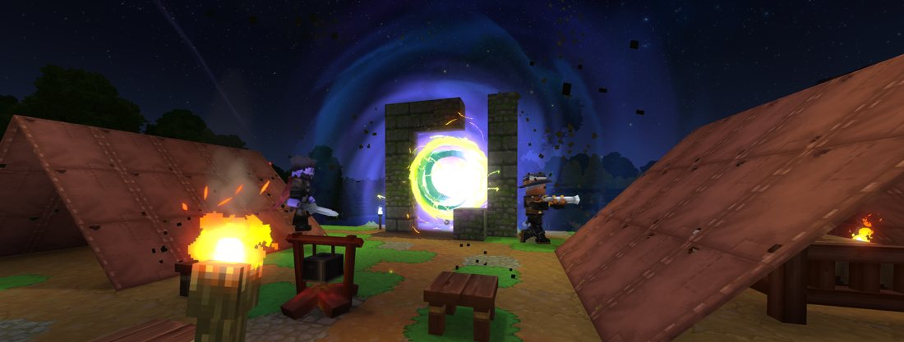
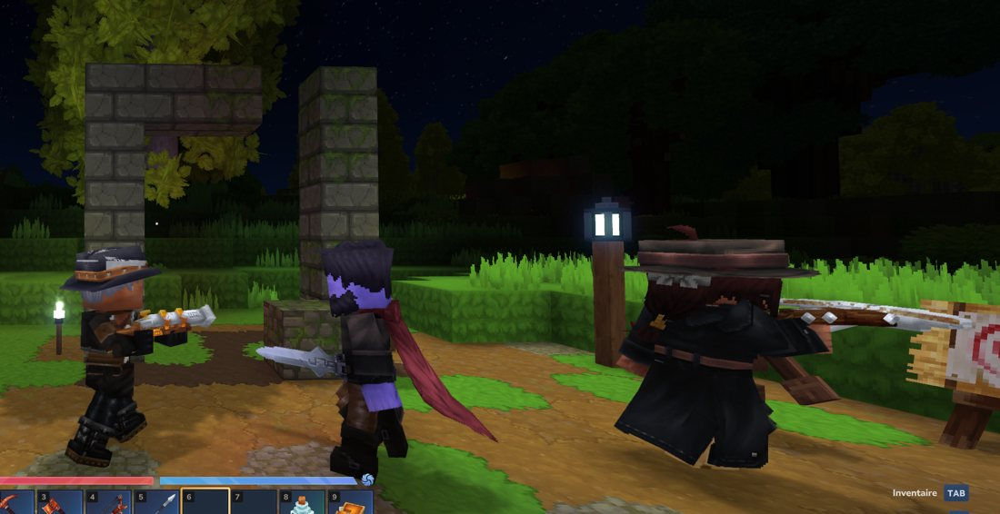

# Brèches des chasseurs

 

> Le voile se déchire... Une brèche va s'ouvrir dans la nuit, non loin d'ici.

La nuit, dans le **monde principal**, le voile se déchire parfois près des joueurs. Des **chasseurs de vampires** dressent aussitôt leur camp devant la faille. Celle-ci mène tout droit au [Comté Vampire](fragment/README.md) : c'est le moyen d'y entrer sans clé.

## Déroulement

| Étape | Durée | Ce que vous voyez |
|---|---|---|
| Attente | **30 min** | compte à rebours « prochaine dans » sur la carte |
| Tombée de la nuit | jusqu'à **19 h 12** | la carte indique « Attend la tombée de la nuit ». La brèche ne s'ouvre qu'entre 19 h 12 et 3 h 36. À la nuit, message : *« Le voile se déchire... Une brèche va s'ouvrir dans la nuit, non loin d'ici. »* |
| Avertissement | **1 min** | « S'ouvre dans \{temps\} » sur la carte |
| Recherche d'un lieu | jusqu'à 10 min | « Cherche un lieu sauvage près de vous ». Il faut qu'il fasse encore nuit ; sinon le cycle recommence. |
| **Ouverture** | **10 min** | titre à l'écran **« Brèche des chasseurs »** — *« Des chasseurs de vampires campent devant la brèche »* — et message : *« Une brèche s'est ouverte : des chasseurs de vampires y ont dressé leur camp. Elle est indiquée sur votre carte. »* |
| Fermeture | | le camp disparaît, le terrain est restauré, les chasseurs partent aussitôt ; le cycle reprend |

- **Une seule brèche à la fois**, et seulement dans le monde principal (jamais dans un fragment).
- Elle s'ouvre dans un **coin sauvage** à **48 à 160 blocs** d'un joueur, sur un terrain assez plat et dégagé.
- Elle est marquée sur la **carte** et la **boussole** (icône ci-dessus) sous le nom « Brèche des chasseurs ».

## Le campement

Une clairière de 8 blocs de rayon, avec au nord une **arche de pierre moussue brisée** dont l'ouverture abrite la **faille rouge** (3 × 4 blocs, lumière et éclairs rouges). Deux [torches de feu purificateur](objets/feu-purificateur.md) encadrent l'arche, trois lanternes purificatrices éclairent le camp : les morts-vivants n'y entrent pas.

| Plan | Contenu | Chasseurs |
|---|---|---|
| **Tentes** | deux tentes de cuir, établi d'armes, table et bougie, feu de camp et tabourets, caisses et tonneaux | **5** |
| **Champ de tir** | une tente, deux cibles, botte de foin, mannequin, râtelier, feu de camp, caisses | **4** |

Chaque chasseur est tiré au hasard : [chasseuse à l'arbalète](pnj/chasseuse-arbalete.md) 40 %, [chasseur au tromblon](pnj/chasseur-tromblon.md) 30 %, [chasseur à l'épée](pnj/chasseur-epee.md) 30 %. Ils sont **neutres** : ils ne ripostent que si vous les frappez. Aucun ne revient pendant la brèche s'il meurt.

## Traverser la faille

- **Marchez dans la faille** : vous êtes téléporté dans la [crypte d'arrivée](fragment/crypte-d-arrivee.md) du **Comté Vampire**.
- **Un seul Comté par brèche**, partagé par tous ceux qui la traversent : on peut y aller à plusieurs.
- Le Comté dure **30 minutes**, même si le camp se referme entre-temps.
- Le **portail de retour** de la crypte vous ramène **3 blocs devant l'arche**, côté camp (ou à l'endroit où était le camp).

> La faille est rouge depuis la dernière mise à jour ; les captures de cette page datent d'une version où elle était encore violette.

## Pour les administrateurs

- Le monde doit autoriser les **évènements de monde** et l'**apparition des PNJ**, sinon le camp reste vide ou la brèche ne démarre jamais.
- Tester tout de suite : `/time midnight` puis `/worldevent start asset Nakasar_Hunter_Breach_Test` (ouvre une brèche une fois, sans l'attente).
- `/worldevent list` affiche l'étape en cours ; `/worldevent cancel` arrête la brèche jusqu'au prochain démarrage du serveur.
