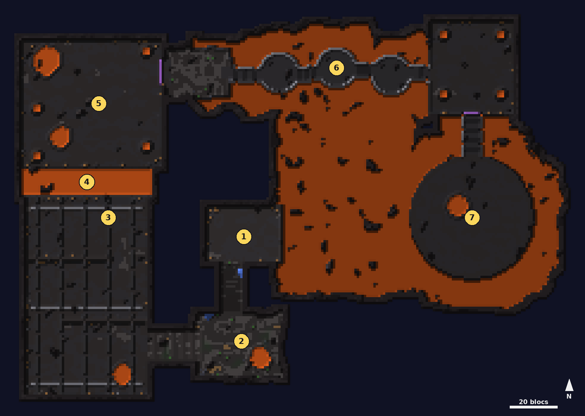

# Boss en fusion

<Infobox pending title="Boss en fusion" kind="Fractale" icon="/jeu/Icons/Items/Nakasar/Fractals/Core_MoltenBoss.png" caption="Noyau du Boss en fusion">
<Info label="Boss">Chaman de la flamme d'élite, Effigie en fusion, Berserker et Tempête de feu en fusion</Info>
<Info label="Alliés">Braham et Rox</Info>
<Info label="Lieu">caverne sous un volcan, gouffre et mer de lave</Info>
<Info label="Saison">2</Info>
</Infobox>

La fonderie de l'**Alliance en fusion**, creusée dans une immense caverne sous un volcan : draguerres et Légion de la Flamme y forgent des armes. Des stalactites pendent de la voûte, des cristaux bleus percent les parois et des chutes de lave tombent dans la mer de lave, tout au fond du gouffre. **Braham** et **Rox** vous attendent au camp, sur un surplomb ; il faut descendre jusqu'à la plate-forme du creuset, une trentaine de blocs plus bas, et éteindre la fonderie.

## Carte

*Carte du Boss en fusion, vue de dessus sous la voûte : du surplomb du camp au centre, la rampe descend à la grotte sud, puis une galerie descend à l'atelier à l'ouest. Le pont du canal de lave mène à la fonderie de l'Effigie au nord-ouest ; la grotte des wagonnets puis la passerelle des cuves, suspendue à des chaînes au-dessus du gouffre (en orange, la mer de lave), descendent par paliers vers la salle des chaudières au nord-est, et le pont du creuset descend à la plate-forme ronde à l'est, pendue au-dessus du vide. Les numéros suivent le déroulé ci-dessous.*

## La lave

Les bassins de lave, le creuset et le canal **brûlent** : 8 % des PV par seconde et **Brûlure** (2 % des PV par seconde tant qu'elle dure). Tombé dans le **canal** ou dans le **gouffre** (jusqu'à la mer de lave), on revient au dernier point de retour au bout d'une seconde et demie.

## Déroulé

### 1. Le camp

Braham et Rox, intouchables, attendent sur le surplomb, au bord du grand gouffre : on y voit la passerelle et la plate-forme du creuset, loin en contrebas. La rampe descend vers la grotte sud, puis une galerie vers l'atelier.

### 2. L'atelier

Quatre **meutes** se réveillent quand on approche à une trentaine de blocs (on peut en courir une pour aller à la suivante) :

- **Mineurs draguerres** : coups de pioche.
- **Draguerres soniques** : onde sonore devant eux, cône rouge de 60° sur 6 blocs, avec recul.
- **Guerriers de la Légion de la Flamme** : coups brûlants, et un **bond** sur le joueur le plus lointain (cercle rouge de 2,5 blocs).
- **Chamans de la Légion** : boule de feu, cercle rouge de 2,5 blocs sous leur cible (Brûlure).

### 3. Le gardien résonateur et le chaman de la flamme d'élite

La quatrième meute a un **gardien résonateur draguerre** (un gobelin gardien à la lueur d'ambre) : un rayon le relie au **chaman de la flamme d'élite**, qui reste **invulnérable** tant que le gardien vit (sa barre de vie le montre). Le gardien ne s'éloigne pas de son poste et frappe au marteau, ce qui repousse. Abattez-le d'abord. Le chaman fait pleuvoir des flammes (quatre cercles rouges autour de lui) et souffle une vague de feu devant lui (cône de 80° sur 8 blocs).

### 4. Le pont du canal de lave

La quatrième meute et son chaman vaincus, le **pont** se pose sur le canal de lave.

### 5. L'Effigie en fusion

Dans la fonderie, l'**Effigie en fusion** s'éveille avec son **Protecteur** et un **second gardien résonateur**, et des renforts accourent. Les protections vont en chaîne : le gardien rend le Protecteur invulnérable, le Protecteur rend l'Effigie invulnérable (barres de vie en mode invulnérable). Dans l'ordre : gardien, Protecteur, Effigie.

- **Coups** au contact et **souffle de flammes** devant elle (cône de 70° sur 10 blocs, Brûlure).
- Toutes les 12 s, elle **frappe le sol** : une onde de choc blanche s'élargit au sol (15 % des PV, recul). **Sautez-la**.
- Toutes les 15 s, une charge de **Puissance** (5 au plus, ▲ sur sa barre) : ses coups font 12 % de plus par charge. Ne traînez pas.
- Personne dans la fonderie : tout s'arrête et attend votre retour, avec les PV du moment (jamais de retour à neuf).

Vaincue, la porte est de la fonderie s'ouvre (point de retour).

### 6. La grotte des wagonnets et la passerelle des cuves

Quatre **groupes** : un dans la grotte, un sur chaque cuve de la passerelle. Suspendue à la voûte par des chaînes, elle descend par paliers au-dessus du gouffre : gare au recul des ondes soniques près du garde-corps. Les quatre vaincus, la barrière du **pont du creuset** s'ouvre (point de retour dans la salle des chaudières) et Braham et Rox vous y rejoignent.

### 7. Le Berserker et la Tempête de feu en fusion

Sur la plate-forme ronde du creuset, les deux chefs de la fonderie :

- Le **Berserker** enchaîne deux coups puis une **onde de choc** devant lui (ligne rouge de 16 × 3 blocs, recul). Toutes les 14 s, il **se téléporte** près d'un joueur. Toutes les 9 s, il **frappe le sol**, en alternance :
  - **onde blanche, au sol** : **sautez** par-dessus ;
  - **onde bleue, en l'air** (à hauteur de saut) : **restez au sol**.
- La **Tempête de feu** vole et lance des flammes : toutes les 7 s, un cercle rouge de 3 blocs sous deux joueurs (12 % des PV, Brûlure), puis un **brasier** qui brûle au sol pendant 8 s.
- Chaque fois que l'un perd un **quart** de sa vie, l'autre **enrage** 12 s : ses attaques reviennent plus vite.
- Le premier tombé, le survivant **absorbe sa flamme** et revient renforcé, avec la même part de vie (pas de soin) :
  - le **Berserker renforcé** fait tomber des **débris** toutes les 10 s (un cercle rouge de 2,5 blocs sous chaque joueur, 15 % des PV) ;
  - la **Tempête renforcée** lève toutes les 20 s une **couronne de vent brûlant** : des bandes rouges tout autour du bord de la plate-forme ; 2 s après, qui y est encore est brûlé et poussé vers le vide pendant 4 s. **Rentrez vers le centre**.
- Personne sur la plate-forme : les chefs attendent votre retour, avec leurs PV du moment.

Les deux vaincus, la fonderie s'éteint : le coffre de récompense et la pierre de sortie apparaissent sur la plate-forme.
