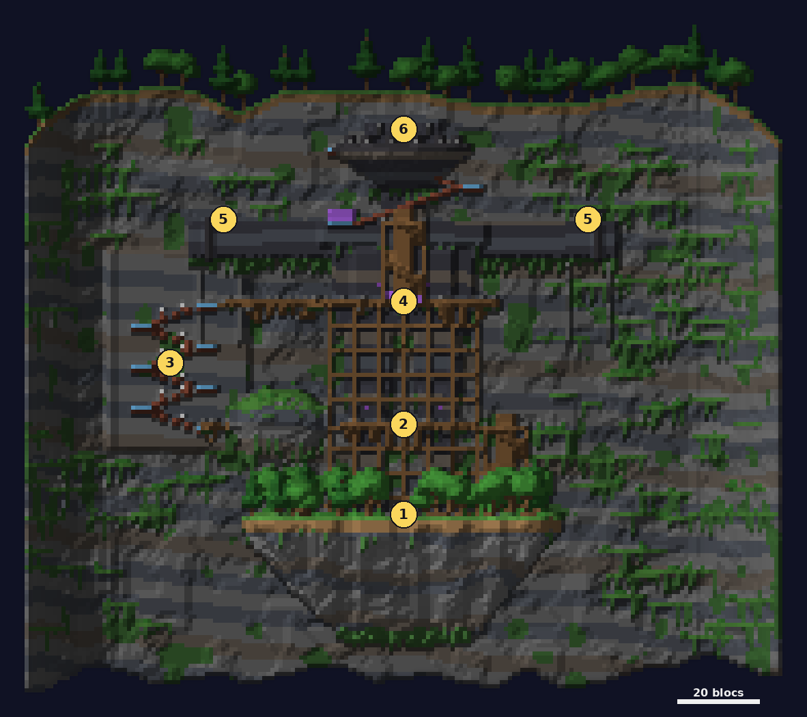

# Falaise

<Infobox pending title="Falaise" kind="Fractale" icon="/jeu/Icons/Items/Nakasar/Fractals/Core_Cliffside.png" caption="Noyau de la Falaise">
<Info label="Boss">l'Archidevin</Info>
<Info label="Objet porté">marteau du culte</Info>
<Info label="Puzzles de saut">tunnel, gargouilles, foyers, rampes</Info>
<Info label="Ciel">matinée claire (10 h 30)</Info>
</Infobox>

Un colosse de pierre est enchaîné à une falaise par un culte. Le groupe l'escalade par des échafaudages et brise ses **cinq sceaux** un par un avec le **marteau du culte**, avant d'affronter l'**Archidevin**.

## Carte

*La Falaise vue de face, depuis le sud : on grimpe le long du colosse enchaîné. Les numéros suivent le déroulé ci-dessous (5 : les deux poignets).*

## Déroulé

1. **Le camp** au pied du colosse : le Chercheur et une vague de cultistes. Le **râtelier** ne donne le marteau qu'une fois le camp nettoyé, et à un seul joueur à la fois.
2. **Les sceaux des genoux** (2 coups chargés chacun), par le **tunnel aux dalles piégées** (18 % des PV par dalle).
3. **L'escalade** sous le souffle des **gargouilles** ; trois **leviers** en haut les coupent.
4. **Le sceau de la poitrine** (3 coups), par la passerelle du torse et ses **foyers** (deux sur trois s'embrasent toutes les 7 s).
5. **Les sceaux des poignets** (3 coups chacun), par les **rampes aux bombes** (leviers R1 et R2). Une **bulle alternée** les protège : frapper l'un protège l'autre ; les incantateurs proches réparent un coup toutes les 20 s.
6. **L'Archidevin**, au sommet.

Chaque palier brisé ouvre une barrière de brume et déplace le point de retour. Tomber dans une zone de saut ramène à la dernière **plateforme sûre** ; tirer un levier fige 4 s.

## Le marteau du culte

- Le prendre coûte **10 % des PV**. Porté, il reste **en main** : impossible de changer d'objet tant qu'on ne l'a pas lâché.
- **Corruption** : en main, elle monte par crans de 10 s. Quand un cran se vide, il monte si le marteau est encore en main, sinon il redescend. Par cran, **+8 %** de dégâts subis ; dès le cran 2, vous ne faites plus que **70 %** de vos dégâts ; le cran 3 étourdit 2 s, et vouloir monter au-delà fait échapper le marteau (étourdi 3 s). Un marteau au sol ne se ramasse pas en passant dessus : accroupissez-vous tout près de lui.
- **Charge** : frappez un ennemi avec le marteau ; s'il meurt dans les 15 s (de n'importe quelle main), le marteau se charge. Un ennemi que vous n'avez pas frappé au marteau ne compte pas. Un coup **chargé** fissure un sceau.
- Au marteau, un coup retire **3 points** de défiance.

## L'Archidevin

Barre de boss et **barre de défiance** (◆◇), ouverte pendant ses attaques annoncées.

- **Transitions à 75, 50, 25 % et 1 PV** : il devient invulnérable tant que le **sceau du cou** n'a pas reçu un coup chargé ; des incantateurs arrivent pour recharger le marteau.
- **Entre 50 et 25 %** : protection, **cages** (un joueur désigné est jeté en cage 2,5 s plus tard, sans esquive ; vos alliés forcent la porte en 5 utilisations, ou vous sortez seul au bout de 15 s) et dévoreurs.
- **Sous 25 %** : hâte et frappes marquées.
- **Niveau 25** et plus : ruée ; **51** : mur anti-projectiles ; **71** : forme démoniaque.
