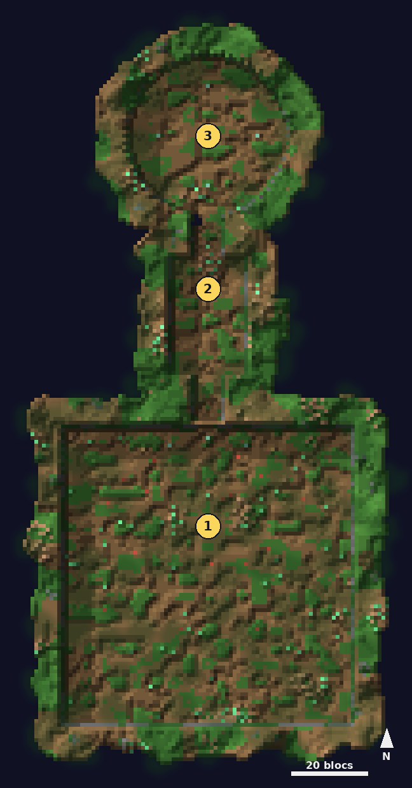

# Marais

<Infobox pending title="Marais" kind="Fractale" icon="/jeu/Icons/Items/Nakasar/Fractals/Core_Swampland.png" caption="Noyau du Marais">
<Info label="Boss">le Moussu, Carnasse</Info>
<Info label="Objet porté">feu-follet</Info>
<Info label="Ciel">brume, 15 h</Info>
</Infobox>

Une course chronométrée aux feux-follets à travers un marais piégé, une embuscade du **Moussu**, puis **Carnasse** dans une clairière où l'on se déplace de cercle vert en cercle vert.

## Carte

*Carte du Marais, vue de dessus, sans le feuillage : 1 la course aux feux-follets, 2 la salle de l'embuscade du Moussu, 3 la clairière de Carnasse.*

## La course aux feux-follets

Rapportez **trois feux-follets** dans leurs failles avant la fin du minuteur : **80 s**, **50 s** dès le niveau 26, **42 s** dès le niveau 51.

- Chaque feu-follet attend sur une **souche** : on repère de loin où le prendre.
- Des **murs de racines** de deux blocs surgissent au premier feu-follet pris : on ne peut pas sauter par-dessus, il faut les contourner.
- Pièges : **fils tendus** (estropié), **pièges à loup** (immobile), **plaques à piques**, **œufs d'araignée**.
- Deux **fusils revigorants** donnent la **rapidité**.
- Raté : tout s'éteint et les feux-follets changent de place.

## Le Moussu

Il surgit quand vous entrez dans la salle de l'embuscade, qui se referme derrière vous.

- Il appelle des **loups** (2, +1 pour deux joueurs, 6 au plus).
- **Furtivité** : il disparaît, puis surgit près d'un joueur avec une **ligne rouge** et sa **défiance ouverte**. Brisez la défiance pendant l'annonce : l'attaque tombe à l'eau et il est étourdi. Sinon, 35 % des PV.
- **Sous 50 %**, il prend sa **forme sauvage** (bonds et griffes) et ne se cache plus.

## Carnasse

Carnasse et ses esprits ne sont vulnérables que **dans le cercle vert** (bordé de lueurs vertes, des émanations vertes montent du sol), qui rétrécit de 7 à 3 blocs en 25 s puis saute à la faille suivante. Dans le cercle, l'endurance revient vite. Carnasse ne regagne jamais de vie.

- **Assauts à 75 et 50 %** : il se retire au centre, invulnérable (ses attaques en cours s'arrêtent net) ; abattez des **esprits animaux** spectraux, loups, renards et ours (4, +2 par joueur) dans le cercle, sous une pluie de poison. Ensuite poussent **3 fleurs de poison** (les ennemis proches d'une fleur ne prennent que 67 % des dégâts).
- **À 25 %** : il se charge **35 s** ; quatre feux-follets apparaissent aux coins. Les quatre failles allumées à temps : Carnasse étourdi 6 s. Sinon, **purge corporelle** (60 % des PV, mortelle dès le niveau 76). Dans les deux cas, ensuite, plus de cercle : il est **vulnérable dans toute la clairière**.
