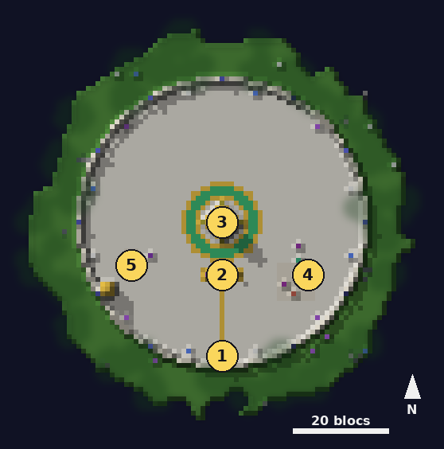

# Observatoire

<Infobox pending title="Observatoire des fractales" kind="Hub" icon="/jeu/Icons/Items/Nakasar/Fractals/Astrolabe_Ring.png" caption="Anneau de l'Astrolabe">
<Info label="Accès">Fragment des Brumes dans l'Ancienne passerelle, ou Portail des Brumes</Info>
<Info label="Groupe">5 joueurs au plus, sur le cercle</Info>
<Info label="Marchands">l'Archiviste et l'Alchimiste de Dessa (est)</Info>
<Info label="Commande">`/fractale`</Info>
</Infobox>

L'**Observatoire** est un petit archipel suspendu dans les Brumes, comme l'Observatoire des Brumes de *Guild Wars 2* : un plateau de roche moussue au centre, l'île asura de l'Archiviste à l'est et l'île du golem d'essai à l'ouest, reliées par des ponts de roche, sous un ciel doré où flottent des ruines gothiques et des aiguilles de pierre. Tout s'y choisit dans le décor : pas de menu à ouvrir.

On arrive devant la grande **porte asura**, au sud : traverser son voile violet ramène chez soi (pas dans les 15 premières secondes). Au centre, l'Astrolabe se dresse dans un bassin où tombent des cascades de lumière.

## Carte

*Carte de l'Observatoire, vue de dessus : 1 point d'arrivée devant la porte asura (retour chez soi), 2 distributeurs de noyaux et de diapasons, 3 Astrolabe et console de sélection au centre du cercle d'harmonisation, 4 île asura de l'Archiviste et de l'Alchimiste de Dessa, 5 île du golem d'essai.*

## Fragment des Brumes {#fragment-des-brumes}

Le **Fragment des Brumes** se fabrique à l'**établi** : **4 éclats de rune + 1 cœur du Vide** (celui des Deepworks). Posé dans l'**Ancienne passerelle**, il ouvre l'Observatoire et il est consommé. Au **Creuset des Brumes**, **25 éclats de Brume + 1 éclat de rune** en refont un sans repasser par les Deepworks ; l'Archiviste en vend aussi.

## Portail des Brumes {#portail-des-brumes}

Le **Portail des Brumes** est une arche de pierre de 3 blocs de large et 4 de haut, à poser chez soi. Il se fabrique au **Creuset des Brumes** (onglet Fragments) : **4 Fragments des Brumes + 50 éclats de Brume + 1 cœur du Gobliterator** (le boss des Deepworks). Il est **toujours ouvert** : le traverser mène à l'Observatoire sans consommer de fragment. Tous ceux qui passent par le même portail arrivent dans le même Observatoire tant qu'il reste ouvert ; vide, il se referme et le portail en ouvre un nouveau au passage suivant. En sortant, on revient devant l'arche. Il se casse et se reprend pour le déplacer.

## Choisir et lancer une fractale

1. À l'entrée du cercle, deux **distributeurs** gratuits : celui des **noyaux** (une fractale chacun) et celui des **diapasons** (un niveau de 1 à 100).
2. Posez un noyau et un diapason dans la **console de sélection**, sur le socle de l'Astrolabe. La console est partagée par tout l'Observatoire. Elle se vide au lancement de la fractale, et les noyaux et diapasons de votre inventaire disparaissent quand vous quittez l'Observatoire : reprenez-en aux distributeurs à chaque partie. Le cercle est **harmonisé** : la fractale, le niveau et le rang s'affichent à l'écran.
3. Montez sur le **cercle d'harmonisation** : les joueurs qui s'y tiennent forment le groupe (5 au plus). Le **meneur** est le premier arrivé dans l'Observatoire ; il part toujours avec le groupe.
4. Le meneur utilise un des 4 **résonateurs** au bord intérieur du cercle : tout le cercle part dans une instance de la fractale, à lui seul. Le niveau ne peut pas dépasser le plus haut niveau débloqué par le meneur.

## L'île de l'Archiviste (est)

- **L'Archiviste** et son **comptoir** : troc d'[éclats de Brume](progression.md#eclats-de-brume) contre infusions, Fragments des Brumes et [cosmétiques de saison](cosmetiques.md).
- **L'Alchimiste de Dessa**, au nord, devant ses fioles : il vend les [potions des Brumes](potions.md), des potions de soin, d'endurance et de mana et de la salade César contre des éclats de Brume.
- **Autel des infusions** : vos 12 emplacements d'[infusion](progression.md#agonie-et-infusions).
- **Creuset des Brumes** : fusion des infusions et nouveau Fragment.
- **Tableau des fractales du jour** : les trois [fractales du jour](progression.md#fractales-du-jour), cochées si vous avez déjà pris leur coffre aujourd'hui.
- **Registre des fractales** : le mode d'emploi de l'Observatoire.

## Golem d'essai (île de l'ouest)

Un mannequin qui encaisse tout, annonce les dégâts reçus et reprend ses PV. Son **pupitre** lui fait rejouer sur vous les zones rouges des fractales (cercle, cône, ligne, puis une cage) ; le premier cercle pose de l'**agonie** au niveau harmonisé, pour tester votre résistance.

## Commande `/fractale`

| Commande | Effet |
|---|---|
| `/fractale niveau <n>` | règle le niveau (meneur, dans l'Observatoire) |
| `/fractale groupe` | le cercle, le niveau et le meneur |
| `/fractale lancer <fractale>` | envoie le cercle (meneur) |
| `/fractale quitter` | quitte la fractale pour l'Observatoire |
| `/fractale infos` | votre niveau débloqué et votre résistance à l'agonie |
| `/fractale instabilites` | les [instabilités](instabilites.md) de la partie ou du jour |
| `/fractale jour` | les [fractales du jour](progression.md#fractales-du-jour) |
