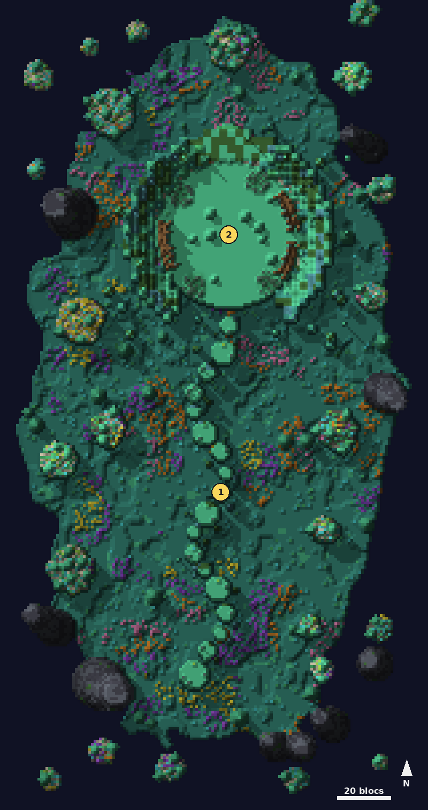

# Océan solide

<Infobox pending title="Océan solide" kind="Fractale" icon="/jeu/Icons/Items/Nakasar/Fractals/Core_SolidOcean.png" caption="Noyau de l'Océan solide">
<Info label="Boss">l'Abîme de Jade</Info>
<Info label="Puzzle de saut">fragments de jade</Info>
<Info label="Ciel">nuit</Info>
</Infobox>

Une traversée de fragments de jade flottants mène à l'**Abîme de Jade**, un monstre invulnérable qu'on ne blesse qu'en lui renvoyant son propre rayon avec des cristaux.

## Carte

*Carte de l'Océan solide, vue de dessus : 1 les fragments de jade, 2 l'arène de l'Abîme de Jade.*

## Déroulé

1. **Les fragments de jade** à sauter au-dessus de l'océan ; une chute ramène au fragment d'avant. De nuit, des **irukandjis** gardent le chemin (600 PV) : leur **décharge** (cercle de 3,5 blocs) jette dans le vide, leur **filament** marque un joueur puis l'attire contre eux, au-dessus du vide s'ils flottent entre deux fragments. Abattez-les ou passez hors de leur portée (12 blocs).
2. **L'Abîme de Jade**, immobile au milieu de l'arène.

## L'Abîme de Jade

**Le cristal réfléchissant** tombe des colosses et des tentacules (sauf les deux premiers). Il ne se ramasse pas en passant dessus : **accroupissez-vous** tout près. Il se met aussitôt dans la barre d'inventaire, sélectionné, et se tient **à deux mains** ; tant que vous le portez, impossible de changer d'objet. **Un seul** cristal par joueur. Clic droit vers l'Abîme : le **lancer**.

**Le rayon** : l'Abîme **vise un joueur** : une tête de mort rouge apparaît dans sa barre d'état, il luit d'orange et un crâne flotte au-dessus de lui. Un message au centre de son écran le prévient. Au bout de **6 s**, le rayon le frappe, où qu'il soit : sans cristal en main, il est **tué** ; avec un cristal, celui-ci est **chargé**. Lancé chargé sur l'Abîme : **−5 %** de sa vie (−3 % par tentacule abattu). Il n'y a pas de zone au sol : seul le joueur visé est concerné.

La barre de vie de l'Abîme se voit de toute la plateforme finale.

- **Phase 1** : deux **tentacules** devant l'Abîme (900 PV). Tant qu'ils vivent, l'Abîme n'attaque pas et aucun colosse ne sort. Dès le niveau 26, un test d'agonie.
- **Phase 2** : quatre **tentacules** percent le jade un peu partout dans l'arène (ils ne repoussent pas et lâchent chacun un cristal), avec un **cristal** posé près de chacun à leur apparition, et l'Abîme vise aussitôt un joueur, puis toutes les **15 s**. Un **colosse de jade** sort toutes les **15 s** (**10** en tout, 3 en vie au plus). Insensible aux attaques à distance, le colosse (300 PV) se bat au contact, sans attaque circulaire, et lâche un cristal.
- **Phase 3**, quand le 10e colosse est tombé : les tentacules restants replongent et six autres sortent, répartis sur toute l'arène ; chacun **repousse 30 s** après sa mort et lâche un cristal. L'Abîme vise toutes les **15 s**. **Sous 8 %**, un dernier rayon vise tout le monde : tenez un cristal.
