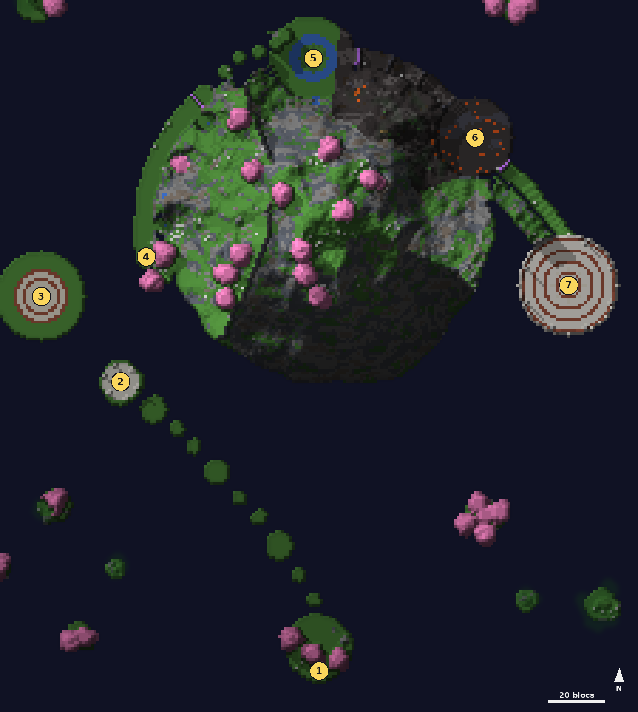

# Pic de Sunqua

<Infobox pending title="Pic de Sunqua" kind="Fractale" icon="/jeu/Icons/Items/Nakasar/Fractals/Core_SunquaPeak.png" caption="Noyau du Pic de Sunqua">
<Info label="Boss">Voix de la montagne, Fureur de la montagne, Ai gardienne du pic (Ai assombrie au rang Maître)</Info>
<Info label="Règle">Bond chargé</Info>
<Info label="Objets">orbes de foudre</Info>
<Info label="Ciel">mer de nuages, plein jour</Info>
<Info label="Saison">2</Info>
</Infobox>

Un massif flottant au milieu d'une mer de nuages : cerisiers roses, bambous, cascades, un cratère de lave et, tout en haut, une arène de marbre. **Ai**, la gardienne du pic, y a laissé ses émotions : sa voix, sa tristesse, sa fureur. L'**Esprit de la montagne** vous accueille sur l'îlot de départ ; il faut monter jusqu'à Ai.

## Carte

*Carte du Pic de Sunqua, vue de dessus : de l'îlot de départ au sud, l'escalier brisé monte au socle, puis les colonnes de vent mènent au plateau de la Voix à l'ouest et à la corniche des cascades. La Tristesse est au nord, la Fureur dans le cratère au nord-est, Ai dans l'arène à l'est. Les numéros suivent le déroulé ci-dessous.*

## Le Bond chargé

Les **orbes de foudre** (petits cristaux bleus) se prennent en passant dessus : chacune donne une charge de **Bond chargé**, trois au plus, et rafraîchit les autres pour 20 s. L'orbe revient 8 s plus tard. Sauter ne consomme rien.

- Une charge : on saute environ deux fois plus haut ; deux : trois fois ; trois : plus de quatre fois.
- Sous Bond chargé (et 3 s après), **la chute ne blesse pas**.
- Il en faut deux pour l'escalier brisé et pour disperser les nuages d'orage.

## Déroulé

### 1. L'îlot de départ

L'Esprit de la montagne et trois orbes de foudre. Une chute, où que ce soit, ramène au dernier point de retour.

### 2. L'escalier brisé

Neuf îlots qui montent vers le socle : on ne passe de l'un à l'autre qu'avec le Bond chargé. Trois **élémentaires d'air** (décharge, tourbillon) gardent les îlots ; l'orbe de foudre de leur îlot s'allume quand ils tombent. Les trois vaincus, un joueur sur le **socle** le réveille : l'escalier se reforme derrière vous (point de retour) et une **colonne de vent** se lève : avancez dedans, elle vous porte jusqu'au plateau.

### 3. La Voix de la montagne

Sur un plateau de pierre rond au-dessus des nuages (point de retour), quatre orbes de foudre aux bords :

- **Ondes d'orbes**, **décharge** et **coup de foudre**.
- À **66 et 33 %**, elle se retire dans une **tornade** au centre : on ne peut plus la blesser. Quatre **nuages d'orage** flottent à 5 blocs du sol : sautez dedans sous Bond chargé (deux charges) pour les disperser. Tant qu'il en reste, la **foudre** tombe toutes les 3 s : un cercle rouge de 2,5 blocs sous un joueur (12 % des PV, Hébété). Les quatre dispersés, elle redevient vulnérable.
- Personne sur le plateau pendant 20 s : elle se tait et revient neuve.

Vaincue, une seconde colonne de vent mène à la corniche des cascades.

### 4. La corniche des cascades

Un chemin au flanc ouest du massif (point de retour), le long des chutes d'eau :

- Toutes les 9 s, les **cascades déferlent** : une bande rouge de 11 × 4 blocs au pied de chaque chute (2 s). Qui y est encore perd 8 % de ses PV, tombe **à terre** et est jeté vers le vide.
- Trois **élémentaires d'eau effrayés** se cachent dans des niches : restez **accroupi** à moins de 3 blocs pendant 3 s pour les rassurer. Au premier qui s'y essaie, deux **esprits de l'eau enragés** surgissent.
- Les trois rassurés, la barrière s'ouvre : les **rochers flottants** mènent au surplomb de la terrasse. On saute : la chute dans la terrasse ne blesse pas.

### 5. La Tristesse de la montagne

Sur la terrasse autour du bassin (point de retour), la **Tristesse** est prisonnière de cinq **rochers tombés** : brisez-les.

- L'**orbe sombre** au-dessus du bassin relie par un rayon le joueur le plus proche : chaque seconde, il prend une charge de **Marché des marées** (4 % plus lent, mais **5 % de dégâts en plus** par charge). À **10 charges**, la marée le submerge : la moitié de ses PV, et 20 % à qui est à moins de 4 blocs.
- Un autre joueur **prend le lien** en se plaçant dans le rayon ; celui qui vient de le passer ne peut pas le reprendre pendant 6 s. Les charges retombent 12 s après la dernière.
- Toutes les 10 s, des **éclats d'eau** : un cercle rouge de 2,5 blocs sous chaque joueur (10 % des PV).
- Personne sur la terrasse pendant 20 s : les rochers retombent, neufs.

Les rochers brisés, la Tristesse est libre et le sentier de lave s'ouvre.

### 6. Le sentier de lave et la Fureur de la montagne

Trois **murs de roche** barrent le sentier ; approchez-en un et ses trois **élémentaires de lave** se réveillent. Un élémentaire qui meurt **explose** (cercle rouge de 3 blocs, 12 % des PV et **Brûlure**, qui ronge 2 % des PV par seconde) et se divise en deux petits élémentaires qui explosent à leur tour (2 blocs). Gardes vaincus, le mur s'effondre (point de retour). Deux **tigres** rôdent avant le dernier mur.

Dans le cratère, la **Fureur de la montagne** :

- **Coups brûlants** (Brûlure), **bond** et **ruée**.
- Toutes les 24 s, des **météores** : un cercle rouge de 4 blocs sous chaque joueur (15 % des PV, à terre). Chaque météore reste là : c'est un **abri**. Quelques secondes plus tard, la **frappe extrême** : un cercle rouge sur tout le cratère ; qui voit la Fureur perd **60 %** de ses PV. Caché derrière un météore, rien. Les météores s'effritent ensuite.
- À **66 et 33 %**, elle se **divise** : protégée et immobile tant que trois petits élémentaires de lave vivent.
- Sous **66 %** : une **onde de choc** toutes les 16 s, un anneau qui s'élargit au sol (12 % des PV, à terre) : **sautez-la**. Et sa **défiance** s'ouvre 8 s toutes les 26 s : brisée, elle est étourdie ; sinon un **brasier** frappe tout le cratère (40 % des PV, Brûlure).
- Sous **33 %** : toutes les 25 s, deux joueurs sont **suivis par un météore** pendant 10 s. Croisez-les (moins de 4 blocs l'un de l'autre) : ils se brisent l'un l'autre. Sinon ils éclatent (cercle rouge de 4 blocs, 35 % des PV). Seul, le vôtre éclate toujours : éloignez-vous de lui.
- Personne dans le cratère pendant 20 s : elle y retourne et revient neuve.

### 7. Ai, gardienne du pic

La montée de bambous mène à l'arène de marbre du sommet (point de retour). Ai frappe du bâton et lance des **rafales**, et change d'élément selon sa vie :

- **Air (100 à 66 %)**
  - **Ondes d'orbes** toutes les 24 s : elle file au bord de l'arène et lance trois vagues de deux bandes rouges de 36 × 4 blocs en travers de l'arène (20 % des PV, à terre). Sa **défiance** est ouverte : brisée, elle vacille et les vagues cessent.
  - **Bombes d'orage** toutes les 18 s : un cercle rouge de 3 blocs se pose sur chaque joueur. Son propre cercle coûte 20 % des PV, celui d'un autre 40 % : écartez-vous.
  - **Balayage** toutes les 14 s : un cône rouge de 120° sur 12 blocs vers le joueur le plus proche (25 % des PV, à terre).
- **Front d'orage (66 %)** : protégée au centre, elle appelle quatre nuages d'orage ; quatre orbes de foudre s'allument au bord. Dispersez les nuages comme pour la Voix.
- **Feu (66 à 33 %)** : météores et frappe extrême comme la Fureur, toutes les 22 s, et le balayage.
- **Pluie de météores (33 %)** : protégée 15 s, des météores tombent sans arrêt (cercles rouges de 4 blocs).
- **Eau (33 à 0 %)** : le **Marché des marées** revient, le rayon part d'Ai elle-même ; et toutes les 16 s, une **marée partagée** : un cercle rouge de 3 blocs sur un joueur ; ses dégâts (90 % des PV) se partagent entre tous ceux qui s'y tiennent. Regroupez-vous dedans.
- **Rang Maître** : Ai vaincue s'**assombrit** (Ai assombrie, vague d'ombre). Toutes les 20 s, une **crainte** apparaît près de chaque joueur et le suit : tuez-la avant 15 s, sinon elle éclate (cercle rouge de 4 blocs, 40 % des PV).
- Personne sur l'arène pendant 20 s : elle se retire et revient neuve (depuis le début).

Ai apaisée, le coffre et la pierre de sortie apparaissent au centre de l'arène.

## Comment c'est fait

Comme dans GW2, aucun boss ne se soigne : une remise à zéro le retire, il revient neuf au prochain venu. Les zones rouges ont exactement la taille de l'effet. Le Bond chargé change la force de saut du joueur côté serveur ; elle revient à la normale à la fin des charges et en quittant la fractale.
