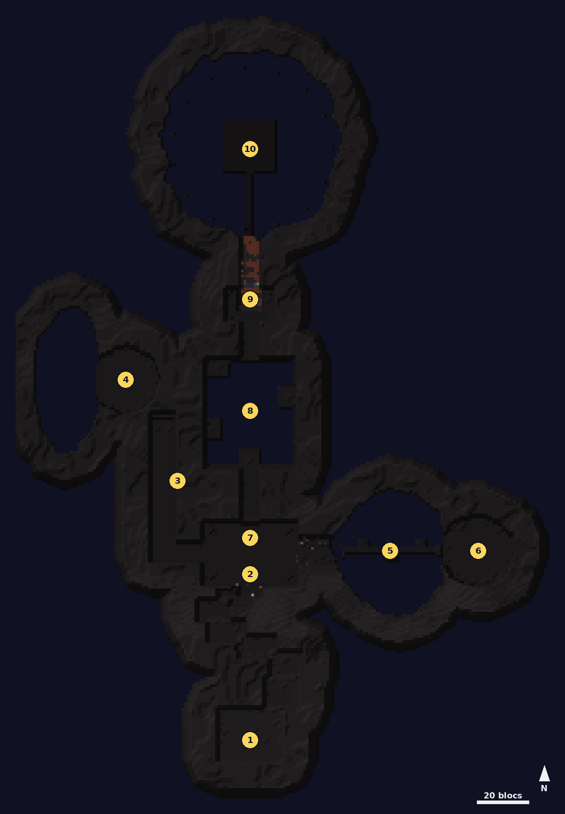

# Pierre-Profonde

<Infobox pending title="Pierre-Profonde" kind="Fractale" icon="/jeu/Icons/Items/Nakasar/Fractals/Core_Deepstone.png" caption="Noyau de Pierre-Profonde">
<Info label="Boss">Sentinelle de Pierre-Profonde, Reine de la couvée, Esprit du Minotaure des ombres, la Voix</Info>
<Info label="Règle">Lumière de Deldrimor</Info>
<Info label="Objets">orbes de lumière, Lumière de Deldrimor</Info>
<Info label="Ciel">neige au sommet, ombre dans le caveau</Info>
<Info label="Saison">2</Info>
</Infobox>

Le caveau englouti des nains de Deldrimor, sous une montagne enneigée. Le nain **Torin** et l'asura **Kay** vous accompagnent : il faut rallumer le **Cristal de Deldrimor** avec les deux orbes de lumière gardées à l'ouest et à l'est, puis descendre, à la lumière retrouvée, jusqu'à la **Voix** qui murmure dans les profondeurs.

## Carte

*Carte de Pierre-Profonde, vue de dessus : on descend la montagne au sud jusqu'à la salle du cristal, on va chercher une orbe à l'ouest et une à l'est, puis on part vers le nord et vers le bas. Les numéros suivent le déroulé ci-dessous.*

## La Lumière de Deldrimor

Quand les deux orbes sont au cristal, chaque joueur reçoit la **Lumière de Deldrimor** (elle revient si on la perd et disparaît quand on quitte la fractale).

- **Clic droit** : un éclat de lumière de 6 blocs autour de vous, 5 s de recharge.
- Elle **dévoile le Minotaure**, **révèle le chemin du gouffre** et allume ses orbes, **refait les dalles** de l'arène de la Voix, et révèle les **dix trésors cachés** des nains un peu partout dans le caveau (un scintillement discret les trahit quand on passe près ; chacun laisse deux objets au sol).

## Les runes

Plusieurs passages s'ouvrent avec **deux runes** à presser **ensemble** : deux joueurs, un sur chaque rune, en même temps (3 s de marge entre les deux). Seul, un joueur ne peut pas les ouvrir.

## Déroulé

### 1. La descente

On arrive au sommet d'une montagne enneigée et l'on descend de corniche en corniche jusqu'à la porte du caveau. Des **chauves-souris des cavernes** nichent sur le chemin.

### 2. La salle du cristal

Torin et Kay vous attendent devant le **Cristal de Deldrimor**, éteint (point de retour). La porte nord est fermée. Il faut l'orbe de l'ouest et celle de l'est.

### 3. La grille de runes (ouest)

Le couloir de l'ouest est une grille de dalles : des rangées **rouges** glissent du nord vers le sud, une rangée toutes les 0,6 s, et chaque vague laisse une ou deux colonnes éteintes où passer. La zone rouge est exactement la dalle : qui marche sur une dalle rouge perd 15 % de ses PV, prend l'agonie 3 s et est repoussé vers le sud. Au bout, les **deux runes** éteignent la grille et ouvrent la barrière de brume de la corniche.

### 4. La Sentinelle de Pierre-Profonde

Sur une corniche ouverte au vide à l'ouest :

- **Souffle glacé** et **coup de vent**.
- Toutes les 18 s, une **spirale de vent** : douze cercles rouges de 2,5 blocs qui partent d'elle en tournant, l'un après l'autre (12 % des PV et Hébété). Tout contre elle, on ne risque rien.
- À **80, 50 et 20 %** (et aussi 65 et 35 % à partir du rang Expert), des **esprits du vent** : un cercle rouge sous un joueur ; qui y est encore est **Emporté** (ni mouvement ni action) et l'esprit file vers le bord ouest. Tuez-le ou brisez sa **défiance** avant qu'il n'arrive : sinon il jette sa prise dans le vide (retour au point de retour).
- Personne sur la corniche pendant 20 s : elle se fond dans le vent et revient neuve.

Vaincue, elle laisse l'**orbe de lumière** : l'utiliser vous ramène à la salle du cristal, orbe en main.

### 5. Le pont du vent (est)

Le couloir de l'est est plein de toiles et de **nids d'araignées** : tant qu'un joueur est près, un nid pond une araignée toutes les 7 s (trois au plus). Cassez les nids. Puis le **pont** étroit au-dessus du gouffre : toutes les 6,5 s, des **bandes rouges** de vent le traversent (2 s) ; qui y est encore est jeté dans le vide et revient au début du pont (8 % des PV). Les **deux runes** du milieu du pont arrêtent le vent et ouvrent la barrière du bout.

### 6. La Reine de la couvée

Dans l'antre, deux **mères de couvée** d'abord, puis la **Reine de la couvée** :

- **Dard**, **charge** et **toile** ; ses coups en cône donnent le **Venin de la couvée** (la vie s'en va pendant 5 s).
- Toutes les 20 s, des araignées.
- À **50 %**, elle se protège 5 s (invulnérable) et appelle diablotins et araignées.
- Personne dans l'antre pendant 25 s : la couvée se retire et revient neuve.

Vaincue, elle laisse la seconde **orbe de lumière**.

### 7. L'Esprit du Minotaure des ombres

Les deux orbes au cristal (utilisez-le, orbe en main), la Lumière de Deldrimor est à vous et le **Minotaure des ombres** surgit dans la salle :

- **Coup de cornes**, **balayage** et **bond**.
- Voilé d'ombre, il ne prend **aucun dégât**. La Lumière de Deldrimor à moins de 10 blocs le **dévoile 8 s** (Exposé à la Lumière : il prend plus de dégâts et ralentit).
- Voilé, sa fumée (4 blocs autour de lui) ralentit et ronge (2 % des PV par seconde).
- À **75, 50 et 25 %**, des **diablotins des ombres** ; à 50 %, un **écharpeur**.
- Lui et ses ombres vaincus, la porte nord s'ouvre.

### 8. Le gouffre invisible

Une salle sans sol, au-dessus du vide, avec quatre **orbes éteintes**. Le chemin de dalles existe, mais on ne le voit pas : il change à chaque partie.

- Libérez la Lumière près de la dernière dalle posée : les **trois suivantes** apparaissent.
- Une orbe atteinte s'**allume** à la Lumière : elle devient le point de retour, et une chute ramène à elle (10 % des PV).
- Dès la deuxième orbe, des **ombres** rôdent et des **flammes spectrales** flottent au-dessus du chemin : après 3 s, la dalle sous une flamme **rougit** (la zone rouge est la dalle même) et tombe 4 s plus tard, sauf si la Lumière la sauve.
- Les quatre orbes allumées, le chemin de la sortie se pose.

### 9. L'ascenseur

Tout le groupe vivant sur la plate-forme pendant 3 s : elle descend. À mi-chemin, elle s'arrête : une vague de **diablotins des ombres**, puis une seconde avec un **écharpeur** et un **suceur de sang**. Vidée, elle reprend jusqu'en bas (point de retour). Un retardataire utilise la **rune de l'ascenseur** pour rejoindre la plate-forme.

### 10. La Voix

Torin consumé par les ombres, sur une arène de dalles au-dessus d'un gouffre :

- **Coup d'ombre**, **vague d'ombre** et **secousses**.
- **Les dalles** : une chute est rattrapée par un **Courant ascendant** (au plus 4, 3, 2 ou 1 selon le rang) ; sans courant, on tombe pour de bon. La Lumière de Deldrimor **refait les dalles** à moins de 4,5 blocs et rend un courant.
- Toutes les 7 s, une **orbe** sur un joueur (cercle rouge de 2,5 blocs) qui brise la dalle touchée et rebondit 1 à 3 fois selon le rang.
- Sous 75 %, toutes les 15 s, une **bombe d'ombre** suit un joueur 2 s puis tombe : cercle rouge de 3,5 blocs (2 s), 30 % des PV, Hébété, dalles brisées ; qui est touché en reçoit aussitôt une autre (trois au plus).
- À **80 et 40 %**, le **siphon spirituel** : sa défiance s'ouvre 13 s et chaque seconde elle prend 4 % des PV de chacun, la dalle d'un siphonné s'effrite. Brisée, la Voix est étourdie.
- À **70, 50 et 30 %**, des **ombres** qui effritent les dalles.
- À **60 et 20 %**, elle se retire au centre, invulnérable : dix **flammes spectrales** filent vers elle. Chaque flamme qui l'atteint déclenche une **déflagration** sur toute l'arène (cercle rouge de 26 blocs, 25 % des PV) : tuez-les en route. Les dix passées, elle redevient vulnérable.
- Personne sur l'arène pendant 30 s : elle se retire et revient neuve.

La Voix vaincue, le coffre et la pierre de sortie apparaissent au centre de l'arène.

## Comment c'est fait

Comme dans GW2, aucun boss ne se soigne : une remise à zéro le retire, il revient neuf au prochain venu. Les zones rouges ont exactement la taille de l'effet.
