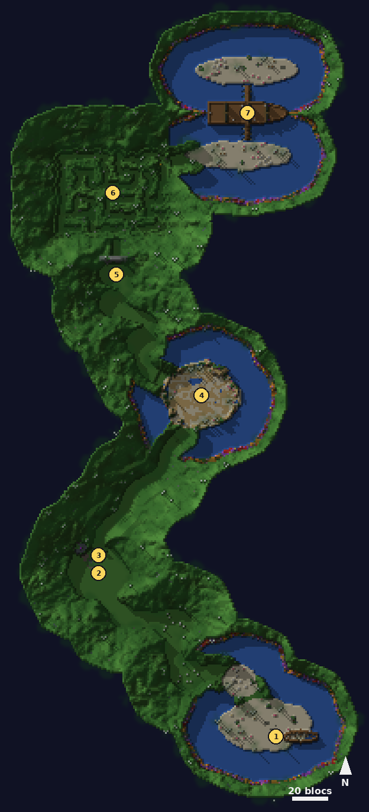

# Récif de la Sirène

<Infobox pending title="Récif de la Sirène" kind="Fractale" icon="/jeu/Icons/Items/Nakasar/Fractals/Core_SirensReef.png" caption="Noyau du Récif de la Sirène">
<Info label="Boss">Tête-de-pierre, Black Peter la Mèche, Mad Jack Squall, le second Calix, Arabella Crowe</Info>
<Info label="Règle">trésors maudits, canon des ombres</Info>
<Info label="Objets">trésor maudit, boulets du canon</Info>
<Info label="Ciel">plein soleil des tropiques</Info>
<Info label="Saison">2</Info>
</Infobox>

L'île du trésor maudit de la capitaine **Arabella Crowe**. Le capitaine **Strohm** et son mousse **Weyandt** vous déposent sur la plage du naufrage : il faut traverser le rivage des sauriens, le ravin miné, le fort englouti de Black Peter et le labyrinthe des trésors, jusqu'à la crique où mouille le **Fierté du Kraken**, le navire fantôme d'Arabella.

## Carte

*Carte du Récif de la Sirène, vue de dessus : on part de la plage au sud-est et on remonte l'île vers le nord jusqu'au navire. Les numéros suivent le déroulé ci-dessous.*

## Le canon des ombres

Trois **canons des ombres** se trouvent sur l'île : sur la corniche au-dessus du ravin, sur le rempart du fort, et quatre sur le pont du navire.

- **Utilisez** le canon pour vous y poster : les trois boulets arrivent dans votre inventaire. Réutilisez-le, ou éloignez-vous de plus de 3,5 blocs, pour le quitter (les boulets disparaissent).
- **Clic droit** avec un boulet : le canon tire là où vous regardez, jusqu'à 70 blocs.
  - **Boulet ricochet** (4 s de recharge) : trois impacts de 2,5 blocs qui rebondissent dans l'axe du tir.
  - **Mitraille** (8 s) : un impact de 4 blocs, gros dégâts, étourdit les ennemis.
  - **Boulet de glace** (15 s) : un impact de 5 blocs qui gèle les ennemis 4 s.
- Tout impact fait **sauter les mines** (sans blesser personne), abat la **palissade** du bout du ravin et entame la **défiance** des boss. Les boulets ne blessent jamais les joueurs.

## Les mines

Les mines (bombes au sol) sautent quand on s'en approche à moins de 1,6 bloc : la mèche s'allume et un **cercle rouge** de 2,5 blocs, la taille exacte du souffle, se remplit en 1,2 s. Qui est encore dedans perd 15 % de ses PV et est projeté. Celles du ravin reviennent 30 s après avoir sauté : le canon les fait sauter de loin.

## Les trésors maudits

- Un trésor au sol se ramasse **accroupi** et reste en main ; un seul à la fois. Le saisir au sol coûte 5 % des PV.
- Tant qu'on le porte, la **malédiction** monte : **Malédiction I** (6 s, ralenti), **II** (12 s, la vie s'en va), **III** (18 s) : vous êtes figé et le trésor tombe. Sans trésor, elle retombe deux fois plus vite.
- **Clic droit** : le trésor est lancé au joueur que vous visez (16 blocs, dans un cône devant vous) s'il n'en porte pas déjà un ; sinon il tombe 3 blocs devant. Le lanceur reçoit l'**Allègement de la malédiction** (8 s : elle ne monte plus).
- Porté à moins de 3 blocs du **coffre de la sirène**, il y est déposé.
- Un **escroc fantôme** qui passe près d'un trésor au sol le rapporte à une cachette.
- Le trésor disparaît quand vous quittez la fractale.

## Déroulé

### 1. La plage du naufrage

Strohm et Weyandt vous attendent près de l'épave. Le long du rivage, trois **camps de sauriens vétérans** : **hérissés** (langue et coup de tête), **brise-os** (morsure, coup de queue en cône rouge) et **écaille-fumée** (fumerolles en cercle rouge). Des **raptors de poche** rôdent entre les camps.

### 2. Tête-de-pierre

Entrer dans la clairière réveille **Tête-de-pierre**, le champion des raptors (le point de retour passe à la clairière) :

- **Charge** : une ligne rouge de 14 x 3 blocs, puis il fonce ; contre une falaise ou un rocher, il reste étourdi.
- **Piétinement** : un cercle rouge de 5 blocs autour de lui.
- À **75 et 50 %**, il appelle une meute de quatre raptors.
- À **25 %**, il rugit (cercle rouge de 8 blocs : **Peur** et recul), brise les rochers qui ferment le **ravin** et s'enfuit : il saute sur la première mine.

### 3. Le ravin miné

Le ravin est plein de **mines**. Montez sur la **corniche** et prenez le canon des ombres : faites sauter les mines devant le groupe, puis tirez sur la **palissade** du bout du ravin pour ouvrir la route du fort.

### 4. Le fort englouti et Black Peter la Mèche

Entrer dans le fort (point de retour) fait lever une vague de **fantômes pirates** et de **tireurs fantômes**. Quand ils tombent, **Black Peter la Mèche** surgit :

- **Tromblon** et **bombes** lancées (cercle rouge de 3 blocs).
- Toutes les 12 s, une **mine sous chaque joueur** du fort : cercle rouge de 3 blocs (2,5 s), puis 15 % des PV et projection.
- À **75, 50 et 25 %**, il **sème huit mines** dans le fort. Faites-les sauter (en marchant dessus ou au canon du rempart) avant qu'il ne les **avale** : il bondit sur la plus proche, prend la **Poudre noire** (dégâts subis divisés par deux) et sa **barre de défiance** s'ouvre 20 s. Brisez-la (coups lourds, boulets du canon) : il est étourdi et la poudre se disperse. Sinon il **explose** : cercle rouge de 10 blocs (3 s), 35 % des PV.
- À chaque tranche de 10 %, deux **fantômes** de l'équipage.
- **Cyclone de cendres** : qui sort du fort pendant le combat brûle (3 % des PV par seconde).
- Si personne n'est dans le fort pendant 20 s, il disparaît dans la fumée et revient au prochain venu.

Black Peter vaincu, la porte de la jungle s'ouvre.

### 5. Le sentier de jungle

Deux clairières de **raptors de poche**. Quand elles sont vides et qu'un joueur atteint la place, la **grande tête de pierre** ouvre la bouche sur le labyrinthe (point de retour).

### 6. Le labyrinthe

Trois **trésors maudits** dorment dans les couloirs de haies, gardés par des fantômes et des **escrocs fantômes**. Rapportez-les au **coffre de la sirène**, près de la sortie, en vous les passant pour ne pas laisser la malédiction monter. Des **orbes spectrales** rebondissent contre les haies : en toucher une fait lever deux fantômes (elle revient 20 s plus tard). Le troisième trésor déposé, la sortie s'ouvre sur la crique.

### 7. La crique et le Fierté du Kraken

Le point de retour passe à l'entrée de la crique. Le navire mouille au milieu, deux passerelles le relient aux plages.

- **Plage sud** : un trésor gardé par des fantômes. Au **coffre du pont** ! Il réveille **Mad Jack Squall** : souffle glacial (cône rouge de 7 blocs, **Glacé**), coup qui **hébète** (cercle rouge de 3 blocs), fantômes à 75, 50 et 25 %, **courants fantômes** dès 50 %.
- **Plage nord** : un autre trésor, qui réveille **le second Calix** : confettis du cadavre (cône rouge de 8 blocs), **Lagon sinistre**, courants fantômes à 50 % (une bande) et 25 % (deux).
- **Défense du navire** : l'équipage fantôme monte à l'abordage par les deux passerelles ; abattez-en 20.
- **La capitaine Arabella Crowe** : gourdin sanglant (cône rouge de 6 blocs, **Hébété**), Lagon sinistre, **Dents des profondeurs**, fantômes à chaque tranche de 10 %. À **75 %** elle bondit à la proue, à **50 %** à la poupe, à **25 %** elle revient au milieu ; les courants fantômes reprennent dès 75 % (deux bandes), puis 50 % (trois).

Pendant ces combats :

- **Courants fantômes** : des bandes rouges en travers du pont (3 s). Qui y reste passe par-dessus bord (10 % des PV).
- **Lagon sinistre** : un cercle rouge de 4 blocs sous un joueur (3 s), puis une flaque d'eau noire de la même taille pendant 10 s. Les joueurs dedans prennent 30 % de dégâts en plus et sont ralentis ; les ennemis dedans prennent **deux fois moins** de dégâts : tirez-les dehors.
- **Dents des profondeurs** : un **cercle vert** de 3 blocs sur un joueur (5 s). Serrez-vous dedans : 60 % des PV partagés entre tous ceux qui y sont. Seul, le joueur visé prend tout.
- **Brouillard fétide** : hors du pont (plages, passerelles), 2 % des PV par seconde. Dans l'eau, les **piranhas des profondeurs** mordent (5 % par seconde) : remontez vite.
- Si personne n'est dans la crique pendant 25 s, le boss disparaît ; il revient neuf quand un joueur remonte sur le pont.

Arabella vaincue, chacun prend son **coffre** de fin sur le pont.

## Différences avec Guild Wars 2

- Le canon des ombres se manie avec trois objets à clic droit (pas de barre de compétences) et vise là où l'on regarde.
- Les trésors maudits se lancent à un joueur visé dans un cône, pas à un point du sol ; la malédiction est un compteur à trois degrés.
- Tête-de-pierre court seul jusqu'à la mine (déplacement imposé par le serveur), sans cinématique.
- Arabella ne passe pas sous l'eau : elle bondit d'un bout à l'autre du pont.
- Les boss ne se soignent jamais : une remise à zéro les retire, ils reviennent neufs.
- Modèles vanilla : sauriens en crapauds-rhinos et crocodile, Tête-de-pierre en rex, fantômes en pirates squelettes, canon gobelin.
