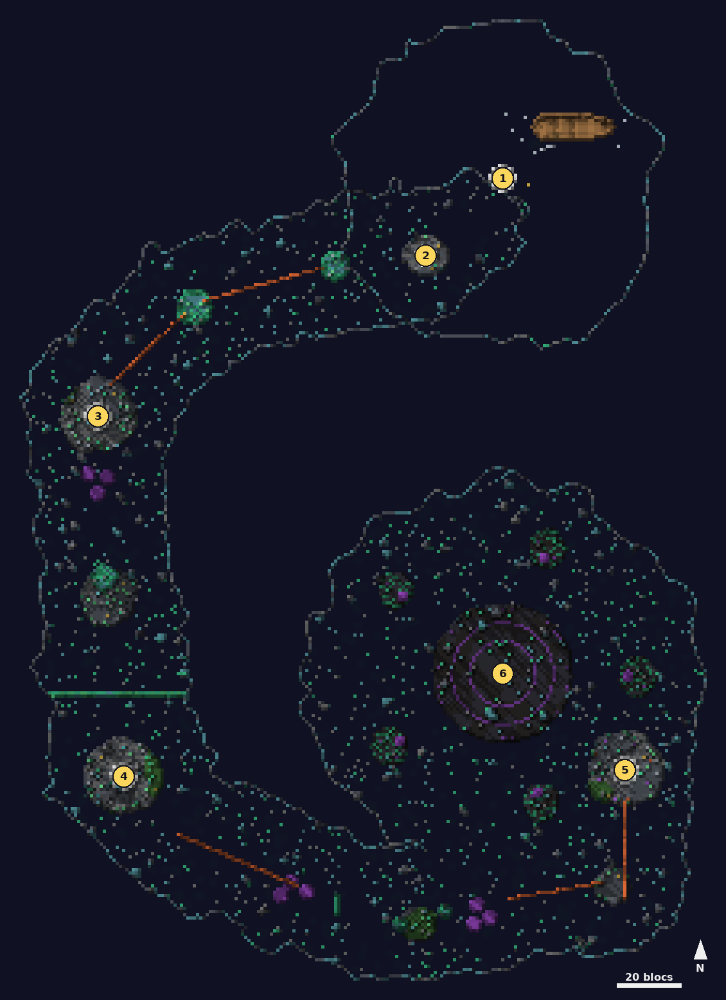

# Ressac silencieux

<Infobox pending title="Ressac silencieux" kind="Fractale" icon="/jeu/Icons/Items/Nakasar/Fractals/Core_SilentSurf.png" caption="Noyau du Ressac silencieux">
<Info label="Boss">le second Dolus corrompu, Kanaxai</Info>
<Info label="Règle">Garde de Thess, équipement de prospection</Info>
<Info label="Objets">grappin, parachute, poudre noire, fusée éclairante</Info>
<Info label="Ciel">grotte de jade sous la mer</Info>
<Info label="Saison">2</Info>
</Infobox>

Une fractale de traversée : sous une mer de jade figée, une expédition luxon a disparu dans une immense grotte de jade sombre. Avec **Thess** et l'équipement des prospecteurs, vous descendez de relevé en relevé par grappin, tyroliennes, canons à vent et champignons, jusqu'au gouffre où rêve **Kanaxai**.

## Carte

*Carte du Ressac silencieux, vue de dessus sans le plafond de la grotte : on part de l'épave sur la mer (au nord-est), on descend par la crevasse et on fait le tour de la grotte jusqu'au gouffre central. Traits orange : tyroliennes. Les numéros suivent le déroulé ci-dessous.*

## Équipement de prospection

À l'arrivée, Thess vous donne quatre objets (clic droit). Le nombre d'objets de la pile est le nombre de charges :

- **Grappin** (3) : le crochet se plante dans la roche visée, jusqu'à 32 blocs, et vous tire jusqu'à elle.
- **Parachute** (3) : en l'air seulement, descente lente vers où vous regardez. S'accroupir le referme.
- **Charge de poudre noire** (2) : vous projette loin devant, sans dégâts de chute. Thess ne la donne qu'après le repaire des araignées.
- **Fusée éclairante** : éclaire 40 s la roche où elle se plante (portée 48 blocs).

Les **Provisions abandonnées** (caisses dorées) de chaque point de contrôle rechargent tout. L'équipement disparaît quand vous quittez la fractale.

## Garde de Thess et points de contrôle

- Chaque **cercle blanc** (marque de relevé) est un point de contrôle : il s'active quand la moitié du groupe est dedans.
- La **Garde de Thess** vous protège des chutes : une chute qui vous coûterait 35 % de vos PV ou plus vous ramène au dernier point de contrôle, sans dégâts. Tomber dans l'abîme fait de même.
- Pendant un trajet guidé et 3 s après, vous ne prenez aucun dégât de chute.

## Les trajets

- **Tyroliennes** : utilisez l'ancre ; vous glissez le long du câble. S'accroupir pour lâcher.
- **Canons à vent** : utilisez le canon ; le vent vous emporte, parfois jusqu'à une tyrolienne.
- **Champignons rebondissants** (champignons violets du jeu, qui luisent) : posez le pied sur le chapeau, il vous renvoie au loin. Sur les îles de Kanaxai, il est au **fond de l'île**, loin de là où l'on arrive.
- Tant qu'un camp n'est pas dégagé, Thess refuse de vous laisser partir : « Pas encore ! »

## Déroulé

### 1. La mer de jade

Vous arrivez près de l'**épave** luxon. Sautez dans la **crevasse** et ouvrez le parachute pour descendre jusqu'au premier relevé.

### 2. Premier relevé

Des **chauves-souris** attaquent dès que le cercle s'active. Ensuite : **grappin** vers la plate-forme de jade, puis deux **tyroliennes** jusqu'au repaire.

### 3. Le repaire des araignées

Toiles partout : la **Mère de couvée des cavernes** et ses petits, avec quelques chauves-souris. Toutes les 14 s, elle pond deux **araignées** (8 au plus) : tuez-la vite. Une fois le camp dégagé, Thess vous donne la **poudre noire** : les champignons vous lancent vers la **grande stalactite de jade**, puis la poudre et le grappin vous font passer le **mur de jade** par son trou.

### 4. Le camp naga

Des **nagas** (pillards, mande-tempête, mande-venin et un mande-vague corrompu) ont pris le troisième camp. Dégagé, il ouvre le **canon à vent**, puis une tyrolienne, des champignons, le **canon suspendu** dans son anneau de jade et les **piliers de jade**.

### 5. Le second Dolus corrompu

Au quatrième relevé, des **marins luxons corrompus** vous attendent. Quand ils tombent, leur second **Dolus** surgit :

- **Visage de l'effroi** : un grand œil s'ouvre au-dessus de lui. **Détournez le regard** (tournez la caméra) avant qu'il ne se ferme : qui le regarde encore perd 25 % de ses PV, prend **Peur** (repoussé, sans pouvoir agir) et **Tourment**.
- **Vitesse effrayante** : cinq marques **I à V** apparaissent au sol. Il bondit de l'une à l'autre dans l'ordre ; un **cercle rouge** sous chaque numéro, de la taille exacte du coup, se remplit jusqu'à son arrivée ; qui est dans le cercle prend 30 % de ses PV et est projeté.

Dolus vaincu, Thess vous envoie au gouffre : parachute jusqu'à l'arène.

### 6. Kanaxai, Faux de la maison Aurkus

Le combat commence quand vous approchez du centre du disque. Thess tombe à son arrivée. Le point de retour passe au bord de l'arène. Deux **Aspects** se lèvent au bord de l'arène (il y en a cinq en tout) ; cinq **îles** flottent autour.

- **Visage de l'effroi** et, après le premier Fendeur, **Vitesse effrayante**, comme Dolus.
- **Tempête déchirante** : des joueurs marqués (un de plus à chaque fois) prennent 20 % de leurs PV et laissent une **flaque de sang** qui reste 25 s. Écartez-vous du groupe avant l'impact, et ne restez pas dans les flaques (**Saignement**).
- **Tir de herse** : les Aspects du bord visent les joueurs (cercles rouges). Sortez-en : chaque Aspect inflige son état (**Mort** : dégâts, **Exposition** : +50 % de dégâts reçus, **Peur**, **Léthargie** : ralenti, **Tourment**).
- **Liens** : un Aspect peut vous lier. Restez lié 3 s et vous partez en **Fantasmagorie** : éloignez-vous à plus de 14 blocs de l'Aspect pour couper le lien.
- **Fantasmagorie** : un Aspect que **vous seul voyez** apparaît sur une île. Allez-y au **grappin**, tuez-le en moins de 30 s (sinon : 40 % de vos PV), et revenez par le **champignon** de l'île.
- **Ombres rassemblées** : à chaque tranche de 10 %, sa **barre de défiance** s'ouvre 5 s. Brisez-la, sinon un joueur au hasard part en Fantasmagorie.
- **Fendeur de mondes** (à 66 et 33 %) : Kanaxai s'élève, invulnérable, et tous les Aspects apparaissent. Vous avez **20 s** pour en tuer le plus possible : le coup fait 20 % des PV, plus 30 % par Aspect encore vivant, et ajoute de l'**Agonie**.
- **Tourment** fait perdre 1 % des PV par seconde, deux fois plus en bougeant.
- Si tout le groupe quitte l'arène 20 s, Kanaxai se dissout et le combat recommence.

Kanaxai vaincu, chacun prend son **coffre** de fin.

## Carnets des marins

Six **carnets** traînent sur le trajet (utiliser pour lire) : ils racontent la descente de l'expédition, les nagas et ce qui est arrivé à Dolus.

## Différences avec Guild Wars 2

- L'équipement est fait de quatre objets à clic droit, pas de compétences spéciales ; les charges sont des piles.
- Le parachute, les tyroliennes et les canons poussent le joueur directement (pas d'animation dédiée) ; à vérifier en jeu.
- La Garde de Thess ne ressuscite pas : elle annule les grosses chutes et ramène au point de contrôle.
- Kanaxai s'engage à l'approche, sans dialogue préalable ; Thess parle dans le chat.
- La Peur bloque et repousse, sans fuite forcée ; les liens se coupent à la distance.
- Les modèles sont provisoires (araignées en blocs, humanoïdes et spectres vanilla).
