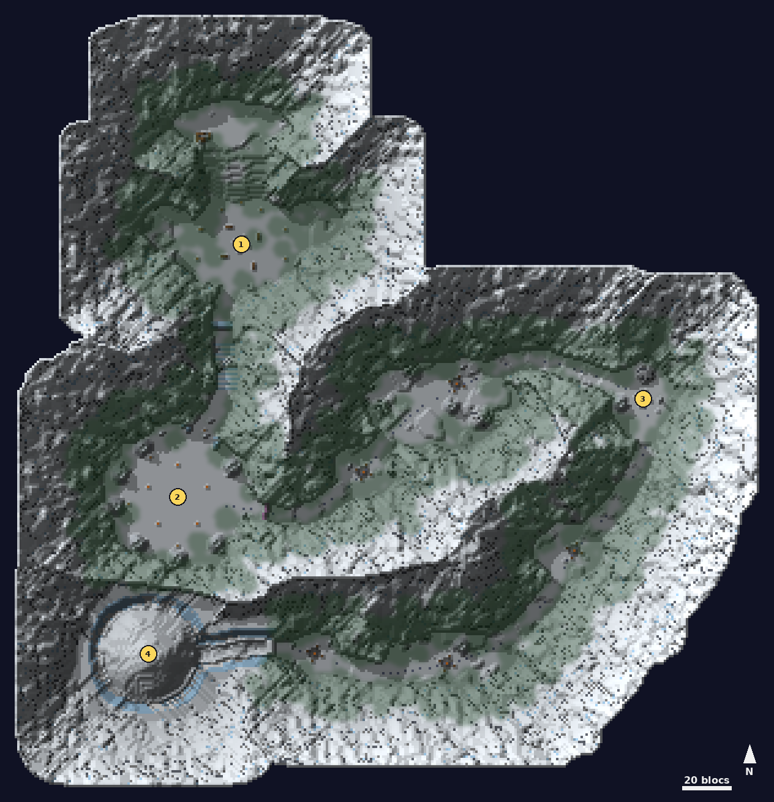

# Tempête de neige

<Infobox pending title="Tempête de neige" kind="Fractale" icon="/jeu/Icons/Items/Nakasar/Fractals/Core_Snowblind.png" caption="Noyau de la Tempête de neige">
<Info label="Boss">Source élémentaire, Chaman légendaire</Info>
<Info label="Règle">Hypothermie loin des feux, jusqu'à la Source</Info>
<Info label="Objets">fagots, torche</Info>
<Info label="Ciel">nuit enneigée (0 h 30)</Info>
</Infobox>

Une fractale d'environnement, toujours de nuit : le froid tue plus que les ennemis, et chaque rencontre tourne autour du feu. Une vallée de montagne fermée, des ruines du nord à la grotte de glace du sud-ouest.

## Carte

*Carte de la Tempête de neige, vue de dessus, sans le feuillage : on part des ruines au nord. Les numéros suivent le déroulé ci-dessous.*

## Hypothermie et Chaleur

Le froid ne compte que pour les deux premières rencontres : **une fois la Source élémentaire vaincue, l'hypothermie disparaît** (piles effacées, éclats brisés).

- **Loin d'un feu allumé**, vous prenez une pile d'**Hypothermie** toutes les **5 s** (2,5 s dans le **blizzard**, deux fois moins vite **torche en main**), jusqu'à 10.
- **Près d'un feu** (grand feu, foyers), vous avez **Chaleur** et perdez une pile toutes les 1,2 s.
- Chaque pile coûte **0,3 % de vos PV max par seconde**, armure ignorée ; dès 5 piles, vous courez moins vite.
- **À 10 piles**, vous êtes pris dans un **éclat de glace** : immobile tant que vos alliés ne l'ont pas brisé (vos propres coups n'y font rien). Libéré, vous repartez à 6 piles.

**Fagots** : les **tas de fagots** en donnent un à chaque utilisation (3 portés au plus) et repoussent en 20 s.

## Déroulé

### 1. Le mur de glace

Au pied de la colline des ruines, un **mur de glace** barre le col. Allumez le **grand feu** de la cuvette avec un fagot pris sous les sapins de la lisière, puis nourrissez-le (chaque fagot +30 %). Il brûle 1,5 % par seconde et fait fondre le mur **rangée par rangée** : environ 90 s à mi-bois, plus vite s'il est bien nourri.

- Toutes les 14 s, des **élémentaires de glace** sortent de la forêt et **marchent vers le feu** ; chacun qui l'atteint lui retire **35 %**. Arrêtez-les avant.
- 5 s après l'allumage puis toutes les 25 s, une meute de **loups blancs** attaque le feu (plus nombreux avec le groupe) ; une vague sur deux, des **Fils de Svanir** et un **Incantateur** l'accompagnent.

### 2. La Source élémentaire

Une fois le mur fondu, montez les **escaliers de glace** jusqu'au **camp Svanir** (tentes, bannières rouges, palissade). La Source s'éveille quand vous entrez dans le cercle. Elle est **immobile** (rien ne la déplace) et **ne regagne jamais de vie** : seul un camp vidé pendant 20 s la remet à neuf. **Cinq foyers** l'entourent :

- un foyer **s'allume torche en inventaire** (prise au **râtelier** à l'entrée du cercle), puis **se nourrit de fagots** (tas devant les **tentes**, +40 %) ; il brûle 1 % par seconde ;
- chaque foyer **éteint** donne à la Source une pile de **bouclier de givre** (❄ sur sa barre) : −18 % des dégâts qu'elle reçoit par pile ;
- à **75, 50 et 25 %**, elle frappe les foyers allumés (cercles rouges) : **−50 %** de bois chacun ;
- **le dernier foyer allumé s'éteint** : **blizzard**, une brume blanche qui cache presque tout, et le froid monte deux fois plus vite. Après 4 s puis toutes les 9 s, la tempête **jette chaque joueur ailleurs dans le camp** (sauf ceux pris dans la glace). Le blizzard dure jusqu'à ce qu'on rallume un foyer, et retombe si tout le monde quitte le camp.
- sa barre affiche le bouclier et le bois de chaque foyer.

Ses attaques : orbe lent qui repousse, **tourbillon** (cercle de 7 blocs) et coups de poing. Vaincue, la brume à l'est du camp s'ouvre et les foyers restent allumés.

### 3. La forêt sombre

Suivez les **empreintes** : le sentier fait le grand tour par l'est, de la clairière à la plaine rocheuse, au **plateau** (point de reprise sur le sentier, juste avant), à la tanière et au creux du sud, sous des **torches** plantées le long du chemin. **Cinq groupes** de Fils de Svanir, d'Incantateurs et de **loups blancs** veillent autour de leurs feux et attaquent quand vous approchez à 30 blocs. Rien n'oblige à les battre : on peut filer jusqu'au poste avancé et au tunnel de la grotte, qui reste ouvert.

### 4. Le Chaman légendaire

Il vous attend dans la **grotte de glace**, sous un dôme de stalactites et de cristaux. Pas de porte : on y entre et on en sort librement.

- **Cristaux corrompus** : à chaque phase au sol, trois cristaux l'entourent ; tant qu'il en reste un, il ne prend aucun dégât.
- **Pluie de glace** (cercle rouge sous chaque joueur), **anneau de pics** (cercle de 5 blocs autour de lui) et **souffle glacé** (cône, ralentit).
- **À 75 et 50 %** : il saute sur sa **corniche**, invulnérable, et fait pleuvoir des pics (cercle rouge sous chaque joueur toutes les 3,5 s : 15 % des PV). L'**Effigie de glace** apparaît au centre, barre de défiance ouverte : **brisez sa défiance ou détruisez-la** pour le faire redescendre.
- **À 25 %** : il prend sa **forme d'ours** ; ses **bonds** renversent 3 s.

Personne dans la grotte pendant 20 s : il se retire et tout est à refaire.
