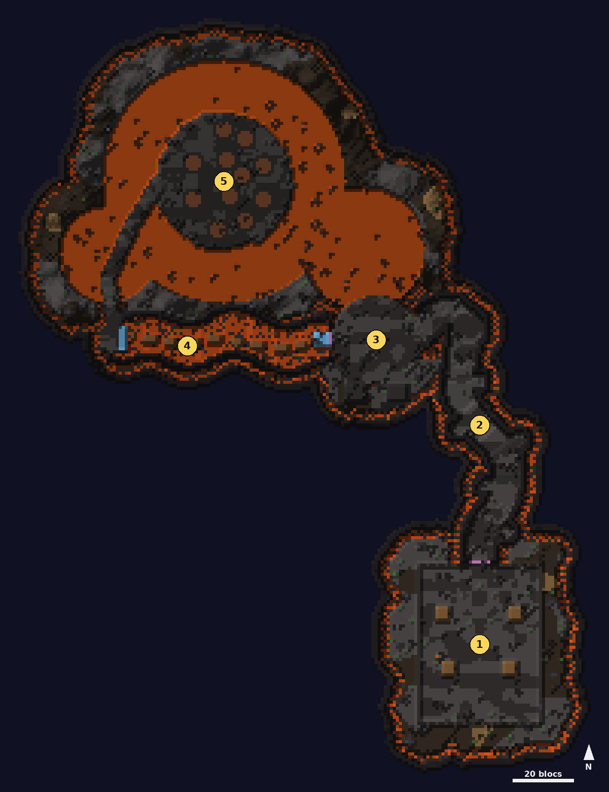

# Volcanique

<Infobox pending title="Volcanique" kind="Fractale" icon="/jeu/Icons/Items/Nakasar/Fractals/Core_Volcanic.png" caption="Noyau de la Volcanique">
<Info label="Boss">Champion chaman, Chaman imprégné</Info>
<Info label="Objet lancé">pierre imprégnée</Info>
<Info label="Ciel">aucun : voûtes et grottes du volcan</Info>
</Infobox>

Un rituel grawl au cœur d'un volcan : groupes de grawls sous les chutes de pierres, couloir de rochers roulants, sauvetage de captifs au bord d'une falaise, puzzle de saut dans une mine, puis un boss ailé sur une île au milieu d'un lac de lave. Tout se passe dans les galeries courbes et les vastes grottes du volcan en activité, et l'on descend peu à peu du camp jusqu'au lac de lave.

## Carte

*Carte de la Volcanique, voûte retirée : on part du camp au sud-est et l'on descend vers le lac de lave au nord-ouest. Les numéros suivent le déroulé ci-dessous.*

## Déroulé

1. **Le camp grawl** autour d'un **totem** : les grawls arrivent par **groupes de 7** et chargent. La barre du totem, visible de toute la fractale, ne baisse qu'à chaque grawl abattu (21, +7 tous les deux joueurs de plus).
2. **Le couloir aux rochers roulants**, une galerie sinueuse en pente : les rochers dévalent la pente **derrière vous** toutes les 5 s. Abritez-vous dans les **niches** ; les rochers laissent une traînée de feu.
3. **Le Champion chaman** et les captifs, au bord d'une falaise qui domine le lac de lave.
4. **La mine**, une galerie qui serpente : des rails qui descendent peu à peu au-dessus de la lave, puis une descente jusqu'au lac.
5. **Le Chaman imprégné**, sur son île, que l'on aperçoit déjà depuis la falaise du Champion.

## Champion chaman

- Il porte **8 piles** de protection : tant qu'il en garde une, il est **invulnérable**. Chaque **pierre imprégnée** lancée sur lui (clic droit vers lui) en retire une ; les pierres tombent des chutes de pierres.
- Une pierre au sol se ramasse **accroupi**, une seule à la fois ; tant qu'on la tient, on ne peut pas changer d'objet en main.
- Les pierres n'apparaissent que tant qu'il est protégé, les vétérans seulement pendant sa première protection. Sa dernière pile retirée, les pierres disparaissent : frappez-le avec vos armes.
- À **50 %** de vie, il se protège de nouveau avec **une seule pile** (sans vétérans).
- Il ne récupère pas de vie tout seul : chaque coup compte, même pendant qu'on attend les pierres.
- Des **vétérans** sortent des grottes du sud et marchent lentement vers les **3 captifs** du bord nord : interceptez-les. Si tous survivent, **5 éclats de Brume** en plus.

## Chaman imprégné

- **Cratères** : de petits cratères de l'île rougissent peu à peu, du brun au jaune, puis crachent de la **lave active** qui brûle très fort. Écartez-vous dès qu'ils changent de couleur.
- **Lac de lave** : on y brûle aussi ; ne quittez pas l'île.
- **Flamme qui se propage** : un joueur touché allume ses voisins.
- À **75, 50 et 25 %**, il plane lentement vers un villageois sous un **bouclier de 50 coups** (quel que soit le nombre de joueurs) : le briser l'étourdit ; s'il atteint le villageois, il se soigne de 25 %.
