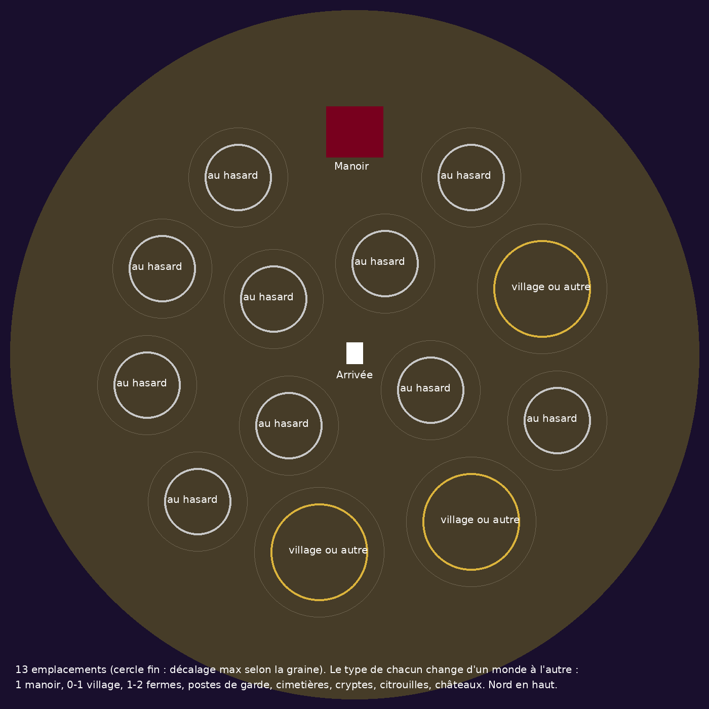

[← Accueil du wiki](../README.md)

# Le Comté Vampire

Un fragment d'Orbis plongé dans une nuit presque sans fin : le domaine du Comte Vampire. Ses villageois, ses fermiers et jusqu'à ses gardes ont été changés en morts-vivants ; au loin, son manoir attend ses invités. Seuls quelques chasseurs de vampires tiennent encore leur camp.

**Objectifs affichés par le portail :** trouver le manoir du comte vampire ; piller les cryptes et les cimetières abandonnés ; explorer le village, les fermes et le poste de garde abandonnés.

## Y aller

| Accès | Comment |
|---|---|
| **Clé de portail** | Placez un [Fragment du Comté Vampire](../objets/cle-du-comte.md) dans une **Ancienne passerelle** (portail vanilla). |
| **Brèche des chasseurs** | La nuit, dans le monde principal, une [brèche des chasseurs](../breches.md) s'ouvre parfois près de vous : entrez dans la faille rouge. |

- **Durée : 30 minutes.** Le fragment se ferme ensuite, et dès qu'il est vide.
- Vous arrivez au centre de la [crypte d'arrivée](crypte-d-arrivee.md). Le **portail de retour** est dans la même crypte, 3 blocs au sud.
- Le **manoir du Comte** est toujours à **220 blocs au nord** de l'arrivée : sortez par la porte de la crypte et suivez le chemin.
- Le JcJ est désactivé.

## Le monde

- **Une île flottante** d'environ **340 blocs de rayon** (près de 680 de large) au-dessus du vide. Le bord s'abaisse de 8 blocs puis tombe en falaise ; dessous, un cône de roche.
- **Relief :** collines douces autour de l'altitude 81 (sol entre 65 et 91), aplanies sous chaque structure.
- **Sols :** cendre, herbe et terre brûlées, gravier moussu. Roche : pierre, ardoise, schiste.
- **Végétation :** forêts d'arbres morts sur environ un tiers de l'île (sapins et frênes morts, arbres pétrifiés, calcinés, moussus, souches), arbres isolés dans la lande, herbes noueuses, buissons et ronces morts, rares champignons luisants violets. Voir [Décor et arbres](decor.md).
- **Ciel et météo :** brouillard violet la nuit, orange au crépuscule ; lune crème au halo orange.
- **Horloge :** on arrive à **20 h**. Le jour dure **5 minutes**, la nuit **20 minutes**.

## Les monstres

- **Lande :** squelettes, squelettes archers, zombies, araignées, chauves-souris, corbeaux.
- **Zones hantées** (à moins de 45 blocs d'une structure) : apparitions plus fréquentes, avec en plus spectres, goules, soldats et archimages squelettes, squelettes d'élite, araignées des cavernes, zombies aberrants, loups-garous, [fantômes](../pnj/fantome.md) à toute heure et [rejetons de vampire](../pnj/rejeton-de-vampire.md) la nuit.
- **Structures :** chacune a ses gardiens, voir le tableau ci-dessous et le [bestiaire](../pnj/README.md).

Toutes les créatures du Comté sont **dans le même camp** : elles ne se blessent pas entre elles et sont ennemies des [chasseurs de vampires](../pnj/chasseur-epee.md).

## Les structures

Chaque monde tire sa propre répartition : 14 emplacements autour de l'arrivée (décalés de 16 blocs au plus), 8 plans possibles, et un tirage pour savoir quels exemplaires apparaissent. Deux structures du même type sont toujours à plus de 140 blocs l'une de l'autre.

| Structure | Par monde | Variantes | Gardiens | Coffres |
|---|---|---|---|---|
| [Manoir du Comte](manoir-du-comte.md) | **1** (220 blocs au nord) | — | [Comte](../pnj/comte-vampire.md) **ou** [Comtesse](../pnj/comtesse-vampire.md), 2 [rejetons](../pnj/rejeton-de-vampire.md) | 7 |
| [Crypte d'arrivée](crypte-d-arrivee.md) | **1** (au centre) | — | aucun | 0 |
| [Village](villages.md) | 0 ou 1 (60 %) | Zombies, En ruine, Araignées | 10 villageois zombifiés / rien / 7 araignées | 10 |
| [Ferme](fermes.md) | 1 ou 2 | Zombies, En ruine, Incendiée | 4 fermiers + [Abomination](../pnj/abomination-zombie.md) / rien / rien | 2 |
| [Poste de garde](postes-de-garde.md) | 1 ou 2 | Garnison, Rebelles, Araignées, En ruine | Capitaine + 6 gardes / 6 rebelles / 5 araignées / rien | 3 |
| [Cimetière](cimetieres.md) | 1 ou 2 | Hanté, Araignées, Morts-vivants | ambiance hantée | 0 |
| [Crypte](cryptes.md) | 1 ou 2 | Pierre, Ardoise, Schiste | ambiance hantée | 1 |
| [Château hanté](chateaux-hantes.md) | 1 ou 2 | Pierre, Ardoise | ambiance hantée | 1 |
| [Champ de citrouilles](champs-de-citrouilles.md) | 1 ou 2 | Simple (3 plans), Géant (2 plans) | rien / [Citrouille géante](../pnj/citrouille-geante.md) | 1 |
| [Camp de chasseurs](camps-de-chasseurs.md) | 0 ou 1 (50 %), ~110 blocs au sud | Tentes, Pavillon | 6 [chasseurs de vampires](../pnj/chasseur-epee.md) (neutres) | 2 |

Au total, un monde compte de **8 à 16 structures** en plus du manoir et de la crypte d'arrivée.

Le contenu de chaque coffre est détaillé dans [Butin des coffres](butin-des-coffres.md).
