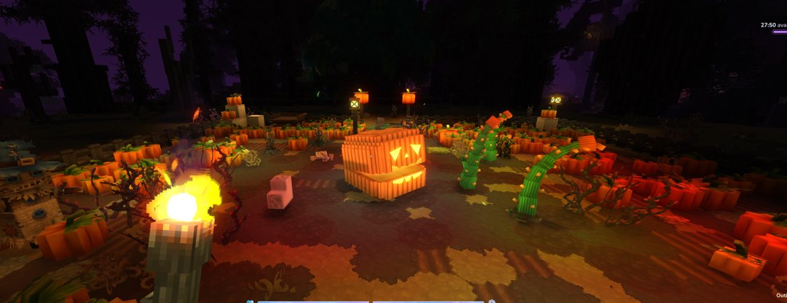

# Champ de citrouilles

<Infobox title="Champ de citrouilles" kind="Structure" image={require("../images/lieux/apercu_champ.png").default} caption="Un champ de citrouilles simple (aperçu du générateur)">
<Info label="Taille">champ de 19 × 23 à 27 × 25 (structure jusqu'à 37 × 14 × 29)</Info>
<Info label="Par monde">1 ou 2</Info>
<Info label="Variantes">Simple (3 plans), Géant (2 plans)</Info>
<Info label="Gardien">[Citrouille géante](../pnj/citrouille-geante.md) (variante Géant, élite, 30 min)</Info>
<Info label="Coffres">**1** (dans la cabane)</Info>
<Info label="Butin">[Ferme](butin-des-coffres.md#ferme)</Info>
</Infobox>

Les champs de citrouilles du domaine, éclairés de lanternes et de citrouilles sculptées. Un sur deux cache une **[Citrouille géante](../pnj/citrouille-geante.md)**.

## Description

Sillons de terre labourée et plus d'une centaine de citrouilles, **allée centrale** nord-sud, **clôture de bois mort** ouverte au nord et au sud, lanternes aux coins et le long de l'allée, **citrouilles sculptées** à l'entrée, **trois épouvantails**, une **charrette**, meules de foin, paniers, **cabane du fermier** dans un coin nord et un arbre mort penché sur la clôture.

## Variantes (une chance sur deux chacune)

| Variante | Plans | Particularité |
|---|---|---|
| **Simple** | 3 | aucun gardien |
| **Géant** | 2 | une **clairière de 7 blocs de rayon** au centre (terre pourrie, ronces, tapis de vrilles, os, couronne de citrouilles sculptées tournées vers l'extérieur) où trône la **[Citrouille géante](../pnj/citrouille-geante.md)** (élite, 30 min), entre **quatre lanternes-citrouilles** qu'un coup renverse (sol en feu sur 3 blocs) |

## Coffre

[Ferme](butin-des-coffres.md#ferme) : récoltes, graines, outils agricoles, nourriture.
