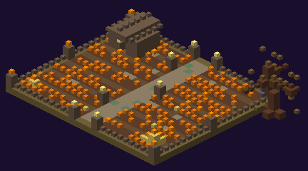

# Champ de citrouilles

Les champs de citrouilles du domaine, éclairés de lanternes et de citrouilles sculptées. Un sur deux cache une **[Citrouille géante](../pnj/citrouille-geante.md)**.

| | |
|---|---|
| Taille | champ de 19 × 23 à 27 × 25 (structure jusqu'à 37 × 14 × 29) |
| Par monde | 1 ou 2 |
| Coffres | **1** (dans la cabane) |

## Description

Sillons de terre labourée et plus d'une centaine de citrouilles, **allée centrale** nord-sud, **clôture de bois mort** ouverte au nord et au sud, lanternes aux coins et le long de l'allée, **citrouilles sculptées** à l'entrée, **trois épouvantails**, une **charrette**, meules de foin, paniers, **cabane du fermier** dans un coin nord et un arbre mort penché sur la clôture.

## Variantes (une chance sur deux chacune)

| Variante | Plans | Particularité |
|---|---|---|
| **Simple** | 3 | aucun gardien |
| **Géant** | 2 | une **clairière de 7 blocs de rayon** au centre (terre pourrie, ronces, tapis de vrilles, os, couronne de citrouilles sculptées tournées vers l'extérieur) où trône la **[Citrouille géante](../pnj/citrouille-geante.md)** (élite, 30 min) |

## Coffre

[Ferme](butin-des-coffres.md#ferme) : récoltes, graines, outils agricoles, nourriture.
