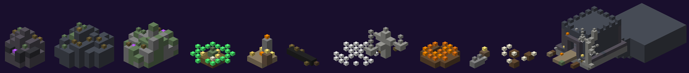
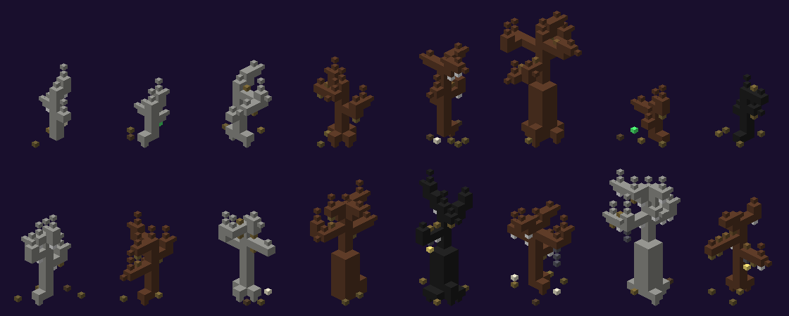

# Décor et arbres

Entre les structures, la lande du Comté est parsemée de petits décors et d'arbres morts. Aucun ne contient de gardien ni de coffre.

## Petits décors

| Décor | Plans | Description |
|---|---|---|
| Affleurement rocheux | 5 | roches moussues, ardoise, schiste, parfois des **cristaux violets** (le plus fréquent) |
| Tronc couché | 3 | frêne, pétrifié ou calciné, racines et champignons |
| Tas d'os | 3 | os, côtes, crânes, pointes d'os |
| Autel de bord de chemin | 3 | pilier à bougie, stèle, lanterne, offrandes (panier de citrouilles ou de paille) |
| Cercle de champignons | 3 | champignons luisants violets ou verts autour d'une pierre levée, bougies |
| Tombe isolée | 3 | stèle, bougie, parfois une lanterne |
| Nid d'araignées | 3 | nappe de toiles, cocons, os |

## Arbres

16 arbres propres au mod, en trois essences : **frêne mort**, **pétrifié** (gris pâle) et **calciné** (noir). Douze arbres morts de 9 à 17 blocs de haut, et quatre « arbres de pendu » : deux avec une **lanterne** suspendue, un avec une **cage**, un avec une **corde de pendu**.

Ils se mêlent aux arbres morts du jeu de base : sapins et frênes morts, arbres pétrifiés, calcinés, tordus, moussus, souches et troncs.

- **Forêts** (environ un tiers de l'île) : arbres serrés, tous les 6 à 7 blocs.
- **Lande** : arbres isolés, tous les 16 blocs environ.
- Aucun arbre ni décor à moins de 38 blocs d'une structure (46 du manoir, 54 du village).
