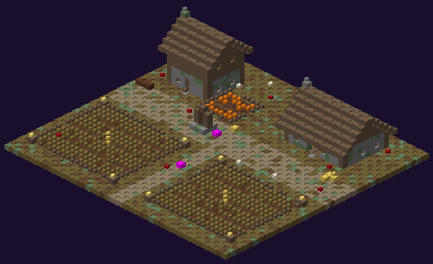
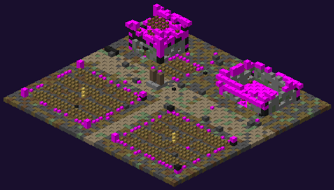

[← Le Comté Vampire](README.md)

# Ferme

Une exploitation du domaine : maison, grange, champs et potager.

| | |
|---|---|
| Taille | **49 × 45** (27 de haut) |
| Par monde | 1 ou 2 |
| Coffres | **2** |

## Plan

**Maison du fermier** sur deux niveaux et **grande grange**, cour en terre battue avec **puits**, **deux champs de blé clos** avec épouvantail et poteaux à lanterne, **potager de citrouilles** clos, meules de foin, tas de bûches, chemin vers le sud.

## Variantes (une chance sur trois chacune)

| Variante | Aspect | Habitants |
|---|---|---|
| **Zombies** | champs sains, sang, os | **4** [fermiers zombifiés](../pnj/fermier-zombifie.md) (10 min) et l'**[Abomination zombie](../pnj/abomination-zombie.md)** dans la grange (élite, 30 min) |
| **En ruine** | écroulée, champs en friche, envahie | aucun |
| **Incendiée** | bois noirci, sol de cendre, blé brûlé, poutres calcinées, **feux** encore allumés dans les décombres | aucun |

## Coffres

| Variante | Butin |
|---|---|
| Zombies, En ruine | [Ferme](butin-des-coffres.md#ferme) : récoltes, graines, outils agricoles, nourriture |
| Incendiée | [Ferme incendiée](butin-des-coffres.md#ferme-incendiée) : charbon, os, quelques graines |
