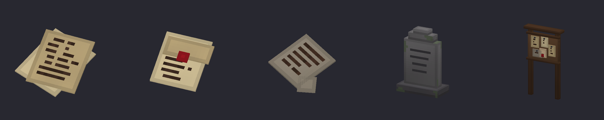

# Notes et épitaphes

Personne ne vous racontera l'histoire du Comté : il n'y a pas de dialogue. Elle se lit par morceaux, sur des notes laissées par ceux qui y ont vécu, qui y montent la garde ou qui y chassent. À vous de la reconstituer.

## Lire une note

- **Une note posée** (au sol, près d'un coffre) ou **une épitaphe** : regardez-la et **utilisez-la** (touche d'interaction, F par défaut). Une page s'ouvre avec son titre et son texte.
- **Une note dans votre sac** : son texte s'affiche dans l'infobulle de l'objet. Vous pouvez aussi la poser au sol puis l'utiliser.
- Les notes posées se **ramassent** comme un bloc. Les épitaphes et le tableau des chasseurs ne se cassent pas.

## Où les trouver

| Lieu | Qui écrit | Notes |
|---|---|---|
| [Brèche des chasseurs](../breches.md) | l'Ordre des chasseurs | le **tableau des chasseurs**, à gauche de l'arche |
| [Crypte d'arrivée](crypte-d-arrivee.md) | les chasseurs | À qui passe la faille |
| [Camps de chasseurs](camps-de-chasseurs.md) | les chasseurs | Ordres du camp, Journal de traque, Note sur l'argent, Liste des disparus, Avertissement griffonné |
| [Villages](villages.md) | les anciens habitants | Lettre jamais envoyée, Avis du bailli, Registre de la ferme, Mot gratté sur une porte |
| [Fermes](fermes.md) et [champs de citrouilles](champs-de-citrouilles.md) | les fermiers | Registre de la ferme, Carnet d'une fermière, Lettre jamais envoyée |
| [Postes de garde](postes-de-garde.md) | les gardes, un prisonnier | Consignes de garde, Serment de la garde, et un mot dans une cellule |
| [Manoir du Comte](manoir-du-comte.md) | le Comte, la Comtesse, leurs serviteurs | Journal du Comte (bibliothèque), Lettre de la Comtesse (chambres), Règles de la maison (cuisine), Page de rituel (laboratoire), Le pacte (crypte au trésor) |
| [Cimetières](cimetieres.md), [cryptes](cryptes.md), [châteaux hantés](chateaux-hantes.md) | épitaphes | environ une stèle sur trois porte une épitaphe lisible : six défunts du Comté |

Les notes sont posées **à côté d'un coffre** : à coup sûr dans les pièces du manoir, la caserne, les quartiers du capitaine et les camps de chasseurs, souvent dans les maisons et les fermes. Les coffres de ces lieux en contiennent aussi parfois une (voir [Butin des coffres](butin-des-coffres.md)).

## Le tableau des chasseurs

Planté devant chaque [brèche des chasseurs](../breches.md), il porte l'appel de l'Ordre. L'utiliser vous remet aussi **le premier contrat** des chasseurs, [la Bête de la ferme](../objets/contrats.md), si vous n'en avez pas déjà un dans votre inventaire et qu'il vous reste une place libre. En multijoueur, chaque joueur reçoit le sien.
