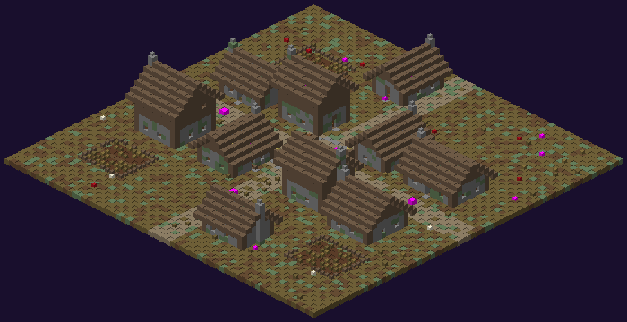

# Village

L'ancien village du Comte. Il n'apparaît que dans **6 mondes sur 10**, toujours sur l'un des trois grands emplacements.

| | |
|---|---|
| Taille | **69 × 69** (27 de haut), aplani sur 50 blocs |
| Par monde | 0 ou 1 (60 %) |
| Coffres | **10** |

## Plan

**10 maisons** le long de deux rues en croix : rez-de-chaussée en moellons, étage à colombages, toits de bois, cheminées. Parmi elles une **grange** (foin, auge), une **forge** (four, forge d'armes) et la **maison du notable** (au nord-ouest de la place, deux étages). Au centre, une place de 13 × 13 avec **puits**, bancs, lanternes et panneau. Trois **jardins clos** de blé en friche.

## Variantes (une chance sur trois chacune)

| Variante | Aspect | Habitants |
|---|---|---|
| **Zombies** | portes enfoncées ou arrachées, fenêtres condamnées, sang, os | **10** [villageois zombifiés](../pnj/villageois-zombifie.md) (réapparition 10 min) |
| **En ruine** | écroulé aux deux tiers, décombres, envahi de plantes, arbres morts dans les ruines | aucun (monstres d'ambiance) |
| **Araignées** | écroulé, toiles dans chaque maison, portes bouchées de toiles, cocons, os | **7** araignées ou araignées des cavernes (10 min) |

## Coffres

| Où | Nombre | Butin |
|---|---|---|
| Maisons | 9 | [Maison du village](butin-des-coffres.md#maison-du-village) : tissus, fibres, nourriture, récoltes, parfois une potion |
| Maison du notable | 1 | [Maison du notable](butin-des-coffres.md#maison-du-notable) : souvent **argent** ou **or**, plats, pages de recettes |
