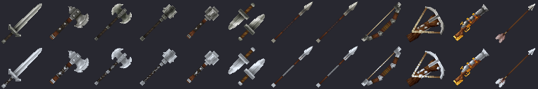

# Armes en argent

Treize armes et munitions en argent, forgées à l'**établi d'armes**. Chacune reprend **exactement** les attaques, les dégâts et la durabilité de sa version en fer : seuls l'aspect, la recette et le bonus changent.

> **Inflige le double de dégâts aux vampires (Comte, Comtesse, rejetons).**

## Le bonus d'argent

- **×2** contre le [Comte](../pnj/comte-vampire.md), la [Comtesse](../pnj/comtesse-vampire.md) et les [rejetons](../pnj/rejeton-de-vampire.md). Aucun effet sur les autres créatures.
- Le bonus s'applique **avant l'armure** : le coup frappe deux fois plus fort, puis l'armure joue.
- **Corps à corps :** il faut tenir une arme en argent (l'épée en acier d'argent du jeu compte aussi). Les sorts de [runes](runes.md) et les effets (poison...) n'en profitent pas.
- **Projectiles :** une flèche, un carreau, une balle ou une lance de jet est « en argent » si elle est tirée avec une arme en argent, ou si c'est une [flèche en argent](#fleches-en-argent). Le bonus suit le projectile, même si vous changez d'arme avant l'impact.
- Les [chasseurs de vampires](../pnj/chasseur-epee.md) portent des armes en argent : eux aussi font double dégâts aux vampires.

## Les armes

Toutes : rareté **Rare**, niveau 25, recette connue d'office, à l'**établi d'armes**.

| | Arme | Base | Onglet | Ingrédients | Temps | Obtenu |
|---|---|---|---|---|---|---|
| | Épée en argent | épée en fer (aspect de l'épée en acier d'argent) | Épées | 6 lingots d'argent, 3 cuirs légers, 3 chutes de lin | 3,5 s | 1 |
|  | Épée longue en argent | épée longue en fer | Épées | 6 lingots d'argent, 4 cuirs légers, 3 chutes de lin | 3,5 s | 1 |
|  | Hache en argent | hache en fer | Masses | 4 lingots d'argent, 4 cuirs légers, 3 chutes de lin | 3,5 s | 1 |
|  | Hache de combat en argent | hache de bataille en fer | Haches de bataille | 10 lingots d'argent, 4 cuirs légers, 3 chutes de lin | 3,5 s | 1 |
|  | Massue en argent | masse en fer | Masses | 10 lingots d'argent, 4 cuirs légers, 3 chutes de lin | 3,5 s | 1 |
|  | Gourdin en argent | gourdin en fer | Masses | 4 lingots d'argent, 4 cuirs légers, 3 chutes de lin | 3,5 s | 1 |
|  | Dagues en argent | dagues en fer | Dagues | 4 lingots d'argent, 2 cuirs légers, 3 chutes de lin | 3,5 s | 1 |
|  | Lance de jet en argent | lance de jet en fer | Épées | 2 lingots d'argent, 1 bûche | 2 s | **4** |
|  | Lance d'argent à deux mains | [lance de fer à deux mains](lance-a-deux-mains.md) | Épées | 4 lingots d'argent, 2 bûches, 2 cuirs légers | 3,5 s | 1 |
|  | Arc en argent | arc court en fer | Arcs | 6 lingots d'argent, 2 cuirs légers, 3 chutes de lin | 3,5 s | 1 |
|  | Arbalète de poing en argent | arbalète en fer | Arcs | 6 lingots d'argent, 4 cuirs légers, 3 chutes de lin | 3,5 s | 1 |
|  | Tromblon en argent | tromblon | Arcs | 8 lingots d'argent, 4 lingots de fer, 2 bûches | 5 s | 1 |
|  | Flèche en argent | flèche en fer | Arcs | 8 flèches grossières, 1 lingot d'argent | 1 s | **8** |

## Flèches en argent

> Munition des arcs et arbalètes, tirée avant les flèches simples. Double dégâts contre les vampires.

- Fonctionnent dans **tous les arcs et arbalètes**, ceux du jeu comme ceux en argent.
- Quand vous avez les deux, l'arme prend **d'abord une flèche en argent**, puis des flèches simples. Elles se cherchent dans la barre d'action, l'inventaire et le sac.
- Relâcher un arc bandé ou décharger une arbalète vous rend la même flèche (une flèche d'argent reste d'argent).
- On ne peut ni les lancer ni frapper avec : ce sont des munitions uniquement. Pile de 100.
- Hors mode Aventure, aucune flèche n'est consommée.

## Où trouver de l'argent

Lingots d'argent dans les coffres du Comté : [trésor du manoir](../fragment/butin-des-coffres.md#tresor-du-manoir) (2 à 6), chambres et atelier du manoir, [quartiers du capitaine](../fragment/butin-des-coffres.md#quartiers-du-capitaine), [ruines du château](../fragment/butin-des-coffres.md#ruines-du-chateau), [cryptes](../fragment/butin-des-coffres.md#crypte), [maison du notable](../fragment/butin-des-coffres.md#maison-du-notable) et [camp de chasseurs](../fragment/butin-des-coffres.md#camp-de-chasseurs).
