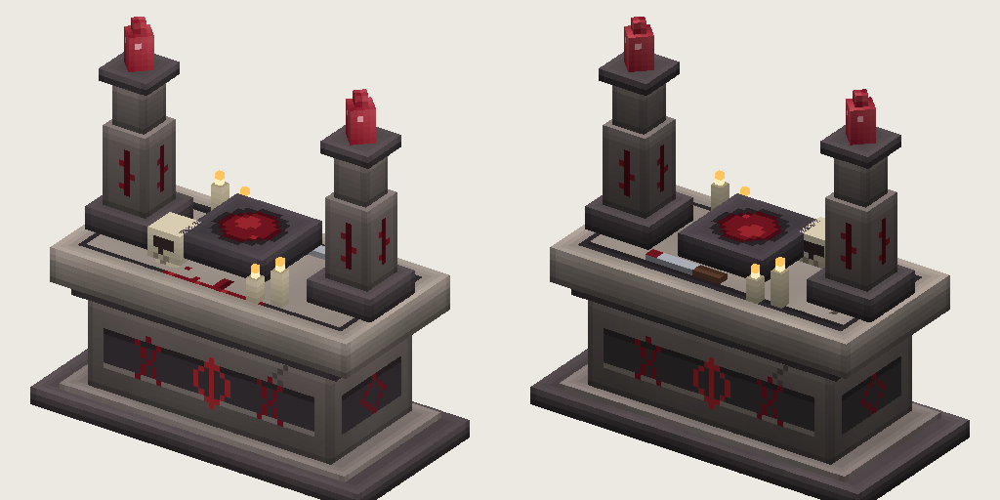

# Autel sacrificiel

 

> Un autel de pierre taché de sang. Permet de graver les runes de capacités Nakasar à partir d'éclats de rune.

Établi de 2 blocs de large et 2 de haut : socle de pierre, bande de runes, bassin de sang, deux obélisques couronnés de cristaux violets, bougies, crâne et dague. Il se tourne vers vous quand vous le posez, demande un bloc plein dessous, et se récupère quand on le casse.

## Fabrication

| Établi | Ingrédients | Temps |
|---|---|---|
| Établi (niveau 1) | **10 roches** (n'importe quelle pierre), **2 lingots de fer**, **1 éclat de rune** | 5 s |

## Utilisation

Ouvrez-le pour graver les [runes](runes.md) dans son onglet **Runes** : **2 éclats de rune** donnent une rune en 1 s.
