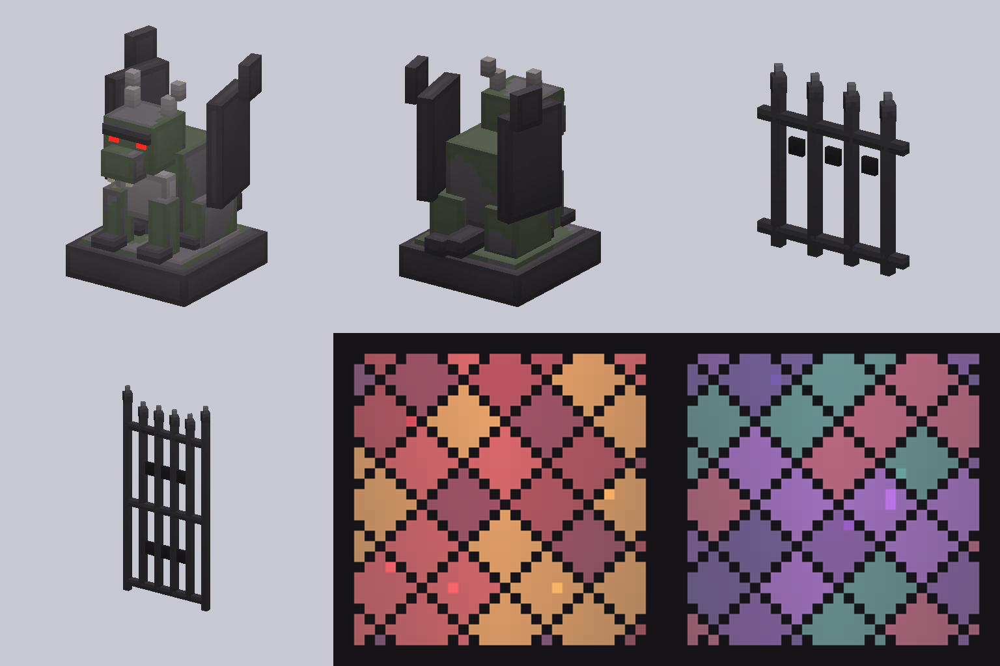
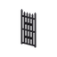

[← Objets](README.md) · [Accueil du wiki](../README.md)

# Blocs décoratifs

Les blocs qui habillent le [Manoir du Comte](../fragment/manoir-du-comte.md) et la [crypte d'arrivée](../fragment/crypte-d-arrivee.md). Ils se cassent et se ramassent ; aucune recette pour l'instant.

| | Bloc | Description | Où |
|---|---|---|---|
|  | **Vitrail pourpre** | vitrail translucide aux losanges rouges et orange, plombs noirs | manoir (106), crypte d'arrivée (11) |
|  | **Vitrail violet** | losanges violets, sarcelle et roses | manoir (74), crypte d'arrivée (13) |
|  | **Gargouille** | gargouille accroupie sur son socle, ailes repliées, **yeux rouges luisants** ; se tourne à la pose | manoir (12), crypte d'arrivée (4) |
|  | **Grille à lances en fer forgé** | grille à pointes de lance, se raccorde comme un mur | manoir (207) |
|  | **Vantail de portail en fer forgé** | vantail de 1 × 2 blocs | manoir (4) |

Voir aussi le [feu purificateur](feu-purificateur.md) (torche et lanterne).
