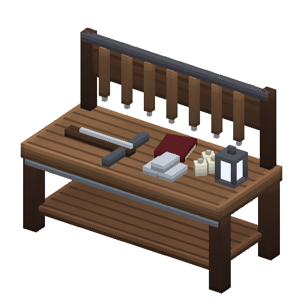

# Établi des chasseurs de vampires

> La table des chasseurs. Rapportez-leur les trophées du Comté : scellés, ils font monter l'établi, qui donne leurs runes, leurs contrats de primes, la clé du Comté et l'argent béni.

Établi de 2 blocs de large : table de bois ferrée d'argent, râtelier à pieux, arbalète, lingots d'argent, ail, grimoire et lanterne de feu purificateur. Il se tourne vers vous quand vous le posez, demande un bloc plein dessous, et se récupère quand on le casse.

## Fabrication

| Établi | Ingrédients | Temps |
|---|---|---|
| Établi (niveau 1) | **10 bois** (n'importe quel tronc), **2 lingots d'argent**, **4 cuirs légers** | 5 s |

## Niveaux

On progresse avec les chasseurs en leur rapportant des [trophées](trophees.md). Les trophées se scellent sur l'établi (onglet **Trophées**), et ce sont les **sceaux** qui l'améliorent. Trophées et sceaux sont des objets : on peut les donner ou les échanger. Le niveau, lui, appartient à l'établi posé : en groupe, un établi amélioré sert à tous ceux qui l'utilisent, et chacun peut aussi poser le sien.

| Niveau | Nom | Amélioration | Débloque |
|---|---|---|---|
| 1 | Recrue | — | onglets **Trophées** et **Feux purificateurs** |
| 2 | Traqueur | **1 [sceau du traqueur](trophees.md#sceaux)**, **4 lingots d'argent** (3 s) | onglets **Runes de chasseur**, **Fragments** et **Contrats** : Aura de lumière, clé du Comté, contrats de la ferme et du champ ; fabrication 15 % plus rapide |
| 3 | Chasseur | **1 [sceau du chasseur](trophees.md#sceaux)**, **8 lingots d'argent**, **4 éclats de rune** (5 s) | onglet **Armes bénies** : [argent béni](armes-en-argent.md#argent-beni) ; Invisibilité, contrat de la garnison ; fabrication 30 % plus rapide |

L'amélioration se fait depuis la fenêtre de l'établi, comme pour les établis du jeu. Un quatrième niveau (Maître chasseur) viendra avec les donjons.

## Recettes

| Onglet | Niveau | Objet | Ingrédients | Temps |
|---|---|---|---|---|
| Trophées | 1 | [Sceau du traqueur](trophees.md#sceaux) | 3 crocs de vampire + 1 trophée d'élite au choix (cœur, insigne ou graine) | 2 s |
| Trophées | 2 | [Sceau du chasseur](trophees.md#sceaux) | 4 crocs de vampire + 2 trophées d'élite différents au choix + 2 lingots d'argent | 4 s |
| Feux purificateurs | 1 | **4** [torches de feu purificateur](feu-purificateur.md) | 1 bois, 1 charbon de bois, 1 lingot d'argent | 1 s |
| Feux purificateurs | 1 | **2** [lanternes de feu purificateur](feu-purificateur.md) | 1 lingot de fer, 1 charbon de bois, 1 lingot d'argent | 1 s |
| Runes de chasseur | 2 | [Aura de lumière](runes.md#aura-de-lumiere) | 2 éclats de rune, 2 lingots d'argent, 1 topaze | 2 s |
| Runes de chasseur | 3 | [Invisibilité](runes.md#invisibilite) | 2 éclats de rune, 3 chutes de lin, 1 saphir | 2 s |
| Fragments | 2 | [Fragment du Comté Vampire](cle-du-comte.md) | 3 éclats de rune, 2 lingots d'argent, 1 rubis, 4 fragments d'os | 5 s |
| Contrats | 2 | [Contrat : la Bête de la ferme](contrats.md) | 2 crocs de vampire, 1 lingot d'argent, 2 chutes de lin, 1 éclat de rune | 3 s |
| Contrats | 2 | [Contrat : le Champ maudit](contrats.md) | 2 crocs de vampire, 1 lingot d'argent, 2 chutes de lin, 1 éclat de rune | 3 s |
| Contrats | 3 | [Contrat : la Garnison du Capitaine](contrats.md) | 4 crocs de vampire, 2 lingots d'argent, 2 chutes de lin, 2 éclats de rune | 3 s |
| Armes bénies | 3 | [12 armes en argent béni](armes-en-argent.md#argent-beni) | l'arme en argent, 2 lingots d'argent, 2 crocs de vampire, 1 topaze | 4 s |
