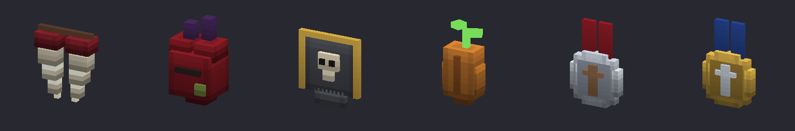

# Trophées et sceaux

Les chasseurs de vampires ne demandent pas d'or : ils veulent des preuves. Chaque élite du Comté laisse un **trophée**, et les rejetons laissent leurs **crocs**. Scellés sur l'[établi des chasseurs](etabli-des-chasseurs.md), ces trophées en font monter le niveau.

## Trophées

| | Trophée | Lâché par | Chance | Rareté | Pile |
|---|---|---|---|---|---|
|  | **Croc de vampire** | [rejeton de vampire](../pnj/rejeton-de-vampire.md) | 50 % | Peu commun | 25 |
|  | **Cœur d'Abomination** | [Abomination zombie](../pnj/abomination-zombie.md) | 100 % | Rare | 10 |
|  | **Insigne du Capitaine** | [Capitaine de la garde](../pnj/capitaine-de-la-garde.md) | 100 % | Rare | 10 |
|  | **Graine de la Citrouille géante** | [Citrouille géante](../pnj/citrouille-geante.md) | 100 % | Rare | 10 |

Les rejetons rôdent autour des structures du Comté la nuit, gardent le manoir et accompagnent le Comte et la Comtesse. Les élites ne sont pas dans tous les mondes du Comté (le type de chaque ferme, poste de garde et champ est tiré au sort) : un nouveau fragment rebat les cartes, et les [contrats de primes](contrats.md) mènent droit à une élite.

Les crocs servent aussi aux contrats et à l'[argent béni](armes-en-argent.md#argent-beni).

## Sceaux {#sceaux}

Un sceau se fabrique sur l'établi des chasseurs, onglet **Trophées**. Les améliorations de l'établi demandent un sceau : n'importe quel trophée d'élite fait l'affaire.

| | Sceau | Niveau de l'établi | Ingrédients | Sert à |
|---|---|---|---|---|
|  | **Sceau du traqueur** | 1 | 3 crocs de vampire + 1 trophée d'élite au choix | passer l'établi au niveau 2 (Traqueur) |
|  | **Sceau du chasseur** | 2 | 4 crocs de vampire + 2 trophées d'élite **différents** au choix + 2 lingots d'argent | passer l'établi au niveau 3 (Chasseur) |

Il y a une recette par trophée (ou par paire de trophées) : l'établi les affiche toutes, il suffit de choisir celle dont on a les trophées.

## Le parcours type

1. Une nuit, une [brèche](../breches.md) s'ouvre. Fabriquez l'établi (10 bois, 2 lingots d'argent, 4 cuirs légers) et traversez la faille.
2. Dans le Comté, chassez les rejetons pour leurs crocs et abattez une élite.
3. Scellez le tout : **sceau du traqueur**, établi au niveau 2. Vous pouvez maintenant fabriquer la [clé du Comté](cle-du-comte.md) et vos premiers [contrats](contrats.md).
4. Abattez deux élites différentes (dans le Comté ou par contrat) : **sceau du chasseur**, établi au niveau 3, [argent béni](armes-en-argent.md#argent-beni) et contrat de la garnison.
