# Bâtiments des Feran

Tous les bâtiments de l'oasis, palier par palier, puis les projets d'emplacement et les avant-postes. Chaque image montre le même bâtiment sous trois angles (vue de face, quart de tour, demi-tour). Voir aussi la page du peuple : [Feran](../feran.md).

## Cœur du village

La place centrale grandit à chaque palier. Première image : le cœur au palier 3 ; seconde : le campement de départ.

### Cœur du village

**Cœur.** Place centrale : tableau du village (commandes, chantiers, emplacements), dépôt des matériaux, bannière. Grandit à chaque palier.

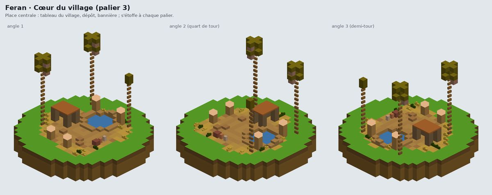

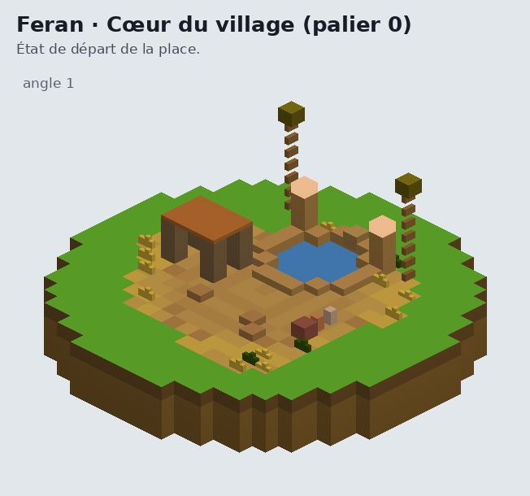

## Bâtiments du village

### Palier 0

#### Hutte de l'ouest

**Habitation.** Logement : Guetteur, Éleveuse.

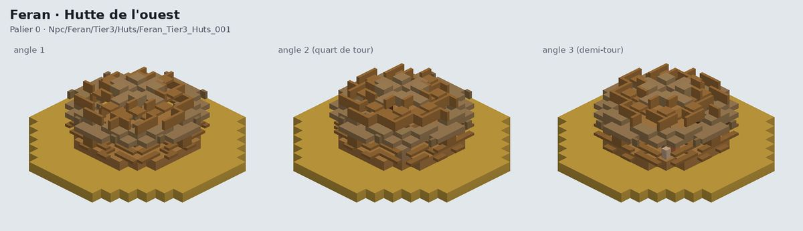

#### Muret du vent

**Habitation.** Poste de travail : Guetteur.

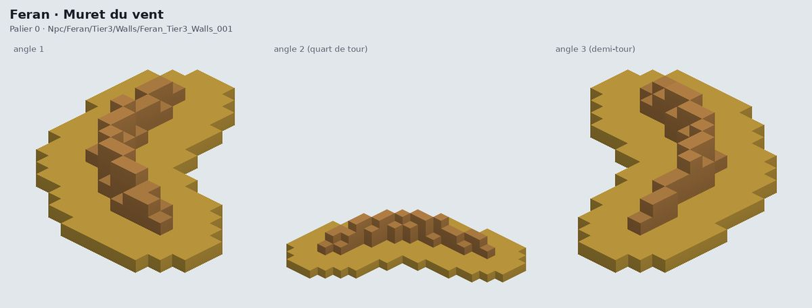

#### Hutte de l'est

**Habitation.** Logement : Bâtisseur.

Même bâtiment que « Hutte de l'ouest ».

### Palier 1

#### Enclos de l'oasis

**Bâtiment de métier.** Métier : Éleveuse. Spécialités : Chameaux (chameaux : cuir et eau des caravanes) ; Béliers du plateau (béliers : laine et cornes) ; Tortues de l'oasis (tortues : écailles et essence d'eau).

#### Entrée de l'oasis

**Bâtiment de métier.** Métier : Porteuse d'eau. Spécialités : Citerne (essence d'eau ; la soif s'apaise au village) ; Jardin d'oasis (cactus, épices et sel).

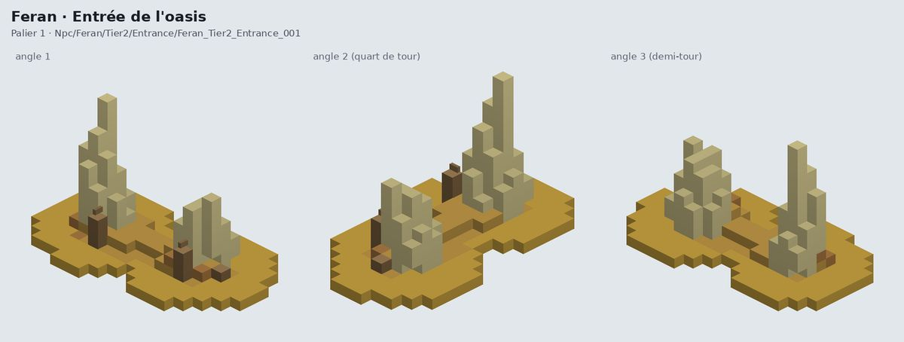

#### Grande hutte

**Habitation.** Logement : Porteuse d'eau.

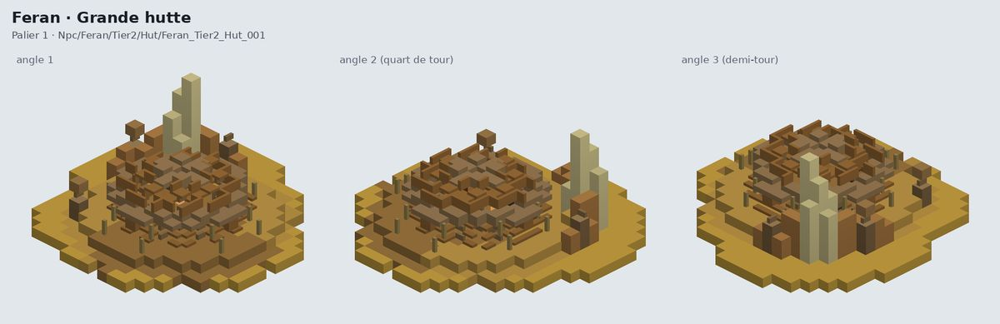

#### Hutte du sud

**Décor.** Sans habitant attitré.

Même bâtiment que « Hutte de l'ouest ».

### Palier 2

#### Hutte du nord-ouest

**Habitation.** Logement : Garde.

#### Hutte de la garde

**Bâtiment de métier.** Métier : Garde. Spécialités : Lanciers (lances ; en raid, des gardes plus solides) ; Coureurs des vents (plumes, armure légère ; en raid, +1 garde).

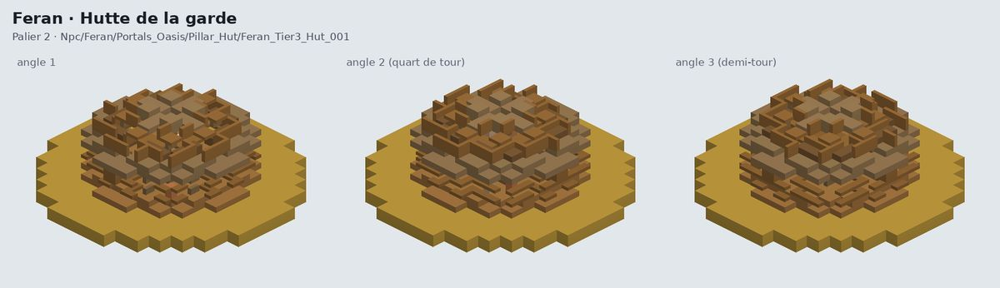

#### Hutte du sud-est

**Décor.** Sans habitant attitré.

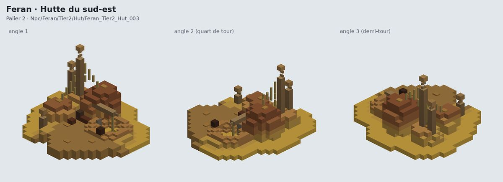

### Palier 3

#### Hutte du chef

**Habitation.** Poste de travail : Ancien du village. Logement : Ancien du village.

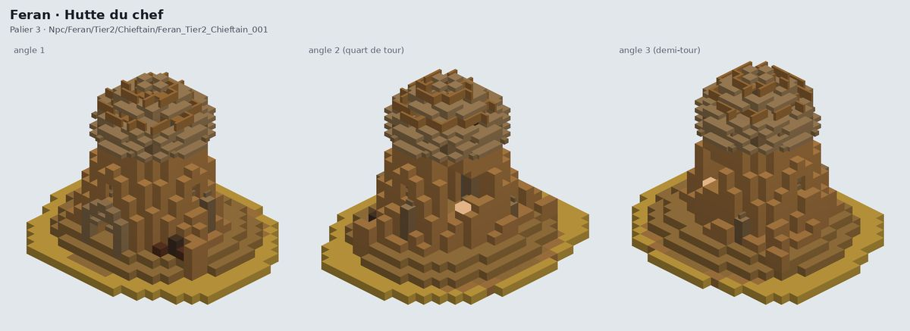

#### Hutte du Windwalker

**Décor.** Sans habitant attitré.

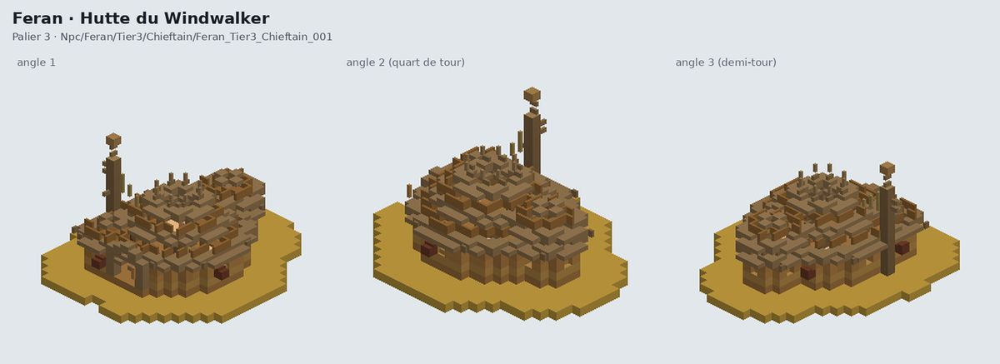

## Projets d'emplacement

Bâtiments au choix sur les deux [terrains libres](../emplacements.md) : le premier ouvre au palier 2, le second au palier 3.

### Caravansérail

**Projet d'emplacement.** Métier : Caravanière. Spécialités : Épices et sel (épices, sel et brochettes) ; Objets d'ailleurs (étoffes et fruits d'autres peuples).

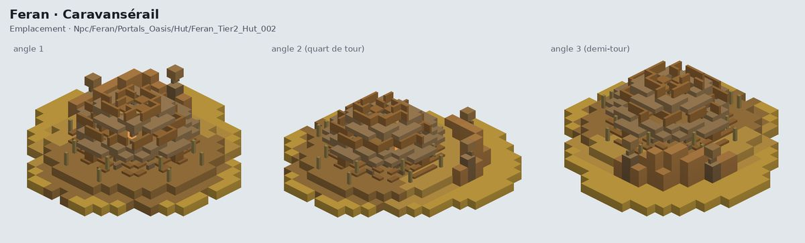

### Citerne

**Projet d'emplacement.** Métier : Gardien de l'eau. Spécialités : Réserve d'eau (eau, seaux et potions d'endurance) ; Essence d'eau (essences d'eau et de glace).

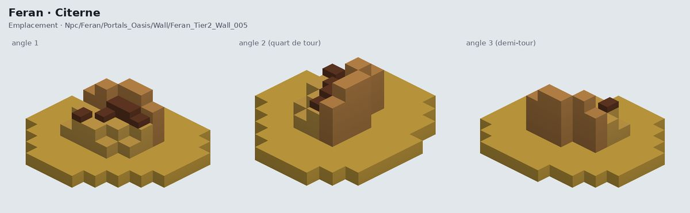

### Deuxième enclos

**Projet d'emplacement.** Métier : Éleveuse. Spécialités : Chameaux (chameaux : cuir et eau des caravanes) ; Béliers du plateau (béliers : laine et cornes) ; Tortues de l'oasis (tortues : écailles et essence d'eau).

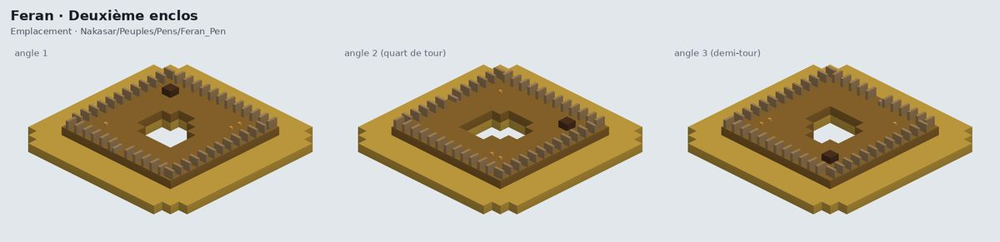

### Atelier de tissage

**Projet d'emplacement.** Métier : Tisserande. Spécialités : Lin et coton (rouleaux et vêtements de lin et de coton) ; Voiles contre le soleil (voiles de tête et tuniques légères).

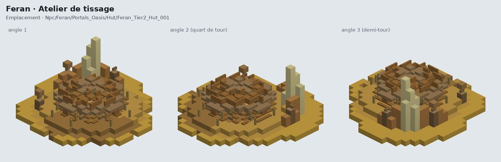

### Volerie des plumes

**Projet d'emplacement.** Métier : Fauconnier. Spécialités : Plumes (plumes bleues, rouges et sombres) ; Flèches (flèches de fer et de précision).

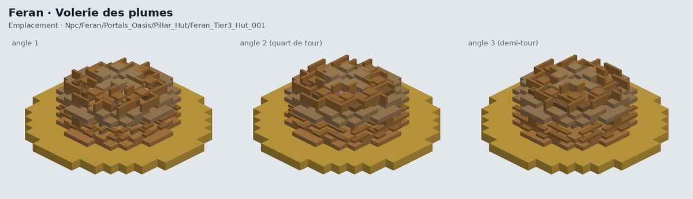

## Avant-postes de métier

Bâtiments isolés fondés à l'écart d'un village de palier 3. Voir [Avant-postes de métier](../avant-postes-de-metier.md).

### Pavillon de chasse

**Avant-poste.** Gibier et peaux ; livre de la viande au village chaque matin. Spécialités : Pelleterie (peaux et cuirs moyens et lourds) ; Vénerie (viande cuite, appâts, caisses de capture).

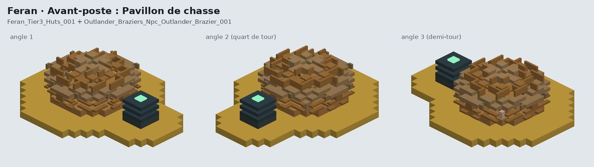

### Ferme

**Avant-poste.** Champs et semences ; livre du blé au village chaque matin. Spécialités : Céréales (maïs, riz et semences éternelles) ; Primeurs (tomates, oignons et citrouilles).

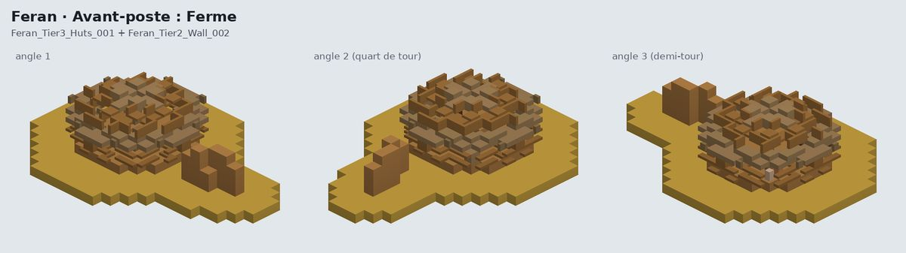

### Mine

**Avant-poste.** Pierre et métaux ; livre de la pierre au village chaque matin. Spécialités : Filons de métal (lingots de fer, de bronze, d'argent et d'or) ; Carrière (briques, marbre et quartzite).

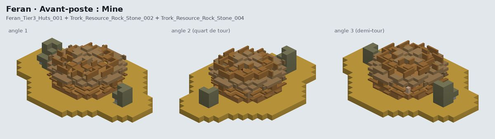

### Pêcherie

**Avant-poste.** Poissons et nasses ; livre du poisson au village chaque matin. Spécialités : Fumoir (poisson grillé et prises rares) ; Viviers (essence d'eau, riz et prise légendaire).

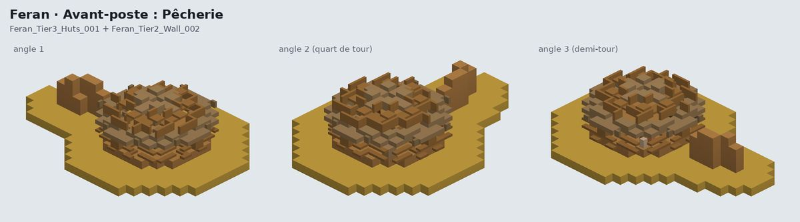

### Scierie

**Avant-poste.** Bois et charpente ; livre des rondins au village chaque matin. Spécialités : Charpente (planches et poutres) ; Sève et graines (sève, graines d'arbres et saignoir).

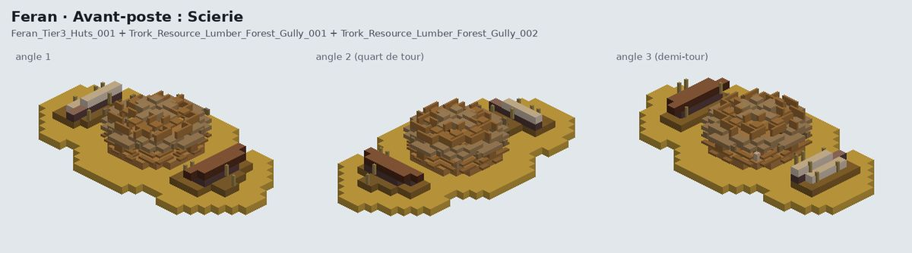

### Tour de guet

**Avant-poste.** Le village voit venir les raids 30 s plus tôt par niveau ; gardes plus nombreux. Spécialités : Guetteurs (cartes et torches ; en raid, +1 garde au village) ; Sentinelles (armure légère ; en raid, des gardes plus solides).

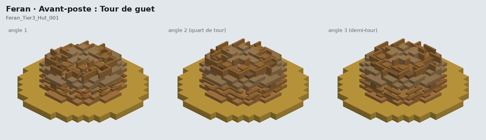
