# Bâtiments des Kweebecs

Tous les bâtiments du village de chênes, palier par palier, puis les projets d'emplacement et les avant-postes. Chaque image montre le même bâtiment sous trois angles (vue de face, quart de tour, demi-tour). Voir aussi la page du peuple : [Kweebecs](../kweebecs.md).

## Cœur du village

La place centrale grandit à chaque palier. Première image : le cœur au palier 3 ; seconde : le campement de départ.

### Cœur du village

**Cœur.** Place centrale : tableau du village (commandes, chantiers, emplacements), dépôt des matériaux, bannière. Grandit à chaque palier.

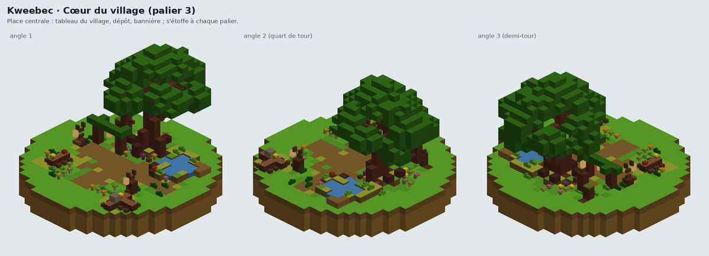

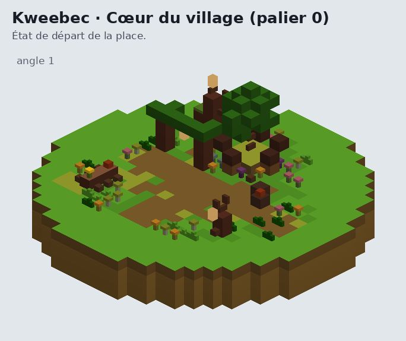

## Bâtiments du village

### Palier 0

#### Abri ouest

**Habitation.** Logement : Jardinière.

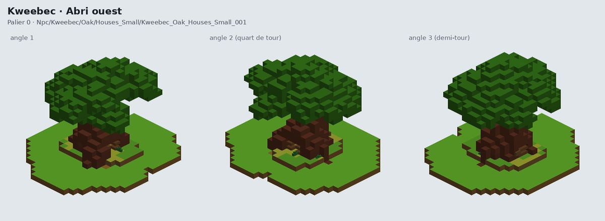

#### Potager

**Bâtiment de métier.** Métier : Jardinière. Spécialités : Maraîcher (graines, légumes et salades) ; Verger à baies (baies, baies d'hiver et tartes).

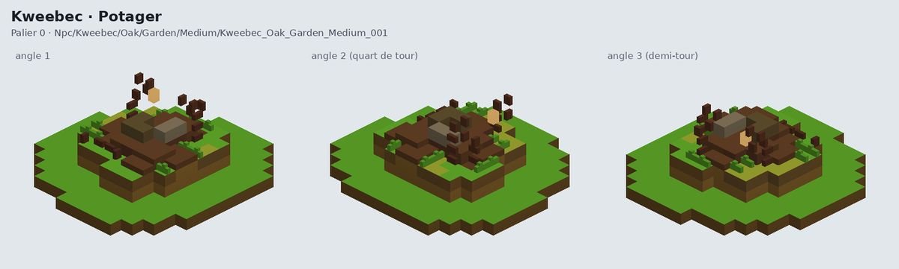

#### Tour de guet

**Habitation.** Poste de travail : Guetteur.

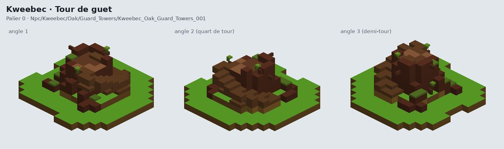

#### Abri est

**Habitation.** Logement : Bâtisseur, Guetteur.

Même bâtiment que « Abri ouest ».

### Palier 1

#### Échoppe

**Décor.** Sans habitant attitré.

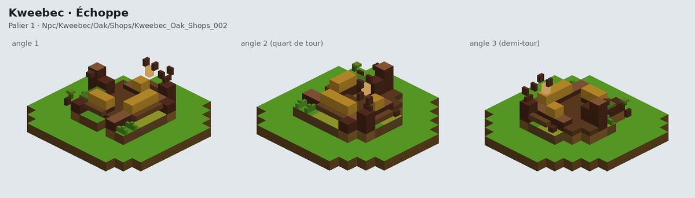

#### Enclos des lapins

**Bâtiment de métier.** Métier : Éleveur de lapins. Spécialités : Basse-cour (poules et dindons : œufs, plumes, volaille) ; Mousse-cornes (mousse-cornes : fibre, écorce et essence de vie) ; Bergerie (moutons : laine, rouleaux de laine).

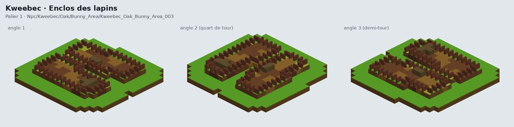

#### Maison sud-ouest

**Habitation.** Logement : Puisatière, Éleveur de lapins.

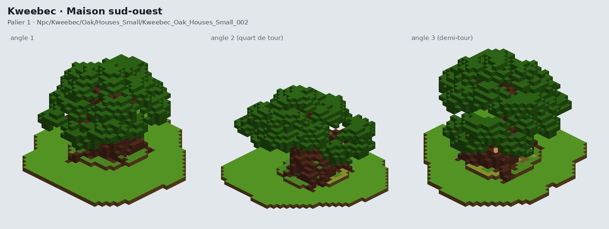

#### Puits

**Bâtiment de métier.** Métier : Puisatière. Spécialités : Source claire (essence d'eau et fioles) ; Vivier (poissons d'eau douce et nasses).

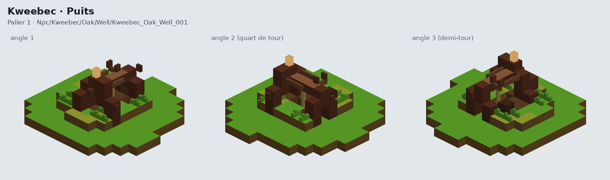

### Palier 2

#### Échoppe ouest

**Décor.** Sans habitant attitré.

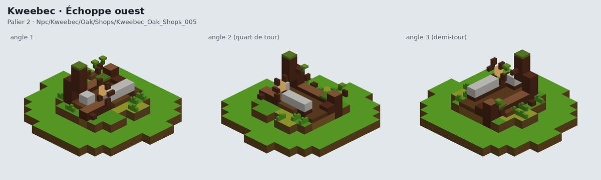

#### Maison de soins

**Bâtiment de métier.** Métier : Soigneuse. Spécialités : Herbes de soin (potions de vie) ; Élixirs (endurance et antidotes).

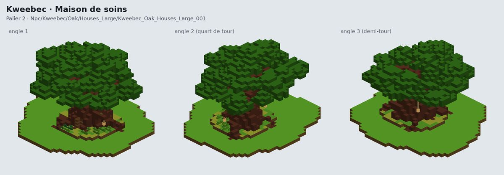

#### Maison des gardes

**Habitation.** Logement : Garde.

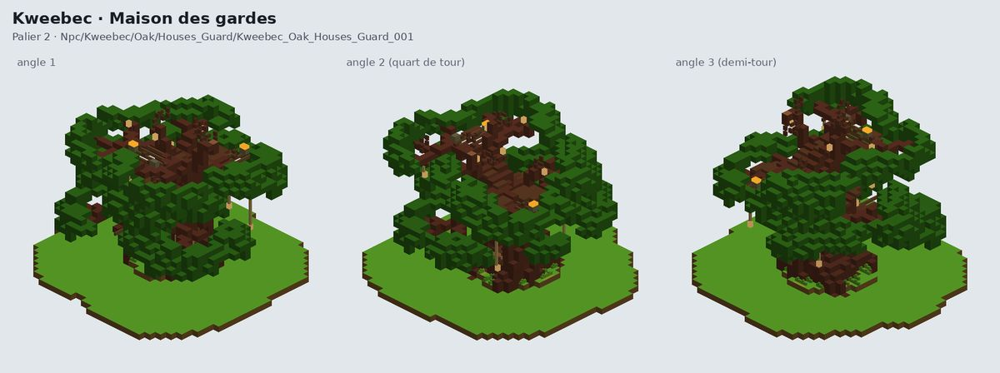

#### Tour de la garde

**Bâtiment de métier.** Métier : Garde. Spécialités : Archers (arcs et flèches ; en raid, 2 gardes de plus postés à la tour) ; Vigiles (armure kweebec ; en raid, +1 garde et des gardes plus solides).

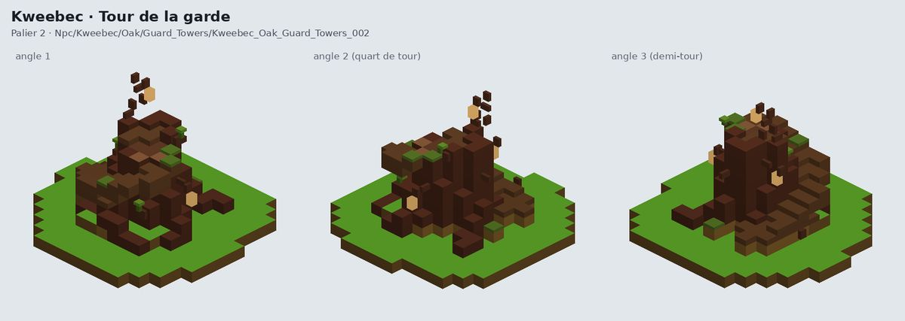

### Palier 3

#### Grand-Père

**Habitation.** Poste de travail : Ancien du Grand-Père. Logement : Ancien du Grand-Père.

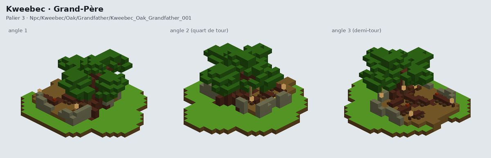

#### Grand potager

**Habitation.** Poste de travail : Jardinier du bourg.

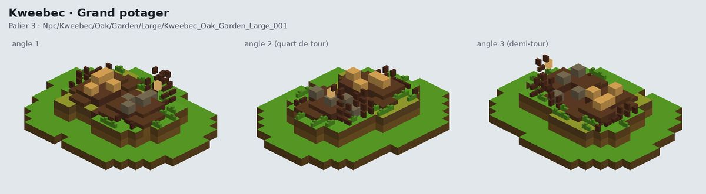

## Projets d'emplacement

Bâtiments au choix sur les deux [terrains libres](../emplacements.md) : le premier ouvre au palier 2, le second au palier 3.

### Atelier d'archerie

**Projet d'emplacement.** Métier : Archer. Spécialités : Arcs légers (arcs courts de cuivre et de fer) ; Flèches de chasse (flèches de fer et de précision).

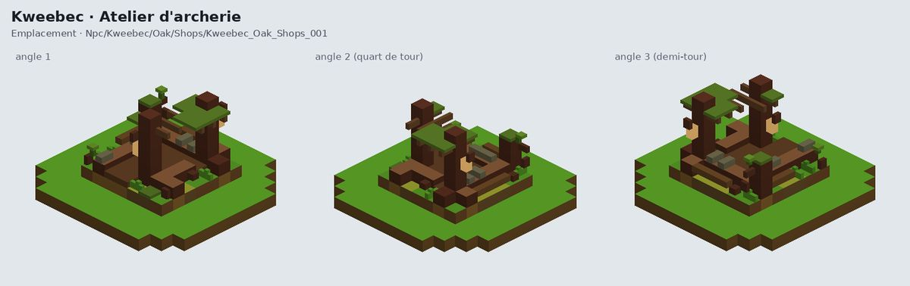

### Deuxième enclos

**Projet d'emplacement.** Métier : Éleveur. Spécialités : Basse-cour (poules et dindons : œufs, plumes, volaille) ; Mousse-cornes (mousse-cornes : fibre, écorce et essence de vie) ; Bergerie (moutons : laine, rouleaux de laine).

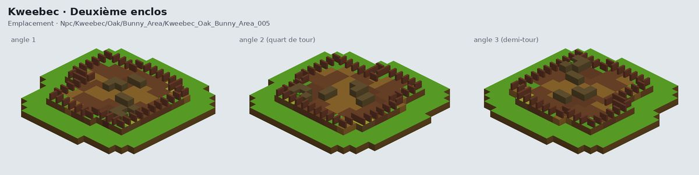

### Grand bassin

**Projet d'emplacement.** Métier : Pêcheuse. Spécialités : Poissons (poissons frais et grillés) ; Essence d'eau (essence d'eau et potions claires).

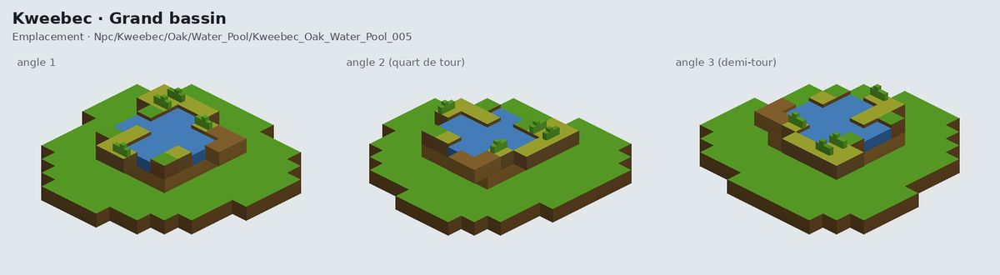

### Herboristerie

**Projet d'emplacement.** Métier : Herboriste. Spécialités : Potions de vie (potions de vie et de régénération) ; Poisons et antidotes (antidotes et fioles de poison).

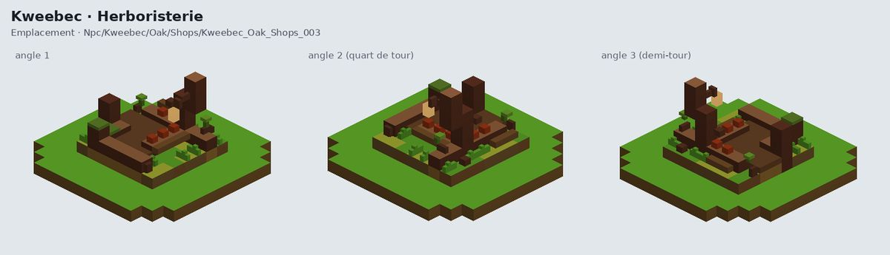

### Atelier du menuisier

**Projet d'emplacement.** Métier : Menuisier. Spécialités : Mobilier kweebec (tabourets, tables, armoires) ; Lanternes (lanternes, bougies et statues).

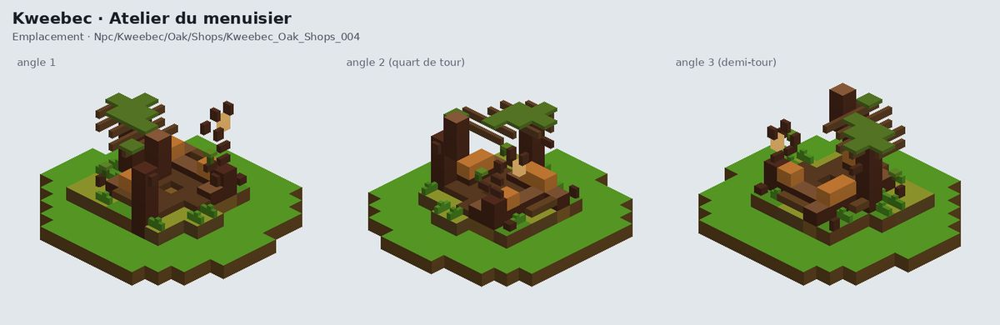

## Avant-postes de métier

Bâtiments isolés fondés à l'écart d'un village de palier 3. Voir [Avant-postes de métier](../avant-postes-de-metier.md).

### Bosquet

**Avant-poste.** Plantes rares et alchimiques ; livre des herbes rares au village chaque matin (plante écarlate, plante azurée, chardon des tempêtes). Les Kweebecs, amis de la nature, n'ont pas de mine. Spécialités : Massif écarlate (plantes écarlates rares et leurs graines) ; Mare azurée (plantes azurées et chardons des tempêtes, et leurs graines).

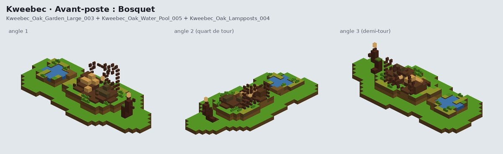

### Pavillon de chasse

**Avant-poste.** Gibier et peaux ; livre de la viande au village chaque matin. Spécialités : Pelleterie (peaux et cuirs moyens et lourds) ; Vénerie (viande cuite, appâts, caisses de capture).

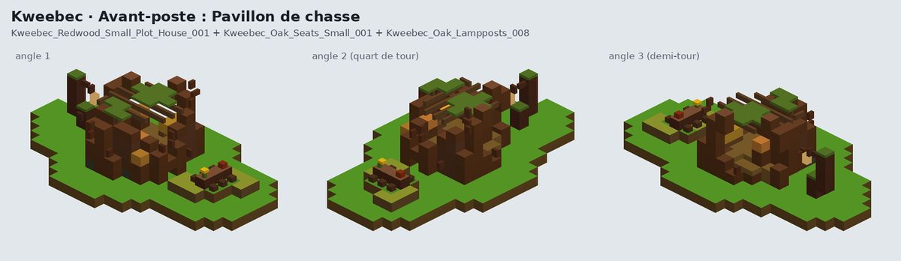

### Ferme

**Avant-poste.** Champs et semences ; livre du blé au village chaque matin. Spécialités : Céréales (maïs, riz et semences éternelles) ; Primeurs (tomates, oignons et citrouilles).

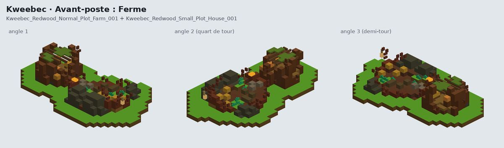

### Pêcherie

**Avant-poste.** Poissons et nasses ; livre du poisson au village chaque matin. Spécialités : Fumoir (poisson grillé et prises rares) ; Viviers (essence d'eau, riz et prise légendaire).

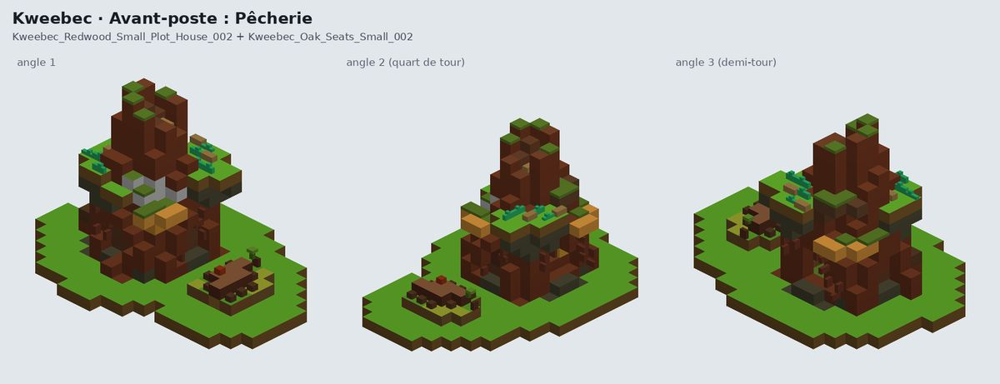

### Scierie

**Avant-poste.** Bois et charpente ; livre des rondins au village chaque matin. Spécialités : Charpente (planches et poutres) ; Sève et graines (sève, graines d'arbres et saignoir).

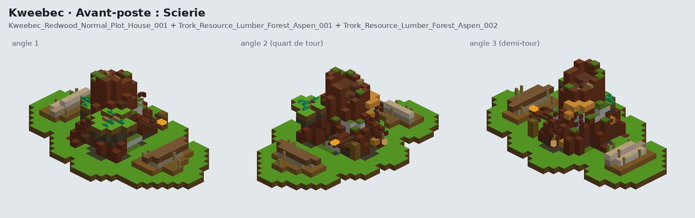

### Tour de guet

**Avant-poste.** Le village voit venir les raids 30 s plus tôt par niveau ; gardes plus nombreux. Spécialités : Guetteurs (cartes et torches ; en raid, +1 garde au village) ; Sentinelles (armure légère ; en raid, des gardes plus solides).

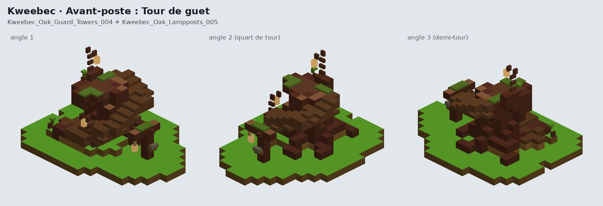
