# Bâtiments des Renoncés

Tous les bâtiments du hameau du givre, palier par palier, puis les projets d'emplacement et les avant-postes. Chaque image montre le même bâtiment sous trois angles (vue de face, quart de tour, demi-tour). Voir aussi la page du peuple : [Renoncés](../renonces.md).

## Cœur du village

La place centrale grandit à chaque palier. Première image : le cœur au palier 3 ; seconde : le campement de départ.

### Cœur du village

**Cœur.** Place centrale : tableau du village (commandes, chantiers, emplacements), dépôt des matériaux, bannière. Grandit à chaque palier.

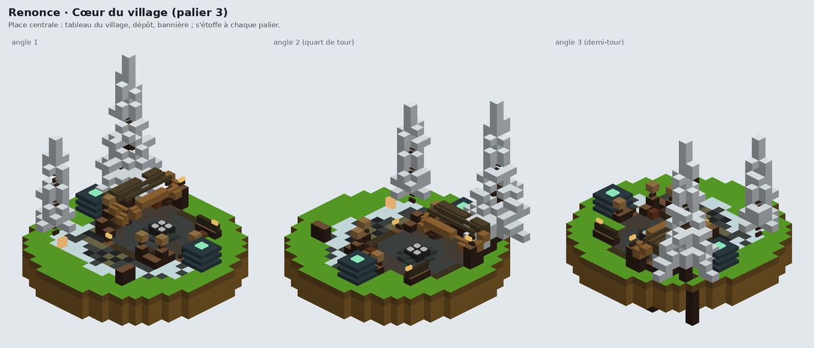

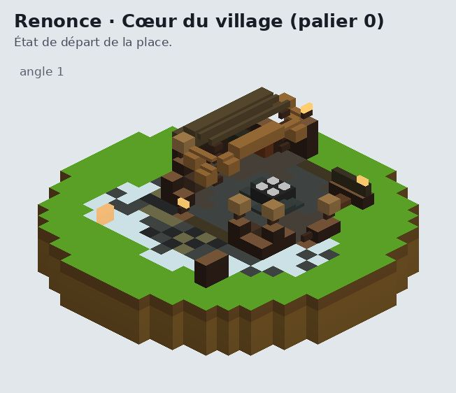

## Bâtiments du village

### Palier 0

#### Abri des fuyards

**Habitation.** Logement : Bâtisseur, Berger.

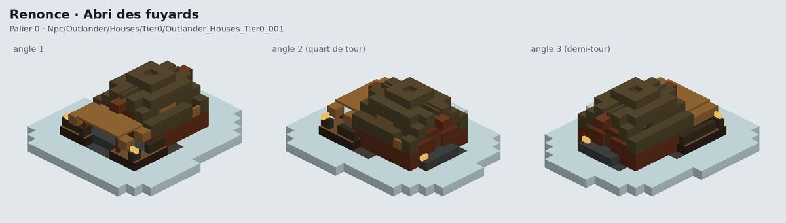

#### Abri du guet

**Habitation.** Logement : Guetteur.

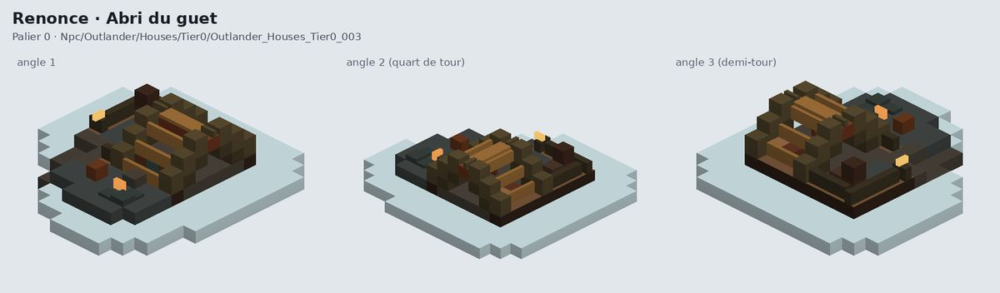

#### Tour de guet

**Habitation.** Poste de travail : Guetteur.

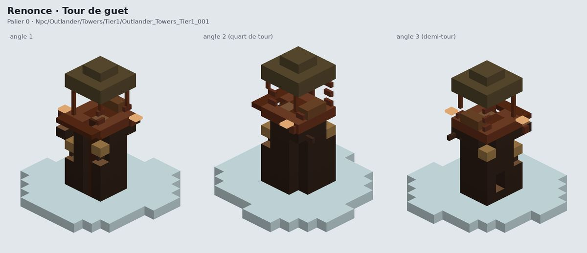

### Palier 1

#### Bergerie du givre

**Bâtiment de métier.** Métier : Berger. Spécialités : Bisons (bisons : bœuf et peaux lourdes) ; Sangliers des neiges (sangliers : viande et défenses) ; Loups blancs des repentis (loups blancs : fourrures épaisses).

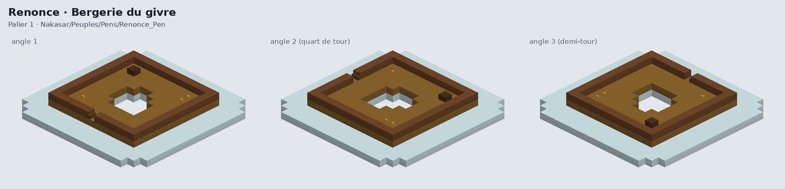

#### Maison des repentis

**Décor.** Sans habitant attitré.

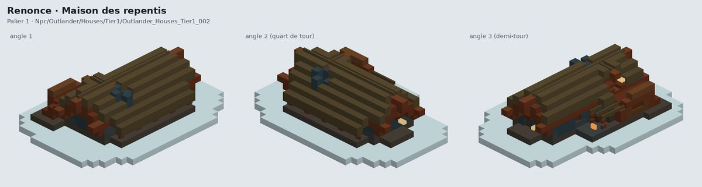

#### Maison du chasseur

**Bâtiment de métier.** Métier : Chasseur. Spécialités : Trappeur des neiges (peaux lourdes et fourrures) ; Pêcheur des glaces (poissons des eaux froides).

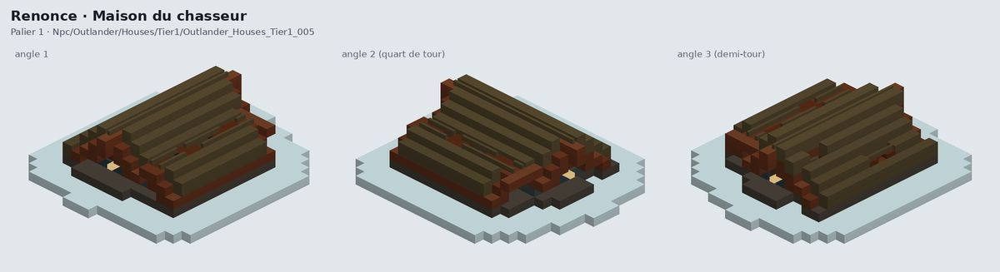

#### Petit bateau

**Décor.** Sans habitant attitré.

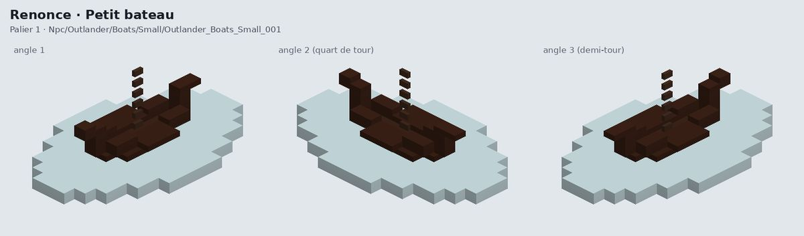

### Palier 2

#### Grand bateau

**Décor.** Sans habitant attitré.

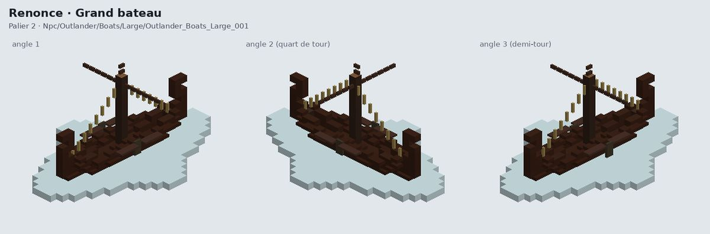

#### Grande maison

**Habitation.** Logement : Garde.

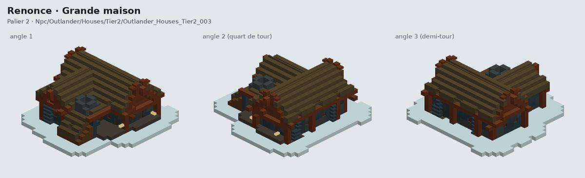

#### Tour du fort

**Bâtiment de métier.** Métier : Garde. Spécialités : Arbalétriers (arbalètes ; en raid, 2 gardes de plus postés à la tour) ; Gardes du givre (manteaux ; en raid, +1 garde et des gardes plus solides).

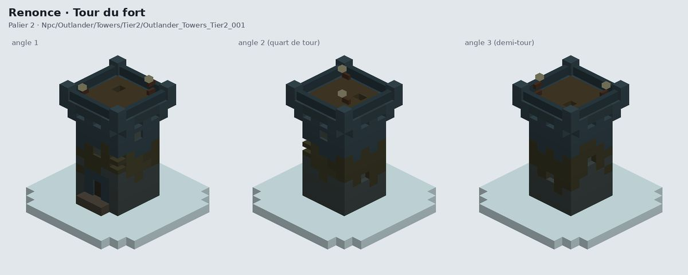

### Palier 3

#### Maison du Sorcier

**Habitation.** Poste de travail : Ancien du village. Logement : Ancien du village.

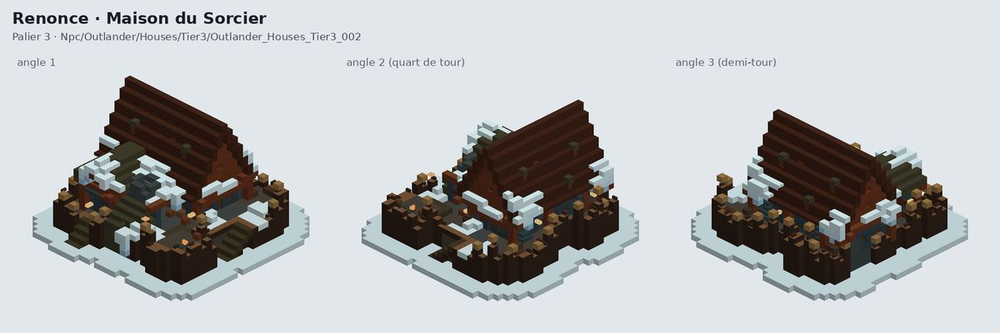

#### Totem brisé

**Décor.** Sans habitant attitré.

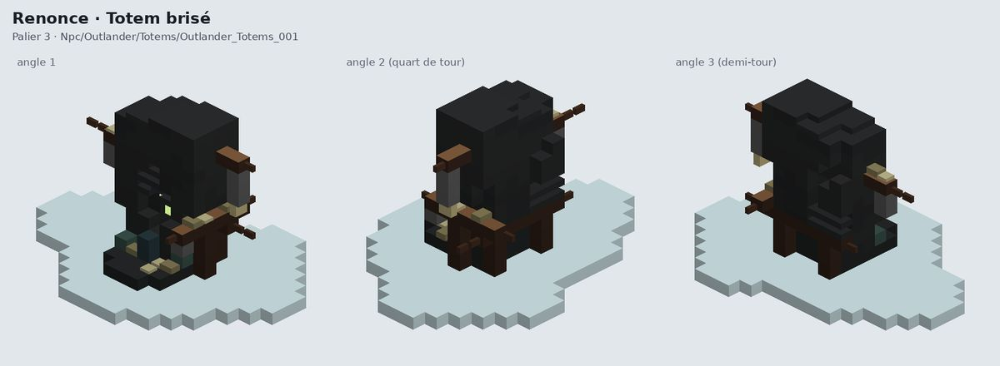

## Projets d'emplacement

Bâtiments au choix sur les deux [terrains libres](../emplacements.md) : le premier ouvre au palier 2, le second au palier 3.

### Cabane de pêche

**Projet d'emplacement.** Métier : Pêcheur. Spécialités : Poissons froids (poissons des eaux froides) ; Filets et nasses (nasses, appâts et belles prises).

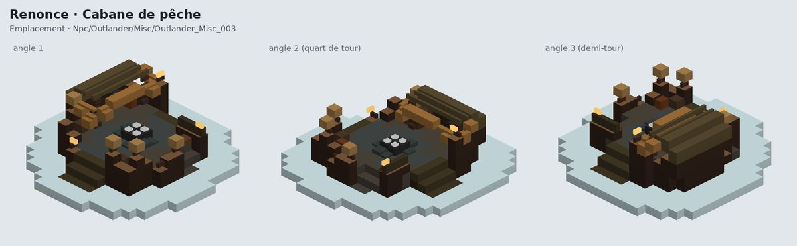

### Chenil

**Projet d'emplacement.** Métier : Maître-chien. Spécialités : Loups de garde (peaux et harnais ; en raid, +1 garde) ; Traîneaux (sangles, bois et cartes du givre).

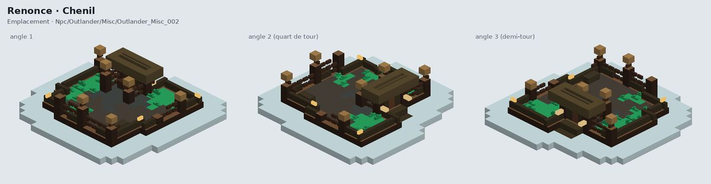

### Deuxième bergerie

**Projet d'emplacement.** Métier : Berger. Spécialités : Bisons (bisons : bœuf et peaux lourdes) ; Sangliers des neiges (sangliers : viande et défenses) ; Loups blancs des repentis (loups blancs : fourrures épaisses).

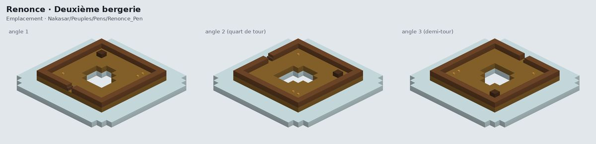

### Forge des repentis

**Projet d'emplacement.** Métier : Forgeron repenti. Spécialités : Armes (masses, lances et arbalètes de fer) ; Armures lourdes (armures de cuir lourd).

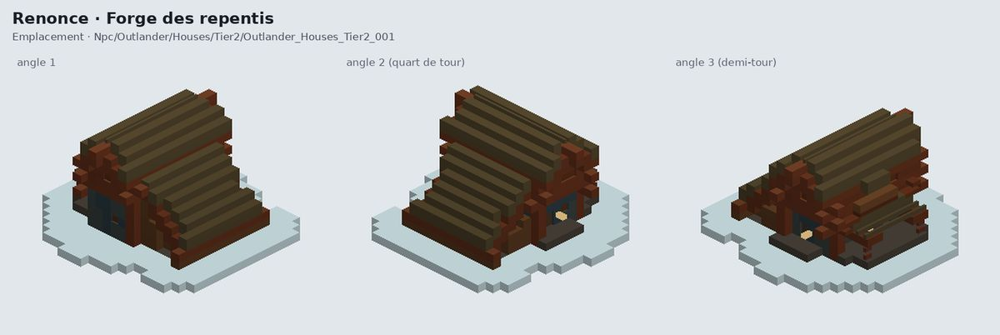

### Fumoir et tannerie

**Projet d'emplacement.** Métier : Tanneur. Spécialités : Viandes fumées (viandes fumées, brochettes, tourtes) ; Fourrures (peaux lourdes et manteaux).

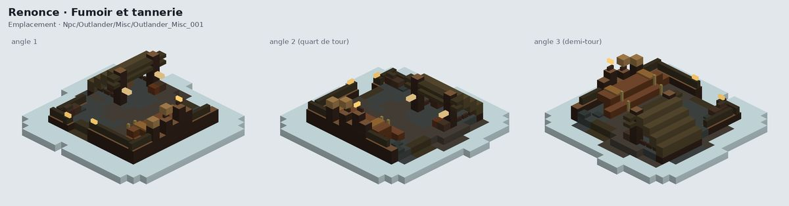

## Avant-postes de métier

Bâtiments isolés fondés à l'écart d'un village de palier 3. Voir [Avant-postes de métier](../avant-postes-de-metier.md).

### Pavillon de chasse

**Avant-poste.** Gibier et peaux ; livre de la viande au village chaque matin. Spécialités : Pelleterie (peaux et cuirs moyens et lourds) ; Vénerie (viande cuite, appâts, caisses de capture).

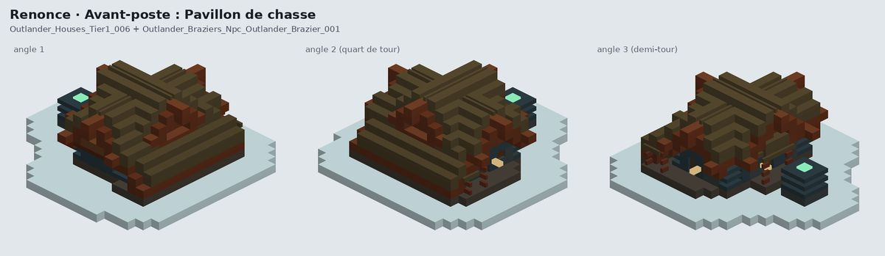

### Ferme

**Avant-poste.** Champs et semences ; livre du blé au village chaque matin. Spécialités : Céréales (maïs, riz et semences éternelles) ; Primeurs (tomates, oignons et citrouilles).

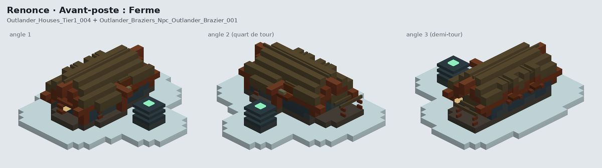

### Mine

**Avant-poste.** Pierre et métaux ; livre de la pierre au village chaque matin. Spécialités : Filons de métal (lingots de fer, de bronze, d'argent et d'or) ; Carrière (briques, marbre et quartzite).

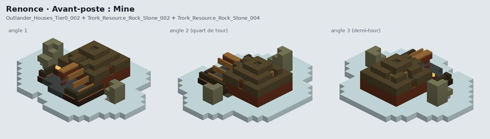

### Pêcherie

**Avant-poste.** Poissons et nasses ; livre du poisson au village chaque matin. Spécialités : Fumoir (poisson grillé et prises rares) ; Viviers (essence d'eau, riz et prise légendaire).

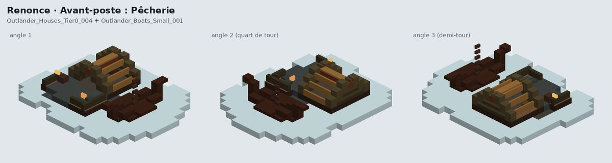

### Scierie

**Avant-poste.** Bois et charpente ; livre des rondins au village chaque matin. Spécialités : Charpente (planches et poutres) ; Sève et graines (sève, graines d'arbres et saignoir).

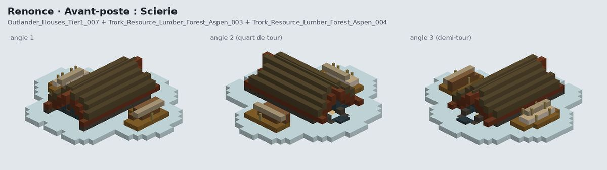

### Tour de guet

**Avant-poste.** Le village voit venir les raids 30 s plus tôt par niveau ; gardes plus nombreux. Spécialités : Guetteurs (cartes et torches ; en raid, +1 garde au village) ; Sentinelles (armure légère ; en raid, des gardes plus solides).

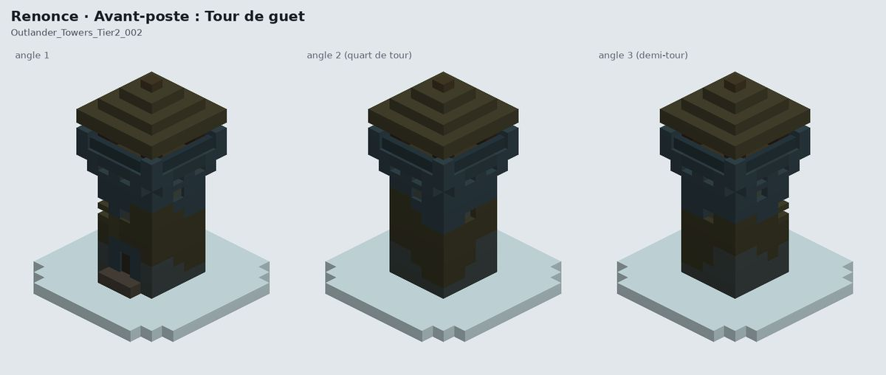
