# Bâtiments des Slothians

Tous les bâtiments du monastère, palier par palier, puis les projets d'emplacement et les avant-postes. Chaque image montre le même bâtiment sous trois angles (vue de face, quart de tour, demi-tour). Voir aussi la page du peuple : [Slothians](../slothians.md).

## Cœur du village

La place centrale grandit à chaque palier. Première image : le cœur au palier 3 ; seconde : le campement de départ.

### Cœur du village

**Cœur.** Place centrale : tableau du village (commandes, chantiers, emplacements), dépôt des matériaux, bannière. Grandit à chaque palier.

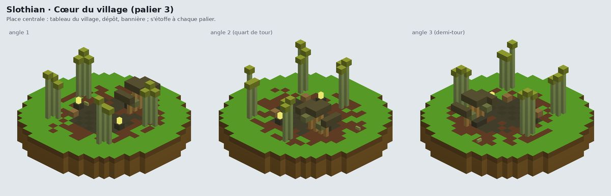

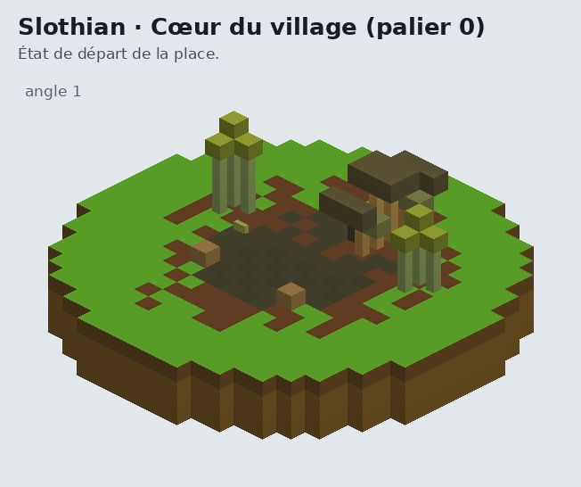

## Bâtiments du village

### Palier 0

#### Affût

**Habitation.** Poste de travail : Guetteur.

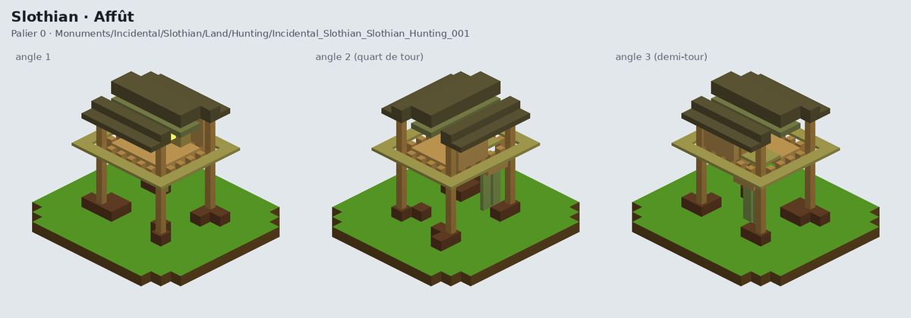

#### Étal des cendres

**Bâtiment de métier.** Métier : Porteur de cendres. Spécialités : Braises (essence de feu et charbon) ; Encens de veille (objets contre la corruption du vide).

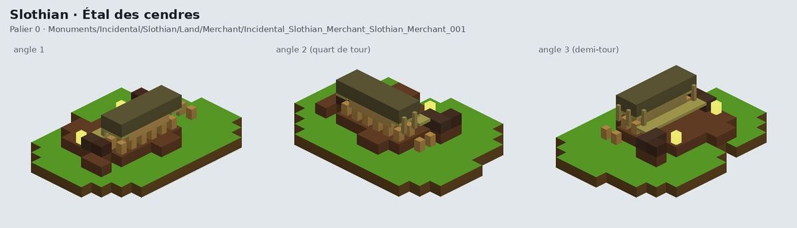

#### Hutte de l'est

**Habitation.** Logement : Bâtisseur, Gardien de la bauge.

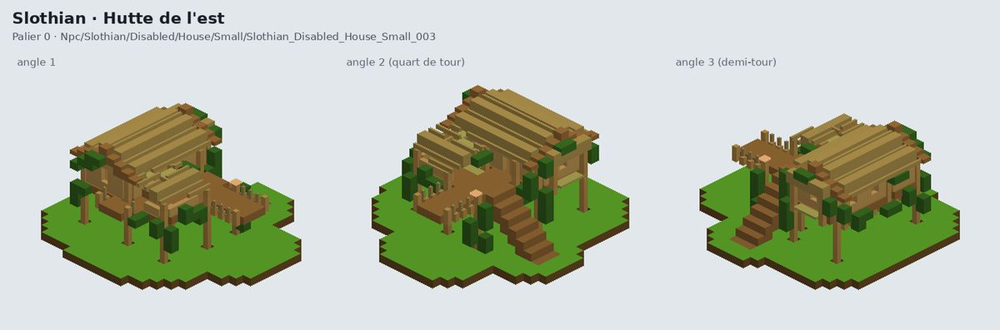

#### Hutte de l'ouest

**Habitation.** Logement : Guetteur, Porteur de cendres.

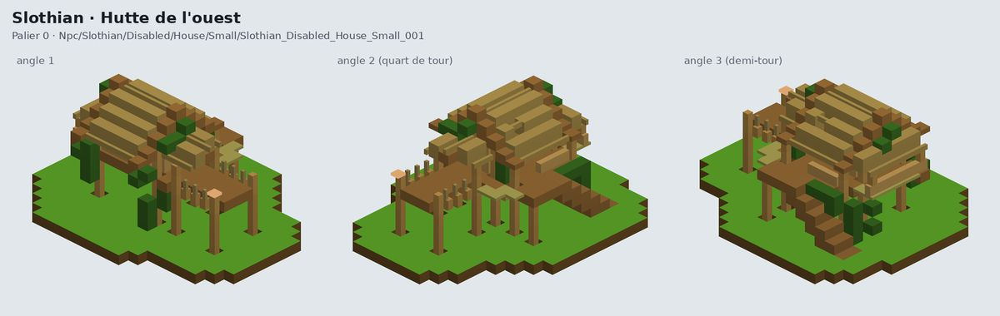

### Palier 1

#### Bauge de veille

**Bâtiment de métier.** Métier : Gardien de la bauge. Spécialités : Archéoptéryx (archéoptéryx : plumes sombres) ; Trillodons (trillodons : cuir épais et cornes) ; Escargots de magme (escargots de magme : coquilles et essence de feu).

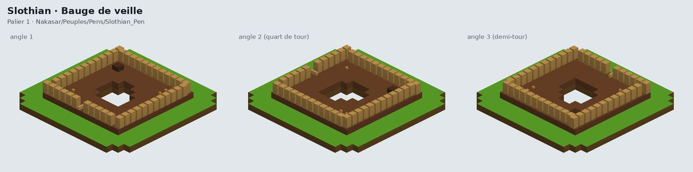

#### Maison du nord-ouest

**Décor.** Sans habitant attitré.

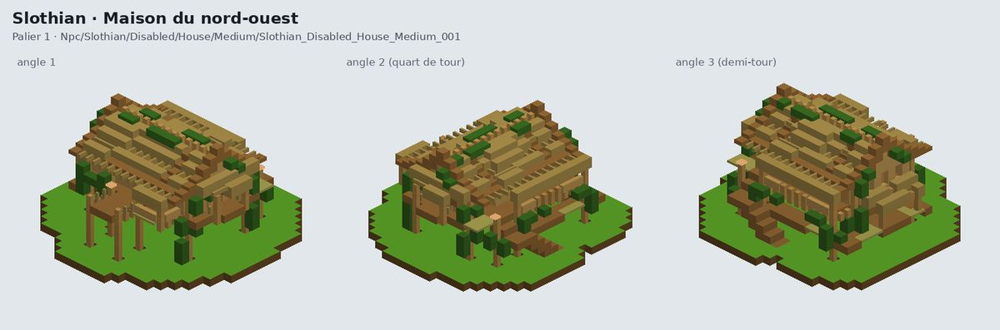

#### Maison du sud-est

**Habitation.** Logement : Garde.

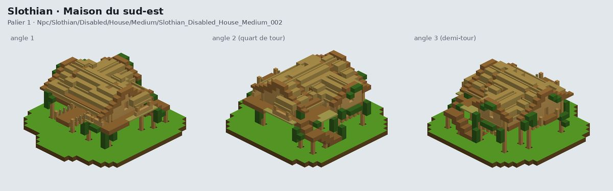

#### Porte du monastère

**Bâtiment de métier.** Métier : Garde. Spécialités : Lances de basalte (lances ; en raid, des gardes bien plus solides) ; Veilleurs (torches ; en raid, +1 garde).

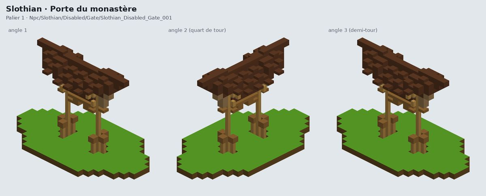

### Palier 2

#### Grande maison

**Décor.** Sans habitant attitré.

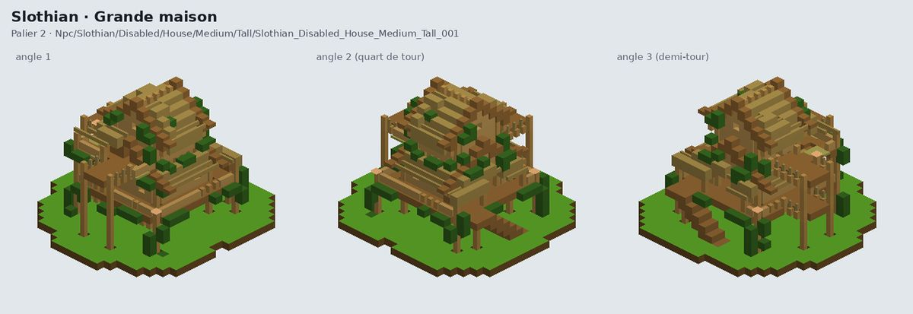

#### Hutte du nord

**Habitation.** Logement : Moine.

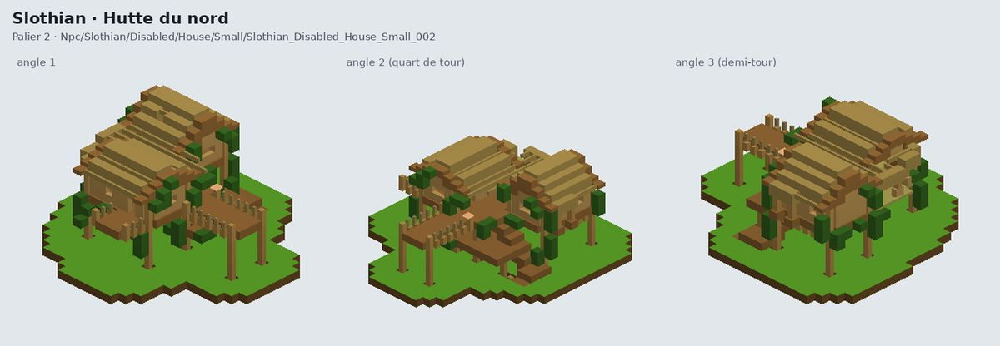

#### Temple de veille

**Bâtiment de métier.** Métier : Moine. Spécialités : Méditation (potions de régénération) ; Chroniques (recettes et objets de mémoire).

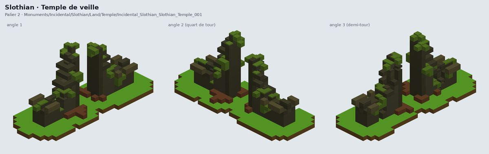

### Palier 3

#### Monastère

**Habitation.** Poste de travail : Doyenne du monastère. Logement : Doyenne du monastère.

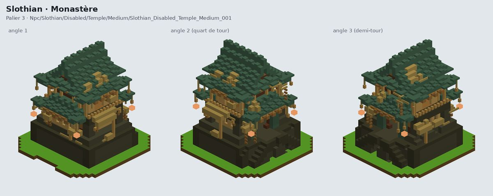

#### Porte des pèlerins

**Décor.** Sans habitant attitré.

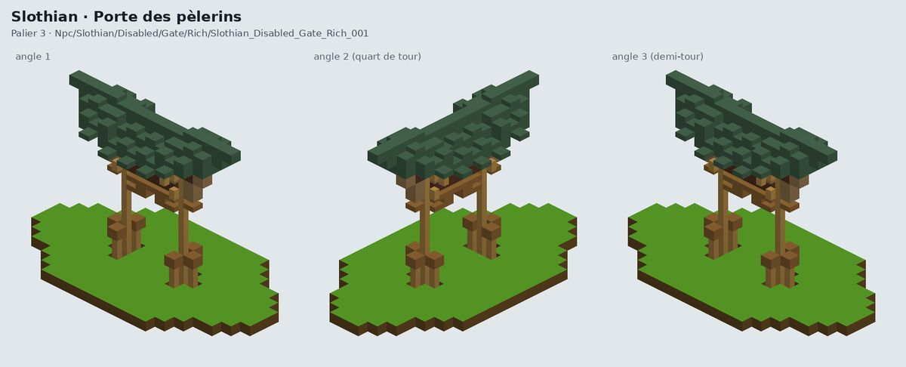

## Projets d'emplacement

Bâtiments au choix sur les deux [terrains libres](../emplacements.md) : le premier ouvre au palier 2, le second au palier 3.

### Cabane de pêche

**Projet d'emplacement.** Métier : Pêcheur. Spécialités : Poissons (poissons frais et grillés) ; Coquillages (coquilles et cristaux du lac).

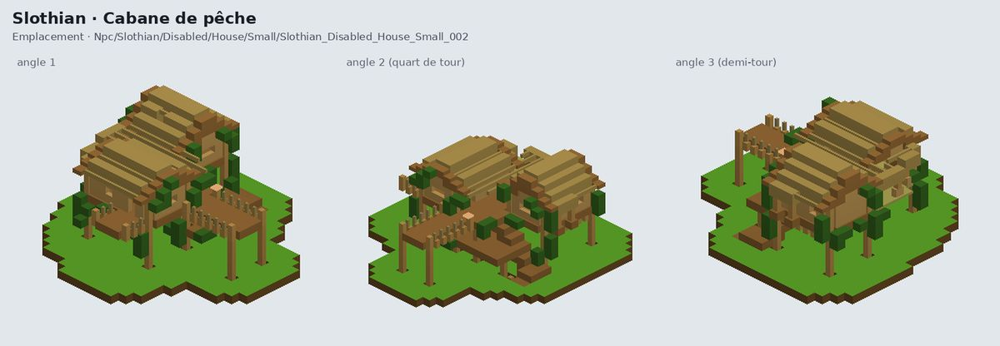

### Deuxième bauge

**Projet d'emplacement.** Métier : Gardien de la bauge. Spécialités : Archéoptéryx (archéoptéryx : plumes sombres) ; Trillodons (trillodons : cuir épais et cornes) ; Escargots de magme (escargots de magme : coquilles et essence de feu).

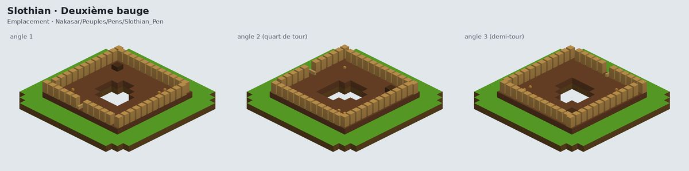

### Puits de basalte

**Projet d'emplacement.** Métier : Puisatier. Spécialités : Eau (eau et potions de régénération) ; Essence de feu (essence de feu, charbon, arc de flamme).

### Sanctuaire

**Projet d'emplacement.** Métier : Gardien du sanctuaire. Spécialités : Protection contre le Vide (potions qui purifient et soignent) ; Offrandes (braseros, pots et essences rares).

### Scriptorium

**Projet d'emplacement.** Métier : Copiste. Spécialités : Recettes (recettes de cuisine et de graines) ; Souvenirs de la veille (livres, tableaux et grimoires).

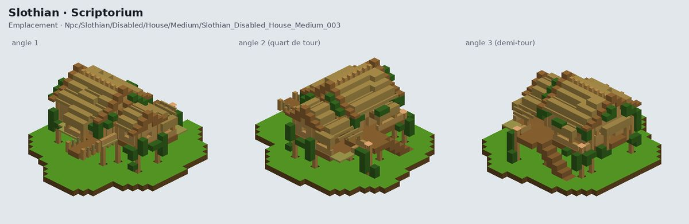

## Avant-postes de métier

Bâtiments isolés fondés à l'écart d'un village de palier 3. Voir [Avant-postes de métier](../avant-postes-de-metier.md).

### Pavillon de chasse

**Avant-poste.** Gibier et peaux ; livre de la viande au village chaque matin. Spécialités : Pelleterie (peaux et cuirs moyens et lourds) ; Vénerie (viande cuite, appâts, caisses de capture).

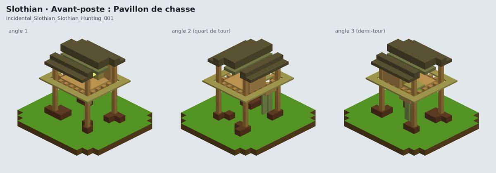

### Ferme

**Avant-poste.** Champs et semences ; livre du blé au village chaque matin. Spécialités : Céréales (maïs, riz et semences éternelles) ; Primeurs (tomates, oignons et citrouilles).

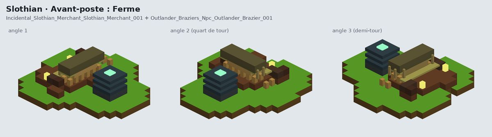

### Mine

**Avant-poste.** Pierre et métaux ; livre de la pierre au village chaque matin. Spécialités : Filons de métal (lingots de fer, de bronze, d'argent et d'or) ; Carrière (briques, marbre et quartzite).

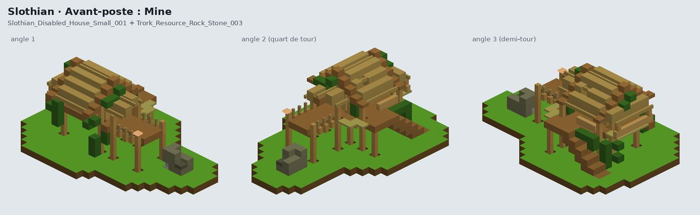

### Pêcherie

**Avant-poste.** Poissons et nasses ; livre du poisson au village chaque matin. Spécialités : Fumoir (poisson grillé et prises rares) ; Viviers (essence d'eau, riz et prise légendaire).

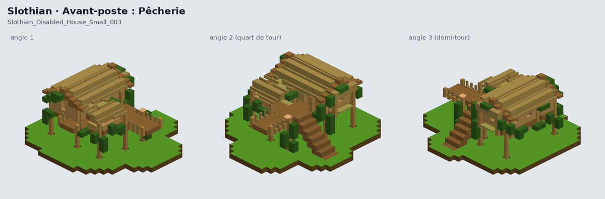

### Scierie

**Avant-poste.** Bois et charpente ; livre des rondins au village chaque matin. Spécialités : Charpente (planches et poutres) ; Sève et graines (sève, graines d'arbres et saignoir).

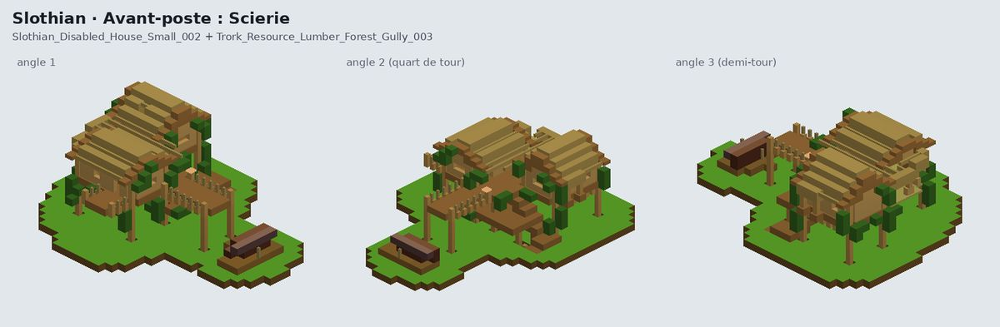

### Tour de guet

**Avant-poste.** Le village voit venir les raids 30 s plus tôt par niveau ; gardes plus nombreux. Spécialités : Guetteurs (cartes et torches ; en raid, +1 garde au village) ; Sentinelles (armure légère ; en raid, des gardes plus solides).

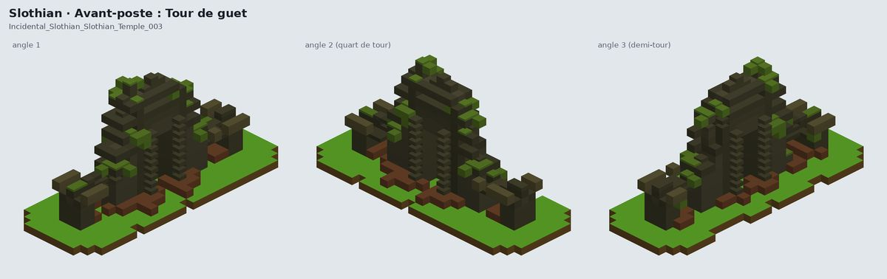
