# Bâtiments des Trorks

Tous les bâtiments du camp trork, palier par palier, puis les projets d'emplacement et les avant-postes. Chaque image montre le même bâtiment sous trois angles (vue de face, quart de tour, demi-tour). Voir aussi la page du peuple : [Trorks](../trorks.md).

## Cœur du village

La place centrale grandit à chaque palier. Première image : le cœur au palier 3 ; seconde : le campement de départ.

### Cœur du village

**Cœur.** Place centrale : tableau du village (commandes, chantiers, emplacements), dépôt des matériaux, bannière. Grandit à chaque palier.

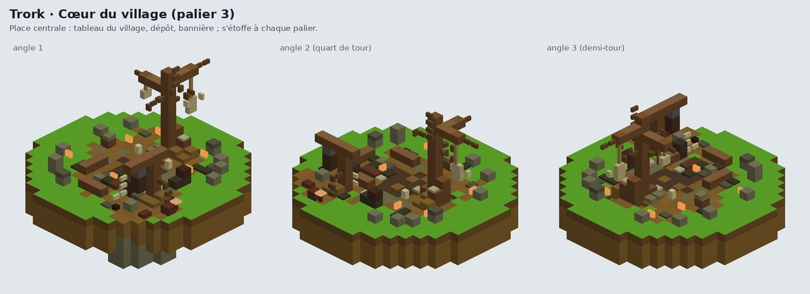

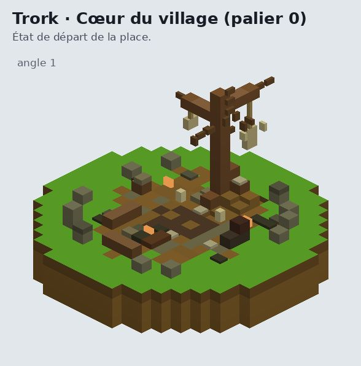

## Bâtiments du village

### Palier 0

#### Panneau d'avertissement

**Décor.** Sans habitant attitré.

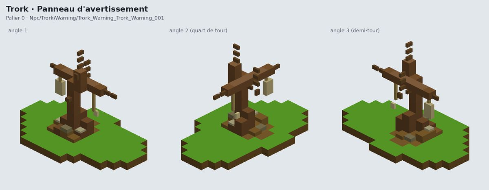

#### Feu de camp

**Bâtiment de métier.** Métier : Guerrier. Spécialités : Rôtisserie (viandes cuites) ; Fosse de combat (armes en os et armure trork).

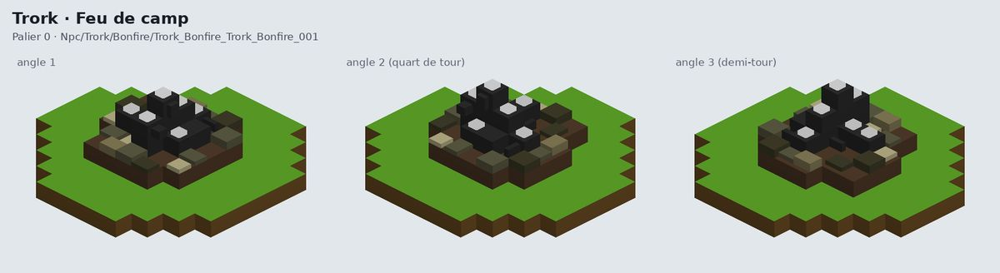

#### Tente ouest

**Habitation.** Logement : Guerrier, Dresseur.

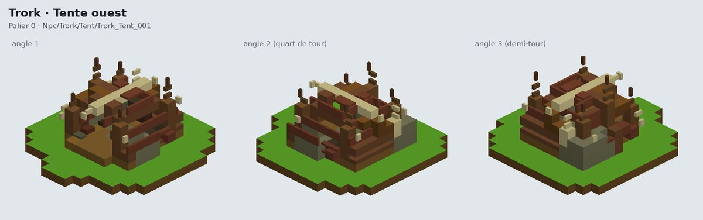

#### Tour de guet

**Habitation.** Poste de travail : Garde.

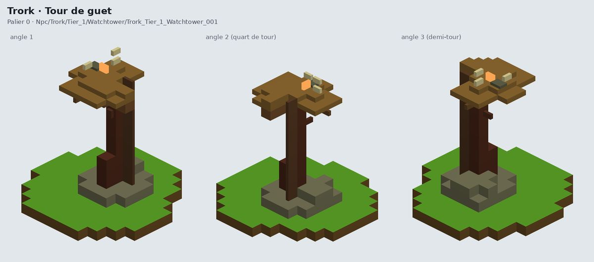

#### Tente est

**Habitation.** Logement : Garde.

Même bâtiment que « Tente ouest ».

### Palier 1

#### Fosse aux bêtes

**Bâtiment de métier.** Métier : Dresseur. Spécialités : Loups de chasse (loups dressés : crocs, os, peaux) ; Porcs sauvages (porcs sauvages : viande et cuir) ; Chèvres des cimes (chèvres : peaux moyennes et lait caillé).

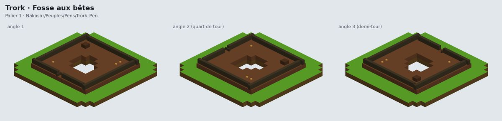

#### Piège du chasseur

**Bâtiment de métier.** Métier : Chasseur. Spécialités : Trappeur (peaux et os) ; Rabatteur (viande et brochettes).

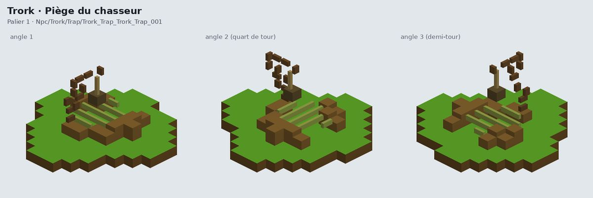

#### Réserve

**Décor.** Sans habitant attitré.

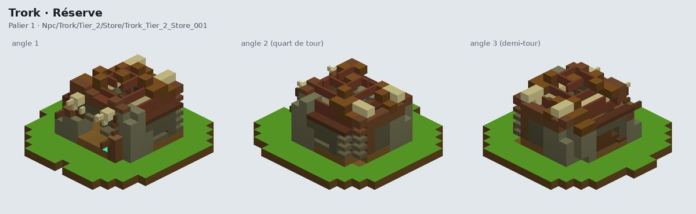

#### Terrier

**Décor.** Sans habitant attitré.

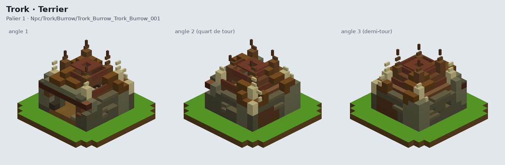

#### Tente sud

**Habitation.** Logement : Chasseur.

Même bâtiment que « Tente ouest ».

### Palier 2

#### Bric-à-brac

**Décor.** Sans habitant attitré.

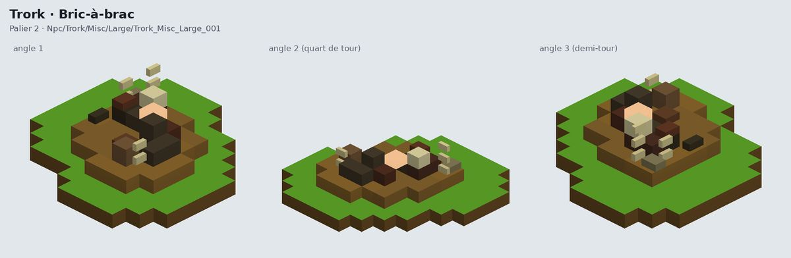

#### Entrepôt

**Bâtiment de métier.** Métier : Cogneur. Spécialités : Pillards (lingots de cuivre et de fer récupérés) ; Bûcherons (rondins, bâtons et écorce).

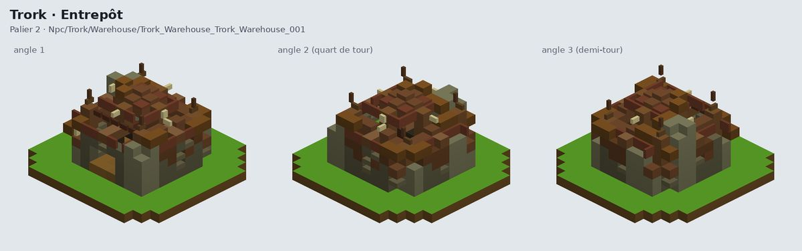

#### Tour est

**Habitation.** Poste de travail : Sentinelle. Logement : Sentinelle.

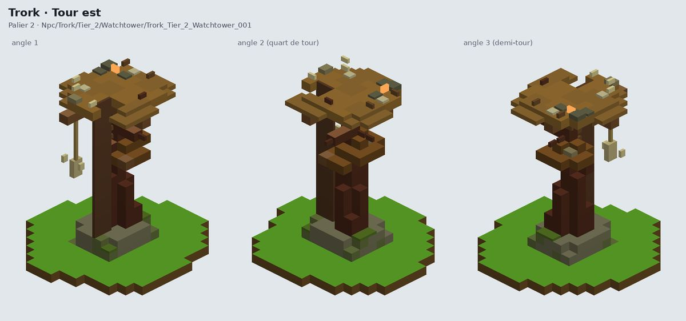

### Palier 3

#### Grand feu

**Décor.** Sans habitant attitré.

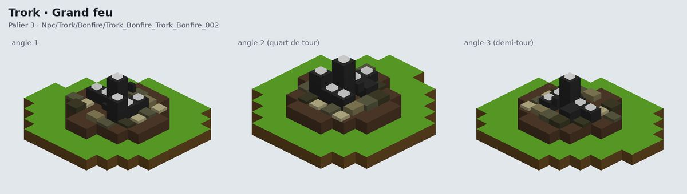

#### Réserve du chef

**Habitation.** Poste de travail : Shaman. Logement : Shaman.

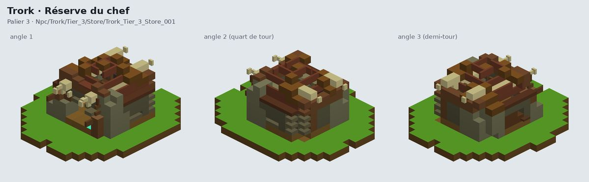

#### Tour ouest

**Décor.** Sans habitant attitré.

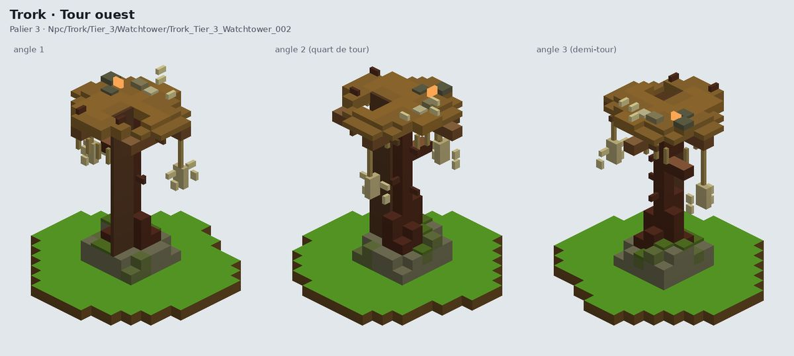

## Projets d'emplacement

Bâtiments au choix sur les deux [terrains libres](../emplacements.md) : le premier ouvre au palier 2, le second au palier 3.

### Camp de bûcherons

**Projet d'emplacement.** Métier : Bûcheron. Spécialités : Bois (rondins de chêne, de bouleau et de séquoia) ; Écorce et sève (écorce, sève et outils pour les récolter).

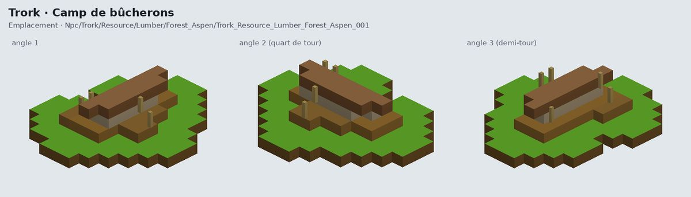

### Carrière

**Projet d'emplacement.** Métier : Casseur de pierre. Spécialités : Pierre (pierre, basalte et poudre) ; Minerai (lingots de cuivre, de fer et d'argent).

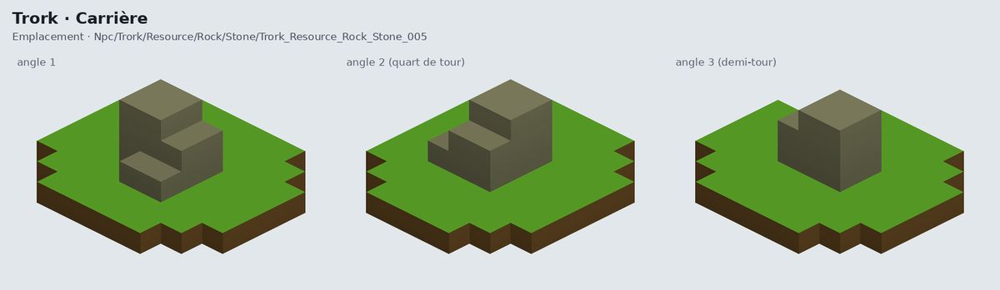

### Deuxième fosse

**Projet d'emplacement.** Métier : Dresseur. Spécialités : Loups de chasse (loups dressés : crocs, os, peaux) ; Porcs sauvages (porcs sauvages : viande et cuir) ; Chèvres des cimes (chèvres : peaux moyennes et lait caillé).

### Forge de guerre

**Projet d'emplacement.** Métier : Forgeron. Spécialités : Armes en os (épées, dagues et haches d'os) ; Armures de peau (armures trorks et de cuir).

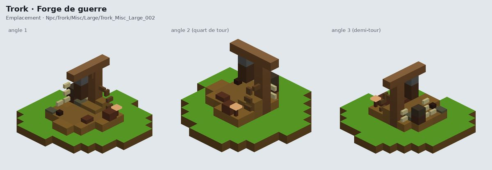

### Tannerie

**Projet d'emplacement.** Métier : Tanneur. Spécialités : Cuirs (cuirs légers, moyens et lourds) ; Sangles et sacs (sangles, musettes et caisses).

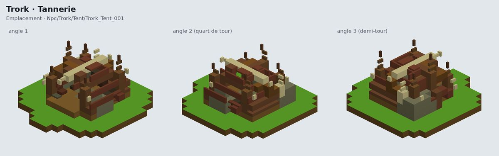

## Avant-postes de métier

Bâtiments isolés fondés à l'écart d'un village de palier 3. Voir [Avant-postes de métier](../avant-postes-de-metier.md).

### Pavillon de chasse

**Avant-poste.** Gibier et peaux ; livre de la viande au village chaque matin. Spécialités : Pelleterie (peaux et cuirs moyens et lourds) ; Vénerie (viande cuite, appâts, caisses de capture).

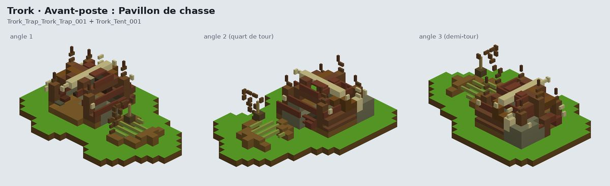

### Ferme

**Avant-poste.** Champs et semences ; livre du blé au village chaque matin. Spécialités : Céréales (maïs, riz et semences éternelles) ; Primeurs (tomates, oignons et citrouilles).

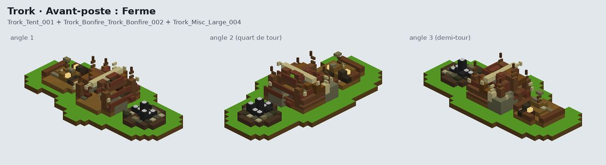

### Mine

**Avant-poste.** Pierre et métaux ; livre de la pierre au village chaque matin. Spécialités : Filons de métal (lingots de fer, de bronze, d'argent et d'or) ; Carrière (briques, marbre et quartzite).

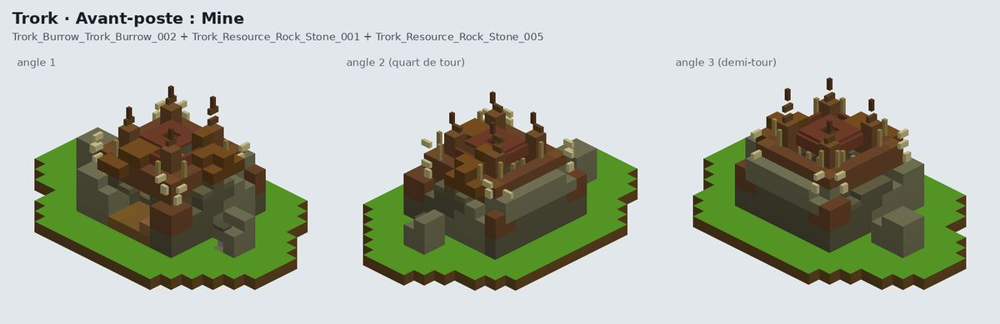

### Pêcherie

**Avant-poste.** Poissons et nasses ; livre du poisson au village chaque matin. Spécialités : Fumoir (poisson grillé et prises rares) ; Viviers (essence d'eau, riz et prise légendaire).

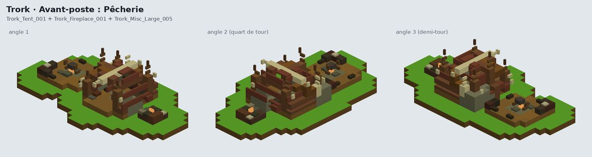

### Scierie

**Avant-poste.** Bois et charpente ; livre des rondins au village chaque matin. Spécialités : Charpente (planches et poutres) ; Sève et graines (sève, graines d'arbres et saignoir).

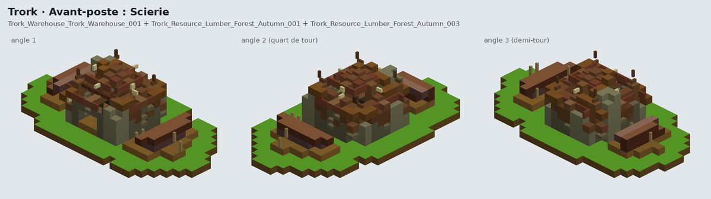

### Tour de guet

**Avant-poste.** Le village voit venir les raids 30 s plus tôt par niveau ; gardes plus nombreux. Spécialités : Guetteurs (cartes et torches ; en raid, +1 garde au village) ; Sentinelles (armure légère ; en raid, des gardes plus solides).

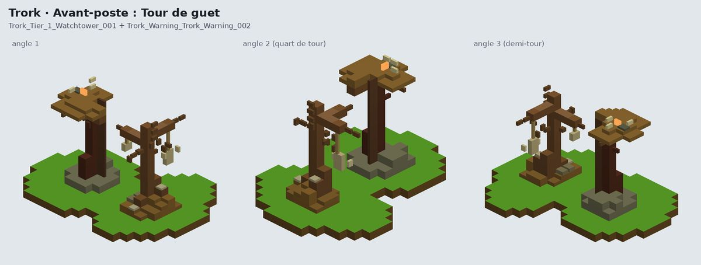
