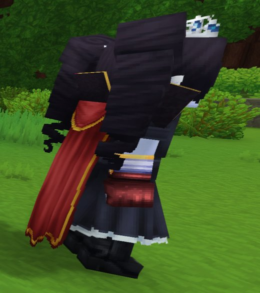
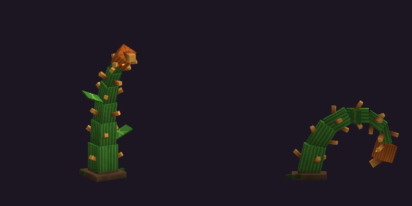
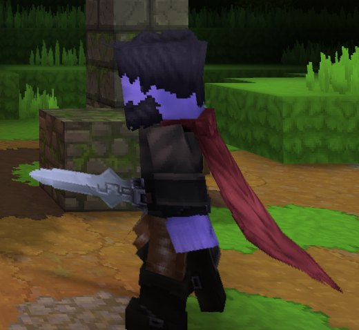
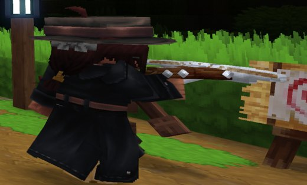
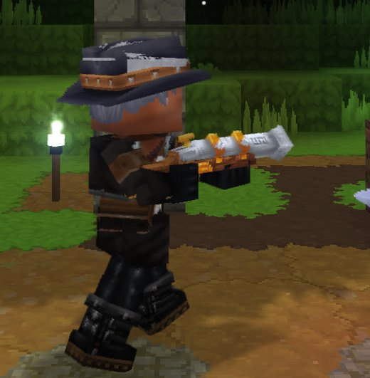

# Bestiaire

Toutes les créatures ajoutées par le mod. Les créatures du Comté forment **un seul camp** : elles ne se blessent jamais entre elles (même avec une attaque de zone) et s'allient contre vous et contre les chasseurs de vampires.

## Boss et élites

| | Créature | Rang | PV | Où | Butin notable |
|---|---|---|---|---|---|
|  | [Comte Vampire](comte-vampire.md) | Boss | 600 | Manoir du Comte | 4 à 6 éclats de rune + 1 rune |
|  | [Comtesse Vampire](comtesse-vampire.md) | Boss | 500 | Manoir du Comte (à la place du Comte, 50 %) | 4 à 6 éclats de rune + 1 rune |
| | [Capitaine de la garde](capitaine-de-la-garde.md) | Élite | 650 | Poste de garde (garnison) | 2 à 4 éclats, hache rouillée (33 %) |
| | [Abomination zombie](abomination-zombie.md) | Élite | 450 | Ferme zombie | 1 à 3 éclats |
|  | [Citrouille géante](citrouille-geante.md) | Élite immobile | 600 | Champ de citrouilles géant | citrouilles, graines, essence, 1 à 3 éclats |

## Créatures du Comté

| | Créature | PV | Où |
|---|---|---|---|
| | [Rejeton de vampire](rejeton-de-vampire.md) | 60 | Manoir, zones hantées la nuit, invoqué par le Comte |
| | [Fantôme](fantome.md) | 45 | Zones hantées, à toute heure |
| | [Villageois zombifié](villageois-zombifie.md) | 80 | Village zombie |
| | [Fermier zombifié](fermier-zombifie.md) | 95 | Ferme zombie |
| | [Paysan rebelle zombifié](paysan-rebelle-zombifie.md) | 85 | Poste de garde des rebelles |
| | [Garde squelette](garde-squelette.md) | 120 | Poste de garde (garnison) |
|  | [Vrille de citrouille](vrille-de-citrouille.md) | 45 | Invoquée par la Citrouille géante |
| | [Vrilles (piège)](vrilles.md) | 12 | Piège de la Citrouille géante |

## Chasseurs de vampires (neutres)

Ils ne vous attaquent que si vous les frappez, et combattent toutes les créatures du Comté. Leurs armes en argent font le double de dégâts aux vampires.

| | Chasseur | PV | Arme |
|---|---|---|---|
|  | [Chasseur (épée)](chasseur-epee.md) | 200 | Épée en argent |
|  | [Chasseuse (arbalète)](chasseuse-arbalete.md) | 160 | Arbalète de poing en argent |
|  | [Chasseur (tromblon)](chasseur-tromblon.md) | 170 | Tromblon en argent |

## Créatures vanilla du Comté

Le Comté fait aussi apparaître des monstres du jeu de base, qui rejoignent le camp des morts-vivants :

- **Partout** : squelettes, squelettes archers, zombies, araignées, chauves-souris, corbeaux.
- **Près des structures** (zones hantées) : spectres, goules, soldats squelettes, araignées des cavernes, zombies aberrants, archimages squelettes, squelettes d'élite, loups-garous.
- **Villages et postes de garde infestés** : araignées et araignées des cavernes (marqueurs, réapparition 10 min).

## Règles communes

- **Zones hantées** : à moins de 45 blocs d'une structure, les monstres apparaissent plus souvent (densité ×1,0 contre ×0,6 dans la lande).
- **Réapparition** : les créatures placées par marqueur reviennent en temps réel (5 min pour les rejetons, 10 min pour les communs, 20 min pour les chasseurs, 30 min pour les boss et élites).
- **Argent** : ×2 contre le Comte, la Comtesse et les rejetons uniquement. Voir [Armes en argent](../objets/armes-en-argent.md).
- **Feu purificateur** : repousse et brûle tous les morts-vivants (vampires, zombies, squelettes, fantômes, goules, spectres). Voir [Feu purificateur](../objets/feu-purificateur.md).
- **Domination** : la rune Domination retourne une créature contre ses anciens alliés pendant 6 s. Voir [Runes](../objets/runes.md#domination).
