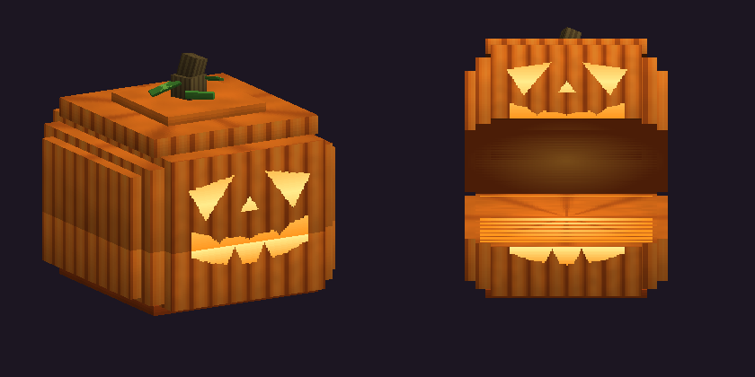
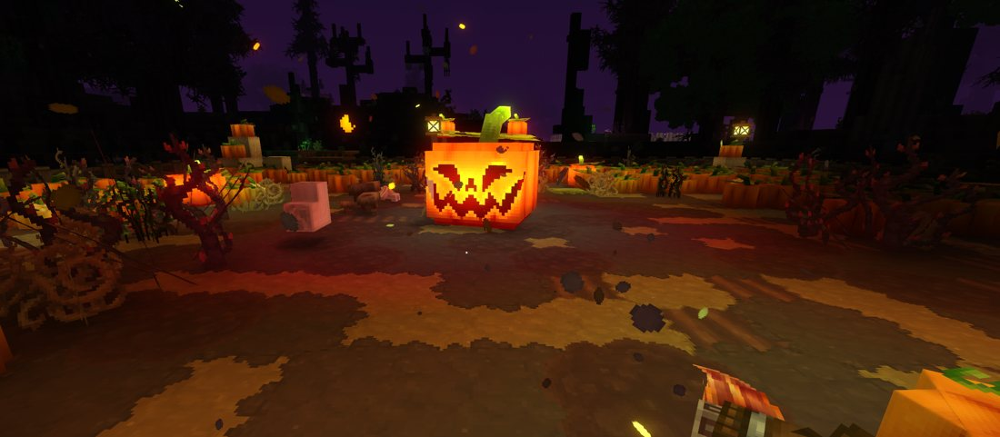

# Citrouille géante

**Élite immobile** · Champ de citrouilles géant · id `Nakasar_Giant_Pumpkin`

Une citrouille sculptée de plus de deux blocs de large, éclairée de l'intérieur. Le haut se soulève comme une mâchoire pour cracher du poison. Elle ne bouge jamais : elle fait pousser autour d'elle des [vrilles combattantes](vrille-de-citrouille.md) et enracine ceux qui s'approchent trop.

> Le modèle 3D est en cours de retouche (version plus lisse, vrilles plus espacées). Les rendus de cette page montrent la version actuelle.

## Fiche

| | |
|---|---|
| Points de vie | **600** |
| Déplacement | **aucun** (ne bouge pas, insensible au recul) |
| Taille | 2,3 × 2,1 × 2,3 blocs, lumière orange (rayon 10) |
| Détection | 14 blocs (ligne de vue) |
| Abandon | plus de cible à 20 blocs : **récupère tous ses PV** |
| Faiblesse | **feu ×2** (brûlure, lave, bâton de feu...) |
| Groupe | Carré de citrouilles. Ni morte-vivante (le feu purificateur ne l'affecte pas), ni vampire (pas de bonus d'argent). |

## Attaques

| Attaque | Portée | Effet | Fréquence |
|---|---|---|---|
| **Invocation des vrilles** | 3 à 6 blocs autour d'elle | jusqu'à **3** [vrilles de citrouille](vrille-de-citrouille.md) par appel, **4 vivantes au maximum** | dès le début du combat, puis toutes les 14 à 18 s |
| **Piège de vrilles** (annoncé) | cercle de **6,5 blocs** | chaque ennemi touché est saisi par des [vrilles](vrilles.md) : **immobilisé** tant qu'elles ne sont pas détruites (20 s au plus) | toutes les 28 à 34 s (premier après 10 à 12 s), si vous êtes à 6 blocs ou moins |
| **Crachat de poison** | 16 blocs (ligne de vue) | **8** dégâts de poison à l'impact + [Poison de citrouille](../effets.md#poison-de-citrouille) **4 dégâts/s pendant 6 s** | toutes les 7 à 9 s |

**Le piège se voit venir :** une zone rouge de 6,5 blocs apparaît au sol pendant **2,2 s**. Sortez-en. Si vous êtes pris, frappez les vrilles à vos pieds (12 PV) pour vous libérer.

## Butin

| Objet | Quantité | Chance |
|---|---|---|
| Citrouille | 3 à 6 | 100 % |
| Graines de citrouille | 2 à 4 | 100 % |
| Essence de vie de citrouille | 1 à 2 | 100 % |
| Éclat de rune | 1 à 3 | 100 % |

## Où la trouver

Au centre de la clairière d'un [champ de citrouilles géant](../fragment/champs-de-citrouilles.md) (rayon 7). Un champ de citrouilles sur deux est de ce type. Réapparition : **30 minutes**.

## Conseils

- Le **feu double ses dégâts**, et ceux de ses vrilles.
- Combattez-la à distance, au-delà de 6,5 blocs : seul le crachat vous atteint, et il se voit partir.
- Si vous vous éloignez à plus de 20 blocs, elle se soigne entièrement.
